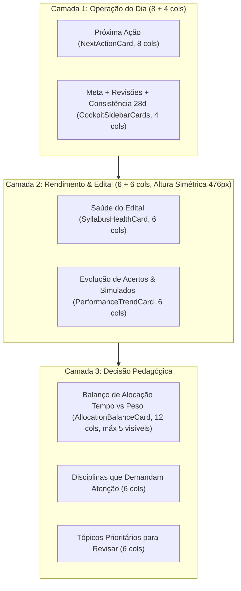

# Design System do Extrato de Estudos

O Extrato de Estudos usa a linguagem visual de um extrato: verde-musgo para estrutura, sálvia para destaque, âmbar só para atenção, papel para superfícies e linhas finas para separar informação (paleta Sálvia; valores em `styles/tokens.css` e no DESIGN.md).

## Tipografia

- Fraunces: marca e valores principais.
- IBM Plex Mono: números, datas, durações, códigos e eixos de gráfico.
- IBM Plex Sans: textos, formulários, explicações, rótulos, botões e abas (Sans 500 13px, sem caixa-alta).
- Pesos semânticos: regular 400, medium 500 e semibold 600.

## Espaçamento

A escala oficial é 4, 8, 12, 16, 20, 24 e 32 px, exposta nos tokens `--space-1` a `--space-8`.

As superfícies, textos, divisores e estados semânticos também têm aliases (`--surface-*`, `--text-*`, `--border-subtle`, `--border-control` e `--status-*`). Use esses papéis em componentes novos ou revisados; os aliases continuam ligados às cores do tema ativo. `--surface-card`, `--surface-card-muted`, `--surface-interactive`, `--text-inverse` e `--status-insufficient` completam os papéis de superfície, texto e evidência insuficiente nos dois temas.

### Controles de Formulário e Acessibilidade (WCAG 2.1 AA 1.4.11)

- **Token `--border-control`:** `#6F857A` (tema Claro) e `#6F8579` (tema Escuro), garantindo contraste mínimo estrito de 3:1 contra `--paper` e `--surface-card` para limites de campos interativos (`input`, `select`, `textarea`, `.subject-search`).
- **Dimensões e Alvos de Toque:** `--control-height` (36px) e `--touch-target` (44px) no mobile, com anel de foco `outline: 2px solid var(--border-emphasis)` e offset de 1–2px.
- **Raios (`--radius-card` e `--radius-control`):** cards, painéis, modais e tabelas usam `var(--radius-card)` (8px); botões, campos, selos, tags (`.tag-chip`) e pills (`.subject-progress-pill`) usam `var(--radius-control)` (6px). Barras, células do heatmap e eventos do calendário mantêm 2px. `--radius` não existe mais.
- **Formatação de Deltas Numéricos:** Todos os indicadores de variação utilizam [`formatDelta()`](src/core/format-number.ts) com o caractere tipográfico de subtração `−` (U+2212) e positivo explícito `+` (ex.: `+2.4 p.p.`, `−1.8%`), evitando hifens ASCII soltos `-`.
- **Pilha Sticky Unificada:** A casca de navegação fixa (`.sticky-shell`) adere estritamente a `top: var(--demo-banner-height, 0px)` sem gaps residuais, prevenindo vazamentos visuais durante a rolagem.
- **Densidade Mobile:** Na aba de Disciplinas da demonstração, tópicos de disciplinas secundárias iniciam colapsados por padrão (`collapsed: subjectIndex > 0`), mantendo a primeira disciplina expandida para descoberta e preservando a performance em telas pequenas.

## Componentes

- `btn`: ação principal; use `tonal`, `tertiary`, `ghost`, `danger`, `small` e botões de ícone conforme o contexto.
- Níveis dos botões: `btn` é primário (no máximo um por card), `btn tonal` repete ações em listas (fundo `--action-tonal-bg`, sem borda), `btn tertiary` é ação com peso de link, `btn ghost` secundário, `btn danger` destrutivo e `icon-btn` para ações somente por ícone. Hover, foco visível, active e disabled são comuns.
- `card`, `card__header`, `card__body` e `card__footer`: estrutura compartilhada; use variantes `card--action`, `card--interactive` ou `card--muted` quando a função justificar.
- `status-badge`: sinal textual semântico; use `--danger`, `--warning`, `--success`, `--info` ou `--insufficient`. A cor nunca deve ser o único indicador.
- `chart-card`: agrupamento lógico de dados.
- `kpi-cell` e `mini-stat`: métricas padrão e compactas.
- `empty-state--compact`: ausência de dados com explicação curta.
- `bar-track` e `bar-fill`: progresso e distribuição.
- `section-head` e `overview-section-heading`: títulos estruturais.
- `compact-header` e `compact-meta`: resumo persistente do plano.
- `diagnostic-row`: tópico, sinal textual, score, evidência, explicação e ação contextual em níveis distintos; os dados semânticos vêm do view-model.
- `backup-danger-zone`: ações destrutivas separadas das operações de recuperação.
- `select-control`: aparência comum dos seletores, com variantes `--compact` e `--wide`.
- `data-row`: histórico traduzido com título, ação e estado.
- `weekly-assessment` e `period-comparison`: interpretação semanal e deltas por unidade.
- `Header`: um único modelo alimenta as apresentações hero e compacta.
- `exam-subject-row`: nome e quatro campos estratégicos alinhados em uma linha no desktop e empilhados no mobile; valores ausentes comunicam herança da meta geral.
- `consistency-strip`: últimos 28 dias em quatro níveis (as mesmas faixas do mapa de calor de Desempenho), no topo de Hoje, com contagem em texto.
- `number-stepper` e `stepper-field`: campo numérico com botões de menos e mais (alvo de 44px), `inputmode="numeric"` e rótulo ligado ao campo; usado no registro de questões, onde acertos nunca passam de resolvidas.
- `metas-subtab` e `metas-subpanel`: atalhos e blocos recolhíveis do Planejamento (`src/ui/planning-subtabs.ts`).
- `advanced-reveal` e `term-hint`: botões do modo Essencial (`src/ui/essential-mode.ts`).
- `backup-export-status`: "Último backup exportado há N dias", em `--warn-text` depois de 7 dias ou quando nunca houve exportação.

Cards representam agrupamentos. Dentro deles, use linhas, espaço e tipografia para estabelecer hierarquia em vez de criar novos cards.

## Temas e responsividade

Todo componente deve usar tokens de cor, preservar contraste em ambos os temas e funcionar a partir de 320 px sem rolagem horizontal global. Para listas, formulários e diagnósticos, permita quebra de nomes longos e empilhe conteúdo antes de reduzir a área de toque.

## Navegação

- Desktop: abas no topo em todas as larguras. A barra lateral acima de 1280 px foi descartada.
- Celular (até 760 px): barra inferior com Início, Hoje, Matérias, Agenda e Mais. A altura medida fica em `--bottom-nav-height`; voltar ao topo, "Salvo" e o aviso usam esse valor.
- Planejamento: cinco blocos recolhíveis, com Plano da semana aberto por padrão. O atalho escolhido abre o bloco sem fechar os demais e fica em `#planejamento/<semana|prova|metas|fechamento|historico>`. `openSectionFor(alvo)` (`src/ui/remembered-sections.ts`) abre a seção recolhida da Visão Geral ou o bloco do Planejamento que contém o alvo; todo salto programático para dentro deles passa por ele antes de rolar.
- Cronômetro: mora em Hoje (`#study-timer`); iniciar uma atividade do plano abre o modo foco, e sair dele volta à aba de origem.

## Preferências do navegador

Preferências de interface ficam no `localStorage`, nunca no estado nem no backup, e toda leitura ou escrita tem `try/catch`:

| Chave | Valores | Padrão |
|---|---|---|
| `bb-premium-theme` | `light`, `dark` | tema do sistema |
| `studytrack.density` | `comfortable`, `compact` | confortável |
| `studytrack.sectionsOpen` | mapa seção → aberta | aberta a partir de 901 px |
| `studytrack.essential` | `on`, `off` | decidido uma vez: `on` sem dados, `off` com registros; a demonstração e os testes automatizados ficam no modo completo |

## Avisos, confirmação e desfazer

- `showToast` mostra um aviso do tamanho do texto.
- `showUndoToast` acrescenta "Desfazer" ao aviso: fica 10 s, pausa sob o ponteiro ou o foco e aceita Ctrl+Z fora de campos de texto.
- `runUndoable(mensagem, ação)` (`src/ui/undoable.ts`) executa a exclusão, salva e oferece o desfazer.
  - `captureUndo` (`src/application/undo/state-undo.ts`) restaura os dados persistentes exatamente como eram.
  - `updatedAt`, `lastBackupAt`, `lastExportAt` e o cronômetro ativo ficam como estão.
  - Se qualquer outro dado mudou depois da exclusão, o desfazer é recusado com aviso.
- **Viram desfazer:** item do calendário, registro de questões, simulado, revisão, sessão com questões vinculadas e tópico arquivado sem vínculos.
- **Mantêm "Tem certeza?":**
  - exclusão de disciplina;
  - limpeza de todos os dados;
  - importação de backup;
  - descarte ou zeramento do cronômetro;
  - escolhas de recuperação de tempo;
  - prévias de planejamento e fechamento (que nunca gravam sem confirmação);
  - conflitos de sincronização.

## Cor por disciplina

Slot de 1 a 8 em `subject.color`, mapeado para `--subject-1…8` nos dois temas. `assignSubjectColors` (`src/domain/subjects/subject-color.ts`) dá a uma disciplina sem cor válida o slot menos usado, na migração v28 → v29 e em `ensureStateDefaults`.

## Listas progressivas

Listas de registros usam DEFAULT_LIST_VISIBLE_ITEMS (5), definido em `src/ui/progressive-list.ts`. Até cinco registros ficam visíveis; a partir de seis, o controle secundário mostra “Mostrar mais · +N” e expande a coleção completa. “Mostrar menos” recolhe e mantém o foco.

Aplicar escopo, filtros, busca e ordenação antes da apresentação. Sessões, questões, simulados e decisões priorizam os mais recentes; revisões mantêm urgência; lacunas mantêm prioridade. Filtros e navegação recolhem as listas. O estado é transitório e não integra armazenamento ou backups. Atualizações de dados recalculam a contagem.

Categorias: progressive-list para registros; always-visible para indicadores, gráficos, matrizes, comparações, navegação e conquistas; paginated-list para grandes coleções. A revisão de classificações históricas mantém paginação de 100 questões. As três recomendações escolhidas para hoje são uma seleção do motor, não uma lista de registros.

O adaptador mountProgressiveLists usa uma relação explícita de seletores e registros, sem aplicar limites a cards arbitrários. Novos módulos devem aderir à mesma constante e controles. Botões reais expõem aria-expanded e aria-controls, foco visível e área mínima de 44 px. Recolhimento só rola quando o controle fica fora da viewport, respeitando prefers-reduced-motion.

## Contrato compartilhado dos gráficos

Use renderChartFrame de `src/ui/chart-components.ts` para título (module-heading), descrição, período, legenda, evidência, visualização e registros textuais. renderChartEmptyState apresenta a evidência necessária; renderChartTooltip escapa os detalhes dos pontos SVG. Os seletores existentes mantêm os próprios eventos e usam chart-period-controls.

Os tokens --chart-series-primary, --chart-series-secondary e --chart-series-target definem os papéis visuais nos dois temas. Questões, Simulados e Plano e execução usam esse contrato. A legenda deve corresponder às séries e a consulta textual precisa informar valores e unidades. A cor não pode ser a única forma de interpretar o gráfico.

### Primitivos de gráfico (SVG puro)

`src/ui/primitives/charts/`:
- `RingGauge`: valor e meta.
- `Sparkline`: tendência; `connectGaps` liga pontos através de períodos sem dado.
- `BulletBar`: valor contra meta.
- `StackedBar`: composição, com os tons `primary`, `primary-soft`, `primary-faint`, `secondary`, `target`, `muted` e `empty`.
- `ColumnChart`: colunas simples, agrupadas ou com linha de meta.

Cada um existe como componente Preact e como `render*` em string, para os renderizadores de HTML. A geometria fica em `geometry.ts`, com testes unitários. Todo gráfico expõe `role="img"` e uma descrição com valores e unidades (percentuais sem espaço antes do %). Dados tabulares ficam em "Ver dados", com região rolável focável e nomeada.

### Inventário de componentes primitivos (Preact)

| Papel                 | Contrato existente                                                   | Componente Preact (`src/ui/primitives/`)                 |
| --------------------- | -------------------------------------------------------------------- | -------------------------------------------------------- |
| Ações e botões        | `btn`, `btn-tonal`, `btn-tertiary`, `btn-ghost`, `btn-danger`        | `<Button variant="..." size="..." />`                    |
| Badges e status       | `status-badge`, `status-pill`, `badge`                               | `<Badge variant="..." />` / `<StatusPill />`             |
| Cards e seções        | `card`, `card--insight`, `card--attention`, `card--primary`          | `<Card variant="..." as="..." />`                        |
| Cabeçalhos editoriais | `module-heading`, `ui-section-header`                                | `<SectionHeader title="..." eyebrow="..." />`            |
| Progresso acessível   | `bar-track`, `bar-fill`, `ui-progress`                               | `<ProgressBar value={...} max={...} />`                  |
| Estados vazios        | `empty-state`, `empty-state--compact`                                | `<EmptyState title="..." message="..." />`               |
| Métricas              | `performance-kpi`, `ui-metric`                                       | `<MetricCard label="..." value="..." />`                 |
| Diálogos e modais     | `modal-overlay`, `<dialog>`                                          | `<Dialog open={...} onClose={...} title="..." />`        |
| Abas de navegação     | `tab-nav`, `nav-item`                                                | `<Tabs items={...} activeTab={...} onTabChange={...} />` |
| Listas de registros   | `src/ui/progressive-list.ts` e `src/ui/list-components.ts`           | Em migração incremental                                  |
| Gráficos              | `src/ui/chart-components.ts`, `chart-frame`, `chart-period-controls` | Contrato compartilhado mantido                           |

### Componentes de tela das abas (Preact `.tsx`)

A migração incremental da interface introduziu componentes funcionais Preact para as telas centrais, organizados por domínio funcional:

| Aba             | Componente TSX                           | Localização                                       | Responsabilidade                                                        |
| --------------- | ---------------------------------------- | ------------------------------------------------- | ----------------------------------------------------------------------- |
| **Disciplinas** | `<SubjectTopicManager />`                | `src/ui/tabs/disciplinas/SubjectTopicManager.tsx` | Gerenciamento de disciplinas, tópicos, importância, esforço e bookmarks |
| **Questões**    | `<QuestionsTable />`                     | `src/ui/tabs/questoes/QuestionsTable.tsx`         | Histórico progressivo de questões, acertos, erros e filtros contextuais |
| **Questões**    | `<PlateauDetectorCard />`                | `src/ui/tabs/questions/PlateauDetectorCard.tsx`   | Diagnóstico de platô de desempenho e prescrição de quebra de estagnação |
| **Simulados**   | `<SimulationsTable />`                   | `src/ui/tabs/questoes/SimulationsTable.tsx`       | Lista e cadastro de simulados completos com notas e metas               |
| **Desempenho**  | `<ShiftEnergyCard />`                    | `src/ui/tabs/performance/ShiftEnergyCard.tsx`     | Análise cronobiológica de energia e eficiência por turno                |
| **Revisões**    | `<ReviewsSchedule />`                    | `src/ui/tabs/revisoes/ReviewsSchedule.tsx`        | Fila de revisões adaptativas, cartões de urgência e ações rápidas       |
| **Calendário**  | `<CalendarView />` / `<CalendarTable />` | `src/ui/tabs/calendar/`                           | Visão mensal interativa e grade operacional de estudo                   |
| **Metas**       | `<WeeklyGoals />`                        | `src/ui/tabs/metas/WeeklyGoals.tsx`               | Distribuição de capacidade, horas planejadas e metas semanais           |
| **Hoje**        | `<TodaySchedule />`                      | `src/ui/tabs/hoje/TodaySchedule.tsx`              | Próxima melhor ação, cronograma do dia e execução em tempo real         |
| **Visão Geral** | `<NextActionCard />`                     | `src/ui/tabs/dashboard/NextActionCard.tsx`        | Próxima ação com 6 respostas e acolhimento de boas-vindas               |
| **Visão Geral** | `<CockpitSidebarCards />`                | `src/ui/tabs/dashboard/CockpitSidebarCards.tsx`   | Coluna de suporte: Meta diária, Carga de revisões e Mini-heatmap 28d   |
| **Visão Geral** | `<SyllabusHealthCard />`                 | `src/ui/tabs/dashboard/SyllabusHealthCard.tsx`    | Saúde do edital com radar multidimensional e faixas de domínio         |
| **Visão Geral** | `<PerformanceTrendCard />`               | `src/ui/tabs/dashboard/PerformanceTrendCard.tsx`  | Gráfico SVG puro de evolução de acertos de questões e simulados         |
| **Visão Geral** | `<AllocationBalanceCard />`              | `src/ui/tabs/dashboard/AllocationBalanceCard.tsx` | Balanço de esforço vs peso no edital com divulgação progressiva (5 itens) |
| **Visão Geral** | `<DashboardOverview />`                  | `src/ui/tabs/visao-geral/DashboardOverview.tsx`   | Painel executivo, índices de prontidão e KPIs resumidos                 |
| **Onboarding**  | `<FirstAccessModal />`                   | `src/ui/components/FirstAccessModal.tsx`          | Modal acessível de primeiro acesso para início guiado ou demo          |

Componentes novos devem reutilizar esses contratos antes de criar variantes. Matrizes e comparações mantêm a visualização simultânea dos dados.

## Integração Tailwind CSS e Design Tokens

A estilização foi enriquecida com **Tailwind CSS v4** integrado diretamente aos design tokens em [`styles/tokens.css`](styles/tokens.css) através de [`styles/tailwind.input.css`](styles/tailwind.input.css).

### Regra de Coexistência Visual (Sem Preflight)

Para garantir fidelidade visual pixel a pixel e prevenir regressões nas suítes visuais com baselines PNG, o reset global (`Preflight`) está **desativado**. O Tailwind atua estritamente gerando utilitários e temas sob demanda.

### Classes Utilitárias Semânticas do Tema

- **Fundos:** `bg-surface-page`, `bg-surface-card`, `bg-surface-card-muted`, `bg-surface-primary`, `bg-brand`, `bg-paper`, `bg-surface-subtle`, `bg-surface-highlight`.
- **Textos:** `text-primary`, `text-secondary`, `text-muted`, `text-on-brand`, `text-green`, `text-amber`, `text-red`.
- **Bordas:** `border-border-default`, `border-border-subtle`, `border-border-emphasis`, `rounded-default` (raio de card), `rounded` (raio de controle).
- **Tipografia:** `font-body` (IBM Plex Sans), `font-display` (Fraunces), `font-data` (IBM Plex Mono).

## Padrão de Cockpit Panorâmico em 3 Camadas Temáticas

O Cockpit da Visão Geral adota uma grade CSS Grid de 12 colunas (`lg:grid-cols-12`) organizada em três camadas semânticas estritas, guiando a leitura do operacional imediato até a decisão pedagógica estratégica:

- **Camada 1 (Operação do Dia):** O card de Próxima Ação domina 8 colunas, apoiado pela coluna lateral de 4 colunas com a Meta Diária (barra de progresso e saldo), Carga de Revisões (urgência) e Mini-Heatmap de Consistência (últimos 28 dias).
- **Camada 2 (Rendimento & Edital):** Paridade horizontal de 6 + 6 colunas entre a Saúde do Edital (cobertura/domínio/retenção) e o Gráfico de Evolução de Acertos e Simulados (8 semanas móveis com dispersão e benchmark). Ambos possuem `flex flex-col justify-between h-full` para travar em 476px no desktop, eliminando lacunas de espaço em branco.
- **Camada 3 (Decisão Pedagógica):** O Balanço de Alocação de Tempo Investido vs Peso no Edital ocupa 12 colunas com divulgação progressiva (padrão de 5 itens visíveis e botão `+N matérias` com `aria-expanded`), seguido pelos Duo Grids analíticos de 6 + 6 colunas.

## Histórico explicável de prontidão

O resumo distingue cálculo atual, último registro salvo, variação entre fechamentos e melhor registro comparável. Registros de alterações estratégicas não entram na comparação entre fechamentos. A comparação só ocorre quando algoritmo, pesos e disponibilidade dos fatores coincidem. A linha do gráfico se interrompe quando a base muda; nenhum registro antigo é recalculado. O detalhamento mostra pontuação anterior e atual e contribuição ponderada de cada fator.

Capturas ocorrem no fechamento e antes de mudanças na data/meta da prova, concurso ativo, configuração de disciplina, impacto/esforço/pré-requisitos de tópico e confirmação ou reversão do plano semanal. Aceitar prioridades do fechamento captura a prontidão antes de alterar o plano. Mudanças sem valor disponível não geram snapshots; re-renderizações não geram capturas. Uma migração futura do algoritmo deve preservar os snapshots e usar um evento explícito, sem reconstrução retroativa.

## Explicações de recomendações

renderRecommendationExplanation usa quatro perguntas: o que fazer, por que, evidências e o que muda ao aceitar. As consequências são operacionais e não garantem desempenho. A Visão Geral, Hoje, diagnóstico com ação vinculada e adaptações reutilizam o contrato. Histórico mostra explanationSnapshot; registros antigos mantêm apenas as razões que de fato foram salvas. Detalhamento da composição matemática continua disponível na recomendação de Hoje.

## Escala Tipográfica e Piso de Legibilidade

- `--text-page-title: 1.5rem` (24px, Fraunces serif semibold) — Títulos de página/aba.
- `--text-card-title: 1.25rem` (20px, Fraunces serif semibold) — Títulos de cards de primeiro nível.
- `--text-label: 0.75rem` (12px, IBM Plex Sans uppercase) — Rótulos de seção, metadados e tags.
- `--text-body: 0.875rem` (14px), 0.9375rem (15px) até 600px de largura — corpo de texto.
- `--text-micro: 0.75rem` (12px) — Piso absoluto de legibilidade. Todo texto do sistema respeita o limite mínimo de 12px sem quebras indesejadas em 320px.

## Gerenciamento de Dados e Backups

O bloco de backup e zona de perigo foi desacoplado da visualização padrão de todas as abas e isolado em um modal flutuante (`#dataManagementOverlay`), acionado pelo botão discreto `#openDataManagementBtn` no rodapé. O botão `[▶ Explorar demonstração]` permanece imediatamente acessível no rodapé para descoberta rápida e onboarding. O overlay vive fora da raiz `<main>`, prevenindo traps de foco e atributos `inert` indevidos.

O bloco mostra o lembrete do último backup exportado (`lastExportAt`, schema 30, gravado só ao baixar o arquivo; `lastBackupAt` continua sendo a cópia automática no navegador): "hoje", "ontem" ou "há N dias", em atenção depois de 7 dias, e "Nenhum backup exportado ainda" para quem nunca exportou.

## Carregamento sob demanda

O `app.bundle.js` carrega o essencial. Catálogo de provas, relatório, ajuda e demonstração são bundles próprios:
- `exam-catalog.bundle.js`;
- `report.bundle.js`;
- `help.bundle.js`;
- `demo.bundle.js`, carregado por `loadDemoGenerator()` só quando a demonstração abre.

Cada bundle é pedido com o mesmo `?v=` do app e entra no pré-cache do service worker. Assim tudo abre offline depois da primeira visita, e versões nunca se misturam.

Um bundle novo precisa de quatro passos:
1. Entrar em `scripts/build.mjs`.
2. Entrar em `service-worker.template.js`.
3. Sair do typecheck (`tsconfig*.json`) e do Prettier.
4. Ganhar um teste em `pwa.spec.js`.

## Iconografia Vetorial (Tabler Icons) e Regra Zero Emojis

- **Zero Emojis:** É terminantemente proibido o uso de emojis Unicode em qualquer elemento de interface (botões, rótulos, badges, tabelas, modais, etc.). Emojis geram inconsistência visual entre sistemas operacionais (Windows, macOS, Linux, iOS, Android) e quebram a estética técnica sóbria de extrato bancário.
- **Tabler Icons:** Toda iconografia utiliza exclusivamente a biblioteca **Tabler Icons** através do componente `<Icon name="..." size={16} stroke={2} class="..." />` ou da função utilitária `renderIconSvg(name, { size, strokeWidth, className })` em [`src/ui/primitives/icon.tsx`](src/ui/primitives/icon.tsx). Os ícones utilizam `currentColor` e adaptam-se perfeitamente aos temas Claro e Escuro.
- **Adição de Novos Ícones:** Para adicionar novos ícones do Tabler, adicione o identificador kebab-case à lista em [`scripts/generate-tabler-icons.mjs`](scripts/generate-tabler-icons.mjs) e execute `node scripts/generate-tabler-icons.mjs` para regenerar os dados vetoriais otimizados sem inflar o bundle desnecessariamente.
