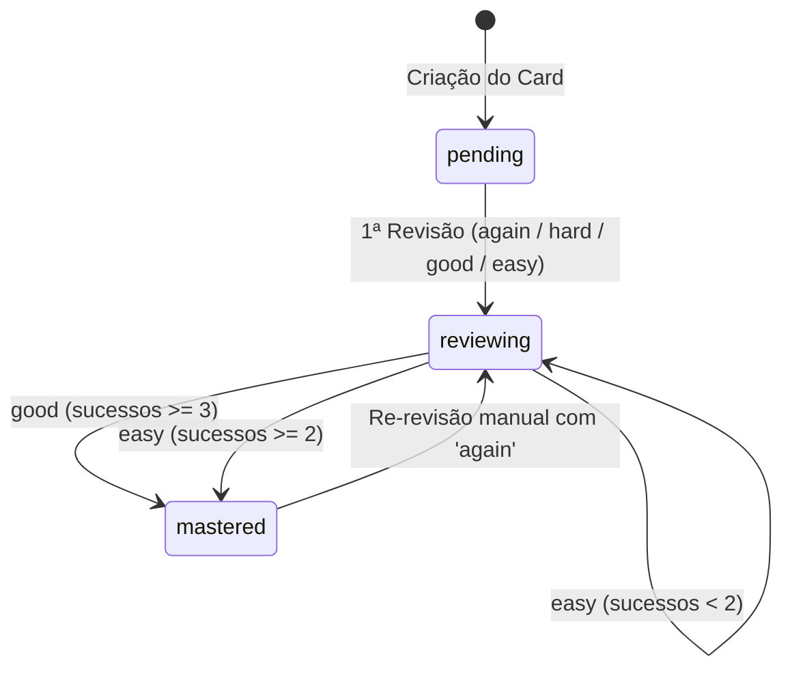

# Contrato do Algoritmo SM-2 Adaptado — Caderno de Erros

Este documento descreve as especificações matemáticas, regras de transição de status e invariantes do algoritmo **SuperMemo SM-2 adaptado** implementado no módulo [`src/domain/notebook/error-notebook-engine.ts`](../src/domain/notebook/error-notebook-engine.ts) do **StudyTrack**.

---

## 1. Visão Geral e Propósito Pedagógico

O **Caderno de Erros Ativo & Flashcards de Bolso** converte erros cometidos em questões e simulados em cartões de fixação imediata com:
- Enunciado resumido da questão / contexto.
- Pegadinha da banca / distrator identificado.
- Conceito correto / fundamento legal ou doutrinário.

A retenção é garantida por uma variante calibrada do algoritmo SM-2 que otimiza intervalos curtos e médios, adaptada ao ritmo de preparação para concursos públicos.

---

## 2. Parâmetros e Variáveis de Estado

Cada flashcard (`ErrorFlashcard`) armazena:

| Campo | Tipo | Valor Inicial | Descrição |
| :--- | :--- | :--- | :--- |
| `status` | `'pending' \| 'reviewing' \| 'mastered'` | `'pending'` | Estado pedagógico no ciclo de fixação. |
| `easeFactor` | `number` | `2.5` | Fator de facilidade (multiplicador de intervalo). Mínimo `1.3`, máximo `3.5`. |
| `intervalDays` | `number` | `1` | Intervalo em dias inteiros até a próxima revisão. |
| `consecutiveSuccesses` | `number` | `0` | Número de acertos sucessivos consecutivos sem erro. |
| `reviewCount` | `number` | `0` | Quantidade total de revisões realizadas. |
| `nextReviewDate` | `string` (`YYYY-MM-DD`) | Data de criação | Data em calendário local na qual o card fica devido (*due*). |
| `lastReviewedAt` | `string` (`ISO 8601`) | `null` | Timestamp exato da última avaliação. |

---

## 3. Classificações e Regras de Agendamento

Ao revisar um cartão, o estudante escolhe uma das quatro avaliações (`FlashcardRating`):

### 3.1. `again` (Errei)
- **Significado:** O estudante não lembrou do conceito ou caiu novamente na pegadinha da banca.
- **Intervalo:** Resetado para **1 dia** (`intervalDays = 1`).
- **Sucessos consecutivos:** Zerados (`consecutiveSuccesses = 0`).
- **Ease Factor:** Reduzido em 0.20:
  $$\text{easeFactor} = \max(1.30,\, \text{easeFactor} - 0.20)$$
- **Status:** Permanece ou retorna para `'reviewing'`.

### 3.2. `hard` (Difícil)
- **Significado:** O estudante acertou com esforço ou hesitação.
- **Intervalo:** Crescimento conservador de 20%:
  $$\text{intervalDays} = \max(1,\, \text{round}(\text{intervalDays} \times 1.20))$$
- **Sucessos consecutivos:** Incrementado em 1 (`consecutiveSuccesses += 1`).
- **Ease Factor:** Leve penalidade de 0.15:
  $$\text{easeFactor} = \max(1.30,\, \text{easeFactor} - 0.15)$$
- **Status:** Permanece em `'reviewing'`.

### 3.3. `good` (Bom)
- **Significado:** Acerto satisfatório no tempo esperado.
- **Intervalo:**
  - 1º acerto consecutivo (`consecutiveSuccesses == 0`): **2 dias**.
  - 2º acerto consecutivo (`consecutiveSuccesses == 1`): **4 dias**.
  - 3º ou mais acertos consecutivos:
    $$\text{intervalDays} = \max(1,\, \text{round}(\text{intervalDays} \times \text{easeFactor}))$$
- **Sucessos consecutivos:** Incrementado em 1 (`consecutiveSuccesses += 1`).
- **Ease Factor:** Mantido estável.
- **Status:** Se `consecutiveSuccesses >= 3`, transiciona para `'mastered'`. Caso contrário, permanece em `'reviewing'`.

### 3.4. `easy` (Fácil)
- **Significado:** Domínio completo e imediato da regra ou pegadinha.
- **Intervalo:**
  - 1º acerto consecutivo (`consecutiveSuccesses == 0`): **4 dias**.
  - 2º ou mais acertos consecutivos:
    $$\text{intervalDays} = \max(1,\, \text{round}(\text{intervalDays} \times (\text{easeFactor} + 0.50)))$$
- **Sucessos consecutivos:** Incrementado em 1 (`consecutiveSuccesses += 1`).
- **Ease Factor:** Bonificação de 0.15:
  $$\text{easeFactor} = \min(3.50,\, \text{easeFactor} + 0.15)$$
- **Status:** Se `consecutiveSuccesses >= 2`, transiciona para `'mastered'`. Caso contrário, permanece em `'reviewing'`.

---

## 4. Diagrama de Transição de Estados

---

## 5. Regras de Elegibilidade e Agendamento Diário

Uma função pura `getDueFlashcards(cards, todayDate)` determina os cartões que compõem o deck do dia:
1. Cartões com `status === 'mastered'` são excluídos da fila diária.
2. Cartões com `status === 'pending'` entram imediatamente na fila do dia (mesmo que criados hoje).
3. Cartões com `status === 'reviewing'` entram na fila se `nextReviewDate <= todayDate`.
4. Os cálculos de data utilizam aritmética de calendário local (`YYYY-MM-DD`), prevenindo variações de fuso horário.

---

## 6. Integridade de Dados e Migração

- Cartões de erro integram a lista de coleções persistentes (`PERSISTENT_COLLECTIONS`).
- O schema valida arrays sem reescrever ou destruir histórico em caso de payload parcial.
- Relações com `topicId` ou `subjectId` órfãos são preservadas e assinaladas na UI em vez de causar falhas em lote.
