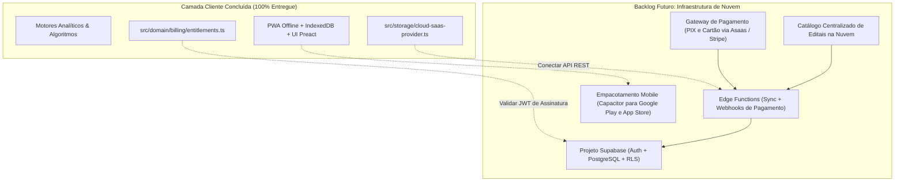

# Mapeamento do que Falta ser Implementado — Extrato de Estudos

Este documento consolida o histórico de entregas e os próximos horizontes de evolução do **Extrato de Estudos**, registrando a conclusão das 4 Fases do Plano Master de Evolução, os fechamentos de cobertura, as especificações estruturantes para a transição **SaaS Local-First** e o backlog futuro mapeado em [docs/recomendacoes-futuras.md](file:///c:/Users/vitor/Documents/Extrato/docs/recomendacoes-futuras.md).

> [!IMPORTANT]
> **Roteiro Histórico Consolidado:** O cronograma executivo, histórico e critérios de aceite de todos os planos de desenvolvimento implementados estão unificados e preservados em **[docs/PLANOS-CONCLUIDOS.md](file:///c:/Users/vitor/Documents/Extrato/docs/PLANOS-CONCLUIDOS.md)**. Todas as 4 fases do plano de evolução e as melhorias subsequentes foram **100% implementadas, testadas e integradas**.

---

## 1. Resumo do Status Atual das Fases e Marcos Técnicos

O Extrato de Estudos opera em arquitetura moderna **TypeScript (`strict: true`), Preact 11 (`.tsx`) e Tailwind CSS v4** sem runtime desnecessário no cliente. A tabela abaixo resume o status de todos os marcos:

|    Fase / Marco     | Título                                          |  Status   | Entregas Principais                                                                                                                                                                                     |
| :-----------------: | ----------------------------------------------- | :-------: | ------------------------------------------------------------------------------------------------------------------------------------------------------------------------------------------------------- |
|     **Infra 1**     | Higiene do Repositório & Build                  | Concluída | `.gitignore` limpo, build reproduzível (`npm run build`), bundles minificados via esbuild.                                                                                                              |
|     **Infra 2**     | Importador de Questões (QConcursos/Tec)         | Concluída | Normalização de CSV/TSV, preview de importação, desduplicação e vínculo automático de disciplinas.                                                                                                      |
|     **Infra 3**     | Migração Estrita para TypeScript                | Concluída | `tsconfig.json` (`strict: true`), 440+ módulos `.ts`, contratos em `src/core/types.ts` e gate `npm run check:types`.                                                                                    |
|     **Infra 4**     | WebDAV com Criptografia E2EE                    | Concluída | PBKDF2-SHA256 e AES-GCM 256 bits (`crypto-utils.ts`), backup seguro em nuvem privada.                                                                                                                   |
|     **Infra 5**     | Otimização de CI/CD (Sharding & Typecheck)      | Concluída | Sharding no Playwright (`1/4` a `4/4`), checagem estática no GitHub Actions e orçamentos rigorosos de gate.                                                                                             |
| **Modernização UI** | Preact 11, Tailwind v4 & Fatiamento de `app.ts` | Concluída | Catálogo de primitivas (`src/ui/primitives/*.tsx`), Tailwind v4 sem preflight destrutivo, `AppStateStore` desacoplado.                                                                                  |
|    **PiP Timer**    | Cronômetro Flutuante Picture-in-Picture         | Concluída | `pip-timer-controller.ts` via Document PiP API com fallback dinâmico no título da aba.                                                                                                                  |
|  **Master Fase 1**  | Decisão Rápida, UX & Primeiro Uso               | Concluída | `NextActionCard.tsx` (6 perguntas contratuais), `SubjectTopicRow.tsx` com Bookmarks de Ponto de Parada, Onboarding 2.0 (`FirstStepsMission.tsx`).                                                       |
|  **Master Fase 2**  | Inteligência Preditiva & Reta Final             | Concluída | `what-if-simulator.ts` (simulação em memória via `structuredCloneSafe`), `final-stretch-policy.ts` (< 15 dias, 85% questões/revisão), `volatile-mastery.ts` (ilusão de competência).                    |
|  **Master Fase 3**  | Hub Completo de Estudos & Flexibilidade         | Concluída | `VerticalizedSyllabusView.tsx` com checklist de 4 etapas e parser de PDF (`raw-syllabus-parser.ts`), `study-cycle-engine.ts` (ciclo rotativo circular) e `focus-energy-analytics.ts` (fadiga/energia).  |
| **Master Fase 4 & Melhorias Pós-Fase 4** | Caderno de Erros, A11y, Onboarding 2.0 & Base SaaS | Concluída | `error-notebook-engine.ts` (SM-2 adaptado), `ErrorNotebookView.tsx`, avisos de revisão na Agenda e Hoje (`ErrorNotebookDueNotice.tsx`), persistência e integridade de `errorFlashcards`, focus traps em modais/tour, anúncios `aria-live` no cronômetro (`timerAriaLive`), roteiro NVDA (`ROTEIRO-AUDITORIA-NVDA.md`), Onboarding 2.0 com viabilidade pedagógica (`calculatePlanFeasibility`), nivelamento em lote e disparo direto do plano em Hoje. |
| **Central de Ajuda 2.0** | Instruções Reativas, Micro-Simuladores & Code-Splitting | Concluída | Code-splitting assíncrono em `src/help.bundle.js` (~80 KB), Preact 11 unificado via `preact-render-to-string`, simulador de retenção Ebbinghaus (`EbbinghausSimulator.tsx`), simulador de amostragem/evidência com 95% CI (`EvidenceConfidenceSimulator.tsx`), hash routing (`#instrucoes?topic=<id>`), cópia de atalho direto no clipboard, chips interativos, metadados automáticos e conformidade estrita WCAG AA. |
| **Auditoria UX/UI & A11y** | Contraste WCAG 2.1 AA, Pilha Sticky, Modal de Dados & Tipografia | Concluída | Token `--border-control` (> 3:1), raios 2px, formatDelta(), sticky sem gap, colapso na demo, modal `#dataManagementOverlay`, ícones SVG nativos e piso 12px. |
| **Modularização do app.ts** | Desacoplamento Arquitetural Integral (Fases 1–10) | Concluída | Redução de 10.921 para **146 linhas (-98,7%)**, zero funções de negócio no `src/app.ts`, isolamento completo de domínio (`src/domain/`), aplicação (`src/application/`), controladores de abas/modais (`src/ui/` e `src/features/`) e wiring de bootstrap (`src/bootstrap/`). Fast Gate com 1.154 testes passando em ~43s e CI Full/Visual 100% verde. |
| **Onboarding & Primeiro Uso para Iniciantes** | Acolhimento, Starter Packs e Ativação no Dia 1 (Fases 1–4) | Concluída | Welcome Hero State (`NextActionCard.tsx`) sem links vazios, Starter Packs em 1 clique (`src/domain/onboarding/starter-packs.ts`), Calibrador Anti-Sobrecarga com folga dominical (`src/domain/onboarding/routine-sustainability.ts`), Sessão de Aquecimento de 15 min no Dia 1 (`FirstStepsMission.tsx`), Tour Essencial em 3 Paradas e pedagogia de estudo sem culpa (`guided-tour-steps.ts`). Fast Gate com 1.172 testes passando em 36s e 19/19 testes E2E verdes. |
| **Refinamento de Usabilidade do Iniciante** | Resolução de 10 Pontos de Fricção do Primeiro Acesso | Concluída | Toast mobile no rodapé; ocultação dinâmica do banner de demo; neutralização de bordas redundantes no Welcome Hero; alinhamento de recomendação opcional na aba Hoje; edição de minutos e sticky actions no modal de sessão; calibração do Índice de Prontidão (eliminação de falsa precisão inicial de 43/100); filtro de concursos contextual; auto-foco ao adicionar tópicos; Tabler Icons e toast orientador na Agenda de Revisões; polimento do tour guiado (sem triângulo de aviso e com compensação sticky); auto-seleção de tópico e foco imediato no registro de questões. Fast Gate com 1.208 testes passando em 17.48s. |
| **Modernização Visual & Cockpit** | Cockpit Panorâmico de Decisão Pedagógica (3 Camadas) | Concluída | Cockpit da Visão Geral em 3 Camadas Temáticas (Camada 1: Operação do Dia 8+4 cols, Camada 2: Rendimento & Edital 6+6 cols com Saúde do Edital e Gráfico de Tendência de Acertos/Simulados com simetria vertical de 476px, Camada 3: Decisão Pedagógica com Balanço de Alocação e divulgação progressiva de 5 itens + Duo Grids analíticos); Detector de Platô em Questões e Energia Cronobiológica em Desempenho; realocação cirúrgica do Grid de Questões (`#kpiGrid`) para Questões & Simulados e Grid de Tópicos (`#quickStats`) para Disciplinas; modal acessível de primeiro acesso (`FirstAccessModal.tsx`). Fast Gate com 1.276 testes passando em ~51s. |
| **Atualização do Modo Demonstração** | Enriquecimento com Novas Capacidades Analíticas | Concluída | Caderno de Erros determinístico com 17 flashcards SM-2 e pegadinhas de bancas (Cesgranrio/Cespe), Detector de Platô com 2 tópicos calibrados em 28 dias e prescrições metodológicas, análise cronobiológica de turnos (Manhã pico, Tarde, Noite com fadiga), pesos explícitos no edital verticalizado para balanço de alocação, navegação expandida no banner (`Desempenho` e `Questões & Platô`) e teste unitário dedicado. Fast Gate com 1.277 testes passando em ~48s e 8/8 testes E2E verdes. |
| **Primeiro Acesso, Reorganização do Cockpit & CI** | Modal de Boas-Vindas, Reorganização Estrutural da Visão Geral e Estabilização CI | Concluída | Modal acessível de primeiro acesso (`FirstAccessModal.tsx`), reorganização em 3 camadas temáticas, realocação da prontidão para Desempenho, KPIs movidos para abas dedicadas, resolução de pendências nos testes de recomendação/flashcards/responsividade e CI 100% verde no GitHub Actions (7/7 jobs). Fast Gate com 1.277 testes em ~43s. |
| **Cockpit Hoje & Acessibilidade Estrita** | Componentes Declarativos no Cockpit Hoje, Acessibilidade WCAG AA e Consolidação CI | Concluída | `TodayGoalsCard.tsx` (`BulletBar`), `TodayWeeklyRhythmCard.tsx` (`ColumnChart`), `TodayExecutionSummary.tsx` (`StackedBar`), eliminação de loop circular entre Questões e Desempenho, rolagem suave de subabas em Planejamento, `<caption>` em 5 tabelas de extrato, microcopy pedagógica (Inflexão Metodológica), navegação contextual de diagnóstico, atalhos `Alt+Enter` e `Alt+S`, 1.290 testes unitários verdes em 52s e CI 100% verde no GitHub Actions (7/7 jobs). |
| **Gráficos Visuais de Desempenho** | Modernização Visual com Cores Semânticas das Disciplinas | Concluída | Linha do Tempo Diária em colunas empilhadas (`StackedColumnChart`), Gráfico Donut de distribuição de estudo (`DonutChart`), Evolução Multilinear de precisão por matéria (`MultiLineChart`) e Matriz Pedagógica Domínio × Retenção em 4 quadrantes (`PedagogicalMatrixChart`), utilizando tokens semânticos `--subject-1..8`. Fast Gate com 1.299 testes passando em ~53s. |
| **Gráficos Visuais de Planejamento** | Modernização Visual e Régua Pedagógica da Aba Planejamento | Concluída | Barras agrupadas Planejado × Realizado por disciplina (`GroupedBarChart`), barras duplas de contraste com edital (`PlanImpactAlignment`), barra contínua de capacidade semanal e mix pedagógico (`AllocationBar`), e régua da jornada de preparação até a prova (`PhaseRoadmapTimeline`). Fast Gate com 1.304 testes passando em 55.62s. |
| **Gráficos Visuais de Questões e Simulados** | Modernização Visual e Cores de Disciplinas na Prática | Concluída | Tendência semanal contínua com colunas de volume (`WeeklyTrendChart`), Pareto de causas de falhas 80/20 (`ErrorParetoChart`), evolução de notas de simulados vs meta (`SimulationTrendChart`), raio-x de matérias no detalhe do simulado (`SimulationBreakdownBarChart`), e swatches coloridos nas tabelas de questões e simulados. Fast Gate com 1.315 testes passando em 76.91s. |
| **Command Palette & Busca Global** | Modernização da Busca Global no Padrão Command Palette | Concluída | Diálogo flutuante centralizado com backdrop blur, ícones Tabler para comandos (`layout-dashboard`, `player-play`, `clock`, `books`, etc.), swatches de disciplinas nos tópicos (`subject-bg-X`), navegação completa por teclado (`Ctrl+K`, setas, `Enter`, `Esc`) e rodapé acessível. Fast Gate com 1.317 testes em 58.33s e 14/14 testes E2E verdes. |
| **Activity Heatmap EasyUI** | Modernização do Mapa de Calor com Modos Calendário e Horários 24h | Concluída | Componente estilo EasyUI (`Surajmaurya1/easyui/activity-heatmap`) em Preact 11 nativo, com modo Calendário Contínuo (meses e semanas alinhados, 5 níveis de intensidade e hover escalado) e modo Horários do Dia (matriz 7x24 para hábitos de estudo e cards de horários de pico e dias mais produtivos). Fast Gate com 1.323 testes em 53.99s. |
| **SaaS Fase 1** | Autenticação, Avatar do Usuário e Sessão com Clerk | Concluída | Adaptador Clerk (`saas-auth-service.ts`), cache offline-first de perfil em `localStorage`, `ClerkUserAvatarButton.tsx` no header e resolução de conflitos de merge de conta (`AccountMergeConflictModal.tsx`). |
| **SaaS Fase 2** | Controle de Planos e Feature Gates (Entitlements) | Concluída | Regras puras em `entitlements.ts`, tolerância de 3 dias no cartão (`past_due`), cálculo de parcelamento em até 12x de R$ 14,90 e modal declarativo híbrido `PaywallModal.tsx`. |
| **SaaS Fase 3** | Sincronização Automática Local-Nuvem (Cloud Sync) | Concluída | `cloud-saas-provider.ts` com push debounced (3s), fila offline com retomada em `online`, reconciliação em `visibilitychange`, criptografia ponta a ponta (E2EE AES-GCM) e selo `CloudSyncBadge.tsx`. |
| **SaaS Fase 4** | Pagamentos Híbridos (PIX + Cartão) e Webhooks | Concluída | Checkout híbrido com suporte a parcelas e cartão, webhook completo (`paid`, `past_due`, `canceled`, `refunded`) e autoatendimento do assinante em `AuthAccountModal.tsx`. |
| **SaaS Fase 5** | Catálogo Dinâmico de Editais na Nuvem | Concluída | Tabela `exam_catalog_templates` com RLS, `cloud-catalog-service.ts` com cache offline, seeds de editais (Bancária, Fiscal, Tribunais, Policial, Administrativa, OAB, ENEM) e `CloudExamCatalogModal.tsx`. |
| **SaaS Fase 8** | Painel de Administração e Backoffice SaaS | Concluída | `AdminDashboardView.tsx`, `admin-service.ts`, métricas em `admin-metrics.ts` (MRR, Receita Líquida, Churn), Radar de Retenção (tolerância cartão e PIX 7d), CRM de Alunos, estornos CDC, trilha de auditoria (`admin_audit_logs`) e ativação direta via deep-linking (`/?admin=1`). |
| **SaaS Fase 9** | Termos de Uso, Privacidade & Conformidade Legal LGPD/CDC | Concluída | `legal-documents.ts` (v2026-11-v1), Obrigação de Meio, Direito de Arrependimento de 7 dias (Art. 49 CDC), Garantia de Não-Sequestro de Dados, `LegalComplianceView.tsx`, painel de autoatendimento Art. 18 LGPD, ativação por URL (`/?legal=terms`, `/?legal=privacy`) e links de conversão. |
| **Go-Live & Infra** | Infraestrutura de Produção, DNS, Fiscal & Runbook | Concluída | Seções 7 a 10 do [`PLANO-TRANSFORMACAO-SAAS.md`](file:///c:/Users/vitor/Documents/Extrato/docs/PLANO-TRANSFORMACAO-SAAS.md): Custom Domain no Clerk (`auth.extratoestudos.com.br` para cookies First-Party no iOS), SPF/DKIM/DMARC no Resend, gestão de NFS-e, telemetria de erros/uptime, políticas PITR e D-Day Checklist. |
| **Master Fase 5** | Melhorias Competitivas (Leruma, Bizzu & Estudei) | Concluída | 5 Starter Packs de 1 clique, importador de edital por texto colado (PDF), Missão de Recuperação de Atrasos guiada por tempo (30/45/60/90m), atalhos diretos para TEC/QC/Caderno, benchmarks estatísticos de aprovação privados na aba Desempenho, tracking de páginas lidas e blocos de vídeo, e acolhimento da Semana Real com `RealWeekBanner` e vocabulário sem culpa. |
| **SaaS Fase 6** | Módulo B2B para Mentorias (`Painel do Mentor`) | *Planejada* | Convite por link de vínculo, painel consolidado da turma com ordenação por risco de abandono e injeção de metas/editais verticalizados pelo mentor. |
| **SaaS Fase 7** | Go-To-Market, Landing Page Conversiva e Empacotamento Mobile | *Planejada* | Empacotamento Android/iOS via Capacitor ou Bubblewrap (TWA) e expansão da landing page. |
| **SaaS Fase 10** | E-mails Transacionais e Retenção (`Resend` + `Clerk`) | *Planejada* | Templates transacionais (`email-templates.ts`), cliente Edge Function com `Idempotency-Key` e réguas preventivas de renovação PIX/Cartão. |

---

## 2. Detalhamento dos Componentes Entregues nas 4 Fases Master

### 2.1. Fase 1: Decisão Rápida, UX do Painel & Primeiro Uso

- **Card de Próxima Ação (`NextActionCard.tsx`):**
  - Responde de imediato às 6 perguntas contratuais: _O que estudar_, _Por que estudar_, _Quanto tempo reservar_, _Importância para a prova_, _Evidência que indica a necessidade_ e _O que fazer a seguir_.
  - Ação de 1 clique `[Iniciar agora]` conectada ao cronômetro sem fricção.
  - **Welcome Hero Card (Primeiro Acesso):** Quando o usuário acessa pela primeira vez (`isFirstRun = !hasPlan && !hasHistory`), o card atua como portal de acolhimento amigável com CTAs diretos para montar o plano guiado ou explorar a demonstração, neutralizando links âncora vazios para `#overview-timer`.
- **Rastreador de Ponto de Parada (Bookmarks de Estudo):**
  - Mapeado em [`src/domain/topic-bookmark.ts`](file:///c:/Users/vitor/Documents/Extrato/src/domain/topic-bookmark.ts) e integrado aos cards e linhas de tópicos (`SubjectTopicRow.tsx`).
  - Permite retomar leituras de PDF, videoaulas e lei seca exatamente do ponto em que parou (ex.: `📄 Pág. 42 de 110 (38%)`).
- **Primeiro Uso Guiado & Ativação no Dia 1:**
  - Pílulas de data pré-edital (90, 180, 365 dias) e 3 presets de disponibilidade semanal (Leve, Padrão, Fim de Semana).
  - **Starter Packs de 1 Clique:** Templates pré-configurados de matérias fundamentais para Área Administrativa, Carreiras Policiais e Área Fiscal & Controle ([`src/domain/onboarding/starter-packs.ts`](file:///c:/Users/vitor/Documents/Extrato/src/domain/onboarding/starter-packs.ts)).
  - **Calibrador Anti-Sobrecarga:** Detecção preventiva de rotinas exaustivas (>35h/sem ou 7 dias contínuos) e atalho `[🏖️ Folga aos Domingos]` ([`src/domain/onboarding/routine-sustainability.ts`](file:///c:/Users/vitor/Documents/Extrato/src/domain/onboarding/routine-sustainability.ts)).
  - **Sessão de Aquecimento (15 min):** Componente [`FirstStepsMission.tsx`](file:///c:/Users/vitor/Documents/Extrato/src/ui/components/FirstStepsMission.tsx) reativo na aba Hoje com ação rápida `[⚡ Aquecimento (15 min)]` para superar a inércia do primeiro dia disparando o cronômetro para a 1ª atividade planejada.
  - **Tour Essencial de 3 Paradas:** Roteiro cognitivamente leve (Hoje → Visão Geral → Questões) e pedagogia de estudo sem culpa ([`src/domain/onboarding/guided-tour-steps.ts`](file:///c:/Users/vitor/Documents/Extrato/src/domain/onboarding/guided-tour-steps.ts)).

### 2.2. Fase 2: Inteligência Preditiva, Modo Reta Final & Explicabilidade

- **Simulador "E se?" (`what-if-simulator.ts` & `WhatIfSimulatorModal.tsx`):**
  - Execução 100% em memória clonando o estado via `structuredCloneSafe`, sem poluir o banco ou exportações.
  - Projeta o impacto de minutos adicionais, multiplicadores de foco por disciplina e antecipação de data no Índice de Prontidão e na Projeção de Desempenho.
- **Modo Reta Final (`final-stretch-policy.ts` & `FinalStretchBanner.tsx`):**
  - Gatilho automático para provas a menos de 15 dias:
    - Realocação de 85% da capacidade semanal para questões e simulados.
    - Congelamento da abertura de novos tópicos teóricos densos ainda não iniciados.
    - Multiplicador de urgência (até 3.0x) para lacunas críticas de alto peso.
- **Detecção de Ilusão de Competência (`volatile-mastery.ts`):**
  - Identifica tópicos dominados inicialmente (> 75-80%) que sofrem queda abrupta após 14 dias sem revisão, sinalizando a necessidade de checagens cegas.

### 2.3. Fase 3: Hub Completo de Estudos & Flexibilidade

- **Edital Verticalizado Interativo & Parser de PDF:**
  - Módulo [`raw-syllabus-parser.ts`](file:///c:/Users/vitor/Documents/Extrato/src/application/subjects/raw-syllabus-parser.ts) que processa texto copiado diretamente de editais em PDF (Cebraspe, FCC, FGV) gerando estrutura de matérias e tópicos.
  - Tabela Preact [`VerticalizedSyllabusView.tsx`](file:///c:/Users/vitor/Documents/Extrato/src/ui/views/VerticalizedSyllabusView.tsx) com checklist de 4 etapas (Teoria, Resumo, Lei Seca, Questões), filtros e atalho direto para o cronômetro.
- **Ciclo de Estudos Flexível em Fila Rotativa:**
  - Motor [`study-cycle-engine.ts`](file:///c:/Users/vitor/Documents/Extrato/src/domain/planning/study-cycle-engine.ts) com fila circular contínua de blocos intercalados proporcionais aos pesos das matérias.
  - Dias não estudados pausam a fila sem gerar falsos atrasos acumulados ou estresse de calendário.
- **Análise Cronobiológica de Energia e Fadiga:**
  - Registro de foco e energia no encerramento de cada sessão.
  - Motor [`focus-energy-analytics.ts`](file:///c:/Users/vitor/Documents/Extrato/src/domain/analytics/focus-energy-analytics.ts) que identifica turnos de rendimento cognitivo máximo e alerta riscos de fadiga mental.

### 2.4. Fase 4 & Melhorias Pós-Fase 4: Caderno de Erros, Acessibilidade Real, Onboarding 2.0 & Base SaaS

- **Caderno de Erros Integrado & Flashcards de Bolso:**
  - Motor de repetição espaçada SM-2 adaptada em [`src/domain/notebook/error-notebook-engine.ts`](file:///c:/Users/vitor/Documents/Extrato/src/domain/notebook/error-notebook-engine.ts) com especificação matemática e matriz de transição documentada em [`docs/CADERNO-ERROS-SM2-CONTRATO.md`](file:///c:/Users/vitor/Documents/Extrato/docs/CADERNO-ERROS-SM2-CONTRATO.md).
  - Sugestões e rascunhos de cartões automáticos a partir de questões erradas (`findQuestionsAwaitingFlashcard` e `addErrorFlashcard`).
  - Avisos em tempo real na Agenda de Revisões e no painel Hoje via componente Preact [`ErrorNotebookDueNotice.tsx`](file:///c:/Users/vitor/Documents/Extrato/src/ui/components/ErrorNotebookDueNotice.tsx).
  - Persistência e integridade protegida no schema (`PERSISTENT_COLLECTIONS`), backup e restauração (`backup-validator.ts`), com tolerância a disciplinas/tópicos órfãos.
  - Controlador dedicado [`error-notebook-controller.ts`](file:///c:/Users/vitor/Documents/Extrato/src/ui/controllers/error-notebook-controller.ts), mantendo o `app.ts` estritamente como *composition root*.
- **Acessibilidade Verificável e Leitores de Tela:**
  - *Focus trap* em modais e diálogos de tour com retorno seguro ao elemento disparador via `Escape`.
  - Anúncios dinâmicos para tecnologias assistivas via `aria-live` em [`src/ui/primitives/a11y.ts`](file:///c:/Users/vitor/Documents/Extrato/src/ui/primitives/a11y.ts) cobrindo início, pausa, zeramento e finalização do cronômetro (`#timerAriaLive`) e classificação de flashcards.
  - Protocolo de auditoria com leitor de telas NVDA formalizado em [`docs/ROTEIRO-AUDITORIA-NVDA.md`](file:///c:/Users/vitor/Documents/Extrato/docs/ROTEIRO-AUDITORIA-NVDA.md), com separação rigorosa entre testes automatizados aprovados e sessões com operador humano pendentes.
- **Onboarding 2.0 e Redução de Atrito:**
  - Feedback visual ativo com `aria-pressed="true"` e classe `.is-active` para atalhos de data pré-edital e rotinas de estudo.
  - Veredito pedagógico de viabilidade do planejamento via [`calculatePlanFeasibility`](file:///c:/Users/vitor/Documents/Extrato/src/application/onboarding/build-onboarding-view-model.ts), calculando ritmo sustentável versus déficit de horas.
  - Ações em lote no assistente para nivelar o grau de dificuldade inicial de todas as disciplinas importadas com 1 clique (`guided-bulk-levels`).
  - CTA "Iniciar 1ª atividade" na aba Hoje disparando imediatamente o primeiro item pendente do plano via `startPlannedActivity`.
  - Seletores semânticos precisos para todas as etapas do Tour Guiado Contextual (`.plano-hoje-card` e `#performancePage`).
- **Isolamento de Armazenamento & Entitlements SaaS:**
  - Módulo puro de direitos e planos em [`src/domain/billing/entitlements.ts`](file:///c:/Users/vitor/Documents/Extrato/src/domain/billing/entitlements.ts) (`free`, `pro`, `mentor`), mantido como preparatório.
  - Conector desacoplado [`src/storage/cloud-saas-provider.ts`](file:///c:/Users/vitor/Documents/Extrato/src/storage/cloud-saas-provider.ts) com sincronização em background, verificação de versão e fallback local seguro.

### 2.5. Central de Ajuda & Instruções 2.0 (Micro-Simuladores & Code-Splitting)

- **Performance sob Demanda & Code-Splitting:**
  - Carregamento assíncrono via `loadHelpBundle()` do arquivo [`src/help.bundle.js`](file:///c:/Users/vitor/Documents/Extrato/src/help.bundle.js) (~80 KB), desacoplando o catálogo didático do carregamento inicial do aplicativo.
  - Disponibilidade offline garantida no PWA através do cache no Service Worker (`APP_SHELL`).
  - Renderização unificada em Preact 11 (`preact-render-to-string`), extinguindo strings HTML manuais.
- **Didática Visual Interativa:**
  - **Simulador da Curva de Ebbinghaus:** [`retention-simulator.ts`](file:///c:/Users/vitor/Documents/Extrato/src/domain/help/retention-simulator.ts) e [`EbbinghausSimulator.tsx`](file:///c:/Users/vitor/Documents/Extrato/src/ui/help/EbbinghausSimulator.tsx) demonstrando os saltos de consolidação mnemônica em D+1, D+7 e D+21.
  - **Simulador de Amostragem & Força da Evidência:** [`evidence-simulator.ts`](file:///c:/Users/vitor/Documents/Extrato/src/domain/help/evidence-simulator.ts) e [`EvidenceConfidenceSimulator.tsx`](file:///c:/Users/vitor/Documents/Extrato/src/ui/help/EvidenceConfidenceSimulator.tsx), modelando a Lei dos Grandes Números, intervalos de confiança de 95% e margem de erro por amostra.
  - **Widget Local de Utilidade:** Feedback binário ("Esta explicação ajudou?") persistido em `localStorage` via [`help-feedback.ts`](file:///c:/Users/vitor/Documents/Extrato/src/domain/help/help-feedback.ts).
- **Navegabilidade & Metadados Didáticos:**
  - Suporte a links diretos e deep-linking (`#instrucoes?topic=<id>`) com botão `🔗 Copiar link` no card.
  - Chips de busca rápida interativos conectados ao controller.
  - Estimativa dinâmica de tempo de leitura (`⏱ X min`) e nível pedagógico (`Iniciante`, `Estratégico`, `Avançado`) via [`topic-metadata.ts`](file:///c:/Users/vitor/Documents/Extrato/src/domain/help/topic-metadata.ts).
  - 3 novos guias: PiP Timer, Caderno de Erros e Simulador What-If.
  - Conformidade estrita com WCAG AA (ratios > 4.5:1) em modo claro e escuro.

### 2.6. Enriquecimento do Modo Demonstração (Dados Fictícios de Alta Fidelidade)

- **Caderno de Erros Determinístico:** Builder modular [`src/demo/demo-builders/error-notebook.ts`](file:///c:/Users/vitor/Documents/Extrato/src/demo/demo-builders/error-notebook.ts) gerando 17 flashcards SM-2 com pegadinhas de bancas (Cesgranrio, Cespe) e conceitos corretos; 11 cartões pendentes hoje e 6 dominados.
- **Calibração do Detector de Platô:** Builder de sessões [`src/demo/demo-builders/study-history.ts`](file:///c:/Users/vitor/Documents/Extrato/src/demo/demo-builders/study-history.ts) calibrando 2 tópicos com estagnação comprovada em 28 dias (*Concordância verbal* e *Determinantes*), gerando prescrições ativas de *Recall Ativo* e *Revisão de Pré-requisitos*.
- **Análise Cronobiológica e Fadiga:** Distribuição das 200 sessões em turnos com foco profundo na Manhã (pico) e esgotamento cognitivo na Noite (alerta de fadiga).
- **Balanço de Alocação de Edital:** Injeção de pesos explícitos no edital verticalizado (`examBlueprint.subjects`) para Caixa e BB, permitindo cálculo exato de matérias sub/sobrealocadas.
- **Navegação do Tour:** Banner da demo com novos atalhos para `Desempenho` e `Questões & Platô`, e atualização do diálogo explicativo de entrada.

### 2.7. Primeiro Acesso, Reorganização da Visão Geral & Estabilização CI

- **Modal de Boas-Vindas e Escolha de Caminho (`FirstAccessModal.tsx`):** Diálogo nativo `<dialog id="firstAccessDialog">` acessível via teclado (`Escape`), detectado de forma pura em `first-access-detector.ts` sem poluir sessões com histórico, oferecendo três trilhas claras: Planejamento Guiado, Configuração Manual ou Modo Demonstração.
- **Reorganização do Cockpit Panorâmico em 3 Camadas:**
  - *Camada 1 (Operação do Dia):* `.overview-now` em grid responsivo de 2 colunas com Próxima Ação e Atenção imediata, sem sobreposição de cards.
  - *Camada 2 (Rendimento & Edital):* `.cockpit-top-grid` (8+4 colunas) com Saúde do Edital, Tendência de Desempenho e Coluna de Suporte com Meta (RingGauge), Carga e Consistência (Heatmap 28 dias).
  - *Camada 3 (Decisão Pedagógica):* `.cockpit-decision-grids` com Balanço de Alocação de Tempo vs. Peso no Edital (divulgação progressiva de 5 itens) e Duo Grids de Vulnerabilidades Críticas e Domínio Volátil.
- **Descongestionamento Cognitivo:** Realocação do card de Prontidão (`#approvalDashboard` / `.performance-readiness`) para a aba **Desempenho**, KPIs de Questões para **Questões & Simulados** e KPIs de Tópicos para **Disciplinas**.
- **Estabilização de Contratos e CI 100% Verde:** Resolução das divergências entre `recommendationId` e ID de tópicos em `study-recommendation-controller.ts`, ativação prioritária de flashcards criados em `error-notebook-engine.ts`, atualização de seletores em `critical-responsive.js` e validação com 7/7 jobs verdes no GitHub Actions (Run `41684731717`).

---

## 3. Próximos Horizontes de Evolução (Backlog Ativo & Futuro)

O desenvolvimento futuro do Extrato de Estudos desdobra-se em duas trilhas complementares: o avanço analítico e de experiência da aplicação local (*Local-First*) e a infraestrutura de nuvem multi-dispositivo (*SaaS*).

### 3.1. Trilha Local-First: Inteligência, Experiência e Engenharia

Detalhadas formalmente em **[docs/PLANO-PROXIMAS-EVOLUCOES.md](file:///c:/Users/vitor/Documents/Extrato/docs/PLANO-PROXIMAS-EVOLUCOES.md)**:

1. **Inteligência Analítica Pura:**
   - *(Concluído)* **Detecção de Platô de Desempenho (`plateau-detector.ts` + `PlateauDetectorCard.tsx`):** diagnóstico de estagnação de precisão em alto volume com prescrição de mudança metodológica, integrado à aba Questões & Simulados.
   - **Custo de Oportunidade do Estudo (`opportunity-cost.ts`):** taxa de Pontos por Hora Investida (PPH) orientando onde cada hora adicional traz mais retorno líquido na prova.
   - **Raio-X Pós-Simulado e Plano de Remediação (`simulated-remediation.ts`):** geração em 1 clique de micro-plano de 7 dias e rascunhos para o Caderno de Erros dos pontos fracos revelados em simulados.
2. **Evolução do Caderno de Erros:**
   - Filtros rápidos por organizadora/banca examinadora (Cebraspe, FGV, FCC, Vunesp) e classificação do motivo cognitivo da armadilha.
   - Métricas do algoritmo SM-2 e gráfico da curva de retenção / esquecimento revertida.
3. **Engenharia e Performance em Escala:**
   - *(Concluído)* Extração integral do `src/app.ts` em 10 fases (reduzido de 10.921 para **146 linhas** como *Pure Composition Root*, incluindo `onboarding-modal-controller.ts`, `timer-ui-controller.ts`, `study-timer-runtime.ts` e sub-wirers em `src/bootstrap/ui/`).
   - Testes de estresse automatizados com histórico simulado de 1 a 3 anos (5.000+ sessões e 15.000+ questões).
4. **Engajamento e PWA:**
   - Lembretes locais diários de revisão via `Notification API` e Service Worker, com privacidade total e sem servidores.

---

### 3.2. Trilha SaaS: Infraestrutura de Nuvem e Assinaturas (Backlog de Escala)

Com todos os motores de domínio, contratos de dados e interfaces locais concluídos, os passos de infraestrutura de nuvem estão descritos em **[docs/PLANO-TRANSFORMACAO-SAAS.md](file:///c:/Users/vitor/Documents/Extrato/docs/PLANO-TRANSFORMACAO-SAAS.md)**:

#### A. Setup do Backend Supabase, Auth Clerk & PostgreSQL RLS [CONCLUÍDO]

- Banco PostgreSQL no Supabase com tabelas `profiles`, `user_study_states`, `user_state_snapshots`, `billing_orders`, `exam_catalog_templates` e `admin_audit_logs`.
- Políticas de segurança em nível de linha (**Row Level Security - RLS**) garantindo que cada usuário acesse exclusivamente seu próprio estado.
- Autenticação avançada via **Clerk** (Google, Apple, e-mail/senha, Passkeys, foto/avatar integrado e cache de perfil offline-first).

#### B. Integração do Gateway de Pagamento Híbrido (PIX e Cartão de Crédito) [CONCLUÍDO]

- Edge Function `abacatepay-checkout` com suporte a PIX pré-pago (31 ou 366 dias) e Cartão de Crédito recorrente/parcelado em até 12x.
- Edge Function `abacatepay-webhook` para recepção de eventos (`paid`, `past_due`, `canceled`, `refunded`), com janela de tolerância de 3 dias no cartão e autoatendimento em `AuthAccountModal.tsx`.

#### C. Catálogo Dinâmico de Editais na Nuvem [CONCLUÍDO]

- Tabela `exam_catalog_templates` e serviço `cloud-catalog-service.ts` com cache local offline em `localStorage`.
- Editais oficiais curados (Caixa, Banco do Brasil, Receita Federal, TJ-SP, PF, INSS, OAB, ENEM) e modal de importação `CloudExamCatalogModal.tsx`.

#### D. Painel de Administração, Backoffice & Conformidade Legal [CONCLUÍDO]

- Painel administrativo `AdminDashboardView.tsx` com Cockpit de Receita (MRR, Net Revenue, Churn), Radar de Retenção duplo, CRM de Alunos, estornos CDC e trilha de auditoria `admin_audit_logs`.
- Central de Conformidade Legal `LegalComplianceView.tsx`, Termos de Uso com Obrigação de Meio e Garantia de Não-Sequestro de Dados, Política de Privacidade e autoatendimento para o Art. 18 da LGPD.

#### E. Próximos Passos Restantes a Implementar

1. **Fase 6: Módulo B2B para Mentorias (`Painel do Mentor`):**
   - Vínculo mentor-aluno por link de compartilhamento de extrato, painel da turma ordenado por risco de abandono e publicação de edital customizado para os alunos.
2. **Fase 7: Empacotamento Mobile (Capacitor / TWA) & GTM:**
   - Publicação de aplicativo nativo Android (Google Play) e iOS (App Store) empacotando os artefatos estáticos gerados por `npm run build`.
3. **Fase 10: Arquitetura de E-mails Transacionais (`Resend` + `Clerk`):**
   - Templates transacionais (`email-templates.ts`), cliente Edge Function com `Idempotency-Key` e réguas preventivas de renovação PIX/Cartão.

---

## 4. Governança e Garantia de Qualidade

Todas as alterações preservam os seguintes critérios inegociáveis:

1. **Tipagem Estática:** 100% TypeScript com `strict: true` validado via `npm run check:types` e `npm run check:types:tests`.
2. **Design System:** Interfaces declarativas Preact (`.tsx`) e utilitários Tailwind CSS v4 integrados aos tokens de cores em `styles/tokens.css` (Zero Emojis Unicode, estritamente Tabler Icons).
3. **Orçamento do Gate Rápido:** `npm run test:fast` executando **1.457 testes unitários** em fuso duplo (UTC e `America/Sao_Paulo`) mais smoke E2E em cerca de 70–96 segundos (meta < 120s).
4. **CI Integrado:** GitHub Actions 100% verde em todos os jobs (`changes`, `experience`, `visual-windows`, `validation 1/4` a `4/4`).
