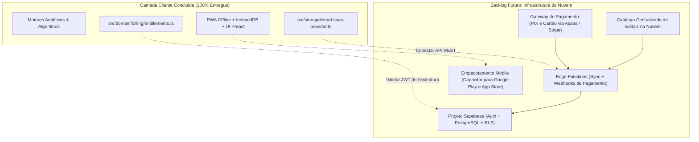

# Mapeamento do que Falta ser Implementado — StudyTrack

Este documento consolida o histórico de entregas e os próximos horizontes de evolução do **StudyTrack**, registrando a conclusão das 4 Fases do Plano Master de Evolução, os fechamentos de cobertura, as especificações estruturantes para a transição **SaaS Local-First** e o backlog futuro mapeado em [docs/recomendacoes-futuras.md](file:///c:/Users/vitor/Documents/Extrato/docs/recomendacoes-futuras.md).

> [!IMPORTANT]
> **Roteiro Histórico Consolidado:** O cronograma executivo, histórico e critérios de aceite de todos os planos de desenvolvimento implementados estão unificados e preservados em **[docs/PLANOS-CONCLUIDOS.md](file:///c:/Users/vitor/Documents/Extrato/docs/PLANOS-CONCLUIDOS.md)**. Todas as 4 fases do plano de evolução e as melhorias subsequentes foram **100% implementadas, testadas e integradas**.

---

## 1. Resumo do Status Atual das Fases e Marcos Técnicos

O StudyTrack opera em arquitetura moderna **TypeScript (`strict: true`), Preact 11 (`.tsx`) e Tailwind CSS v4** sem runtime desnecessário no cliente. A tabela abaixo resume o status de todos os marcos:

|    Fase / Marco     | Título                                          |  Status   | Entregas Principais                                                                                                                                                                                     |
| :-----------------: | ----------------------------------------------- | :-------: | ------------------------------------------------------------------------------------------------------------------------------------------------------------------------------------------------------- |
|     **Infra 1**     | Higiene do Repositório & Build                  | Concluída | `.gitignore` limpo, build reproduzível (`npm run build`), bundles minificados via esbuild.                                                                                                              |
|     **Infra 2**     | Importador de Questões (QConcursos/Tec)         | Concluída | Normalização de CSV/TSV, preview de importação, desduplicação e vínculo automático de disciplinas.                                                                                                      |
|     **Infra 3**     | Migração Estrita para TypeScript                | Concluída | `tsconfig.json` (`strict: true`), 440+ módulos `.ts`, contratos em `src/core/types.ts` e gate `npm run check:types`.                                                                                    |
|     **Infra 4**     | WebDAV com Criptografia E2EE                    | Concluída | PBKDF2-SHA256 e AES-GCM 256 bits (`crypto-utils.ts`), backup seguro em nuvem privada.                                                                                                                   |
|     **Infra 5**     | Otimização de CI/CD (Sharding & Typecheck)      | Concluída | Sharding no Playwright (`1/4` a `4/4`), checagem estática no GitHub Actions e orçamentos rigorosos de gate.                                                                                             |
| **Modernização UI** | Preact 11, Tailwind v4 & Fatiamento de `app.ts` | Concluída | Catálogo de primitivas (`src/ui/primitives/*.tsx`), Tailwind v4 sem preflight destrutivo, `AppStateStore` desacoplado.                                                                                  |
|    **PiP Timer**    | Cronômetro Flutuante Picture-in-Picture         | Concluída | `pip-timer-controller.ts` via Document PiP API com fallback dinâmico no título da aba.                                                                                                                  |
|  **Master Fase 1**  | Decisão Rápida, UX & Primeiro Uso               | Concluída | `NextActionCard.tsx` (6 perguntas contratuais), `SubjectTopicRow.tsx` com Bookmarks de Ponto de Parada, Onboarding 2.0 (`FirstStepsMission.tsx`).                                                       |
|  **Master Fase 2**  | Inteligência Preditiva & Reta Final             | Concluída | `what-if-simulator.ts` (simulação em memória via `structuredCloneSafe`), `final-stretch-policy.ts` (< 15 dias, 85% questões/revisão), `volatile-mastery.ts` (ilusão de competência).                    |
|  **Master Fase 3**  | Hub Completo de Estudos & Flexibilidade         | Concluída | `VerticalizedSyllabusView.tsx` com checklist de 4 etapas e parser de PDF (`raw-syllabus-parser.ts`), `study-cycle-engine.ts` (ciclo rotativo circular) e `focus-energy-analytics.ts` (fadiga/energia).  |
| **Master Fase 4 & Melhorias Pós-Fase 4** | Caderno de Erros, A11y, Onboarding 2.0 & Base SaaS | Concluída | `error-notebook-engine.ts` (SM-2 adaptado), `ErrorNotebookView.tsx`, avisos de revisão na Agenda e Hoje (`ErrorNotebookDueNotice.tsx`), persistência e integridade de `errorFlashcards`, focus traps em modais/tour, anúncios `aria-live` no cronômetro (`timerAriaLive`), roteiro NVDA (`ROTEIRO-AUDITORIA-NVDA.md`), Onboarding 2.0 com viabilidade pedagógica (`calculatePlanFeasibility`), nivelamento em lote e disparo direto do plano em Hoje. |

---

## 2. Detalhamento dos Componentes Entregues nas 4 Fases Master

### 2.1. Fase 1: Decisão Rápida, UX do Painel & Primeiro Uso

- **Card de Próxima Ação (`NextActionCard.tsx`):**
  - Responde de imediato às 6 perguntas contratuais: _O que estudar_, _Por que estudar_, _Quanto tempo reservar_, _Importância para a prova_, _Evidência que indica a necessidade_ e _O que fazer a seguir_.
  - Ação de 1 clique `[Iniciar agora]` conectada ao cronômetro sem fricção.
- **Rastreador de Ponto de Parada (Bookmarks de Estudo):**
  - Mapeado em [`src/domain/topic-bookmark.ts`](file:///c:/Users/vitor/Documents/Extrato/src/domain/topic-bookmark.ts) e integrado aos cards e linhas de tópicos (`SubjectTopicRow.tsx`).
  - Permite retomar leituras de PDF, videoaulas e lei seca exatamente do ponto em que parou (ex.: `📄 Pág. 42 de 110 (38%)`).
- **Primeiro Uso Guiado & Missão do 1º Dia:**
  - Pílulas de data pré-edital (90, 180, 365 dias) e 3 presets de disponibilidade semanal (Leve, Padrão, Fim de Semana).
  - Componente [`FirstStepsMission.tsx`](file:///c:/Users/vitor/Documents/Extrato/src/ui/components/FirstStepsMission.tsx) reativo na aba Hoje orientando os primeiros passos práticos.

### 2.2. Fase 2: Inteligência Preditiva, Modo Reta Final & Explicabilidade

- **Simulador "E se?" (`what-if-simulator.ts` & `WhatIfSimulatorModal.tsx`):**
  - Execução 100% em memória clonando o estado via `structuredCloneSafe`, sem poluir o banco ou exportações.
  - Projeta o impacto de minutos adicionais, multiplicadores de foco por disciplina e antecipação de data no Índice de Prontidão e na Projeção de Desempenho.
- **Modo Reta Final (`final-stretch-policy.ts` & `FinalStretchBanner.tsx`):**
  - Gatilho automático para provas a menos de 15 dias:
    - Realocação de 85% da capacidade semanal para questões e simulados.
    - Congelamento da abertura de novos tópicos teóricos densos ainda não iniciados.
    - Multiplicador de urgência (até 3.0x) para lacunas críticas de alto peso.
- **Detecção de Ilusão de Competência (`volatile-mastery.ts`):**
  - Identifica tópicos dominados inicialmente (> 75-80%) que sofrem queda abrupta após 14 dias sem revisão, sinalizando a necessidade de checagens cegas.

### 2.3. Fase 3: Hub Completo de Estudos & Flexibilidade

- **Edital Verticalizado Interativo & Parser de PDF:**
  - Módulo [`raw-syllabus-parser.ts`](file:///c:/Users/vitor/Documents/Extrato/src/application/subjects/raw-syllabus-parser.ts) que processa texto copiado diretamente de editais em PDF (Cebraspe, FCC, FGV) gerando estrutura de matérias e tópicos.
  - Tabela Preact [`VerticalizedSyllabusView.tsx`](file:///c:/Users/vitor/Documents/Extrato/src/ui/views/VerticalizedSyllabusView.tsx) com checklist de 4 etapas (Teoria, Resumo, Lei Seca, Questões), filtros e atalho direto para o cronômetro.
- **Ciclo de Estudos Flexível em Fila Rotativa:**
  - Motor [`study-cycle-engine.ts`](file:///c:/Users/vitor/Documents/Extrato/src/domain/planning/study-cycle-engine.ts) com fila circular contínua de blocos intercalados proporcionais aos pesos das matérias.
  - Dias não estudados pausam a fila sem gerar falsos atrasos acumulados ou estresse de calendário.
- **Análise Cronobiológica de Energia e Fadiga:**
  - Registro de foco e energia no encerramento de cada sessão.
  - Motor [`focus-energy-analytics.ts`](file:///c:/Users/vitor/Documents/Extrato/src/domain/analytics/focus-energy-analytics.ts) que identifica turnos de rendimento cognitivo máximo e alerta riscos de fadiga mental.

### 2.4. Fase 4 & Melhorias Pós-Fase 4: Caderno de Erros, Acessibilidade Real, Onboarding 2.0 & Base SaaS

- **Caderno de Erros Integrado & Flashcards de Bolso:**
  - Motor de repetição espaçada SM-2 adaptada em [`src/domain/notebook/error-notebook-engine.ts`](file:///c:/Users/vitor/Documents/Extrato/src/domain/notebook/error-notebook-engine.ts) com especificação matemática e matriz de transição documentada em [`docs/CADERNO-ERROS-SM2-CONTRATO.md`](file:///c:/Users/vitor/Documents/Extrato/docs/CADERNO-ERROS-SM2-CONTRATO.md).
  - Sugestões e rascunhos de cartões automáticos a partir de questões erradas (`findQuestionsAwaitingFlashcard` e `addErrorFlashcard`).
  - Avisos em tempo real na Agenda de Revisões e no painel Hoje via componente Preact [`ErrorNotebookDueNotice.tsx`](file:///c:/Users/vitor/Documents/Extrato/src/ui/components/ErrorNotebookDueNotice.tsx).
  - Persistência e integridade protegida no schema (`PERSISTENT_COLLECTIONS`), backup e restauração (`backup-validator.ts`), com tolerância a disciplinas/tópicos órfãos.
  - Controlador dedicado [`error-notebook-controller.ts`](file:///c:/Users/vitor/Documents/Extrato/src/ui/controllers/error-notebook-controller.ts), mantendo o `app.ts` estritamente como *composition root*.
- **Acessibilidade Verificável e Leitores de Tela:**
  - *Focus trap* em modais e diálogos de tour com retorno seguro ao elemento disparador via `Escape`.
  - Anúncios dinâmicos para tecnologias assistivas via `aria-live` em [`src/ui/primitives/a11y.ts`](file:///c:/Users/vitor/Documents/Extrato/src/ui/primitives/a11y.ts) cobrindo início, pausa, zeramento e finalização do cronômetro (`#timerAriaLive`) e classificação de flashcards.
  - Protocolo de auditoria com leitor de telas NVDA formalizado em [`docs/ROTEIRO-AUDITORIA-NVDA.md`](file:///c:/Users/vitor/Documents/Extrato/docs/ROTEIRO-AUDITORIA-NVDA.md), com separação rigorosa entre testes automatizados aprovados e sessões com operador humano pendentes.
- **Onboarding 2.0 e Redução de Atrito:**
  - Feedback visual ativo com `aria-pressed="true"` e classe `.is-active` para atalhos de data pré-edital e rotinas de estudo.
  - Veredito pedagógico de viabilidade do planejamento via [`calculatePlanFeasibility`](file:///c:/Users/vitor/Documents/Extrato/src/application/onboarding/build-onboarding-view-model.ts), calculando ritmo sustentável versus déficit de horas.
  - Ações em lote no assistente para nivelar o grau de dificuldade inicial de todas as disciplinas importadas com 1 clique (`guided-bulk-levels`).
  - CTA "Iniciar 1ª atividade" na aba Hoje disparando imediatamente o primeiro item pendente do plano via `startPlannedActivity`.
  - Seletores semânticos precisos para todas as etapas do Tour Guiado Contextual (`.plano-hoje-card` e `#performancePage`).
- **Isolamento de Armazenamento & Entitlements SaaS:**
  - Módulo puro de direitos e planos em [`src/domain/billing/entitlements.ts`](file:///c:/Users/vitor/Documents/Extrato/src/domain/billing/entitlements.ts) (`free`, `pro`, `mentor`), mantido como preparatório.
  - Conector desacoplado [`src/storage/cloud-saas-provider.ts`](file:///c:/Users/vitor/Documents/Extrato/src/storage/cloud-saas-provider.ts) com sincronização em background, verificação de versão e fallback local seguro.

---

## 3. Próximos Horizontes de Evolução (Backlog Ativo & Futuro)

O desenvolvimento futuro do StudyTrack desdobra-se em duas trilhas complementares: o avanço analítico e de experiência da aplicação local (*Local-First*) e a infraestrutura de nuvem multi-dispositivo (*SaaS*).

### 3.1. Trilha Local-First: Inteligência, Experiência e Engenharia

Detalhadas formalmente em **[docs/PLANO-PROXIMAS-EVOLUCOES.md](file:///c:/Users/vitor/Documents/Extrato/docs/PLANO-PROXIMAS-EVOLUCOES.md)**:

1. **Inteligência Analítica Pura:**
   - **Detecção de Platô de Desempenho (`plateau-detector.ts`):** diagnóstico de estagnação de precisão em alto volume com prescrição de mudança metodológica.
   - **Custo de Oportunidade do Estudo (`opportunity-cost.ts`):** taxa de Pontos por Hora Investida (PPH) orientando onde cada hora adicional traz mais retorno líquido na prova.
   - **Raio-X Pós-Simulado e Plano de Remediação (`simulated-remediation.ts`):** geração em 1 clique de micro-plano de 7 dias e rascunhos para o Caderno de Erros dos pontos fracos revelados em simulados.
2. **Evolução do Caderno de Erros:**
   - Filtros rápidos por organizadora/banca examinadora (Cebraspe, FGV, FCC, Vunesp) e classificação do motivo cognitivo da armadilha.
   - Métricas do algoritmo SM-2 e gráfico da curva de retenção / esquecimento revertida.
3. **Engenharia e Redução Progressiva do `app.ts`:**
   - Extração de `onboarding-modal-controller.ts` (~350 linhas).
   - Extração de `timer-ui-controller.ts` (~400 linhas).
   - Testes de estresse automatizados com histórico simulado de 1 a 3 anos (5.000+ sessões).
4. **Engajamento e PWA:**
   - Lembretes locais diários de revisão via `Notification API` e Service Worker, com privacidade total e sem servidores.

---

### 3.2. Trilha SaaS: Infraestrutura de Nuvem e Assinaturas (Backlog de Escala)

Com todos os motores de domínio, contratos de dados e interfaces locais concluídos, os passos de infraestrutura de nuvem estão descritos em **[docs/PLANO-TRANSFORMACAO-SAAS.md](file:///c:/Users/vitor/Documents/Extrato/docs/PLANO-TRANSFORMACAO-SAAS.md)**:

#### A. Setup do Backend Supabase (Auth & PostgreSQL RLS)

- Provisionar banco PostgreSQL no Supabase com as tabelas `profiles`, `user_study_states` e `user_state_snapshots`.
- Configurar políticas de segurança em nível de linha (**Row Level Security - RLS**) garantindo que cada usuário só acesse e modifique seu próprio estado.
- Autenticação por Magic Link (e-mail sem senha) e Login Social (Google OAuth).

#### B. Integração do Gateway de Pagamento (PIX e Cartão)

- Edge Function `create-checkout` para geração de cobrança PIX imediata ou assinatura por cartão de crédito.
- Edge Function `webhook` para recepção de eventos de pagamento confirmando o plano `pro` e atualizando os entitlements em tempo real.

#### C. Catálogo Dinâmico de Editais na Nuvem

- API remota de editais verticalizados pré-estruturados (carreiras fiscais, tribunais, policiais, bancárias e ENEM/OAB).
- Download e merge de editais com 1 clique para assinantes Pro diretamente via `exam-import-service.ts`.

#### D. Empacotamento Mobile (Capacitor / TWA)

- Publicação de aplicativo nativo Android (Google Play) e iOS (App Store) empacotando os artefatos estáticos gerados por `npm run build`.

---

## 4. Governança e Garantia de Qualidade

Todas as alterações preservam os seguintes critérios inegociáveis:

1. **Tipagem Estática:** 100% TypeScript com `strict: true` validado via `npm run check:types` e `npm run check:types:tests`.
2. **Design System:** Interfaces declarativas Preact (`.tsx`) e utilitários Tailwind CSS v4 integrados aos tokens de cores.
3. **Orçamento do Gate Rápido:** `npm run test:fast` executando 957 testes unitários em fuso duplo (UTC e `America/Sao_Paulo`) mais smoke E2E em cerca de 31 segundos (meta < 120s).
