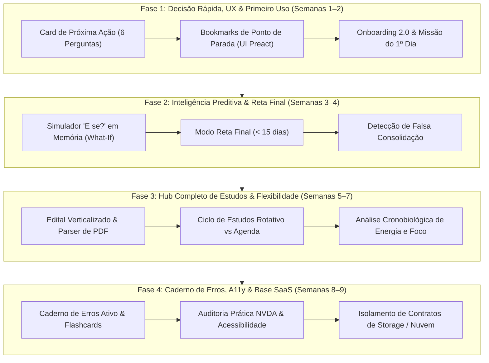

# Plano Unificado de Implementação e Evolução — StudyTrack
### *Da Persistência Local ao Hub Completo de Estudos de Alta Performance*

---

## 1. Resumo Executivo & Alinhamento Estratégico

Este documento formaliza o plano de evolução do **StudyTrack**, unificando as diretrizes de governança técnica (testes rigorosos, confiabilidade e explicabilidade analítica) com o **estado real e avançado do código-fonte**, integrando as especificações mapeadas em:
- [docs/O-QUE-FALTA-IMPLEMENTAR.md](file:///c:/Users/vitor/Documents/Extrato/docs/O-QUE-FALTA-IMPLEMENTAR.md)
- [docs/PLANO-PRIMEIRO-USO-GUIADO.md](file:///c:/Users/vitor/Documents/Extrato/docs/PLANO-PRIMEIRO-USO-GUIADO.md)
- [docs/DECISION-EXPERIENCE-CONTRACT.md](file:///c:/Users/vitor/Documents/Extrato/docs/DECISION-EXPERIENCE-CONTRACT.md)
- [docs/TEST-STRATEGY.md](file:///c:/Users/vitor/Documents/Extrato/docs/TEST-STRATEGY.md)
- [ARCHITECTURE.md](file:///c:/Users/vitor/Documents/Extrato/ARCHITECTURE.md)

### O que este plano ajusta em relação à proposta genérica anterior:

1. **Eliminação de 5 a 6 semanas de retrabalho:** O repositório já conta com inventário minucioso ([TEST-SUITE-INVENTORY.md](file:///c:/Users/vitor/Documents/Extrato/docs/TEST-SUITE-INVENTORY.md)), 790+ testes Node em fuso duplo (UTC e `America/Sao_Paulo`), 59 suítes E2E Playwright, migração total para TypeScript estrito (`strict: true`), sincronização WebDAV com criptografia de ponta a ponta (AES-GCM-256) e timer flutuante em Picture-in-Picture.
2. **Foco no valor real para o concurseiro:** Concentração imediata na redução da sobrecarga cognitiva diária (decisão rápida do que estudar), no poder preditivo sem efeitos colaterais em banco (*What-If Simulator* e *Modo Reta Final*) e na transformação do app em um **Hub Completo de Estudos** (bookmarks de materiais, edital verticalizado e ciclo de estudos flexível).

---

## 2. Pilha Tecnológica e Diretrizes Inegociáveis de Engenharia

Conforme estabelecido nas regras de governança do repositório ([AGENTS.md](file:///c:/Users/vitor/Documents/Extrato/AGENTS.md)):

1. **Tipagem Estática Obrigatória:** Todo código novo de domínio (`src/domain/`) e aplicação (`src/application/`) deve ser escrito em **TypeScript (`.ts`)** e validado com `npm run check:types`.
2. **Interface Declarativa e Tokens:** Novas interfaces devem ser componentes **Preact 11 (`.tsx`)**, consumindo as primitivas compartilhadas (`src/ui/primitives/*.tsx`) e estilizadas via **Tailwind CSS v4** integrado a `styles/tokens.css`. É vedado o uso de `innerHTML` ou strings HTML interpoladas.
3. **Estratégia de Testes Proporcional:**
   - **Regras de negócio e algoritmos:** Testes unitários no Node rodando com hook nativo (`npm run test:fast`). Meta: < 120s.
   - **Jornadas centrais de UI:** Testes E2E dirigidos no Playwright para fluxos críticos, sem inflar a matriz browser desnecessariamente.
   - **Execuções completas (`npm run test:full`):** Reservadas para releases e mudanças estruturais de esquema/persistência.

---

## 3. Cronograma Executivo Macro (9 Semanas)

---

## 4. Detalhamento das Fases

### Fase 1: Decisão Rápida, UX do Painel & Primeiro Uso
*Duração estimada: 2 semanas | Prioridade: P0 (Retenção e Uso Diário)*

#### 1.1. Card de Próxima Ação com as 6 Perguntas Contratuais
* **Objetivo:** Eliminar a paralisia do estudante na tela inicial, apresentando uma recomendação cristalina baseada nos pesos do edital e nas lacunas reais de desempenho.
* **Contrato Visual:** Respeitar o [DECISION-EXPERIENCE-CONTRACT.md](file:///c:/Users/vitor/Documents/Extrato/docs/DECISION-EXPERIENCE-CONTRACT.md) e responder explicitamente às 6 perguntas:
  1. *O que devo estudar?* (Disciplina e Tópico prioritário).
  2. *Por que devo estudar isso?* (Racional: atraso, peso alto no edital, ou precisão abaixo da meta).
  3. *Quanto tempo devo reservar?* (Duração sugerida conforme a disponibilidade de hoje).
  4. *Qual é a importância para a prova?* (Peso relativo no edital).
  5. *Que evidência indica a necessidade?* (Ex.: acerto de 54% nas últimas 30 questões).
  6. *O que devo fazer a seguir?* (Ação imediata: teoria, revisão ou bateria de questões).
* **Arquivos Impactados:** `src/ui/dashboard/`, `src/domain/analytics/recommendations.ts`, `src/ui/primitives/Card.tsx`.

#### 1.2. Rastreador de Ponto de Parada (Bookmarks de Estudo em Preact)
* **Objetivo:** Integrar à interface o domínio já existente em [`src/domain/topic-bookmark.ts`](file:///c:/Users/vitor/Documents/Extrato/src/domain/topic-bookmark.ts), permitindo retomar leituras de PDF, videoaulas e lei seca exatamente do ponto em que parou.
* **Componentes a Implementar:**
  1. `src/ui/components/BookmarkBadge.tsx`: Exibir badge contextual no Card de Próxima Ação e no cabeçalho do timer (ex.: `📄 Pág. 42 de 110 (38%) · Continuar de onde parou`).
  2. **Check-out de Sessão:** Adicionar ao modal de conclusão do cronômetro campos opcionais rápidos: *Onde você parou?* (Tipo: PDF/Vídeo/Lei, Posição atual e Total de páginas/unidades).
  3. **Edição Inline:** Permitir ajuste rápido do marcador direto na lista de tópicos em `src/ui/subjects/SubjectsTab.tsx`.

#### 1.3. Primeiro Uso Guiado & Missão do 1º Dia
* **Objetivo:** Concluir a implementação da Camada 1 e Camada 2 de [docs/PLANO-PRIMEIRO-USO-GUIADO.md](file:///c:/Users/vitor/Documents/Extrato/docs/PLANO-PRIMEIRO-USO-GUIADO.md).
* **Tarefas:**
  1. **Presets de 1 Clique no Wizard:** Pílulas de data pré-edital (3, 6 e 12 meses) e presets de rotina semanal (Leve: 2h/dia; Padrão: 4h/dia; Foco em Fim de Semana) para evitar digitação manual excessiva.
  2. **Missão do 1º Dia:** Widget reativo na aba Hoje orientando o novo usuário a realizar sua 1ª sessão no cronômetro e importar seu primeiro CSV de questões após a criação do plano.

#### Critérios de Aceite da Fase 1:
- [ ] A tela inicial responde em < 3 segundos qual a próxima melhor ação do dia.
- [ ] O ponto de parada preenchido no encerramento de uma sessão reaparece automaticamente na próxima recomendação do mesmo tópico.
- [ ] Novos usuários passam pelo wizard inicial em menos de 60 segundos usando os atalhos de rotina.
- [ ] Todos os testes unitários (`npm run test:fast`) e suíte de onboarding (`tests/e2e/onboarding.spec.js`) passam 100%.

---

### Fase 2: Inteligência Preditiva, Modo Reta Final & Explicabilidade
*Duração estimada: 2 semanas | Prioridade: P1 (Diferencial Analítico)*

#### 2.1. Simulador "E se?" (`what-if-simulator.ts`)
* **Objetivo:** Dar poder preditivo ao estudante sem poluir o histórico ou persistir alterações experimentais no banco de dados.
* **Implementação Técnica:**
  - Localização: `src/domain/forecasts/what-if-simulator.ts`.
  - Execução pura em memória clonando o estado via `structuredClone(appState)`.
  - Simulações dinâmicas:
    - *Acréscimo de minutos diários de estudo*.
    - *Realocação de horas para disciplinas de maior peso de edital*.
    - *Impacto projetado no Índice de Prontidão ([readiness-score.ts](file:///c:/Users/vitor/Documents/Extrato/src/domain/analytics/readiness-score.ts)) e na Projeção Calibrada ([calibrated-score-projection.ts](file:///c:/Users/vitor/Documents/Extrato/src/domain/forecasts/calibrated-score-projection.ts))*.
  - Modal Preact `src/ui/forecasts/WhatIfSimulatorModal.tsx` com sliders em tempo real e comparativo visual (Estado Atual vs. Estado Simulado).

#### 2.2. Modo Reta Final (`final-stretch-policy.ts`)
* **Objetivo:** Adaptar automaticamente a estratégia de preparação à medida que a prova se aproxima.
* **Regras de Domínio:**
  - Gatilho ativado quando a contagem regressiva da prova atingir **< 15 dias** (ou configurável).
  - 80%+ da capacidade semanal realocada automaticamente para simulados e questões de fixação.
  - Congelamento da abertura de novos tópicos teóricos densos ainda não iniciados.
  - Foco agressivo em lacunas de alta incidência na prova com acerto histórico < 70%.
  - Alerta visual no cabeçalho: `🚨 Modo Reta Final Ativado (Faltam X dias)`.

#### 2.3. Detecção de "Falsa Consolidação" (Ilusão de Competência)
* **Objetivo:** Identificar tópicos que atingem alto percentual de acerto (> 90%) logo após o estudo teórico, mas sofrem colapso de retenção em revisões espaçadas (> 14 dias).
* **Entrega:** Marcação diagnóstica de *"Domínio Volátil"* no relatório analítico, sugerindo baterias cegas de questões sem consulta.

#### Critérios de Aceite da Fase 2:
- [ ] Nenhuma alteração realizada dentro do modal do simulador *What-If* é persistida em IndexedDB ou exportada no backup JSON.
- [ ] O gerador de cronograma inverte as proporções de teoria/questões ao cruzar o limiar de 15 dias da prova.
- [ ] Testes unitários puros no Node validam o isolamento de mutação e a coerência matemática das projeções.

---

### Fase 3: Hub Completo de Estudos & Flexibilidade
*Duração estimada: 3 semanas | Prioridade: P1 (Profundidade de Uso)*

#### 3.1. Edital Verticalizado Interativo & Parser de PDF
* **Objetivo:** Substituir planilhas externas por uma visualização integrada do conteúdo programático com checklist de etapas e métricas em linha única.
* **Componentes:**
  1. **Contrato de Tipos:** Campo `stageChecklist: { theoryDone, summaryDone, lawOrNotesDone, questionsDone }` em `src/core/types.ts`.
  2. **Parser de Edital Bruto (`parseRawSyllabusText`):** Módulo em `src/application/subjects/structured-content-import.ts` capaz de processar texto copiado diretamente de editais em PDF (ex.: `"1. Atos administrativos. 1.1 Conceito e requisitos. 1.2 Revogação e anulação."`), gerando estrutura hierárquica com prévia de importação.
  3. **Interface Preact (`src/ui/views/VerticalizedSyllabusView.tsx`):** Tabela interativa com filtros de peso, taxa de domínio atual e ação de 1 clique `[▶ Estudar agora]`.

#### 3.2. Ciclo de Estudos Flexível (Modo Fila Rotativa vs. Modo Agenda)
* **Objetivo:** Atender concurseiros com jornadas imprevisíveis de trabalho, substituindo a agenda por dia fixo por uma fila contínua de blocos intercalados.
* **Implementação:**
  - `src/domain/planning/study-cycle-engine.ts`: Criação de blocos de 45 a 90 minutos intercalando disciplinas complementares.
  - Alternador em `GoalsPlanningTab.tsx`: `📅 Agenda por Dia da Semana` vs. `🔄 Ciclo Rotativo`.
  - O não cumprimento de um dia de estudo apenas pausa a fila, sem gerar avalanche de atrasos falsos na grade semanal.

#### 3.3. Análise Cronobiológica de Energia e Fadiga
* **Objetivo:** Identificar horários de pico cognitivo e prevenir esgotamento mental (*burnout*).
* **Implementação:**
  - Registro de 1 clique no encerramento da sessão: Foco (`[🔥 Profundo]`, `[⚡ Normal]`, `[💭 Distraído]`) e Energia (`[🔋 Alta]`, `[⚖️ Normal]`, `[🪫 Cansado]`).
  - Motor `src/domain/analytics/focus-energy-analytics.ts`: Correlação de precisão em questões por turno do dia (manhã, tarde, noite) com alerta no diagnóstico quando houver queda contínua de rendimento associada a cansaço.

#### Critérios de Aceite da Fase 3:
- [ ] Colar texto bruto de edital gera matérias e tópicos estruturados sem erros de parsing.
- [ ] A troca entre modo Ciclo e modo Agenda preserva o histórico de sessões e estatísticas consolidadas.
- [ ] Correlações de energia e turno exigem amostra mínima de 5 sessões antes de exibir diagnósticos ao usuário.

---

### Fase 4: Caderno de Erros, Acessibilidade Real & Base SaaS
*Duração estimada: 2 semanas | Prioridade: P2 (Maturidade, Inclusão e Escala)*

#### 4.1. Caderno de Erros Ativo & Flashcards de Bolso
* **Objetivo:** Transformar cada questão errada em oportunidade de fixação imediata.
* **Implementação:**
  - Extração de questões marcadas como incorretas em sessões ou no importador de CSV (Tec/QConcursos).
  - Interface compacta de cards com: *Enunciado resumido*, *Pegadinha da Banca* e *Conceito Correto*.
  - Agendamento automático no motor de Revisão Espaçada até a fixação comprovada em nova bateria de questões.

#### 4.2. Listas Progressivas e Auditoria de Acessibilidade (NVDA / Leitores de Tela)
* **Objetivo:** Garantir usabilidade fluida e conformidade com leitores de tela reais conforme [docs/DECISION-EXPERIENCE-CLOSURE.md](file:///c:/Users/vitor/Documents/Extrato/docs/DECISION-EXPERIENCE-CLOSURE.md).
* **Tarefas:**
  - Padronizar listas extensas (histórico, revisões pendentes, tópicos atrasados) com limite de 5 itens e botão `Mostrar mais (+N)`.
  - Auditoria assistida com NVDA / VoiceOver garantindo que modais fechem com `Esc`, foquem o primeiro controle e anunciem status de timers e mensagens de alerta de forma clara via ARIA.

#### 4.3. Isolamento da Camada de Armazenamento para Transição SaaS
* **Objetivo:** Preparar a base do StudyTrack para futura expansão multi-dispositivo sem reescrita de código, conforme [docs/PLANO-TRANSFORMACAO-SAAS.md](file:///c:/Users/vitor/Documents/Extrato/docs/PLANO-TRANSFORMACAO-SAAS.md).
* **Implementação:**
  - Padronizar os contratos de interface em `src/storage/` para permitir que o repositório local (IndexedDB + WebDAV) possa receber um conector de nuvem (API REST / Supabase / WebSocket) de forma modular.

#### Critérios de Aceite da Fase 4:
- [ ] Questões erradas podem ser revisadas em formato de flashcard integrado à agenda diária.
- [ ] 100% dos fluxos essenciais são operáveis exclusivamente por teclado sem armadilhas de foco (*keyboard traps*).
- [ ] Homologação total do gate de qualidade: `npm run test:full` aprovado em Windows/Chromium.

---

## 5. Matriz de Rastreabilidade e Governança de Testes

| Área Alterada | Tipo de Validação | Comando de Execução | Orçamento Máximo |
|---|---|---|---|
| **Domínio / Algoritmos** (`src/domain/`) | Unitários puros em Node | `npm run test:fast` | < 120 segundos |
| **Tipagem Estática** | TypeScript Compiler | `npm run check:types` | < 15 segundos |
| **Jornadas de Interface** | Playwright E2E Focado | `npx playwright test tests/e2e/recent-flows.spec.js` | < 180 segundos |
| **Regressão de Persistência** | Suíte de Regressão | `npm run test:regression` | < 420 segundos |
| **Release / Fechamento de Fase** | Gate Completo Full | `npm run test:full` | Monitorado (CI Sharding) |

---

## 6. Referências Técnicas do Projeto

- **Arquitetura Geral:** [ARCHITECTURE.md](file:///c:/Users/vitor/Documents/Extrato/ARCHITECTURE.md)
- **Estratégia e Política de Testes:** [docs/TEST-STRATEGY.md](file:///c:/Users/vitor/Documents/Extrato/docs/TEST-STRATEGY.md) e [AGENTS.md](file:///c:/Users/vitor/Documents/Extrato/AGENTS.md)
- **Inventário da Suíte de Testes:** [docs/TEST-SUITE-INVENTORY.md](file:///c:/Users/vitor/Documents/Extrato/docs/TEST-SUITE-INVENTORY.md)
- **Contratos de Decisão e Experiência:** [docs/DECISION-EXPERIENCE-CONTRACT.md](file:///c:/Users/vitor/Documents/Extrato/docs/DECISION-EXPERIENCE-CONTRACT.md)
- **Plano de Primeiro Uso Guiado:** [docs/PLANO-PRIMEIRO-USO-GUIADO.md](file:///c:/Users/vitor/Documents/Extrato/docs/PLANO-PRIMEIRO-USO-GUIADO.md)
- **Mapeamento de Pendências:** [docs/O-QUE-FALTA-IMPLEMENTAR.md](file:///c:/Users/vitor/Documents/Extrato/docs/O-QUE-FALTA-IMPLEMENTAR.md)
- **Visão de Transformação SaaS:** [docs/PLANO-TRANSFORMACAO-SAAS.md](file:///c:/Users/vitor/Documents/Extrato/docs/PLANO-TRANSFORMACAO-SAAS.md)
