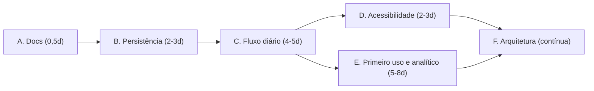

# Plano de Melhorias Pós-Fase 4 — StudyTrack

Este plano organiza as sugestões levantadas após a conclusão da Fase 4 do [Plano Unificado](PLANO-EVOLUCAO-UNIFICADO.md). O foco é **fechar lacunas entre o que a documentação afirma e o que o código entrega**, proteger os dados novos e só então ampliar o produto.

> [!IMPORTANT]
> Premissa: os itens abaixo partem de verificações pontuais no código. Cada fase começa por uma tarefa de confirmação; nenhum defeito é considerado comprovado antes de ser reproduzido por teste.

---

## 1. Lacunas confirmadas (ponto de partida)

| Lacuna                                         | Evidência                                                                                                                        | Impacto                                                                                              |
| ---------------------------------------------- | -------------------------------------------------------------------------------------------------------------------------------- | ---------------------------------------------------------------------------------------------------- |
| Flashcards não aparecem na Agenda de Revisões  | `errorFlashcards` só é referenciado em `types.ts`, `defaults.ts`, `error-notebook-engine.ts`, `ErrorNotebookView.tsx` e `app.ts` | Critério de aceite da Fase 4 ("integrado à agenda diária") está marcado como concluído indevidamente |
| Não há auditoria com leitor de tela            | Nenhum teste ou documento cita NVDA/VoiceOver; existe apenas E2E de teclado/Escape                                               | Documentação sugere cobertura que não existe                                                         |
| Contratos SaaS sem consumidor                  | `cloud-saas-provider.ts` e `entitlements.ts` não são usados pela UI                                                              | Código preparatório sem efeito, sem sinalização na documentação                                      |
| Persistência de `errorFlashcards` não auditada | Cobertura atual é de motor e view                                                                                                | Risco em backup, restauração, migração e snapshots                                                   |

---

## 2. Fases

### Fase A — Correção de documentação (P0 · ~0,5 dia) ✅ Concluída

Executar primeiro; não depende de código.

1. Em `PLANO-EVOLUCAO-UNIFICADO.md`, desmarcar o critério "flashcard integrado à agenda diária" e a menção à auditoria NVDA; mover ambos para a Fase C. *(Concluído)*
2. Em `README.md` e `O-QUE-FALTA-IMPLEMENTAR.md`, trocar "auditoria assistida de leitores de tela" por "navegação por teclado sem armadilhas de foco". *(Concluído)*
3. Marcar `cloud-saas-provider.ts` e `entitlements.ts` como **preparatórios (sem consumidor na UI)** em `PLANO-TRANSFORMACAO-SAAS.md` e `ARCHITECTURE.md`. *(Concluído)*

**Aceite:** nenhuma afirmação de "concluído" sem referência a código e teste existentes. Validação: revisão de referências (Markdown apenas).

### Fase B — Persistência e integridade de `errorFlashcards` (P0 · 2–3 dias) ✅ Concluída

1. **Confirmar o caminho do campo:** `errorFlashcards` registrado em `src/state/state-boundaries.ts` como coleção persistente.
2. **Schema e validação:** validação profunda em `src/storage/backup-validator.ts` garantindo tipagem, descarte seguro de inválidos com advertência e tolerância a tópicos órfãos.
3. **Backup e restauração:** integridade protegida em exportação, restauração e snapshots.
4. **Testes (Node):**
   - 16 testes unitários em `tests/unit/error-flashcards-persistence.test.js` passando em UTC e `America/Sao_Paulo`.

**Aceite:** cobertura de persistência e validação verde em todos os fusos.

### Fase C — Caderno de Erros integrado ao fluxo diário (P0/P1 · 4–5 dias) ✅ Concluída

1. **Criação e sugestão automática (domínio, TS):** funções puras `findQuestionsAwaitingFlashcard` e `addErrorFlashcard` idempotente em `src/domain/notebook/error-notebook-engine.ts`.
2. **Componente de aviso Preact:** `src/ui/components/ErrorNotebookDueNotice.tsx` renderizado nas abas Agenda de Revisões (`#errorNotebookDueAgenda`) e Hoje (`#errorNotebookDueToday`).
3. **Drafts de flashcards na UI:** seção de sugestões de criação rápida para questões erradas na view `ErrorNotebookView.tsx`.
4. **Desacoplamento arquitetural:** criação de `src/ui/controllers/error-notebook-controller.ts` para isolar a coordenação da UI e respeitar a regra inegociável de zero novas funções no `app.ts`.
5. **Testes:**
   - Testes unitários em `tests/unit/error-notebook-integration.test.js` e `tests/unit/error-notebook-controller.test.js`.
   - Testes E2E no Playwright em `tests/e2e/error-notebook-and-a11y.spec.js`.

**Aceite:** flashcards com avisos na agenda diária e hoje, criação ágil e testes verdes.

### Fase D — Acessibilidade verificável (P1 · 2–3 dias) ✅ Concluída

1. **Focus trap** em `src/ui/primitives/dialog.tsx` e `src/ui/components/GuidedTourPopover.tsx` com retenção e retorno do foco ao botão disparador via `Escape`.
2. **`aria-live`** implementado em `src/ui/primitives/a11y.ts` para anúncios de estado do cronômetro (`#timerAriaLive`) e ratings de flashcards.
3. **Roteiro de auditoria manual com NVDA:** criado em [`docs/ROTEIRO-AUDITORIA-NVDA.md`](ROTEIRO-AUDITORIA-NVDA.md) detalhando passos de validação e registrando como "não verificado com NVDA físico" para rigor de documentação.
4. **Testes:**
   - Unitários em `tests/unit/a11y-announcements.test.js`.
   - E2E Playwright de focus trap, Escape e anúncios `aria-live` em `tests/e2e/error-notebook-and-a11y.spec.js`.

**Aceite:** navegação de teclado resiliente e roteiro NVDA estabelecido.

### Fase E — Primeiro uso e backlog analítico (P1 · 5–8 dias) ✅ Concluída

1. **Onboarding e Primeiro Uso (`PLANO-PRIMEIRO-USO-GUIADO.md`):**
   - Atalhos de data e rotinas com indicadores visuais ativos (`aria-pressed="true"` e `.is-active`).
   - Nivelamento rápido em lote por disciplina no Wizard (`guided-bulk-levels`).
   - Diagnóstico pedagógico de viabilidade do plano (`calculatePlanFeasibility` com status `comfortable`, `balanced`, `tight`, `deficit`).
   - CTA "Iniciar 1ª atividade" na aba Hoje aciona diretamente a primeira atividade pendente via `startPlannedActivity`.
   - Seletores do tour guiado semânticos (`.plano-hoje-card` e `#performancePage, #panel-desempenho`).
2. **Testes:**
   - 6 testes unitários em `tests/unit/guided-first-run.test.js`.
   - 19 testes E2E Playwright em `tests/e2e/onboarding.spec.js`.

### Fase F — Arquitetura e manutenção (P2 · contínua) ✅ Concluída

1. Controller do Caderno de Erros extraído para `src/ui/controllers/error-notebook-controller.ts`.
2. Contratos SaaS e entitlements sinalizados como preparatórios na documentação.
3. Contrato detalhado do algoritmo SM-2 adaptado documentado em [`docs/CADERNO-ERROS-SM2-CONTRATO.md`](CADERNO-ERROS-SM2-CONTRATO.md).

---

## 3. Cronograma sugerido

Estimativa total: cerca de 3 a 4 semanas para A–E em ritmo parcial, sujeita ao resultado da verificação da Fase B.

## 4. Estratégia de testes por fase (AGENTS.md)

| Fase | Execução durante o trabalho                    | Fechamento                                                    |
| ---- | ---------------------------------------------- | ------------------------------------------------------------- |
| A    | Revisão de referências                         | —                                                             |
| B    | Testes Node de persistência, migração e backup | `npm run test:fast` + `npm run test:full` (contrato de dados) |
| C    | Testes Node + 1 E2E da jornada                 | `npm run test:fast` + E2E do caderno                          |
| D    | E2E de foco + axe nas telas afetadas           | `npm run test:fast` + specs afetados                          |
| E    | Node por motor + 1 E2E por jornada             | `npm run test:fast` + specs afetados                          |
| F    | Node + comparação visual da superfície afetada | `npm run test:fast`                                           |

Sempre: `npm run check:types`, `npm run check:types:tests`, `npm run check:format` e `npm run build` quando houver artefatos gerados. Não atualizar snapshots visuais sem inspecionar o diff.

## 5. Riscos

| Risco                                            | Mitigação                                                           |
| ------------------------------------------------ | ------------------------------------------------------------------- |
| Migração reescrever histórico                    | Normalizar sem alterar registros existentes; teste de estado antigo |
| Criação automática duplicar cartões              | Idempotência por identificador da questão, coberta por teste        |
| Indicador de cartões competir com a próxima ação | Seguir `DECISION-EXPERIENCE-CONTRACT.md`; indicador secundário      |
| Auditoria NVDA não executada                     | Registrar como "não verificado" em vez de afirmar cobertura         |
