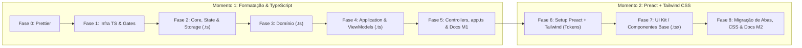
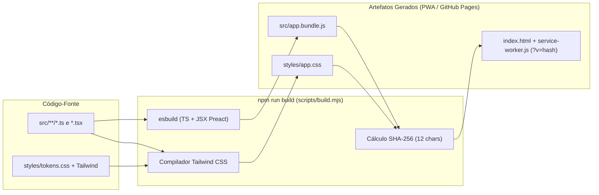

# Plano Detalhado de Modernização: Formatação, TypeScript, Preact e Tailwind CSS

Este documento descreve o roteiro técnico e arquitetural para modernizar a base de código do **StudyTrack (Extrato de Estudos)** em dois momentos incrementais:

1. **Momento 1 (Fases 0 a 5):** Padronização de formatação (`Prettier`), migração incremental para **TypeScript** (`.ts`) e fatiamento do orquestrador [`src/app.js`](../src/app.js).
2. **Momento 2 (Fases 6 a 8):** Adoção incremental de componentes declarativos com **Preact** (`.tsx`) e **Tailwind CSS** conectado às variáveis semânticas de [`styles/tokens.css`](../styles/tokens.css), sem quebrar os testes de regressão visual ([`docs/VISUAL-TEST-POLICY.md`](VISUAL-TEST-POLICY.md)).

---

## Visão Geral das Fases



---

## Como Funciona o Build e a Execução do Projeto

Para o desenvolvimento diário, para os gates de CI e para a publicação estática no GitHub Pages, **os comandos principais permanecem os mesmos (`npm run build`, `npm run check:bundle`, `npm test`, `npm run serve`)**. O próprio [`scripts/build.mjs`](../scripts/build.mjs) continua sendo o ponto único de geração dos artefatos e do hash SHA-256 de versionamento da PWA.

### 1. Pipeline de Build no Momento 1 (TypeScript)

O bundler atual (`esbuild`) já compila arquivos `.ts` nativamente, sem necessidade de plugins externos.

1. **Transpilação e Empacotamento (`npm run build`):**
   * O `esbuild` lê os módulos `.ts` e `.js` em conjunto, remove as anotações de tipos e gera os mesmos bundles IIFE para o navegador: [`src/app.bundle.js`](../src/app.bundle.js) e [`src/exam-catalog.bundle.js`](../src/exam-catalog.bundle.js).
2. **Cálculo do Hash de Versão (`__BUILD_VERSION__`):**
   * No [`scripts/build.mjs`](../scripts/build.mjs), a lista `sourceFiles` inclui arquivos `.ts` (além de `.js`, `.css`, `.html`, `.svg` e `.webmanifest`).
   * Qualquer alteração em um módulo `.ts` atualiza automaticamente o hash SHA-256 de 12 caracteres injetado em [`index.html`](../index.html) e [`service-worker.js`](../service-worker.js) a partir de [`service-worker.template.js`](../service-worker.template.js).
3. **Checagem Estática de Tipos (`npm run check:types`):**
   * Como o `esbuild` realiza apenas o *type-stripping* para manter o build em milissegundos, a validação completa do sistema de tipos é feita por `tsc -p tsconfig.json --noEmit` (executado isoladamente em `npm run check:types` e integrado na fase `Typecheck` do [`scripts/run-test-gate.mjs`](../scripts/run-test-gate.mjs)).
4. **Execução Direta dos Testes Unitários (`npm test`):**
   * **Não exige build prévio:** O Node.js (v22.6+ / v24+) executa arquivos `.ts` nativamente no runner `node --test`.

### 2. Pipeline de Build no Momento 2 (Preact + Tailwind CSS)

Na segunda etapa, o [`scripts/build.mjs`](../scripts/build.mjs) passa a compilar também componentes `.tsx` (Preact) e utilitários do Tailwind CSS dentro do mesmo fluxo determinístico:



1. **Compilação de JSX (`.tsx`) para Preact no `esbuild`:**
   * A chamada do `build()` em [`scripts/build.mjs`](../scripts/build.mjs) recebe duas propriedades nativas do `esbuild`:
     ```js
     const result = await build({
       entryPoints: [resolve(projectRoot, bundle.entry)],
       bundle: true,
       write: false,
       format: 'iife',
       platform: 'browser',
       target: ['es2020'],
       charset: 'utf8',
       jsx: 'automatic',
       jsxImportSource: 'preact',
       legalComments: 'none',
       minify: true,
       define: { __STUDYTRACK_BUILD_VERSION__: JSON.stringify(buildVersion) },
       banner: { js: '/* Arquivo gerado. Edite os modulos em src/, nao este bundle. */' }
     });
     ```
2. **Processamento do Tailwind CSS:**
   * Antes de calcular o `buildVersion`, o [`scripts/build.mjs`](../scripts/build.mjs) processa as classes utilitárias usadas nos arquivos de `src/` junto aos tokens de [`styles/tokens.css`](../styles/tokens.css) e gera o `styles/app.css` otimizado.
   * O comando `npm run check:bundle` (`node scripts/build.mjs --check`) verifica se tanto os bundles JS quanto o CSS e o hash do `index.html`/`service-worker.js` estão atualizados e reproduzíveis.
3. **Execução de Testes Unitários com `.tsx` no Node:**
   * Para testar renderizadores `.tsx` diretamente em `node --test` sem navegador, utiliza-se `preact-render-to-string` com um hook leve de resolução/transformação via `module.registerHooks` nativo do Node + `esbuild.transformSync`.

### 3. Tabela de Referência de Comandos

| Finalidade | Comando | Comportamento após a modernização |
| :--- | :--- | :--- |
| Gerar bundles, CSS, HTML e Service Worker | `npm run build` | Compila `.ts`/`.tsx` via `esbuild`, processa CSS e atualiza hashes SHA-256 em `index.html` e `service-worker.js`. |
| Verificar reprodutibilidade dos artefatos | `npm run check:bundle` | Executa `node scripts/build.mjs --check` e falha se algum artefato gerado estiver desatualizado. |
| Checar tipos estáticos | `npm run check:types` | Executa `tsc -p tsconfig.json --noEmit` em toda a base. |
| Verificar sintaxe rápida | `npm run check:syntax` | Valida a sintaxe de todos os arquivos `.js`, `.mjs`, `.ts` e `.tsx` via `esbuild`. |
| Formatar o código-fonte | `npm run format` | Formata `src/`, `scripts/` e `tests/` com Prettier. |
| Verificar formatação no CI | `npm run check:format` | Confere se todos os arquivos seguem o padrão do `.prettierrc.json`. |
| Executar testes unitários | `npm test` | Roda `node --test tests/unit/*.test.js` diretamente no Node. |
| Executar gate rápido | `npm run test:fast` | Roda sintaxe, `tsconfig.json`, inventário, tiers, `check:bundle`, unitários (UTC/SP) e smoke E2E. |
| Servir PWA localmente | `npm run serve` | Inicia o servidor HTTP local ([`scripts/serve.mjs`](../scripts/serve.mjs)). |

---

## Detalhamento das Fases — Momento 1 (Formatação & TypeScript)

### Fase 0 — Padronização de Formatação e Legibilidade (Prettier)
1. **Configuração do Prettier:**
   * Instalar `prettier` em `devDependencies` no [`package.json`](../package.json).
   * Criar `.prettierrc.json` (indentação de 2 espaços, aspas simples, ponto e vírgula, `printWidth: 100`).
   * Criar `.prettierignore` ignorando artefatos gerados e catálogos de dados extensos:
     * `src/app.bundle.js`
     * `src/exam-catalog.bundle.js`
     * `service-worker.js`
     * `src/domain/exams/exam-catalog-data.json`
     * `src/demo/demo-scenario.json`
     * `tests/config/*.json`
2. **Scripts e Histórico Git:**
   * Adicionar `"format": "prettier --write src scripts tests"` e `"check:format": "prettier --check src scripts tests"` ao [`package.json`](../package.json).
   * Executar a formatação em commit dedicado e registrar o hash em `.git-blame-ignore-revs`.
   * Executar `npm run build` para atualizar o hash de versão nos artefatos.

### Fase 1 — Infraestrutura TypeScript e Scripts de Build/Testes
1. **Substituir [`jsconfig.json`](../jsconfig.json) por `tsconfig.json`:**
   * Configurar `"allowJs": true`, `"checkJs": true`, `"noEmit": true`, `"allowImportingTsExtensions": true`, `"target": "ES2022"`, `"module": "NodeNext"`, `"moduleResolution": "NodeNext"`.
   * Manter [`src/theme-bootstrap.js`](../src/theme-bootstrap.js) e [`src/pwa.js`](../src/pwa.js) como `.js` (carregados diretamente via `<script>` no [`index.html`](../index.html) e cacheados no `APP_SHELL` do [`service-worker.template.js`](../service-worker.template.js)).
2. **Atualizar scripts de verificação e impacto:**
   * [`package.json`](../package.json): atualizar `"check:types": "tsc -p tsconfig.json --noEmit"`.
   * [`scripts/build.mjs`](../scripts/build.mjs): incluir `.ts` (e `.tsx`) em `sourceFiles` e `isTextFile`.
   * [`scripts/check-syntax.mjs`](../scripts/check-syntax.mjs): validar `.ts` e `.tsx` passando o `loader` correspondente ao `transformSync` do `esbuild`.
   * [`scripts/run-test-gate.mjs`](../scripts/run-test-gate.mjs): apontar a etapa `Typecheck` para `tsconfig.json`.
   * [`scripts/select-affected-tests.mjs`](../scripts/select-affected-tests.mjs), [`scripts/lib/affected-test-plan.js`](../scripts/lib/affected-test-plan.js) e [`tests/config/test-impact-map.js`](../tests/config/test-impact-map.js): suportar extensões `.ts` e `.tsx` na resolução do grafo de dependências e no mapeamento de áreas de impacto.

### Fase 2 — Contratos Centrais, Core, State e Storage
1. **Converter [`src/core/types.js`](../src/core/types.js) para `src/core/types.ts`:**
   * Exportar interfaces e tipos nativos (`TopicStatus`, `TopicDifficulty`, `BookmarkResourceType`, `TopicBookmark`, `Topic` com `bookmark?: TopicBookmark | null`, `Subject`, `QuestionRecord`, `SimulationBreakdownItem`, `SimulationRecord`, `StudySession`, `ReadinessSnapshot`, `AppState`, `WeeklyPlan`, `PlanItem`, `GoalConfig`).
   * Declarar a tipagem da API `DocumentPictureInPicture` para suportar [`src/ui/controllers/pip-timer-controller.js`](../src/ui/controllers/pip-timer-controller.js) sem erros no `tsc`.
2. **Migrar `src/core/`, `src/state/`, `src/storage/` e `src/repositories/` para `.ts`:**
   * Tipar utilitários puros (`utils.ts`, `date-utils.ts`, `clock.ts`, `format-number.ts`, `crypto-utils.ts`).
   * Tipar [`src/state/schema.js`](../src/state/schema.js), [`src/state/strategic.js`](../src/state/strategic.js) e [`src/state/defaults.js`](../src/state/defaults.js) garantindo retorno `AppState`.
   * Tipar os contratos de armazenamento (`storage-provider.ts`, `repository.ts`, `real-storage-provider.ts`, `demo-storage-provider.ts`, `remote-sync-provider.ts`, `migration-service.ts`, `backup-service.ts`) e repositórios.

### Fase 3 — Camada de Domínio (`src/domain/`)
1. Migrar para `.ts` com tipagem estrita (`strictNullChecks` e `noImplicitAny`):
   * Revisões, Ponto de Parada (Bookmark) e Metas ([`src/domain/reviews.js`](../src/domain/reviews.js), [`src/domain/topic-bookmark.js`](../src/domain/topic-bookmark.js), `src/domain/goals/*`).
   * Planejamento e Capacidade (`src/domain/planning/*`).
   * Análises, Diagnósticos e Projeções (`src/domain/analytics/*`, `src/domain/diagnostics/*`, `src/domain/forecasts/*`).
   * Questões, Recomendações, Sessões e Inteligência de Prova (`src/domain/questions/*`, `src/domain/recommendations/*`, `src/domain/sessions/*`, `src/domain/exam-intelligence/*`, `src/domain/exams/*`).

### Fase 4 — Camada de Aplicação e View-Models (`src/application/`)
1. Migrar casos de uso e construtores de modelos de visão (`build-*-view-model.ts`, `build-*-page-model.ts`), exportando as interfaces de saída que servirão como `Props` para a camada de interface:
   * `src/application/planning/**`, `src/application/daily-execution/**`, `src/application/adherence/**`, `src/application/planning-sustainability/**`.
   * `src/application/performance/**`, `src/application/projection/**`, `src/application/recovery/**`, `src/application/diagnostics/**`, `src/application/analytics/**`.
   * `src/application/questions/**`, `src/application/simulations/**`, `src/application/goals/**`, `src/application/recommendations/**`, `src/application/subjects/**`, `src/application/exam-intelligence/**`.

### Fase 5 — Controllers, Renderers e Fatiamento do [`src/app.js`](../src/app.js)
1. Migrar `src/ui/view-models/`, `src/ui/controllers/`, `src/ui/renderers/` e `src/features/` para `.ts`.
2. Extrair responsabilidades do monólito [`src/app.js`](../src/app.js) (~5.560 linhas) em módulos coesos e tipados:
   * `src/ui/subjects/` (fluxos de disciplinas e tópicos).
   * `src/ui/sessions/` (cronômetro e registro de sessões).
   * `src/ui/navigation/global-search-controller.ts` (Command Palette `Ctrl+K` e atalhos).
   * `src/state/store.ts` (gerenciamento de estado em memória e notificações).
3. Converter o ponto de montagem restante para `src/app.ts` e habilitar `"strict": true` global no `tsconfig.json`.

---

## Detalhamento das Fases — Momento 2 (Preact + Tailwind CSS)

### Fase 6 — Setup do Preact + Tailwind CSS Conectado ao [`styles/tokens.css`](../styles/tokens.css)
1. **Regra de Coexistência Visual (Sem Preflight Global):**
   * O reset global do Tailwind (`Preflight`) **não** deve ser ativado enquanto [`styles/app.css`](../styles/app.css) coexistir na aplicação, preservando a fidelidade pixel a pixel exigida por [`docs/VISUAL-TEST-POLICY.md`](VISUAL-TEST-POLICY.md).
2. **Mapeamento Semântico de Tokens:**
   * Mapear as variáveis de [`styles/tokens.css`](../styles/tokens.css) no tema do Tailwind (`bg-surface-page`, `bg-surface-card`, `bg-navy`, `text-primary`, `text-secondary`, `border-default`, `font-body`, `font-display`, `font-data`, `rounded-default`), preservando o funcionamento automático do modo escuro (`[data-theme="dark"]`).

### Fase 7 — Criação do UI Kit de Componentes Base (`src/ui/primitives/*.tsx`)
1. Construir componentes Preact reutilizáveis e tipados com Tailwind CSS:
   * `<Button>` (`primary`, `ghost`, `danger`, `small`, `icon-btn`, respeitando `--control-height: 36px` e `--touch-target: 44px`).
   * `<Card>` e `<SectionHeader>` (variantes `default`, `insight`, `attention`, `primary` e cabeçalhos `module-heading`).
   * `<Badge>` / `<StatusPill>` (`danger`, `warning`, `success`, `info`, `insufficient`).
   * `<ProgressBar>` (`bar-track` e `bar-fill` acessíveis).
   * `<Dialog>` (wrapper acessível sobre `<dialog>` nativo).

### Fase 8 — Migração Incremental das Superfícies (`.tsx`) e Limpeza de [`styles/app.css`](../styles/app.css)
1. **Onda 1 (Baixo risco visual):** Central de Ajuda/Instruções, Modais de Importação e Cabeçalhos.
2. **Onda 2 (Formulários e coleções):** Planejamento/Metas, Questões & Simulados e Disciplinas.
3. **Onda 3 (Superfícies com baseline de screenshot em [`docs/VISUAL-TEST-POLICY.md`](VISUAL-TEST-POLICY.md)):** Desempenho, Trajetória/Projeção, Sustentabilidade, Aderência, Hoje e Visão Geral, mantendo seletores semânticos (`id`, `data-*`, `role`) e validando cada superfície nos testes visuais.
4. **Remoção gradual de CSS legado:** excluir de [`styles/app.css`](../styles/app.css) os seletores exclusivos de cada seção à medida que sua migração para `.tsx` for concluída.

---

## Fase 9 — Plano de Atualização da Documentação do Projeto

Seguindo a diretriz do [`CONTRIBUTING.md`](../CONTRIBUTING.md) de que a documentação principal deve refletir sempre o comportamento implementado, os documentos serão atualizados em sincronia com a conclusão de cada momento:

### 9.1. Documentos atualizados na conclusão do Momento 1 (Formatação + TypeScript)
* **[`ARCHITECTURE.md`](../ARCHITECTURE.md):** atualizar diagramas e lista de arquivos de `.js` para `.ts`, documentar `src/core/types.ts`, `tsconfig.json` e os novos módulos extraídos de `src/app.ts`.
* **[`README.md`](../README.md):** incluir instruções de `npm run format` / `npm run check:format`, detalhar o pipeline de build com TypeScript + `esbuild` e atualizar a seção de Arquitetura.
* **[`CONTRIBUTING.md`](../CONTRIBUTING.md):** incluir padrões de tipagem em `src/core/types.ts` e verificação de formatação com Prettier.
* **[`tests/README.md`](../tests/README.md), [`docs/TEST-STRATEGY.md`](TEST-STRATEGY.md), [`docs/TEST-IMPACT-SELECTION.md`](TEST-IMPACT-SELECTION.md) e [`docs/TEST-SUITE-INVENTORY.md`](TEST-SUITE-INVENTORY.md):** atualizar referências para `.ts`, `tsconfig.json` e regenerar o inventário via `node scripts/audit-test-suite.mjs`.

### 9.2. Documentos atualizados na conclusão do Momento 2 (Preact + Tailwind CSS)
* **[`DESIGN-SYSTEM.md`](../DESIGN-SYSTEM.md), [`DESIGN.md`](../DESIGN.md), [`docs/UI-FOUNDATIONS.md`](UI-FOUNDATIONS.md) e [`docs/VISUAL-HIERARCHY.md`](VISUAL-HIERARCHY.md):** documentar o mapeamento entre [`styles/tokens.css`](../styles/tokens.css) e o tema do Tailwind CSS, além do catálogo de componentes base em `src/ui/primitives/*.tsx`.
* **[`docs/VISUAL-TEST-POLICY.md`](VISUAL-TEST-POLICY.md):** documentar a política de coexistência de estilos sem `Preflight` global e validação visual dos componentes `.tsx`.
* **[`SECURITY.md`](../SECURITY.md) e [`SECURITY-AUDIT.md`](../SECURITY-AUDIT.md):** registrar a substituição de `innerHTML` e `escapeHtml` manual por componentes JSX do Preact e a redução de estilos inline dinâmicos.

---

## Estratégia de Validação e Gates de Teste

Conforme definido em [`AGENTS.md`](../AGENTS.md):

| Fase | Validação Durante a Execução | Gate de Conclusão da Fase |
| :--- | :--- | :--- |
| **Fase 0 (Prettier)** | `npm run check:syntax && npm run build` | `npm run test:fast` |
| **Fase 1 (Infra TS)** | `npm run check:types && npm run check:bundle` | `npm run test:full` (altera `scripts/` e configuração de gates) |
| **Fase 2 (Core/State/Storage)** | `node --test` nos testes de estado/storage/backup | `npm run test:full` (altera contratos globais em [`test-impact-map.js`](../tests/config/test-impact-map.js)) |
| **Fase 3 (Domain)** | `npm run check:types` + testes unitários do subdomínio | `npm run test:fast` + `npm run test:affected` |
| **Fase 4 (Application)** | `npm run check:types` + testes unitários da camada | `npm run test:fast` + `npm run test:affected` |
| **Fase 5 (UI & `app.ts`)** | `npm run check:types` + testes de controllers/renderers | `npm run test:full` (refatoração do `src/app.js`) |
| **Fases 6–8 (Preact + Tailwind)** | `npm run test:fast` + comparação visual da superfície migrada | `npm run test:visual` / `npm run test:full` ao concluir cada onda |
| **Fase 9 (Documentação)** | `node scripts/audit-test-suite.mjs --check` + revisão de referências | Validação documental + `npm run check:bundle` |
