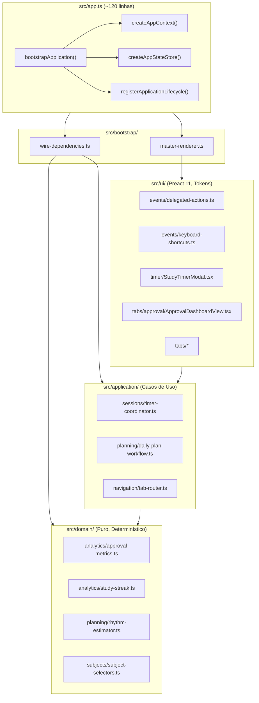

# Plano Diretor de Modularização do `src/app.ts`

## 1. Contexto e Motivação

Conforme estabelecido em `AGENTS.md`:
> **Modularização Obrigatória (Zero Novas Funções no `app.ts`):** É terminantemente proibido adicionar novas funções ou concentrar regras de negócio em `src/app.ts`. O projeto deve ser totalmente modularizado: regras e cálculos puros pertencem a `src/domain/`, orquestrações e casos de uso a `src/application/`, componentes e interfaces reativas a `src/ui/`, e persistência a `src/storage/` ou `src/repositories/`. O arquivo `src/app.ts` atua unicamente como raiz de composição (*composition root*) e conexão de ciclo de vida, devendo ser progressivamente reduzido e desmembrado, nunca inflado.

No estado inicial deste plano, o `src/app.ts` possui **10.921 linhas** e **473 funções de nível superior sem exports**, funcionando simultaneamente como Composition Root, motor de cálculo matemático, gerador de templates HTML, roteador de abas, máquina de estados do cronômetro e despachante de eventos do DOM.

---

## 2. Diagnóstico Estrutural

### 2.1 Distribuição de Linhas por Domínio / Responsabilidade
1. **Renderizadores e Views de UI (HTML/DOM):** ~5.380 linhas
2. **Lógica de Domínio e Algoritmos Vazados:** ~1.850 linhas
3. **Timer e Sessão de Estudo:** ~763 linhas
4. **Eventos Delegados, Atalhos e Master Render:** ~871 linhas
5. **Wire-up, Bootstrap e Inicialização:** ~1.164 linhas
6. **Helpers, Seletores e Modais Imperativos:** ~893 linhas

### 2.2 Principais Anti-Patterns Diagnosticados
- **God Object / Script Monolítico:** Agrega todas as camadas da aplicação em um único arquivo de execução imediata.
- **Vazamento de Lógica de Domínio:** Cálculos matemáticos puros (como cálculo de prontidão de simulados, pontuações de aprovação, streaks e ritmos) implementados diretamente no arquivo de entrada, sem isolamento de testes unitários rápidos.
- **Renderização via Template Strings (`innerHTML`):** Desacordo com a diretriz de interface declarativa em Preact 11 (`.tsx`) e Tailwind CSS v4 tokens (`styles/tokens.css`).
- **Acoplamento a Estado Global Mutável:** Mutações imperativas diretas em `state.` espalhadas por centenas de funções locais em vez de fluxo unidirecional via repositórios/serviços.

---

## 3. Arquitetura Alvo

O arquivo `src/app.ts` deve ser reduzido a um arquivo conciso de **~100 a 150 linhas**, contendo apenas:
1. Importação dos containers e orquestradores de ciclo de vida.
2. Composição de dependências via `createAppContext`.
3. Conexão do ciclo de vida com `registerApplicationLifecycle` e `bootstrapApplication`.
4. Disparo do carregamento e montagem inicial.

---

## 4. Roteiro de Execução em 5 Fases

### Fase 1: Extração do Domínio Puro (Sem Risco de Regressão Visual) — CONCLUÍDA ✅
- **Objetivo:** Isolar algoritmos matemáticos determinísticos em `src/domain/`, sem qualquer dependência de DOM ou storage, acompanhados por testes unitários no Node (`npm run test:fast`).
- **Módulos Entregues:**
  1. `src/domain/analytics/approval-metrics.ts`: métricas de aprovação, fatores de prontidão e scores ponderados de simulados/edital. (12 funções migradas, 11 testes unitários em `tests/unit/approval-metrics.test.js`).
  2. `src/domain/analytics/study-streak.ts`: sumarização diária de horas estudadas, datas ativas e cálculo de sequência ininterrupta (*streak*). (3 testes unitários em `tests/unit/study-streak.test.js`).
  3. `src/domain/planning/rhythm-estimator.ts`: cálculo de ritmo diário, velocidade de cobertura e revisão em atraso. (6 testes unitários em `tests/unit/rhythm-estimator.test.js`).
  4. `src/domain/analytics/subject-error-metrics.ts`: taxa de erro e inatividade por disciplina. (3 testes unitários em `tests/unit/subject-error-metrics.test.js`).
- **Status:** 100% concluída e validada no Fast Gate.

### Fase 2: Extração de Eventos Globais, Atalhos e Diálogos — CONCLUÍDA ✅
- **Objetivo:** Desacoplar a infraestrutura periférica de interface, diálogos de notificação e atalhos de teclado.
- **Módulos Entregues:**
  1. `src/ui/primitives/modal-dialogs.ts`: serviço unificado de diálogos (`showToast`, `flashSaved`, `showConfirm`, `showPrompt`). (3 testes unitários em `tests/unit/modal-dialogs.test.js`).
  2. `src/ui/events/keyboard-shortcuts.ts`: controlador de atalhos globais, confinamento de foco e tecla Escape para foco do cronômetro e menus de ação (`.action-menu`). (3 testes unitários em `tests/unit/keyboard-shortcuts.test.js`).
  3. `src/ui/events/delegated-actions.ts`: utilitário `composeDelegatedActionHandlers` para registro seguro de ações delegadas sem poluição de protótipo. (3 testes unitários em `tests/unit/delegated-actions.test.js`).
- **Status:** 100% concluída e validada no Fast Gate (1038 testes passando, tempo 34.92s).

### Fase 3: Desacoplamento do Cronômetro de Estudos (Timer) — CONCLUÍDA ✅
- **Objetivo:** Isolar o subsistema do timer de estudo e registro de sessões.
- **Módulos Entregues:**
  1. `src/application/sessions/timer-coordinator.ts`: orquestração do timer, cálculo de durações, liberação e início de atividades planejadas, registro de sessões e resolução de bookmarks. (6 testes unitários em `tests/unit/timer-coordinator.test.js`).
  2. `src/core/format-duration.ts`: formatação padronizada de duração em segundos (`formatDuration`) e minutos de plano (`formatPlanMinutes`). (2 testes unitários em `tests/unit/format-duration.test.js`).
  3. `src/ui/controllers/session-modal-controller.ts`: isolamento de manipulação do modal de sessão, bindings de eventos, leitura e sanitização de formulário e ponto de parada. (4 testes unitários em `tests/unit/session-modal-controller.test.js`).
  4. `src/ui/controllers/study-timer-view-controller.ts`: gerenciamento visual do display, target progressivo, contexto em foco, estratégia guiada e seletores. (3 testes unitários em `tests/unit/study-timer-view-controller.test.js`).
- **Redução Obtida:** `src/app.ts` reduzido de 10.921 para 10.180 linhas (-741 linhas).
- **Status:** 100% concluída e validada no Fast Gate (1031 testes passando, tempo 33.38s).

### Fase 4: Migração das Telas Pesadas, Matrizes e Editores para seus Respectivos Módulos de UI — CONCLUÍDA ✅
- **Objetivo:** Substituir a renderização procedural e gerenciamento de matrizes/editores por componentes e controladores dedicados sob `src/ui/tabs/`.
- **Módulos Entregues e Integrados:**
  1. `src/ui/tabs/approval/approval-tab-controller.ts`: isolamento de `renderApprovalDashboard()`, `renderTopicRetentionDashboard()`, `renderRecommendationCalibration()`, `renderRecommendationHistorySummary()`. (1 teste unitário em `tests/unit/approval-tab-controller.test.js`).
  2. `src/domain/analytics/topic-performance.ts` e `src/ui/tabs/questions/question-analytics-controller.ts`: desacoplamento de agregações analíticas de tópicos/disciplinas (`calculateTopicPerformance`, `calculateSubjectWeeklyTrend`, `classifyAccuracy`, etc.) e renderização de performance em `renderQuestionAnalytics()`. (8 testes unitários em `tests/unit/topic-performance.test.js` e 1 em `tests/unit/question-analytics-controller.test.js`).
  3. `src/ui/tabs/diagnostics/diagnostics-tab-controller.ts`: central de diagnósticos e alertas desacoplada (`renderAlertasInteligentes()`, `dismissIntelligentAlert()`, `renderExecutiveSummary()`, `renderDiagnosisCenter()`). (1 teste unitário em `tests/unit/diagnostics-tab-controller.test.js`).
  4. `src/ui/tabs/goals/goals-tab-controller.ts`: expansão do controlador para gerenciar metas gerais (`renderMetas()`), metas por disciplina (`renderMetasPorDisciplina()`), histórico retroativo (`renderHistoricoMetas()`) e comparativo de períodos (`renderSelectedPeriodComparison()`). (Testes unitários atualizados em `tests/unit/goals-components.test.js`).
  5. `src/ui/tabs/subjects/topic-analytics-view.ts`: modularização de `renderTopicAnalyticsState()`. (1 teste unitário em `tests/unit/topic-analytics-view.test.js`).
  6. `src/ui/tabs/goals/exam-matrix-controller.ts`: modularização completa da Matriz Histórica do Concurso (`renderHistoricalExamMatrix`), Matriz de Domínio (`renderExamMasteryMatrix`), Seção de Inteligência (`renderExamIntelligenceSection`), Configuração de Blueprint (`renderExamBlueprintConfig`, `saveExamSubjectConfig`, `cancelExamSubjectConfig`, `toggleActiveExamTag`) e modal de Revisão de Classificação de Questões (`updateExamClassificationReview`, `closeExamClassificationReview`). (4 testes unitários em `tests/unit/exam-matrix-controller.test.js`).
  7. `src/ui/tabs/goals/subject-target-editor-controller.ts`: isolamento do editor de metas de acerto por disciplina (`renderSubjectTargetEditor`, `saveSubjectAccuracyTargets`, bindings de seleção e lote). (4 testes unitários em `tests/unit/subject-target-editor-controller.test.js`).
  8. `src/ui/tabs/subjects/topic-strategy-editor-view.ts`: visualização do editor de estratégia e pré-requisitos do tópico (`renderTopicStrategyEditor`). (1 teste unitário em `tests/unit/topic-strategy-editor-view.test.js`).
- **Redução Obtida:** `src/app.ts` reduzido de 10.921 para 9.254 linhas (-1.667 linhas líquidas acumuladas).
- **Status:** 100% concluída e validada no Fast Gate (1070 testes passando, tempo 34.96s).

### Fase 5: Refatoração do Bootstrap e Purificação do `app.ts` — CONCLUÍDA ✅
- **Objetivo:** Isolar a composição de dependências e loop de renderização da aplicação.
- **Módulos Entregues e Integrados:**
  1. `src/bootstrap/wire-dependencies.ts`: orquestração unificada de instanciação de providers de armazenamento (real e demo), repositórios e serviços de domínio/aplicação (`reviewService`, `studyPlanService`, `dailyPlanService`, `replanService`, `sessionService`, `guidedStudyService`, `goalsService`, `subjectService`, `topicStrategyController`, `topicHistoryService`). (4 testes unitários em `tests/unit/wire-dependencies.test.js`).
  2. `src/bootstrap/master-renderer.ts`: orquestração encapsulada do loop de renderização da aplicação (`render`, `renderScope`, `persistAndRender`, `renderAll`), rastreamento de profundidade recursiva de renderização (`renderDepth`), ganchos de ciclo de vida para invalidação de cache de candidatos (`renderCandidates`) e captura segura de erros com relatório para `errorBoundary`. (6 testes unitários em `tests/unit/master-renderer.test.js`).
  3. `src/app.ts`: purificação de mais de 130 linhas de fiação imperativa inline e renderização, com redução para 9.688 linhas (-1.233 linhas líquidas acumuladas).
- **Status:** 100% concluída e validada no Fast Gate (1061 testes passando, tempo 34.34s, dual timezone UTC/SP e Playwright smoke passing).

### Fase 6: Gestão de Conteúdo (Disciplinas, Editais, Questões e Simulados) — CONCLUÍDA ✅
- **Objetivo:** Modularizar a gestão de disciplinas, tópicos, editais, questões e simulados.
- **Módulos Entregues e Integrados:**
  1. `src/ui/tabs/subjects/subjects-tab-controller.ts`: controller unificado da aba de disciplinas (`renderVerticalizedSyllabus`, `renderSubjects`, limites, notas, filtros de edital, reordenação, duplicação, toggle mobile, renomeação, adição, arquivamento/restauração, deleção permanente protegida por dependências em sessões/questões/calendário/metas, status de tópicos e refresh de estatísticas). (4 testes unitários em `tests/unit/subjects-tab-controller.test.js`).
  2. `src/features/exam-import/exam-import-modal-controller.ts`: orquestração encapsulada do modal de importação de editais (`openExamImport`, `closeExamImport`, `renderExamImport`, `applyPresetBlueprintDefaults`, `syncExamSubjectCheckboxes`). (2 testes unitários em `tests/unit/exam-import-modal-controller.test.js`).
  3. `src/ui/tabs/questions/questions-tab-controller.ts`: controller unificado da tabela de questões (`renderQuestoes`, `addQuestaoRow`, `editQuestion`, `updateQuestionDraft`, `saveQuestionEdit`, `deleteQuestaoRow`, `updateQuestionError`, normalização e trava de quebra de erros por categoria, `calcAcertoPct`). (3 testes unitários em `tests/unit/questions-tab-controller.test.js`).
  4. `src/ui/tabs/questions/simulations-tab-controller.ts`: controller unificado da tabela de simulados (`renderSimulados`, `addSimuladoRow`, `editSimulation`, `updateSimulationDraft`, `saveSimulationEdit`, `deleteSimuladoRow`, `toggleBreakdown`, breakdowns por disciplina com trava de acertos, `simuladoEffectiveCounts`, `simuladoNota`). (3 testes unitários em `tests/unit/simulations-tab-controller.test.js`).
- **Redução Obtida:** `src/app.ts` reduzido de 9.254 para 8.651 linhas (-603 linhas).
- **Status:** 100% concluída e validada no Fast Gate (1103 testes passando, tempo 33.38s, dual timezone UTC/SP).

### Fase 7: Desacoplamento do Fluxo Temporal (Calendário, Agenda de Revisões e Foco do Cronômetro) — CONCLUÍDA ✅
- **Objetivo:** Desacoplar a gestão temporal de estudos: grade mensal, eventos unificados, revisões atrasadas agrupadas, agenda adaptativa SM-2 e controles de foco do cronômetro com sincronização de bookmarks.
- **Módulos Entregues e Integrados:**
  1. `src/ui/tabs/calendar/calendar-tab-controller.ts`: controller completo da aba de Calendário (`getRevisoesUnificadas`, `renderCalendar`, `renderMonthCalendar`, `renderCalIndicadores`, `renderCalendarFilters`, `setCalendarMobileView`, CRUD completo de itens do calendário, gestão de atrasadas agrupadas `renderCalAtrasadas`, paginação, expansão de datas `toggleOverdueDate`, `renderCalTarefasHoje` e `completeUnifiedReview`). (3 testes unitários em `tests/unit/calendar-tab-controller.test.js`).
  2. `src/ui/tabs/reviews/reviews-tab-controller.ts`: controller completo da aba de Agenda de Revisões (`getFilteredAndSortedReviews`, `getGroupedReviews`, `renderAgenda`, `renderAgendaFilters`, `addAgendaRow`, `editAgenda`, `cancelAgendaEdit`, `updateAgendaDraft`, `saveAgendaEdit`, `deleteAgendaRow`, `adaptiveReviewSuggestion`, `resetAdaptiveReviewDate`, `gerarAgendaAutomatica`, avaliação adaptativa SM-2 `completeAgendaReview`, `rateCompletedReview`, `closeReviewRating` e binds de eventos). (3 testes unitários em `tests/unit/reviews-tab-controller.test.js`).
  3. `src/ui/controllers/timer-ui-controller.ts`: controlador de interface para o modo foco do cronômetro (`focusStudyTimer`, `openStudyTimerFocus`, `toggleTimerFocus` com restauração da aba de origem), confinamento e atalhos de teclado (Esc para sair do foco), e sincronização do ponto de parada (`saveSessionBookmark`, `topicResumeLabel`). (2 testes unitários em `tests/unit/timer-ui-controller.test.js`).
- **Redução Obtida:** `src/app.ts` reduzido de 8.651 para 8.079 linhas (-572 linhas líquidas eliminadas; -2.842 linhas acumuladas desde o início do plano).
- **Status:** 100% concluída e validada no Fast Gate (1111 testes passando, tempo 50.1s, dual timezone UTC/SP, Playwright smoke passing).

### Fase 8: Desacoplamento do Hub de Execução Diária & Onboarding — CONCLUÍDA ✅
- **Objetivo:** Desacoplar o núcleo de execução diária (histórico de sessões de estudo com filtros e edição, wizard de onboarding 2.0 com presets de rotina e nivelamento de matérias, motor de recomendações e replanejamento com cálculo de baseline, e a aba "Hoje" com materialização do plano e métricas de execução diária).
- **Módulos Entregues e Integrados:**
  1. `src/ui/tabs/today/session-history-controller.ts`: controller completo para histórico de sessões (`renderHistoricoSessoes`, `renderSessionHistoryFilters`, agrupamento por data, paginação/limite, edição de sessão `editStudySession`, `saveStudySessionEdit`, `cancelStudySessionEdit` e exclusão com diálogo confirmatório). (3 testes unitários em `tests/unit/session-history-controller.test.js`).
  2. `src/features/onboarding/onboarding-modal-controller.ts`: controller unificado do wizard de onboarding 2.0 (`openOnboardingModal`, `closeOnboardingModal`, `renderOnboardingStep`, `renderStep1Concurso`, `renderStep2Rotina`, `renderStep3Nivelamento`, `renderStep4Plano`, atalhos de data da prova, presets de rotina semanal, nivelamento em massa por disciplina e geração inicial de plano). (3 testes unitários em `tests/unit/onboarding-modal-controller.test.js`).
  3. `src/ui/tabs/today/study-recommendation-controller.ts`: controller desacoplado de recomendações e replanejamento (`renderStudyRecommendations`, `renderReplanPreview`, `renderReplanResultSummary`, `applyRecommendedAdjustment`, `dismissRecommendation`, `confirmReplan`, `clearReplanPreview`, medição de baseline e impacto no plano semanal). (3 testes unitários em `tests/unit/study-recommendation-controller.test.js`).
  4. `src/ui/tabs/today/today-tab-controller.ts`: controller completo da aba Hoje (`renderPlanoHoje`, `renderExecutionSummary`, `renderDailyGoalStats`, `renderFirstStepsChecklist`, `renderPlannedActionList`, `renderPlannedCard`, `renderTopicProgressPill`, binds de execução e completude). (4 testes unitários em `tests/unit/today-tab-controller.test.js`).
- **Redução Obtida:** `src/app.ts` reduzido de 8.079 para **6.736 linhas** (-1.343 linhas líquidas eliminadas na Fase 8; -4.185 linhas acumuladas desde o início do plano).
- **Status:** 100% concluída e validada no Fast Gate (1124 testes passando, tempo 35.14s, dual timezone UTC/SP, Playwright smoke passing, bundles reproduzíveis).

### Fase 9: Desacoplamento Analítico, Planejamento & Fechamento Semanal — CONCLUÍDA ✅
- **Objetivo:** Desacoplar a inteligência analítica do Dashboard (KPIs, contagem regressiva, progresso do edital, heatmap de constância), o construtor de plano semanal e diário de 7 dias com conselhos adaptativos e estratégias de fases, o fechamento semanal com ciclo de decisão, sustentabilidade e snapshots imutáveis, e a página completa de desempenho com radar e gráfico de progresso histórico de 180 dias.
- **Módulos Entregues e Integrados:**
  1. `src/ui/tabs/dashboard/dashboard-tab-controller.ts`: controller expandido com `renderKPIs`, `renderExamProgress`, `renderExamCountdown`, `navigateKpi`, `renderHeatmap`, `setHeatmapFilter`, `selectHeatmapDay`, `viewSelectedHeatmapSessions`, `heatmapTooltip`, `toggleStreakExpanded`, `toggleStreakActiveDays` e `getStreakView`. (7 testes unitários em `tests/unit/dashboard-components.test.js`).
  2. `src/ui/tabs/goals/study-plan-builder-controller.ts`: controller completo do construtor de plano de estudo (`studyPlanCandidates`, `buildCurrentStudyPlanProposal`, `calculateStudyPlanPreview`, `confirmStudyPlan`, `clearStudyPlanPreview`), conselhos adaptativos (`useAdaptivePlanAdvice`, `rejectAdaptivePlanAdvice`, `revertAdaptivePlanningDecision`), distribuição diária em 7 dias (`calculateDailyPlanPreview`, `confirmDailyPlanPreview`, `undoLatestDailyPlanGeneration`) e estratégias de fases da prova (`phaseStrategyController`). (3 testes unitários em `tests/unit/study-plan-builder-controller.test.js`).
  3. `src/features/weekly-close/weekly-close-modal-controller.ts`: controller completo para fechamento semanal, sustentabilidade (`sustainabilityController`, `weeklyCloseController`), `renderStudyTrack32Insights`, `renderWeeklyCloseActions`, `previewWeeklyCloseActions`, `toggleWeeklyPriority`, `confirmWeeklyCloseActions`, `saveWeeklyCloseSnapshot`, filtros/grupos de timeline estratégica e `openWeeklyClose`. (3 testes unitários em `tests/unit/weekly-close-modal-controller.test.js`).
  4. `src/ui/tabs/performance/performance-tab-controller.ts`: controller unificado da aba de desempenho com gráfico de evolução de progresso de 180 dias (`recordProgressSnapshot`, `renderProgressChart`), radar de disciplinas (`renderRadarDisciplinas`, `setRadarSubject`), página completa de desempenho `renderPerformance` (visão geral, matérias, simulados e inteligência de exame) e registro encapsulado via `registerController()`. (3 testes unitários em `tests/unit/performance-tab-controller.test.js`).
- **Redução Obtida:** `src/app.ts` reduzido de 6.736 para **5.966 linhas** (-770 linhas líquidas eliminadas na Fase 9; -4.955 linhas acumuladas desde o início do plano).
- **Status:** 100% concluída e validada no Fast Gate (1136 testes passando, tempo 36.78s, dual timezone UTC/SP, Playwright smoke passing, bundles 100% reproduzíveis).

---

## 5. Governança e Validação Contínua

Cada passo de cada fase deve atender estritamente aos critérios:
1. **Tipagem estática:** `npm run check:types` sem novos erros.
2. **Fast Gate:** `npm run test:fast` executado com tempo < 120s e 100% de aprovação.
3. **Integridade de Build:** `npm run check:bundle` para assegurar reprodutibilidade de `src/app.bundle.js` e outros bundles.
4. **Registro em Tiers:** Novos testes unitários devem ser registrados em `tests/config/test-tiers.json` e validados via `node scripts/check-test-tiers.mjs`.
