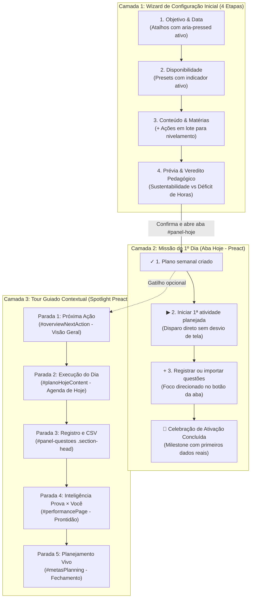

# Plano Detalhado de Implementação: Primeiro Uso Guiado (Onboarding 2.0, Ativação & Tour Interativo)

Este documento especifica a arquitetura, os contratos de código, os componentes **Preact (`.tsx`)**, os tipos **TypeScript (`.ts`)**, os seletores DOM, a pedagogia analítica e a estratégia de testes para evoluir o fluxo de **Primeiro Uso Guiado** do **StudyTrack**, cobrindo desde o primeiro acesso sem dados até a ativação diária e o tour guiado pelas áreas estratégicas.

---

## 1. Diagnóstico e Objetivos de Evolução

### O que já foi entregue (Baseline Consolidada — Commits `b2a45c8`, `b0080dc`, `4fb98ae`)

- **Camada 1 (Wizard Inicial):** Pílulas de data pré-edital de 90, 180 e 365 dias ([`EXAM_DATE_SHORTCUTS`](file:///c:/Users/vitor/Documents/Extrato/src/application/onboarding/build-onboarding-view-model.ts#L10-L14)) e 3 presets de rotina semanal ([`AVAILABILITY_PRESETS`](file:///c:/Users/vitor/Documents/Extrato/src/application/onboarding/build-onboarding-view-model.ts#L23-L42)).
- **Camada 2 (Missão do 1º Dia):** View-model puro [`buildFirstStepsMission`](file:///c:/Users/vitor/Documents/Extrato/src/application/onboarding/build-first-steps-mission.ts), componente Preact [`FirstStepsMission.tsx`](file:///c:/Users/vitor/Documents/Extrato/src/ui/components/FirstStepsMission.tsx), isolamento de persistência no modo Demo e barra de restauração (`canRestore`).
- **Camada 3 (Tour Guiado com Spotlight):** Máquina de estados pura [`guided-tour-steps.ts`](file:///c:/Users/vitor/Documents/Extrato/src/domain/onboarding/guided-tour-steps.ts), popover Preact com máscara SVG de recorte translúcido (`#tour-spotlight-mask`), posicionamento resiliente contra a barra móvel inferior e gatilhos em `#demoBanner` e `#panel-instrucoes`.
- **Proteção Automatizada:** 100% verde no FAST gate (882 testes Node em UTC e São Paulo + 19 testes E2E em [`tests/e2e/onboarding.spec.js`](file:///c:/Users/vitor/Documents/Extrato/tests/e2e/onboarding.spec.js)).

### Lacunas e Oportunidades Identificadas para a Próxima Fase

1. **Falta de Feedback Ativo nos Atalhos:** Os botões de atalho de data e rotinas preenchem os inputs, mas não indicam visualmente qual predefinição está ativa (`aria-pressed="true"`).
2. **Nivelamento Repetitivo de Conteúdo (Etapa 3):** Editais com 12 a 16 disciplinas exigem mudar dropdowns um a um; falta um botão de nivelamento em lote (_"Definir todas como Base intermediária"_).
3. **Falta de Veredito Pedagógico de Viabilidade (Etapa 4):** A prévia expõe 4 números brutos (Capacidade, Tópicos, Carga e Semanas), mas não calcula se o plano cabe na rotina informada (ritmo sustentável vs déficit de horas).
4. **Desvio de Rota no CTA de Início da 1ª Atividade:** Na aba Hoje, clicar em _"Iniciar 1ª atividade"_ redireciona para a Visão Geral em tela cheia com cronômetro vazio, em vez de disparar a primeira matéria real do plano de hoje no próprio painel.
5. **Alinhamento Semântico das Paradas do Tour:** A Parada 2 (Hoje) aponta para `#studyRecommendation` (sugestão opcional fora do plano) em vez do card oficial de execução (`#planoHojeContent`), e a Parada 4 (Desempenho) foca no container genérico `#panel-desempenho` em vez do hub analítico.

---

## 2. Arquitetura Refinada em 3 Camadas



---

## 3. Especificação Técnica das Melhorias

### 3.1. Camada 1: Wizard Inicial de Alta Eficiência

#### A. Feedback de Estado Ativo nos Atalhos (Etapas `goal` e `availability`)

- Em [`build-onboarding-view-model.ts`](file:///c:/Users/vitor/Documents/Extrato/src/application/onboarding/build-onboarding-view-model.ts), computar:
  - `activeDateShortcut`: offset em dias caso a data atual coincida exatamente com `today + offset`.
  - `activeAvailabilityPreset`: ID do preset cuja distribuição horária coincida com `hoursByDay`.
- Em [`onboarding-renderer.ts`](file:///c:/Users/vitor/Documents/Extrato/src/features/onboarding/onboarding-renderer.ts):
  - Renderizar `aria-pressed="true"` e classe CSS `.is-active` no botão do preset ativo.

#### B. Ações em Lote para Nível de Disciplinas (Etapa `content`)

- Quando `model.subjects.length > 0`, renderizar barra de atalhos rápidos:
  ```html
  <div class="guided-bulk-levels" role="group" aria-label="Nivelamento rápido">
    <span>Aplicar a todas:</span>
    <button type="button" class="btn ghost small" data-guided-bulk-level="Médio">
      Intermediária (Recomendado)
    </button>
    <button type="button" class="btn ghost small" data-guided-bulk-level="Difícil">
      Começar da base
    </button>
    <button type="button" class="btn ghost small" data-guided-bulk-level="Fácil">
      Tenho boa base
    </button>
  </div>
  ```
- Handler em `app.ts` aplica o valor para todas as disciplinas ativas em uma única mutação reativa.

#### C. Diagnóstico Pedagógico de Viabilidade (Etapa `plan`)

- Exportar função pura `calculatePlanFeasibility`:
  ```ts
  export interface PlanFeasibilityResult {
    status: 'comfortable' | 'balanced' | 'tight' | 'deficit';
    totalAvailableHours: number;
    totalNeededHours: number;
    coverageRatio: number; // available / needed
    badgeText: string;
    verdictMessage: string;
  }
  ```
- Regras de negócio:
  - `coverageRatio >= 1.25`: _"Ritmo sustentável com margem folgada para revisões e imprevistos."_ (Badge: Excelente)
  - `1.0 <= coverageRatio < 1.25`: _"Ritmo equilibrado. A carga cobre o edital até a data prevista."_ (Badge: Equilibrado)
  - `0.75 <= coverageRatio < 1.0`: _"Ritmo apertado. Recomenda-se reservar ~X horas a mais para não acumular revisões."_ (Badge: Atenção)
  - `coverageRatio < 0.75`: _"Déficit de prazo. Com a disponibilidade atual, cerca de X% do edital será coberto. O StudyTrack priorizará as matérias de maior peso."_ (Badge: Priorização Crítica)

---

### 3.2. Camada 2: Ativação Fluida na Aba Hoje

#### A. Disparo Direto da 1ª Atividade Planejada

- Na ação `start-first-session`:
  - Em vez de redirecionar para o timer da Visão Geral, buscar o primeiro item com status `pending` em `state.dailyPlans` de hoje.
  - Se existir, invocar `startPlannedActivity(firstItem.id)` mantendo o usuário na aba Hoje com a atividade em execução.
  - Se não houver itens no plano de hoje, focar no botão de adicionar atividade manual ou abrir o seletor contextual.

#### B. Foco Orientado na Aba de Questões

- Na ação `open-questions`:
  - Chamar `activateTab('questoes')`.
  - Rolar suavemente e atribuir foco ao botão `+ Registrar sessão` (`#addQuestaoRowBtn`) ou abrir o menu de importação CSV caso o estudante prefira importar lotes.

#### C. Celebração de Conclusão da Missão

- Quando `allComplete` se tornar verdadeiro pela primeira vez (`hasPlan && hasSession && hasQuestions`):
  - Armazenar flag de celebração `studytrack_first_steps_celebrated` para evitar repetições.
  - Disparar toast comemorativo: _“🎉 Parabéns! Você concluiu seus primeiros passos práticos. Agora seus diagnósticos estratégicos têm dados reais.”_

---

### 3.3. Camada 3: Tour Guiado Interativo Refinado

#### A. Seletores Semânticos Precisos

| Ordem | ID                  | Aba Alvo     | Seletor Alvo Anterior           | **Novo Seletor Semântico**                                     | Justificativa                                                                                                                                                   |
| :---: | ------------------- | ------------ | ------------------------------- | -------------------------------------------------------------- | --------------------------------------------------------------------------------------------------------------------------------------------------------------- |
| **1** | `overview-action`   | `dashboard`  | `#overviewNextAction`           | `#overviewNextAction`                                          | Inalterado; ponto focal cristalino da tela inicial.                                                                                                             |
| **2** | `today-execution`   | `hoje`       | `#studyRecommendation`          | **`.plano-hoje-card`**                                         | O texto fala do cronômetro dividindo o estudo em etapas e creditando no plano; deve apontar para o card oficial do plano de hoje, não para sugestões opcionais. |
| **3** | `questions-hub`     | `questoes`   | `#panel-questoes .section-head` | `#panel-questoes .section-head`                                | Inalterado; cabeçalho com ações de registro e CSV.                                                                                                              |
| **4** | `exam-intelligence` | `desempenho` | `#panel-desempenho`             | **`#performancePage .performance-hero, #examIntelligenceHub`** | Apontar para o componente analítico de Prontidão e peso da prova, evitando que o recorte englobe a tela inteira.                                                |
| **5** | `weekly-planning`   | `metas`      | `#metasPlanning`                | `#metasPlanning`                                               | Inalterado; seção de distribuição de carga e fechamento semanal.                                                                                                |

#### B. Acessibilidade e Transições do Spotlight

1. **Focus Trap:** Conter a navegação por teclado (`Tab` / `Shift+Tab`) estritamente entre os botões do popover (`#guidedTourPopover`).
2. **Transição Suave de Máscara SVG:** Adicionar transição CSS nos atributos do retângulo de recorte SVG para suavizar o movimento quando a parada muda.
3. **Persistência de Conclusão do Tour:** Armazenar `studytrack_tour_completed="1"` em `localStorage` para não insistir no tour após a primeira conclusão voluntária.

---

## 4. Matriz de Priorização das Tarefas

```mermaid
quadrantChart
    title Priorização de Melhorias do Primeiro Uso
    x-axis Baixo Esforço --> Alto Esforço
    y-axis Baixo Impacto --> Alto Impacto
    quadrant-1 Prioridade Alta (Fase 2)
    quadrant-2 Vitórias Imediatas P0 (Fase 1)
    quadrant-3 Melhorias Futuras P2 (Fase 3)
    quadrant-4 Avaliar Custo-Benefício
    "Alinhar seletores das Paradas 2 e 4": [0.15, 0.88]
    "Corrigir CTA 'Iniciar 1ª atividade' na Hoje": [0.20, 0.95]
    "Feedback ativo em atalhos e presets": [0.18, 0.70]
    "Veredito de Viabilidade na Prévia (Etapa 4)": [0.35, 0.92]
    "Nivelamento em massa de disciplinas": [0.28, 0.78]
    "Transição suave no recorte do Spotlight": [0.42, 0.65]
    "Toast de celebração ao bater 100% da missão": [0.22, 0.60]
    "Focus Trap acessível no Tour": [0.38, 0.55]
    "Opção de concurso livre no Wizard": [0.65, 0.72]
```

---

## 5. Fases de Execução

### Fase 1: Vitórias Rápidas de Alto Impacto (P0)

1. **Corrigir o CTA _"Iniciar 1ª atividade"_** em [`src/app.ts`](file:///c:/Users/vitor/Documents/Extrato/src/app.ts#L8560) para acionar `startPlannedActivity` do primeiro item de hoje sem desviar para a Visão Geral.
2. **Atualizar os seletores do Tour** em [`guided-tour-steps.ts`](file:///c:/Users/vitor/Documents/Extrato/src/domain/onboarding/guided-tour-steps.ts):
   - Parada 2: `.plano-hoje-card`
   - Parada 4: `#performancePage` / `.exam-intelligence-hub`
3. **Feedback visual ativo** nos botões de atalho de data e rotinas em [`onboarding-renderer.ts`](file:///c:/Users/vitor/Documents/Extrato/src/features/onboarding/onboarding-renderer.ts).

### Fase 2: Valor Pedagógico e Redução de Atrito (P1)

1. **Implementar `calculatePlanFeasibility`** em [`build-onboarding-view-model.ts`](file:///c:/Users/vitor/Documents/Extrato/src/application/onboarding/build-onboarding-view-model.ts) e renderizar o veredito pedagógico na Etapa 4 da prévia.
2. **Adicionar nivelamento em lote** de disciplinas na Etapa 3 do assistente.
3. **Foco orientado em Questões** ao clicar em _"Registrar questões"_.

### Fase 3: Polimento e Acessibilidade (P2)

1. **Focus Trap** no popover flutuante do tour em [`GuidedTourPopover.tsx`](file:///c:/Users/vitor/Documents/Extrato/src/ui/components/GuidedTourPopover.tsx).
2. **Celebração de conclusão** com toast motivacional ao atingir 3 de 3 na Missão do 1º Dia.
3. **Transição animada** das coordenadas da máscara SVG do Spotlight.

---

## 6. Critérios de Aceite (Definition of Done)

### Baseline Entregue

- [x] O estudante consegue configurar data da prova (pré-edital) e disponibilidade semanal da rotina com **apenas 2 cliques** no Wizard Inicial.
- [x] Após confirmar o primeiro plano, a aba **Hoje** exibe o checklist de ativação prática até que a 1ª sessão e a 1ª bateria de questões sejam registradas (ou o guia seja dispensado).
- [x] O **Tour Guiado Interativo** percorre as 5 áreas principais sem gerar overflow horizontal em 320px/375px/1440px, sem violações de contraste no Axe (`wcag2a`, `wcag2aa`) e fecha com `Escape` restaurando o foco.
- [x] `npm run check:types`, `npx playwright test tests/e2e/onboarding.spec.js` e `npm run test:fast` passam sem regressões.

### Próxima Fase de Evolução (Entregue)

- [x] Ao clicar em _"Iniciar 1ª atividade"_, a primeira matéria planejada de hoje entra em execução imediatamente no painel Hoje, sem redirecionamento confuso para o timer da Visão Geral.
- [x] A Parada 2 do Tour foca no card de execução diária (`.plano-hoje-card`) e a Parada 4 no hub de inteligência analítica (`#performancePage`).
- [x] A Etapa 4 da Prévia exibe o parecer analítico de viabilidade (sustentável, equilibrado ou déficit com recomendação de ajuste).
- [x] A Etapa 3 permite nivelar todas as disciplinas importadas com um único clique.
- [x] Atalhos de data e presets de rotina exibem estado ativo (`aria-pressed="true"` e feedback visual).
- [x] Todos os testes unitários (`FAST gate < 120s`) e E2E permanecem 100% verdes.
