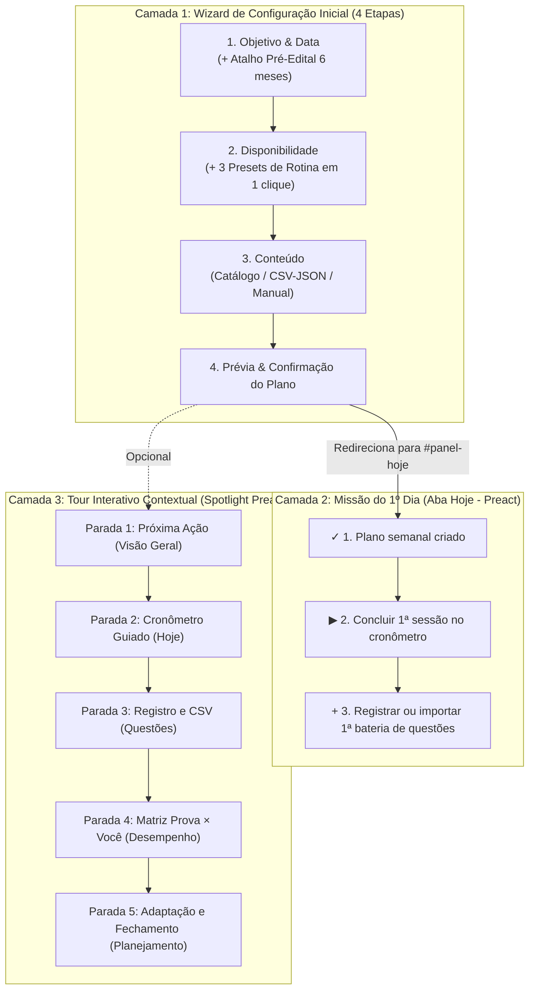

# Plano Detalhado de Implementação: Primeiro Uso Guiado (Onboarding 2.0 & Tour Interativo)

Este documento especifica a arquitetura, os contratos de código, os componentes **Preact (`.tsx`)**, os tipos **TypeScript (`.ts`)**, os seletores DOM e a estratégia de testes para evoluir o fluxo de **Primeiro Uso Guiado** do **StudyTrack**, cobrindo desde o primeiro acesso sem dados até a conclusão da primeira sessão real e o tour interativo pelas áreas analíticas.

---

## 1. Diagnóstico Atual e Objetivos

### O que já existe no projeto (Baseline Modernizada)
* **View-Model:** [`src/application/onboarding/build-onboarding-view-model.ts`](file:///c:/Users/vitor/Documents/Extrato/src/application/onboarding/build-onboarding-view-model.ts)
* **Renderer / Componente:** [`src/features/onboarding/onboarding-renderer.ts`](file:///c:/Users/vitor/Documents/Extrato/src/features/onboarding/onboarding-renderer.ts)
* **Design System & Primitivas:** `src/ui/primitives/*.tsx` (`Button`, `Card`, `Badge`, `ProgressBar`, `Dialog`) estilizados com **Tailwind CSS v4** e tokens de `styles/tokens.css`.
* **Suíte E2E de Proteção:** [`tests/e2e/onboarding.spec.js`](file:///c:/Users/vitor/Documents/Extrato/tests/e2e/onboarding.spec.js) e baselines visuais em `tests/e2e/onboarding.spec.js-snapshots/`.

### Lacunas que este plano resolve
1. **Atrito de digitação no Wizard Inicial:** Hoje o estudante precisa digitar manualmente uma data futura na Etapa 1 (mesmo quando está em pré-edital sem data marcada) e preencher 7 inputs numéricos individuais na Etapa 2 (`Dom` a `Sáb`).
2. **Abandono pós-criação do plano ("Queda do Penhasco"):** Assim que o usuário confirma o primeiro plano (`studyPlans.length > 0`), o card `#guidedOnboarding` desaparece (`visible: false`) e o usuário fica sem guia prático para realizar sua **1ª sessão no cronômetro** e sua **1ª bateria de questões**.
3. **Falta de Tour Guiado Contextual (App Real e Modo Demo):** Conforme listado no item 74 de [docs/recomendacoes-futuras.md](file:///c:/Users/vitor/Documents/Extrato/docs/recomendacoes-futuras.md#L138-L139), falta um tour rápido de 5 passos com destaque visual (*Spotlight*) que apresente na prática o ciclo `Visão Geral → Hoje → Questões → Inteligência da Prova → Fechamento Semanal`.

---

## 2. Arquitetura em 3 Camadas



### Restrição Inegociável de Compatibilidade
Para preservar 100% dos testes e snapshots visuais existentes em [`tests/e2e/onboarding.spec.js`](file:///c:/Users/vitor/Documents/Extrato/tests/e2e/onboarding.spec.js):
* A ordem dos elementos na `#panel-dashboard` deve permanecer estritamente: `#overviewNextAction` → `#guidedOnboarding` → `#kpiGrid` → `#quickStats`.
* O card `#guidedOnboarding` na Visão Geral não deve sofrer mutação estrutural no estado inicial e deve continuar ficando `hidden` após a criação do plano (`hasPlan || hasHistory`).
* A **Camada 2 (Missão do 1º Dia)** será renderizada como componente Preact na aba **Hoje** (`#panel-hoje`), exatamente para onde o estudante é levado após clicar em *"Confirmar e criar meu plano"*.

---

## 3. Especificação Técnica por Camada (TypeScript + Preact)

### 3.1. Camada 1: Atalhos de 1 Clique no Wizard Inicial

#### A. Arquivos Impactados
* [`src/application/onboarding/build-onboarding-view-model.ts`](file:///c:/Users/vitor/Documents/Extrato/src/application/onboarding/build-onboarding-view-model.ts)
* [`src/features/onboarding/onboarding-renderer.ts`](file:///c:/Users/vitor/Documents/Extrato/src/features/onboarding/onboarding-renderer.ts)
* [`src/app.ts`](file:///c:/Users/vitor/Documents/Extrato/src/app.ts) (handlers delegados em `src/ui/delegated-actions.ts`)

#### B. Contratos e Regras de Negócio
1. **Atalhos de Data na Etapa `goal`:**
   - Exibir pílulas rápidas abaixo do campo `#guidedExamDate`:
     - `data-guided-date-offset="90"` → *"Daqui a 3 meses (Reta curta)"*
     - `data-guided-date-offset="180"` → *"Daqui a 6 meses (Pré-edital)"*
     - `data-guided-date-offset="365"` → *"Daqui a 1 ano (Base longa)"*
   - Ao clicar, calcula a data local a partir de `model.today` usando utilitário puro de [`src/core/date-utils.ts`](file:///c:/Users/vitor/Documents/Extrato/src/core/date-utils.ts), preenche `#guidedExamDate` e dispara o evento `change` para liberar imediatamente o botão `Continuar →`.

2. **Presets de Disponibilidade na Etapa `availability`:**
   - Exportar constante pura `AVAILABILITY_PRESETS` em [`build-onboarding-view-model.ts`](file:///c:/Users/vitor/Documents/Extrato/src/application/onboarding/build-onboarding-view-model.ts):
     ```ts
     export interface AvailabilityPreset {
       id: string;
       label: string;
       hoursByDay: Record<string, number>;
     }

     export const AVAILABILITY_PRESETS: readonly AvailabilityPreset[] = Object.freeze([
       {
         id: 'work_study',
         label: 'Trabalho + Estudo (14h/sem)',
         hoursByDay: { '0': 0, '1': 2, '2': 2, '3': 2, '4': 2, '5': 2, '6': 4 }
       },
       {
         id: 'intensive',
         label: 'Dedicação Intensa (28h/sem)',
         hoursByDay: { '0': 0, '1': 4.5, '2': 4.5, '3': 4.5, '4': 4.5, '5': 5, '6': 5 }
       },
       {
         id: 'light_habit',
         label: 'Ritmo Leve (10h30/sem)',
         hoursByDay: { '0': 1.5, '1': 1.5, '2': 1.5, '3': 1.5, '4': 1.5, '5': 1.5, '6': 1.5 }
       }
     ]);
     ```
   - Ao clicar em um botão `[data-guided-availability-preset="<id>"]`, atualiza todos os inputs `[data-guided-day="0..6"]` e recalcula o total semanal imediatamente.

---

### 3.2. Camada 2: Checklist "Primeiros Passos na Prática" (Pós-Plano)

#### A. Arquivos a Criar
* **View-Model Puro:** `src/application/onboarding/build-first-steps-mission.ts`
* **Componente Preact:** `src/ui/components/FirstStepsMission.tsx`
* **Integração de Estado:** Chave `studytrack_first_steps_dismissed` em `localStorage` (ou flag transitória em modo Demo).

#### B. Regra de Exibição Pura (`buildFirstStepsMission.ts`)
```ts
export interface MissionItem {
  id: 'plan' | 'session' | 'questions';
  label: string;
  done: boolean;
  ctaLabel: string;
  ctaAction: string;
}

export interface FirstStepsMissionModel {
  visible: boolean;
  completedCount: number;
  totalCount: number;
  progressPercent: number;
  missions: MissionItem[];
  activeMission: MissionItem | null;
}

export function buildFirstStepsMission({
  hasPlan = false,
  sessionsCount = 0,
  questionsCount = 0,
  dismissed = false
}: {
  hasPlan?: boolean;
  sessionsCount?: number;
  questionsCount?: number;
  dismissed?: boolean;
} = {}): FirstStepsMissionModel {
  const hasSession = sessionsCount > 0;
  const hasQuestions = questionsCount > 0;
  const allComplete = hasPlan && hasSession && hasQuestions;

  const missions: MissionItem[] = [
    {
      id: 'plan',
      label: 'Criar seu primeiro plano semanal',
      done: hasPlan,
      ctaLabel: 'Configurar plano',
      ctaAction: 'open-onboarding'
    },
    {
      id: 'session',
      label: 'Registrar a 1ª sessão de estudo no cronômetro',
      done: hasSession,
      ctaLabel: 'Iniciar 1ª atividade',
      ctaAction: 'start-first-session'
    },
    {
      id: 'questions',
      label: 'Registrar ou importar sua 1ª bateria de questões',
      done: hasQuestions,
      ctaLabel: 'Registrar questões',
      ctaAction: 'open-questions'
    }
  ];

  const completedCount = missions.filter(m => m.done).length;
  const activeMission = missions.find(m => !m.done) || null;

  return Object.freeze({
    visible: hasPlan && !allComplete && !dismissed,
    completedCount,
    totalCount: missions.length,
    progressPercent: Math.round((completedCount / missions.length) * 100),
    missions,
    activeMission
  });
}
```

#### C. Componente Preact (`FirstStepsMission.tsx`)
* Renderizado diretamente em `src/ui/today/TodayTab.tsx` ou montado por `today-controller.ts` dentro de `#firstStepsMissionSlot`.
* Utiliza componentes de `src/ui/primitives/*.tsx`: `Card`, `Button`, `ProgressBar`, `Badge`.
* Suporta botões de ação: `"Dispensar guia"` (`[data-first-steps-dismiss]`) e `"🧭 Fazer tour rápido"` (`[data-guided-tour-start]`).

---

### 3.3. Camada 3: Tour Guiado Interativo com Spotlight

#### A. Arquivos a Criar
* **Definição das Etapas e Estado Puro:** `src/domain/onboarding/guided-tour-steps.ts`
* **Controlador DOM e Teclado:** `src/ui/controllers/guided-tour-controller.ts`
* **Componente Preact do Popover:** `src/ui/components/GuidedTourPopover.tsx`

#### B. As 5 Paradas do Tour (`GUIDED_TOUR_STEPS`)

| Ordem | ID | Aba Alvo (`tab`) | Seletor Alvo (`selector`) | Título | Mensagem Pedagógica |
|:---:|---|---|---|---|---|
| **1** | `overview-action` | `dashboard` | `#overviewNextAction` | **Sua única prioridade de agora** | O StudyTrack cruza peso do edital, lacunas e revisões para destacar uma única próxima ação. Sem paralisia por excesso de escolha. |
| **2** | `today-execution` | `hoje` | `#studyRecommendation` | **Execução guiada e cronômetro** | Ao iniciar uma atividade, o cronômetro divide a sessão em etapas (Teoria, Questões e Fechamento) e credita os minutos no plano do dia. |
| **3** | `questions-hub` | `questoes` | `#panel-questoes .section-head` | **Questões e Importador CSV** | Registre baterias manualmente ou importe relatórios CSV do QConcursos/Tec Concursos classificando o motivo cognitivo dos erros. |
| **4** | `exam-intelligence` | `desempenho` | `#panel-desempenho` | **Inteligência da Prova × Você** | Veja sua evolução de Prontidão, compare períodos e descubra onde você ganha mais pontos por hora investida. |
| **5** | `weekly-planning` | `metas` | `#metasPlanning` | **Planejamento vivo e Fechamento** | Redistribua atrasos sem estourar sua capacidade diária e feche a semana para congelar seu histórico estratégico. |

#### C. Mecânica Visual e Acessibilidade do Spotlight
1. **Troca Automática de Aba:**
   - Ao avançar para a parada `i`, o controlador chama `activateTab(step.tab)` antes de localizar `document.querySelector(step.selector)`.
2. **Posicionamento Resiliente (`positionPopover`):**
   - Faz `target.scrollIntoView({ block: 'center', behavior: 'instant' })`.
   - Lê `target.getBoundingClientRect()` e calcula se o popover cabe abaixo ou acima do elemento, garantindo que `x >= 12` e `x + width <= window.innerWidth - 12` (sem overflow em telas de 320px/375px).
3. **Navegação Completa por Teclado:**
   - `ArrowRight` / `Enter` no botão primário: próxima parada.
   - `ArrowLeft`: parada anterior.
   - `Escape`: encerra o tour imediatamente, remove a classe `.is-tour-highlighted` e devolve o foco ao botão que iniciou o tour.
4. **Gatilhos de Entrada:**
   - Botão `"🧭 Tour guiado"` na barra do Modo Demonstração (`#demoModeBanner`) e na aba `Instruções` (`#panel-instrucoes`).

---

## 4. Ordem de Execução das Tarefas

### Etapa 1: Domínio e View-Models Puros (TypeScript + Node)
1. Atualizar [`src/application/onboarding/build-onboarding-view-model.ts`](file:///c:/Users/vitor/Documents/Extrato/src/application/onboarding/build-onboarding-view-model.ts) exportando `AVAILABILITY_PRESETS` e `EXAM_DATE_SHORTCUTS`, mais helper puro `applyOnboardingDateShortcut(todayStr, offsetDays)`.
2. Criar `src/application/onboarding/build-first-steps-mission.ts`.
3. Criar `src/domain/onboarding/guided-tour-steps.ts` com a máquina de estados pura (`createGuidedTourState`, `nextTourStep`, `prevTourStep`).
4. Criar testes unitários em `tests/unit/guided-first-run.test.js` validando todas as funções puras em `UTC` e `America/Sao_Paulo`.

### Etapa 2: Componentes Preact, Controller e Estilos Tailwind
1. Atualizar [`src/features/onboarding/onboarding-renderer.ts`](file:///c:/Users/vitor/Documents/Extrato/src/features/onboarding/onboarding-renderer.ts) para renderizar os botões de atalho de data (Etapa 1) e presets de rotina (Etapa 2) sem quebrar a estrutura nem o contraste WCAG AA testado em [`tests/e2e/onboarding.spec.js`](file:///c:/Users/vitor/Documents/Extrato/tests/e2e/onboarding.spec.js).
2. Criar `src/ui/components/FirstStepsMission.tsx` e `src/ui/components/GuidedTourPopover.tsx`.
3. Criar `src/ui/controllers/guided-tour-controller.ts` e conectar os eventos em `src/ui/delegated-actions.ts` / `src/app.ts`.
4. Processar classes do Tailwind via `npm run build` garantindo fidelidade pixel a pixel.

### Etapa 3: Testes E2E e Gates de Qualidade
1. Executar `npm run check:types` para garantir 0 erros de tipagem estática.
2. Executar `npx playwright test tests/e2e/onboarding.spec.js` garantindo que todos os casos e snapshots existentes continuam verdes.
3. Adicionar caso E2E testando:
   - Os atalhos de 1 clique no Wizard Inicial;
   - A exibição da "Missão do 1º Dia" na aba Hoje após criar o plano;
   - A navegação pelas 5 paradas do Tour Guiado Interativo e encerramento com `Escape`.
4. Atualizar inventário (`node scripts/audit-test-suite.mjs`), regerar bundle (`npm run build`) e rodar `npm run test:fast`.

---

## 5. Critérios de Aceite (Definition of Done)

* [ ] O estudante consegue configurar data da prova (pré-edital) e disponibilidade semanal da rotina com **apenas 2 cliques** no Wizard Inicial.
* [ ] Após confirmar o primeiro plano, a aba **Hoje** exibe o checklist de ativação prática até que a 1ª sessão e a 1ª bateria de questões sejam registradas (ou o guia seja dispensado).
* [ ] O **Tour Guiado Interativo** percorre as 5 áreas principais sem gerar overflow horizontal em 320px/375px/1440px, sem violações de contraste no Axe (`wcag2a`, `wcag2aa`) e fecha com `Escape` restaurando o foco.
* [ ] `npm run check:types`, `npx playwright test tests/e2e/onboarding.spec.js` e `npm run test:fast` passam sem regressões.
