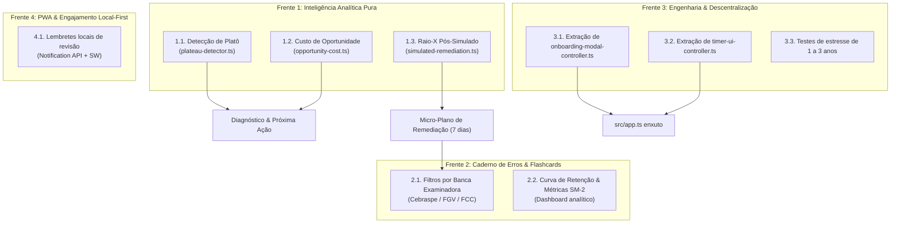
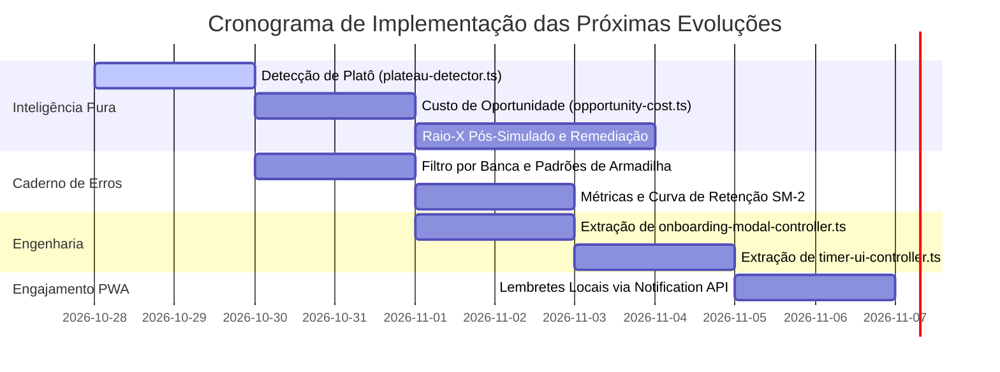

# Plano de Próximas Evoluções: Inteligência Analítica, Experiência e Engenharia

Este plano detalha as especificações técnicas, os contratos de domínio, as interfaces **Preact 11 (`.tsx`)**, os tipos **TypeScript (`strict: true`)** e a estratégia de testes para as próximas frentes de evolução do **StudyTrack**, consolidando o avanço pós-Fase 4 e preparando o terreno para a maturidade analítica e arquitetural da aplicação.

---

## 1. Contexto e Objetivos

Com as 4 Fases Master do plano de evolução, o fechamento de melhorias pós-Fase 4, a Central de Ajuda 2.0 (com micro-simuladores didáticos e code-splitting), a Auditoria de UX/UI & Acessibilidade e a conclusão integral das 10 Fases do Plano Diretor de Modularização do `app.ts` (reduzido de 10.921 para **146 linhas**, -98,7%) consolidados em [Planos Concluídos](PLANOS-CONCLUIDOS.md), o StudyTrack possui sua base metodológica, algoritmos de repetição espaçada (SM-2 adaptado), acessibilidade essencial WCAG AA, documentação interativa e estabilidade de testes (1.154 unitários em ~43s) plenamente homologados.

O objetivo deste plano é **transformar dados brutos em decisões de alto retorno pedagógico**, enriquecer o ecossistema do Caderno de Erros, validar performance de longo prazo (1 a 3 anos de histórico) e habilitar engajamento *local-first* sem servidores externos.

---

## 2. Visão Geral das Frentes de Trabalho



---

## 3. Especificação Técnica por Frente

### Frente 1: Inteligência Analítica e Pedagógica (Motores Puros em `src/domain/`)

#### 1.1. Detecção de Platô de Desempenho (`src/domain/analytics/plateau-detector.ts`)
- **Problema:** O estudante resolve grande volume de questões em um tópico ou disciplina (ex.: 200+ questões), mas sua precisão permanece estagnada em faixa intermediária (ex.: 65% a 70%) há mais de 3 ou 4 semanas. Insistir no mesmo formato mecânico causa desgaste sem ganho marginal de pontos.
- **Contrato de Tipos:**
  ```ts
  export interface PlateauDetectionInput {
    topicId: string;
    subjectId: string;
    windowDays?: number; // Padrão: 28 dias
    minQuestions?: number; // Mínimo de evidência: 60 questões
    rollingWindows?: Array<{ date: string; accuracy: number; count: number }>;
  }

  export interface PlateauDiagnosticResult {
    hasPlateau: boolean;
    confidence: 'low' | 'medium' | 'high';
    averageAccuracy: number;
    variance: number;
    questionCount: number;
    weeksStagnant: number;
    prescribedAction: {
      strategy: 'active_recall' | 'statute_deep_dive' | 'prerequisite_review';
      headline: string;
      rationale: string;
    };
  }
  ```
- **Regra de Negócio:**
  - Amostra mínima: $\ge 60$ questões nos últimos 28 dias divididas em pelo menos 3 semanas.
  - Variação da precisão entre as janelas $< 3,5$ pontos percentuais e precisão média $< 75\%$.
  - Prescrição: Se erro for predominantemente literalidade, prescrever leitura de lei seca; se for confusão conceitual, sugerir resolução via Caderno de Erros; se faltar base, sugerir revisão do tópico pré-requisito.

#### 1.2. Custo de Oportunidade do Estudo (`src/domain/analytics/opportunity-cost.ts`)
- **Problema:** O estudante investe tempo excessivo em matérias de baixo peso que já domina razoavelmente, enquanto matérias com peso alto e grande potencial de ganho de pontos são negligenciadas.
- **Contrato de Tipos:**
  ```ts
  export interface OpportunityMetric {
    subjectId: string;
    subjectName: string;
    examWeightPercent: number;
    currentMastery: number; // 0 a 100
    potentialScoreGain: number; // Pontos líquidos recuperáveis
    estimatedEffortHours: number; // Horas estimadas para fechar lacuna
    pointsPerHourRatio: number; // PPH = potentialScoreGain / estimatedEffortHours
    tier: 'top_priority' | 'secondary' | 'marginal';
  }
  ```
- **Fórmula de Eficiência:**
  $$\text{PPH} = \frac{\text{Peso no Edital} \times \max(0, 85 - \text{Domínio Atual})}{\max(1, \text{Carga Restante em Horas})}$$
- **Apresentação:** Integrada ao topo do Centro de Diagnóstico, destacando para onde cada hora adicional estudada gera o maior retorno na nota final.

#### 1.3. Raio-X Pós-Simulado e Plano de Remediação (`src/domain/diagnostics/simulated-remediation.ts`)
- **Problema:** Ao registrar um simulado, o concurseiro visualiza apenas a nota global e percentual por matéria, sem um plano de ação imediato para fechar as vulnerabilidades reveladas.
- **Solução:**
  - Diagnóstico comparando a nota obtida com o ponto de corte do edital (quando cadastrado) e com a média histórica.
  - Modal Preact `SimulatedRemediationModal.tsx`:
    1. Lista dos 3 tópicos com maior número absoluto de pontos perdidos.
    2. Botão *"Criar 7 dias de Remediação"*: gera plano diário de 1 semana realocando 60% da carga para os tópicos de maior sangria.
    3. Botão *"Gerar rascunhos para o Caderno de Erros"*: pré-popula automaticamente cartões para cada questão errada identificada no simulado.

---

### Frente 2: Evolução do Caderno de Erros e Flashcards

#### 2.1. Filtros por Banca Examinadora e Padrão de Armadilha
- **Evolução em `ErrorFlashcard`:**
  - Adicionar campos opcionais: `banca?: 'Cebraspe' | 'FGV' | 'FCC' | 'Vunesp' | string` e `trapType?: 'literalidade' | 'inversao_conceito' | 'excecao_doutrinaria' | 'jurisprudencia'`.
- **Evolução na UI (`ErrorNotebookView.tsx`):**
  - Barra de chips rápidos: `[Todas as Bancas]` `[Cebraspe]` `[FGV]` `[FCC]`.
  - Permite ao estudante revisar especificamente o perfil de pegadinhas da organizadora do seu concurso ativo.

#### 2.2. Métricas de Retenção do Algoritmo SM-2
- **Dashboard de Fixação:**
  - Métrica de Cartões Dominados: quantidade e percentual de cards com `status === 'mastered'`.
  - Métrica de Estabilidade: média de `easeFactor` do deck (identificando matérias com cartões mais difíceis, $\text{EF} < 1.8$).
  - Gráfico de "Curva de Esquecimento Revertida": taxa de acerto na primeira revisão vs após 3 ciclos de repetição espaçada.

---

### Frente 3: Engenharia, Modularização de `app.ts` (Concluída ✅) e Testes de Estresse

Seguindo a diretriz inegociável de **Zero Novas Funções no `src/app.ts`** estabelecida no [AGENTS.md](../AGENTS.md), o desacoplamento do arquivo raiz foi **100% concluído** (reduzido de 10.921 para **146 linhas** ao longo das 10 Fases documentadas em [PLANO-MODULARIZACAO-APP.md](PLANO-MODULARIZACAO-APP.md)):

#### 3.1. Extração de `src/features/onboarding/onboarding-modal-controller.ts` — CONCLUÍDA ✅
- **Responsabilidade:** Isolou o ciclo de vida do assistente inicial (abertura, avanço de etapas, atalhos de data, presets de disponibilidade, nivelamento em lote e criação do plano).

#### 3.2. Extração de `src/ui/controllers/timer-ui-controller.ts` e `src/ui/tabs/today/study-timer-runtime.ts` — CONCLUÍDA ✅
- **Responsabilidade:** Centralizou os seletores DOM, botões (iniciar, pausar, zerar, finalizar, modo foco), restauração pós-reload, integração PiP, formatação do display e anúncios `aria-live`.

#### 3.3. Testes de Estresse com Históricos Longos (1 a 3 anos) — PRÓXIMO PASSO
- Criação de gerador de carga sintética em `tests/fixtures/long-history-generator.js` (5.000+ sessões, 15.000+ questões).
- Medição objetiva de:
  - Tempo de inicialização (`DOMContentLoaded` até o primeiro render).
  - Tempo de resposta da busca global (`Ctrl+K`).
  - Renderização da Linha do Tempo Estratégica.
- **Aceite:** Se o render ultrapassar 100ms em hardware modesto, introduzir virtualização de lista via Preact.

---

### Frente 4: Engajamento Local-First e PWA (Notification API)

- **Arquitetura 100% Client-Side:** Sem servidores, sem telemetria e sem custos de infraestrutura.
- **Funcionamento:**
  - O estudante habilita a opção *"Lembretes locais diários"* na aba de preferências.
  - O Service Worker ou temporizador nativo do navegador programa uma notificação local às 08:00 (ou horário de preferência):
    - *"Você tem X flashcards e Y tópicos para revisar hoje no StudyTrack."*
  - Ao clicar, ativa a aba Hoje ou o deck do Caderno de Erros.

---

## 4. Matriz de Priorização e Cronograma Sugerido



---

## 5. Estratégia de Testes e Governança (`AGENTS.md`)

Para cada funcionalidade implementada:
1. **Regra de Domínio Pura:** Testes unitários em Node.js (`tests/unit/*.test.js`) rodando em UTC e `America/Sao_Paulo`. Orçamento Fast Gate: manter soma total $< 120s$.
2. **Integração de UI:** Componentes declarativos Preact 11 (`.tsx`) com renderização em nós dedicados, sem interpolar `innerHTML`.
3. **Jornada do Usuário:** 1 teste Playwright E2E focado por funcionalidade central, validando a interação do estudante.
4. **Governança:** Registrar todos os novos arquivos em `tests/config/test-tiers.json` e auditar via `node scripts/audit-test-suite.mjs`.
