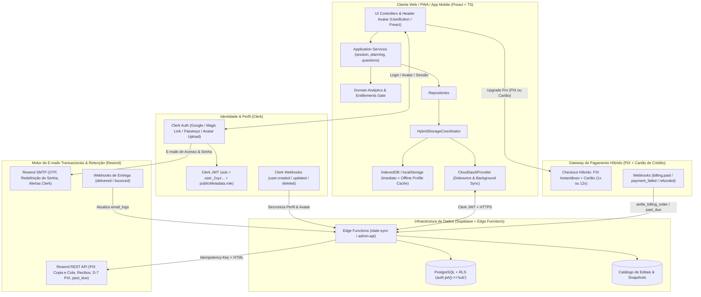

# Plano Detalhado de Transformação em SaaS — Extrato de Estudos

Este documento estabelece o roteiro técnico, arquitetural e de negócios para transformar o **Extrato de Estudos** de uma aplicação local-only em um **SaaS (Software as a Service) Local-First** altamente escalável, preservando seus diferenciais de velocidade, funcionamento offline e zero dependências pesadas no cliente.

---

## 1. Arquitetura Alvo: "Local-First SaaS"

Diferente de um SaaS tradicional (onde toda interação depende de round-trips HTTP e processamento em servidor), o Extrato de Estudos adotará o padrão **Local-First SaaS**:

1. **Processamento 100% no Cliente (Custo Marginal R$ 0 de CPU):**
   - Todos os motores analíticos ([`priority-score.ts`](file:///c:/Users/vitor/Documents/Extrato/src/domain/analytics/priority-score.ts), [`readiness-score.ts`](file:///c:/Users/vitor/Documents/Extrato/src/domain/analytics/readiness-score.ts), [`cognitive-profile.ts`](file:///c:/Users/vitor/Documents/Extrato/src/domain/diagnostics/cognitive-profile.ts), [`performance-forecast.ts`](file:///c:/Users/vitor/Documents/Extrato/src/domain/forecasts/performance-forecast.ts)) continuam rodando no navegador do usuário compilados em TypeScript.
2. **Persistência Primária Instantânea (`IndexedDB`):**
   - A interface sempre lê e grava primeiro no [`indexed-db-provider.ts`](file:///c:/Users/vitor/Documents/Extrato/src/storage/indexed-db-provider.ts) e [`local-storage-provider.ts`](file:///c:/Users/vitor/Documents/Extrato/src/storage/local-storage-provider.ts). O usuário nunca vê telas de _loading_ ao registrar uma sessão ou questão.
3. **Nuvem Assíncrona para Assinantes (`CloudSaaSProvider`):**
   - O backend atua como **camada de identidade, faturamento, sincronização multi-dispositivo, backup contínuo e distribuição de catálogos de editais**.



---

## 2. Estrutura do Banco de Dados e Segurança (PostgreSQL + RLS + Clerk Third-Party Auth)

Como o estado do Extrato de Estudos já é validado e migrado por [`src/state/schema.ts`](file:///c:/Users/vitor/Documents/Extrato/src/state/schema.ts) e [`src/storage/migration-service.ts`](file:///c:/Users/vitor/Documents/Extrato/src/storage/migration-service.ts), o esquema relacional no PostgreSQL (Supabase) utiliza a integração nativa de **Third-Party Auth com o Clerk**, onde o identificador canônico do usuário (`user_2NNEq...`) vem assinado na claim `sub` do JWT (`auth.jwt()->>'sub'`):

### 2.1. Tabelas Principais

```sql
-- 1. Perfis Sincronizados com o Clerk, Avatar, Papel Administrativo e Assinatura (PIX + Cartão)
CREATE TABLE public.profiles (
  id TEXT PRIMARY KEY, -- Clerk User ID (ex: 'user_2NNEqL2nrIRdJ194ndJqAHwEfxC'), extraído de (auth.jwt()->>'sub')
  email TEXT NOT NULL,
  display_name TEXT,
  avatar_url TEXT, -- URL da foto/logo do usuário gerenciada pelo Clerk (imageUrl)
  role TEXT NOT NULL DEFAULT 'user' CHECK (role IN ('user', 'admin')),
  plan_tier TEXT NOT NULL DEFAULT 'free' CHECK (plan_tier IN ('free', 'pro', 'mentor')),
  subscription_status TEXT NOT NULL DEFAULT 'inactive' CHECK (subscription_status IN ('inactive', 'trialing', 'active', 'past_due', 'canceled')),
  subscription_period_end TIMESTAMPTZ,
  payment_method TEXT CHECK (payment_method IN ('pix', 'card')),
  auto_renew BOOLEAN NOT NULL DEFAULT false,
  cancel_at_period_end BOOLEAN NOT NULL DEFAULT false,
  card_brand TEXT, -- ex: 'visa', 'mastercard', 'elo'
  card_last4 TEXT, -- últimos 4 dígitos para exibição segura na conta e no Admin
  abacatepay_customer_id TEXT,
  external_subscription_id TEXT, -- ID da assinatura recorrente no gateway de cartão
  terms_accepted_version TEXT, -- versão aceita dos Termos e Política (ex: '2026-11-v1')
  terms_accepted_at TIMESTAMPTZ, -- registro de aceite contratual (Marco Civil + CDC)
  privacy_accepted_at TIMESTAMPTZ, -- registro de ciência/consentimento (Art. 8º da LGPD)
  created_at TIMESTAMPTZ NOT NULL DEFAULT now(),
  updated_at TIMESTAMPTZ NOT NULL DEFAULT now()
);

-- 2. Estado Sincronizado do Estudante (Documento Canônico Validado até 5 MB)
CREATE TABLE public.user_study_states (
  user_id TEXT PRIMARY KEY REFERENCES public.profiles(id) ON DELETE CASCADE,
  schema_version INTEGER NOT NULL,
  state_json JSONB NOT NULL,
  checksum_sha256 TEXT NOT NULL,
  device_id TEXT,
  client_updated_at TIMESTAMPTZ NOT NULL,
  server_updated_at TIMESTAMPTZ NOT NULL DEFAULT now()
);

-- 3. Histórico de Snapshots na Nuvem (Proteção Anti-Corrupção / Rollback)
CREATE TABLE public.user_state_snapshots (
  id UUID PRIMARY KEY DEFAULT gen_random_uuid(),
  user_id TEXT NOT NULL REFERENCES public.profiles(id) ON DELETE CASCADE,
  schema_version INTEGER NOT NULL,
  state_json JSONB NOT NULL,
  checksum_sha256 TEXT NOT NULL,
  reason TEXT NOT NULL DEFAULT 'auto_weekly' CHECK (reason IN ('auto_weekly', 'pre_import', 'manual')),
  created_at TIMESTAMPTZ NOT NULL DEFAULT now()
);

-- 4. Registro Auditável de Pedidos e Cobranças (PIX & Cartão de Crédito)
CREATE TABLE public.billing_orders (
  id UUID PRIMARY KEY DEFAULT gen_random_uuid(),
  user_id TEXT NOT NULL REFERENCES public.profiles(id) ON DELETE CASCADE,
  provider_billing_id TEXT UNIQUE NOT NULL,
  plan_id TEXT NOT NULL CHECK (plan_id IN ('pro_monthly', 'pro_annual', 'mentor_monthly')),
  payment_method TEXT NOT NULL DEFAULT 'pix' CHECK (payment_method IN ('pix', 'card')),
  installments INTEGER NOT NULL DEFAULT 1 CHECK (installments BETWEEN 1 AND 12),
  amount_cents INTEGER NOT NULL CHECK (amount_cents > 0),
  fee_cents INTEGER NOT NULL DEFAULT 0 CHECK (fee_cents >= 0),
  net_amount_cents INTEGER GENERATED ALWAYS AS (amount_cents - fee_cents) STORED,
  status TEXT NOT NULL DEFAULT 'PENDING' CHECK (status IN ('PENDING', 'PAID', 'FAILED', 'EXPIRED', 'CANCELED', 'REFUNDED', 'CHARGEBACK')),
  failure_reason TEXT, -- código/motivo de recusa do cartão (ex: 'insufficient_funds', 'expired_card')
  checkout_url TEXT,
  paid_at TIMESTAMPTZ,
  created_at TIMESTAMPTZ NOT NULL DEFAULT now()
);

-- 5. Catálogo Oficial de Editais Verticalizados (Atualizável sem Deploy)
CREATE TABLE public.exam_catalog_templates (
  id UUID PRIMARY KEY DEFAULT gen_random_uuid(),
  slug TEXT UNIQUE NOT NULL,
  title TEXT NOT NULL,
  organizer_banca TEXT NOT NULL,
  exam_year INTEGER NOT NULL,
  category TEXT NOT NULL, -- 'bancario' | 'fiscal' | 'tribunais' | 'policial' | 'enem'
  is_premium BOOLEAN NOT NULL DEFAULT true,
  version INTEGER NOT NULL DEFAULT 1,
  blueprint_json JSONB NOT NULL,
  published_at TIMESTAMPTZ NOT NULL DEFAULT now()
);

-- 6. Vínculo Mentor <-> Aluno (Para o Tier B2B Mentoria)
CREATE TABLE public.mentor_students (
  id UUID PRIMARY KEY DEFAULT gen_random_uuid(),
  mentor_id TEXT NOT NULL REFERENCES public.profiles(id) ON DELETE CASCADE,
  student_id TEXT NOT NULL REFERENCES public.profiles(id) ON DELETE CASCADE,
  status TEXT NOT NULL DEFAULT 'pending' CHECK (status IN ('pending', 'active', 'revoked')),
  created_at TIMESTAMPTZ NOT NULL DEFAULT now(),
  UNIQUE(mentor_id, student_id)
);

-- 7. Trilha Imutável de Auditoria Administrativa (Backoffice SaaS)
CREATE TABLE public.admin_audit_logs (
  id UUID PRIMARY KEY DEFAULT gen_random_uuid(),
  admin_id TEXT NOT NULL REFERENCES public.profiles(id) ON DELETE RESTRICT,
  action TEXT NOT NULL, -- 'grant_subscription' | 'settle_order' | 'restore_snapshot' | 'publish_catalog' | 'revoke_access' | 'resend_email'
  target_user_id TEXT REFERENCES public.profiles(id) ON DELETE SET NULL,
  reason TEXT NOT NULL,
  metadata JSONB NOT NULL DEFAULT '{}'::jsonb,
  created_at TIMESTAMPTZ NOT NULL DEFAULT now()
);

-- 8. Histórico Auditável de E-mails Transacionais e de Retenção (Resend)
CREATE TABLE public.email_logs (
  id UUID PRIMARY KEY DEFAULT gen_random_uuid(),
  user_id TEXT REFERENCES public.profiles(id) ON DELETE SET NULL,
  recipient_email TEXT NOT NULL,
  template_key TEXT NOT NULL CHECK (
    template_key IN (
      'welcome_onboarding',
      'pix_pending_recovery',
      'pro_activated_receipt',
      'pix_expiring_7d',
      'pix_expiring_1d',
      'card_payment_failed_past_due',
      'subscription_canceled_or_refunded',
      'weekly_study_digest',
      'lgpd_account_deleted'
    )
  ),
  resend_email_id TEXT UNIQUE,
  idempotency_key TEXT UNIQUE NOT NULL,
  status TEXT NOT NULL DEFAULT 'sent' CHECK (status IN ('sent', 'delivered', 'opened', 'bounced', 'complained', 'failed')),
  error_message TEXT,
  metadata JSONB NOT NULL DEFAULT '{}'::jsonb,
  created_at TIMESTAMPTZ NOT NULL DEFAULT now(),
  updated_at TIMESTAMPTZ NOT NULL DEFAULT now()
);
```

### 2.2. Políticas de Segurança (RLS com Clerk JWT) e Funções Atômicas

- **Identidade via Clerk JWT (`public.current_user_id()`):** Função SQL auxiliar `SELECT (auth.jwt()->>'sub')` que identifica o titular autenticado no Clerk sem depender da tabela legada `auth.users`.
- **`user_study_states`:** `SELECT` permitido ao titular (`(auth.jwt()->>'sub') = user_id`, garantindo que o aluno possa baixar seus dados mesmo após o vencimento do período Pro); `INSERT` e `UPDATE` exigem `(auth.jwt()->>'sub') = user_id AND public.has_active_pro(auth.jwt()->>'sub')`.
- **Sincronização Clerk -> `public.profiles`:** Realizada via **Webhook Assinado do Clerk (Svix)** nos eventos `user.created`, `user.updated` (atualizando `email`, `display_name`, `avatar_url` e `role` a partir de `public_metadata.role`) e `user.deleted` (`ON DELETE CASCADE`), além de *auto-upsert* defensivo na Edge Function no primeiro acesso.
- **`profiles`, `billing_orders`, `user_state_snapshots`, `admin_audit_logs`, `email_logs`:** `REVOKE INSERT, UPDATE, DELETE FROM anon, authenticated`. O usuário lê apenas seus próprios registros (`SELECT`), enquanto mutações de plano, liquidação de pedidos (`public.settle_billing_order`), disparos do Resend e operações de suporte ocorrem exclusivamente via `service_role` ou RPCs `SECURITY DEFINER` auditadas.

---

## 3. Fases de Implementação Técnica no Código

A implementação é dividida em **10 Fases Incrementais**, garantindo que os testes existentes (`npm run test:fast`) continuem passando a cada etapa.

### Quadro Geral de Progresso da Transformação SaaS

| Fase | Título | Status | Módulos Principais | Testes Validados |
|---|---|---|---|---|
| **Fase 1** | Autenticação, Avatar do Usuário e Sessão com Clerk | **CONCLUÍDA** | `src/auth/saas-auth-service.ts`, `ClerkUserAvatarButton.tsx`, `account-merge.ts` | `clerk-saas-auth.test.js` |
| **Fase 2** | Controle de Planos e Feature Gates | **CONCLUÍDA** | `src/domain/billing/entitlements.ts`, `PaywallModal.tsx`, tolerância 3d | `entitlements.test.js` |
| **Fase 3** | Sincronização Automática Local-Nuvem | **CONCLUÍDA** | `src/storage/cloud-saas-provider.ts`, `CloudSyncBadge.tsx`, fila offline | `cloud-saas-provider.test.js` |
| **Fase 4** | Pagamentos Híbridos (PIX + Cartão) e Webhooks | **CONCLUÍDA** | `abacatepay-checkout`, `abacatepay-webhook`, `AuthAccountModal.tsx` | `abacatepay-webhook-logic.test.js` |
| **Fase 5** | Catálogo Dinâmico de Editais na Nuvem | **CONCLUÍDA** | `cloud-catalog-service.ts`, `CloudExamCatalogModal.tsx`, migração SQL | `cloud-catalog-service.test.js` |
| **Fase 6** | Módulo B2B para Mentorias (`Painel do Mentor`) | *Planejada* | `mentor-service.ts`, `MentorStudentsView.tsx`, link de vínculo | A implementar |
| **Fase 7** | GTM, Lojas e Estratégia de Distribuição | *Planejada* | Pacote TWA/Capacitor, SEO / Landing | A implementar |
| **Fase 8** | Painel de Administração e Backoffice SaaS | **CONCLUÍDA** | `admin-metrics.ts`, `admin-service.ts`, `AdminDashboardView.tsx`, audit logs | `admin-backoffice.test.js` |
| **Fase 9** | Termos de Uso, Privacidade & Conformidade Legal | **CONCLUÍDA** | `legal-documents.ts`, `LegalComplianceView.tsx`, Art. 49 CDC e Art. 18 LGPD | `legal-compliance.test.js` |
| **Fase 10** | E-mails Transacionais e Retenção (`Resend`) | *Planejada* | `email-templates.ts`, `resend-mailer.ts`, `email_logs` | A implementar |

---

### Fase 1: Camada de Autenticação, Avatar do Usuário e Sessão com Clerk (`src/auth/`) [CONCLUÍDA]

- **Objetivo:** Permitir que o estudante use o app anonimamente (modo Free Local) ou entre/crie conta via **Clerk** (Google, Apple, Magic Link, Passkeys), exibindo a **foto/logo do usuário (`UserButton` / Avatar) no cabeçalho** com gerenciamento completo de perfil e dispositivos, sem sacrificar o boot instantâneo offline.
- **Arquivos a Criar/Modificar:**
  1. [`src/auth/saas-auth-service.ts`](file:///c:/Users/vitor/Documents/Extrato/src/auth/saas-auth-service.ts):
     - Adaptador desacoplado para o **Clerk (`@clerk/clerk-js`)** carregado de forma assíncrona (*lazy-load* via `publishableKey`), mantendo fallback e **Cache Local de Perfil Offline-First** (`userId`, `email`, `displayName`, `avatarUrl`, `role` e `profile.planTier`) em `localStorage`.
     - Assim, quando o estudante abre o Extrato de Estudos sem internet (ex: no metrô ou modo avião), o cabeçalho renderiza sua foto/avatar e seu status Pro em `< 50ms` sem depender da rede; quando online, o Clerk renova silenciosamente o JWT (`getToken()`) para autenticar no Supabase e nas Edge Functions.
  2. `src/ui/components/ClerkUserAvatarButton.tsx` e [`src/ui/components/AuthAccountModal.tsx`](file:///c:/Users/vitor/Documents/Extrato/src/ui/components/AuthAccountModal.tsx):
     - **Botão de Avatar/Logo do Usuário no Header:** Exibe a imagem de perfil do aluno (`user.imageUrl` do Clerk, com upload/recorte de foto nativo no modal de perfil do Clerk ou fallback elegante com iniciais e badge `PRO` / `FREE` / `ADMIN`).
     - Menu rápido integrado dando acesso a: *Gerenciar Perfil e Foto (Clerk UserProfile)*, *Dispositivos e Sessões Conectadas*, *Minha Assinatura (PIX / Cartão)* e *Painel Admin* (visível apenas quando `role === 'admin'`).
  3. **Fusão de Conta no Primeiro Login (Onboarding Merge):**
     - Se o usuário já estudou por 10 dias no modo anônimo local e resolve entrar com o Clerk:
       - Caso a nuvem esteja vazia, o estado local é enviado imediatamente (`initial upload`).
       - Caso a nuvem já tenha dados de outro aparelho, exibe modal de resolução em Preact: _"Manter dados da nuvem"_, _"Substituir pelos dados deste dispositivo"_ ou _"Baixar backup antes de sincronizar"_.

---

### Fase 2: Controle de Planos e Feature Gates (`src/domain/billing/entitlements.ts`) [CONCLUÍDA]

- **Objetivo:** Centralizar em funções puras de domínio o que cada plano (`free`, `pro`, `mentor`) pode acessar, evitando `if (user.isPro)` espalhados pela UI.
- **Arquivos Criados:**
  1. [`src/domain/billing/entitlements.ts`](file:///c:/Users/vitor/Documents/Extrato/src/domain/billing/entitlements.ts):
     - Resolve os direitos de acesso (`resolveEntitlements`), janelas de tolerância (`past_due` em renovações de cartão) e partição de disciplinas no Onboarding (`partitionOnboardingSubjectsByEntitlement`).
  2. [`src/ui/components/PaywallModal.tsx`](file:///c:/Users/vitor/Documents/Extrato/src/ui/components/PaywallModal.tsx):
     - Modal declarativo em Preact utilizando as primitivas de `src/ui/primitives/*.tsx` (`Dialog`, `Button`, `Card`, `Badge`), exibido quando um usuário `free` clica em um recurso `PRO`, permitindo escolher entre **PIX Instantâneo** (com desconto no Anual) ou **Cartão de Crédito** (recorrência mensal ou Anual parcelado em até 12x), além de degustação no Modo Demo.

---

### Fase 3: Sincronização Automática Local-Nuvem (`src/storage/cloud-saas-provider.ts`) [CONCLUÍDA]

- **Objetivo:** Sincronizar o estado de forma transparente, resiliente a quedas de conexão e com controle de concorrência entre PC e celular.
- **Arquivos a Criar/Modificar:**
  1. [`src/storage/cloud-saas-provider.ts`](file:///c:/Users/vitor/Documents/Extrato/src/storage/cloud-saas-provider.ts):
     - Implementa a sincronização contínua acoplada ao [`real-storage-provider.ts`](file:///c:/Users/vitor/Documents/Extrato/src/storage/real-storage-provider.ts):
       - **Gravação (Push com Debounce + Fila Offline):**
         - Ao salvar no `IndexedDB`, agenda um push de 3 segundos.
         - Se estiver offline (`!navigator.onLine`), marca `pendingCloudSync = true` no `localStorage` e dispara assim que o evento `window.addEventListener('online')` ocorrer.
       - **Leitura e Reconciliação (Pull no Boot / `visibilitychange`):**
         - Quando o estudante abre o app ou volta para a aba (`document.visibilityState === 'visible'`), consulta `server_updated_at` e `checksum_sha256`.
         - Se o servidor tiver um estado mais novo e íntegro (validado por [`migration-service.ts`](file:///c:/Users/vitor/Documents/Extrato/src/storage/migration-service.ts)), atualiza o `IndexedDB` local, guarda a versão anterior no backup rotativo ([`backup-service.ts`](file:///c:/Users/vitor/Documents/Extrato/src/storage/backup-service.ts)) e re-renderiza a UI.
       - **Opção de Criptografia Ponta a Ponta (Zero-Knowledge):**
         - Reaproveita [`src/core/crypto-utils.ts`](file:///c:/Users/vitor/Documents/Extrato/src/core/crypto-utils.ts) caso o usuário deseje criptografar o `state_json` com senha própria antes de enviar ao banco SaaS.
  2. **Indicador de Status de Sync no Header (`CloudSyncBadge.tsx`):**
     - Badge discreto no cabeçalho utilizando exclusivamente ícones vetoriais Tabler (`<Icon name="cloud-check" />`, `<Icon name="refresh" />`, `<Icon name="cloud-off" />`).

---

### Fase 4: Integração de Pagamentos Híbrida (PIX + Cartão de Crédito) e Webhooks [CONCLUÍDA]

- **Objetivo:** Combinar a liquidez imediata e taxa mínima do **PIX** com a retenção automática e o parcelamento do **Cartão de Crédito** (que ainda não existe no código atual de checkout e será adicionado de forma incremental).

#### 4.1. Base Atual Implementada (PIX via AbacatePay)
1. **Edge Function [`supabase/functions/abacatepay-checkout/index.ts`](file:///c:/Users/vitor/Documents/Extrato/supabase/functions/abacatepay-checkout/index.ts):**
   - Autentica o usuário via JWT, aplica rate-limit de 60s e cria cobrança `methods: ['PIX']` (`ONE_TIME`) na AbacatePay para `pro_monthly` (R$ 19,90 — 31 dias) ou `pro_annual` (R$ 178,80 — 366 dias), registrando o pedido `PENDING` em [`public.billing_orders`](file:///c:/Users/vitor/Documents/Extrato/supabase/migrations/20261105000000_initial_saas_schema.sql#L43-L53).
2. **Edge Function [`supabase/functions/abacatepay-webhook/index.ts`](file:///c:/Users/vitor/Documents/Extrato/supabase/functions/abacatepay-webhook/index.ts):**
   - Valida `x-webhook-secret` em tempo constante ([`webhook-logic.ts`](file:///c:/Users/vitor/Documents/Extrato/supabase/functions/_shared/webhook-logic.ts)), confere o valor pago e executa a RPC atômica [`public.settle_billing_order`](file:///c:/Users/vitor/Documents/Extrato/supabase/migrations/20261107000000_paywall_rls.sql#L49-L75).

#### 4.2. Evolução Planejada: Adição do Pagamento com Cartão de Crédito
Para eliminar a barreira de entrada no plano anual e automatizar a renovação mensal, a camada de pagamentos será expandida com suporte completo a **Cartão de Crédito** (via habilitação de `CARD` na AbacatePay ou provedor complementar Stripe Brasil / Asaas):

1. **Modalidades de Cobrança no Cartão (`src/domain/billing/entitlements.ts`):**
   - **Pro Mensal no Cartão (`R$ 19,90/mês`):** Assinatura recorrente automática (`auto_renew = true`), renovando `subscription_period_end` a cada ciclo sem fricção.
   - **Pro Anual no Cartão (`R$ 178,80/ano` ou `12x de R$ 14,90`):** Parcelamento em até 12x no cartão de crédito, permitindo que o estudante pague o valor mensal reduzido sem comprometer o limite à vista.
2. **Evolução do Checkout (`saas-auth-service.ts` + Edge Function de Checkout):**
   - Parâmetro `paymentMethod: 'pix' | 'card'` e `installments?: number` (1 a 12 para o plano anual).
   - No `PaywallModal.tsx` e `AuthAccountModal.tsx`, seletor visual de método de pagamento (`PIX com liberação imediata` vs. `Cartão de Crédito em até 12x`).
   - Gravação de `payment_method`, `installments`, `fee_cents` e metadados seguros do cartão (`card_brand`, `card_last4`, `external_subscription_id`) sem jamais trafegar dados sensíveis de PAN/CVV pelo nosso banco (100% tokenizado no checkout hospedado do gateway — *PCI-DSS SAQ-A*).
3. **Ciclo de Vida de Cartão nos Webhooks (`settle_billing_order` + Tratamento de Falhas):**
   - **`billing.paid` / `invoice.paid`:** Liquida o pedido (`PAID`), grava `fee_cents`, ativa `plan_tier = 'pro'`, `subscription_status = 'active'`, `auto_renew = (payment_method = 'card')` e estende `subscription_period_end`.
   - **`invoice.payment_failed` / `billing.overdue` (Exclusivo Cartão):** Quando a renovação automática do cartão é recusada (ex: falta de limite ou cartão vencido), muda `subscription_status = 'past_due'` e registra `failure_reason`. O `resolveEntitlements` e a função RLS `has_active_pro` concedem **3 dias de tolerância (*grace period*)** enquanto o app exibe um alerta para atualizar o cartão ou quitar via PIX, evitando perda abrupta de sincronização.
   - **`customer.subscription.Updated` (`cancel_at_period_end`):** Quando o assinante solicita cancelamento da recorrência do cartão, mantém `subscription_status = 'active'` e `cancel_at_period_end = true` até o fim do período já pago (`subscription_period_end`), sem interromper o acesso antecipadamente.
   - **`billing.refunded` / `charge.dispute.created` (Estorno ou Chargeback de Cartão):** Marca o pedido como `REFUNDED` ou `CHARGEBACK` em `billing_orders`, revoga o tier pago imediatamente (`plan_tier = 'free'`, `subscription_status = 'canceled'`) e alerta o painel Admin.
4. **Autoatendimento do Assinante (`AuthAccountModal.tsx`):**
   - Exibe o método atual (`PIX Pré-pago` ou `Cartão final •••• 1234`), data da próxima renovação/vencimento, botão para **Alterar Cartão / Trocar para PIX** e botão de **Cancelar Renovação Automática** com 1 clique.

---

### Fase 5: Catálogo Dinâmico de Editais na Nuvem (`src/application/subjects/cloud-catalog-service.ts`) [CONCLUÍDA]

- **Objetivo:** Transformar a dor de "cadastrar edital" no maior ímã de conversão para o plano Pro.
- **Como Implementar:**
  1. Hoje [`exam-catalog-runtime.ts`](file:///c:/Users/vitor/Documents/Extrato/src/domain/exams/exam-catalog-runtime.ts) carrega BB e Caixa de um bundle estático.
  2. Criar `src/application/subjects/cloud-catalog-service.ts` que consulta `GET /api/v1/exam-catalog`:
     - Lista todos os concursos disponíveis na nuvem com filtros por área (_Bancária, Fiscal, Tribunais, Policial, Administrativa, ENEM/Vestibulares, OAB_).
     - Cada item mostra: _Quantidade de disciplinas, Total de tópicos mapeados, Banca organizadora e Pesos calibrados_.
     - Ao selecionar um edital no plano Pro, o JSON do edital é baixado e passado diretamente para o [`exam-import-service.ts`](file:///c:/Users/vitor/Documents/Extrato/src/application/subjects/exam-import-service.ts) já existente, que faz o merge idempotente com o estado do aluno.

---

### Fase 6: Módulo B2B para Mentorias (`Painel do Mentor`)

- **Objetivo:** Criar uma segunda fonte de receita de ticket alto (R$ 149 a R$ 399/mês via PIX ou Cartão Recorrente) vendendo para mentores e pequenos cursos preparatórios.
- **Como Implementar:**
  1. **Convite por Link:** O mentor gera um link de vínculo. O aluno aceita compartilhar a leitura do seu extrato com o mentor.
  2. **Visão Consolidada da Turma:**
     - O mentor vê uma tabela com seus alunos ordenada por **Risco de Abandono / Queda de Aderência** ([`risk-score.ts`](file:///c:/Users/vitor/Documents/Extrato/src/domain/diagnostics/risk-score.ts)):
       - `Nome do Aluno` | `Horas na Semana (Meta vs Real)` | `Índice de Prontidão` | `Principal Gargalo Atual` | `Última Sessão`.
  3. **Injeção de Metas / Edital:** O mentor pode publicar um edital verticalizado customizado da sua mentoria para todos os seus alunos com 1 clique.

---

### Fase 7: Go-To-Market, Landing Page Conversiva e Empacotamento Mobile

1. **Landing Page com "Live Demo de 1 clique":**
   - A maior arma de vendas do Extrato de Estudos já está pronta: o [`demo-generator.ts`](file:///c:/Users/vitor/Documents/Extrato/src/demo/demo-generator.ts) que cria 130 dias de histórico realista.
   - Na página inicial de vendas ([`SalesLandingPage.tsx`](file:///c:/Users/vitor/Documents/Extrato/src/ui/components/SalesLandingPage.tsx)), o visitante pode clicar em **"Testar Plataforma Ao Vivo (Com 130 dias de dados simulados)"**, interagir com o Índice de Prontidão, Matriz do Edital e Simulador, e converter via PIX ou Cartão.
2. **Publicação nas Lojas (Google Play & App Store):**
   - Empacotar o bundle gerado por [`scripts/build-app-bundle.mjs`](file:///c:/Users/vitor/Documents/Extrato/scripts/build-app-bundle.mjs) via **Capacitor** ou **Bubblewrap (TWA)** para presença nas lojas oficiais.
3. **Conformidade LGPD Nativa:**
   - Como o app já possui Exportação Completa em JSON e Limpeza Total de Dados em [`backup-service.ts`](file:///c:/Users/vitor/Documents/Extrato/src/storage/backup-service.ts), basta acionar a exclusão do usuário na API do **Clerk** (que dispara o webhook `user.deleted` apagando a linha em `public.profiles` com `ON DELETE CASCADE`) para cumprir 100% dos requisitos de portabilidade e direito ao esquecimento da LGPD.

---

### Fase 8: Painel de Administração e Backoffice SaaS (`AdminDashboardView`) [CONCLUÍDA]

- **Objetivo:** Fornecer controle operacional completo sobre contas e avatares sincronizados via **Clerk**, assinaturas **PIX e Cartão de Crédito**, saúde da sincronização *Local-First*, suporte a alunos com restauração de snapshots, catálogo de editais e métricas financeiras acionáveis — sem depender de consultas SQL manuais no banco.
- **Diretrizes de Engenharia e Segurança:**
  1. **Autorização Estrita no Servidor (`role = 'admin'` via Clerk JWT + PostgreSQL + Auditoria):**
     - Nenhuma permissão administrativa reside no cliente. A Edge Function `supabase/functions/admin-api/index.ts` valida o JWT emitido pelo **Clerk** e verifica `public.is_admin(auth.jwt()->>'sub')` no PostgreSQL (além de `publicMetadata.role === 'admin'`) antes de executar ações com `service_role`.
     - Toda mutação administrativa exige um motivo textual (`reason`) e gera um registro imutável em `public.admin_audit_logs`.
  2. **Isolamento Modular (Zero Impacto no Bundle do Aluno e Zero Funções em `src/app.ts`):**
     - Regras e cálculos puros de métricas de negócio em `src/domain/admin/admin-metrics.ts`.
     - Cliente HTTP administrativo e provedor de simulação local em `src/application/admin/admin-service.ts`.
     - Interface declarativa em Preact 11 + Tailwind v4 + tokens semânticos em `src/ui/views/AdminDashboardView.tsx` (utilizando exclusivamente Tabler Icons via `<Icon />`, zero emojis).
- **Os 5 Módulos Operacionais do Painel Admin:**
  1. **Cockpit de Receita (PIX vs. Cartão), Retenção & Inadimplência (Padrão F):**
     - **MRR Equivalente, Receita Bruta & Receita Líquida (`net_amount_cents`):** Separação entre planos mensais (`R$ 19,90`) e anuais (`R$ 178,80`), descontando automaticamente a tarifa fixa do PIX (`R$ 0,80`) vs. taxas de processamento/parcelamento do Cartão (`fee_cents`).
     - **Mix e Conversão por Método de Pagamento:** Comparativo de conversão entre **QR Codes PIX** (`PAID` vs. `PENDING`/`EXPIRED`) e **Transações de Cartão** (taxa de aprovação vs. recusas `FAILED` por falta de limite/antifraude, mais distribuição de parcelas `1x..12x`).
     - **Radar Duplo de Retenção e Recuperação de Receita:**
       - **Inadimplência de Cartão (`past_due`):** Lista assinantes cuja renovação automática no cartão falhou e que estão na janela de tolerância de 3 dias, permitindo enviar link direto de recuperação via PIX ou atualização de cartão.
       - **Vencimento Pré-Pago PIX (`expiring_soon`):** Lista assinantes PIX (`auto_renew = false`) cujo `subscription_period_end` vence nos próximos **7 dias**, mais assinantes de cartão que marcaram `cancel_at_period_end = true`.
     - **Ativação & Retenção Real (D7/D30):** Proporção de assinantes e usuários `free` com `server_updated_at` ativo nos últimos 7 dias vs. cadastros inativos.
  2. **Gestão de Usuários (Clerk), Assinaturas, E-mails e Conciliação Financeira (CRM Operacional):**
     - Lista com **Avatar (`avatar_url` do Clerk)**, nome, e-mail, `clerk_user_id` (`user_2xyz...`), `abacatepay_customer_id` ou `card_last4`, com filtros por `plan_tier`, `subscription_status` e `payment_method` (`pix` | `card`).
     - **Concessão / Extensão Manual Auditada & Sincronização de Role no Clerk:** Botões rápidos para conceder ou estender acesso (`+7 dias Trial`, `+31 dias Pro Mensal`, `+366 dias Pro Anual`, promover para `mentor` / `admin` sincronizando `publicMetadata` no Clerk ou revogar/bloquear acesso) com registro obrigatório em `admin_audit_logs`.
     - **Conciliação de Cobranças, Estornos (CDC 7 dias) e Cancelamento de Recorrência:** Visualização de `billing_orders` por usuário (com bandeira do cartão, parcelas, taxas ou link PIX), liquidação manual auditada via `settle_billing_order`, comando de **Estorno por Direito de Arrependimento (Art. 49 do CDC — 7 dias, marcando `REFUNDED`)** e pausa de renovação automática no cartão (`cancel_at_period_end`).
     - **Histórico de E-mails (`email_logs`) e Reenvio 1-Click via Resend:** Exibe na ficha do aluno o status de entrega dos e-mails enviados (`sent`, `delivered`, `opened`, `bounced`) e oferece botões diretos de suporte: **"Reenviar QR Code PIX"**, **"Enviar Lembrete de Renovação"** e **"Enviar Link de Atualização de Cartão"**.
     - **Operações LGPD e Aceite Legal:** Visualização da versão/data de aceite dos Termos (`terms_accepted_version`, `terms_accepted_at`), exportação do pacote de dados do titular (Portabilidade — Art. 18, V da LGPD) ou exclusão definitiva da conta no Clerk e no Supabase (Eliminação — Art. 18, VI da LGPD).
  3. **Telemetria *Local-First* & *Time-Machine* de Snapshots (Suporte Técnico):**
     - **Inspeção Privacy-First de `user_study_states`:** Exibe `schema_version`, tamanho do payload em KB (monitorando a margem até o limite de 5 MB), `checksum_sha256`, `device_id`, `client_updated_at` vs. `server_updated_at` e contadores estruturais (total de disciplinas, sessões e questões) sem expor dados íntimos desnecessariamente.
     - **Restauração 1-Click (`user_state_snapshots`):** Lista o histórico de snapshots do aluno (`auto_weekly`, `pre_import`, `manual`) e permite: (a) criar um snapshot manual imediato de segurança, ou (b) restaurar um snapshot anterior para `user_study_states` de forma transacional.
  4. **Gestor do Catálogo Oficial de Editais (`exam_catalog_templates`):**
     - Listagem, criação, versionamento (`version`), ativação/desativação e validação estrutural do `blueprint_json` dos editais verticalizados na nuvem sem necessidade de novo deploy do cliente.
  5. **Saúde da Infraestrutura, Storage, Entregabilidade de E-mails & Trilha de Auditoria:**
     - Monitoramento de consumo de armazenamento PostgreSQL (`user_study_states` + `user_state_snapshots`), taxa de entrega/bounce do **Resend**, alertas de *chargeback*/falhas de webhook e visualização cronológica completa da tabela `admin_audit_logs`.

---

### Fase 9: Página de Termos de Uso, Política de Privacidade e Conformidade Legal (LGPD, CDC e Marco Civil) [CONCLUÍDA]

- **Objetivo:** Disponibilizar uma página jurídica pública, clara e interativa (`/?legal=terms` / `/?legal=privacy` e modal integrado ao cadastro/checkout), assegurando conformidade integral com a **LGPD (Lei nº 13.709/2018)**, o **Código de Defesa do Consumidor — CDC (Lei nº 8.078/1990)** e o **Marco Civil da Internet (Lei nº 12.965/2014)**.
- **Arquivos a Criar/Integrar:**
  1. `src/domain/legal/legal-documents.ts`:
     - Versão canônica versionada (`CURRENT_LEGAL_VERSION = '2026-11-v1'`), metadados de vigência, quadro estruturado de bases legais da LGPD e cláusulas contratuais puras (permitindo auditoria determinística de versão de aceite).
  2. `src/ui/views/LegalComplianceView.tsx` (e acesso via `?legal=terms` ou `?legal=privacy`):
     - Página/visão em Preact 11 + Tailwind v4 + tokens semânticos (`styles/tokens.css`) e Tabler Icons (`<Icon />`, zero emojis), com navegação por abas (**Termos de Uso**, **Política de Privacidade & LGPD**, **Seus Direitos e Portabilidade**), índice lateral clicável, resumo executivo em linguagem simples (*Legal Design*) antes do texto jurídico formal e botão de impressão/exportação.
  3. **Integração nos Pontos de Conversão e Rodapé:**
     - Links permanentes no rodapé da aplicação principal e da [`SalesLandingPage.tsx`](file:///c:/Users/vitor/Documents/Extrato/src/ui/components/SalesLandingPage.tsx).
     - Checkbox/aviso explícito de aceite no [`AuthAccountModal.tsx`](file:///c:/Users/vitor/Documents/Extrato/src/ui/components/AuthAccountModal.tsx) e no [`PaywallModal.tsx`](file:///c:/Users/vitor/Documents/Extrato/src/ui/components/PaywallModal.tsx), gravando `terms_accepted_version`, `terms_accepted_at` e `privacy_accepted_at`.
- **Estrutura Jurídica Obrigatória da Página:**
  1. **Termos e Condições Gerais de Uso (CDC — Lei nº 8.078/1990 e Código Civil):**
     - **Natureza do Serviço (Obrigação de Meio):** Esclarecimento de que o Extrato de Estudos é uma ferramenta algorítmica de organização, análise de desempenho e planejamento de estudos, não configurando promessa ou garantia de aprovação em concursos públicos ou exames.
     - **Licença de Uso e Planos (`Free`, `Pro Mensal`, `Pro Anual` e `Mentor`):** Limites objetivos de cada plano (conforme [`entitlements.ts`](file:///c:/Users/vitor/Documents/Extrato/src/domain/billing/entitlements.ts)), caráter pessoal e intransferível da conta.
     - **Regras de Faturamento (PIX e Cartão de Crédito) e Cancelamento sem Multa:**
       - Diferenciação transparente entre o pagamento pré-pago via **PIX** (acesso por 31 ou 366 dias corridos, sem renovação automática) e a assinatura via **Cartão de Crédito** (renovação automática mensal ou parcelamento anual em até 12x, com possibilidade de cancelamento da renovação futura a qualquer momento via `cancel_at_period_end`, mantendo o acesso até o fim do ciclo vigente).
     - **Direito de Arrependimento em 7 Dias (Art. 49 do CDC):** Garantia expressa de desistência imotivada em até **7 (sete) dias corridos** a contar da assinatura inicial ou contratação online, com reembolso integral e imediato (devolução via PIX ou estorno na fatura do cartão de crédito).
     - **Garantia de Não-Sequestro de Dados (*Local-First Guarantee*):** Cláusula contratual garantindo que, em caso de cancelamento ou expiração do plano Pro, o usuário jamais perde seus registros locais de estudo e mantém o direito de exportar 100% do seu histórico.
  2. **Política de Privacidade e Proteção de Dados Pessoais (LGPD — Lei nº 13.709/2018 e Marco Civil — Lei nº 12.965/2014):**
     - **Arquitetura *Privacy-by-Design* e *Local-First*:**
       - Explicação clara da diferença entre o **Modo Local (`Free`)** — em que 100% das matérias, sessões, notas e caderno de erros permanecem exclusivamente no navegador do dispositivo (`IndexedDB`/`localStorage`), sem envio a servidores externos — e o **Modo Sincronizado (`Pro`/`Mentor`)** — em que o documento canônico (`user_study_states`) é armazenado de forma isolada por Row Level Security (RLS), com opção de criptografia ponta a ponta (*Zero-Knowledge* via [`crypto-utils.ts`](file:///c:/Users/vitor/Documents/Extrato/src/core/crypto-utils.ts)).
     - **Inventário de Dados Pessoais e Bases Legais (Art. 7º da LGPD):**
       - *Execução de Contrato (Art. 7º, V):* Nome, endereço de e-mail, foto/avatar de perfil opcional (`avatar_url`), identificador de conta Clerk (`sub`) e estado de estudo sincronizado (`state_json`).
       - *Cumprimento de Obrigação Legal ou Regulatória (Art. 7º, II):* CPF/CNPJ (`taxId`), telefone e registros de faturamento (`billing_orders`) exigidos pela legislação tributária/fiscal brasileira, além dos registros de acesso à aplicação pelo prazo legal de **6 meses** (Art. 15 do Marco Civil da Internet — Lei nº 12.965/2014).
       - *Legítimo Interesse (Art. 7º, IX) e Prevenção à Fraude (Art. 11, II, 'g'):* Hashes de integridade (`checksum_sha256`), identificador técnico de dispositivo (`device_id`) e controle de limite de requisições (*rate-limiting*).
     - **Operadores, Subprocessadores e Segurança de Pagamentos (*PCI-DSS*):**
       - Identificação transparente dos operadores técnicos: **Clerk** (gestão de identidade, autenticação MFA/OAuth, sessões e foto de perfil), **Supabase** (banco PostgreSQL criptografado em repouso e em trânsito via TLS 1.3 com validação de JWT do Clerk via RLS), **AbacatePay / Gateway de Cartão** (processamento de PIX e Cartão em ambiente *PCI-DSS SAQ-A*, de modo que o Extrato de Estudos armazena apenas `card_brand` e `card_last4`, jamais tendo acesso ao número completo do cartão ou CVV), **Resend** (envio seguro de e-mails transacionais, recibos e alertas de conta com autenticação DKIM/SPF/DMARC) e **Cloudflare / Vercel** (entrega de conteúdo e proteção DDoS).
       - Declaração expressa de **zero comercialização de dados** e zero compartilhamento com redes de anúncios.
     - **Exercício Imediato dos Direitos do Titular (Art. 18 da LGPD):**
       - Painel interativo dentro da própria página jurídica com botões diretos para:
         1. **Confirmação, Acesso e Portabilidade (Art. 18, I, II e V):** baixar imediatamente todos os dados em formato estruturado e interoperável (`JSON` / `CSV` via [`backup-service.ts`](file:///c:/Users/vitor/Documents/Extrato/src/storage/backup-service.ts)).
         2. **Correção e Anonimização (Art. 18, III e IV):** edição de perfil/avatar via Clerk e limpeza seletiva.
         3. **Eliminação e Direito ao Esquecimento (Art. 18, VI e Art. 16):** botão para apagar todos os dados locais do navegador e/ou excluir a conta no Clerk e na nuvem (`ON DELETE CASCADE` em `user_study_states` e `user_state_snapshots`), ressalvada apenas a guarda obrigatória de registros fiscais pelo prazo legal (Art. 16, I da LGPD).
     - **Encarregado pelo Tratamento de Dados Pessoais (DPO — Art. 41 da LGPD) e Foro:**
       - Canal direto de contato para requisições relativas à LGPD e eleição do Foro do domicílio do consumidor (em conformidade com o Art. 101, I do CDC).

---

### Fase 10: Arquitetura de E-mails Transacionais, Recuperação de Receita e Retenção (`Resend` + `Clerk`)

- **Objetivo:** Unificar todos os envios de e-mail sob o domínio oficial do Extrato de Estudos utilizando o **Resend** (3.000 e-mails/mês gratuitos no tier inicial), dividindo a responsabilidade entre **Identidade/Senha (Clerk via SMTP do Resend)** e **Faturamento/Retenção/LGPD (Supabase Edge Functions via API REST do Resend com `Idempotency-Key`)**.
- **Arquivos a Criar/Integrar:**
  1. `src/domain/notifications/email-templates.ts`:
     - Funções puras e determinísticas que geram o assunto, texto plano e HTML responsivo de cada template transacional (seguindo a identidade editorial do Extrato de Estudos e zero emojis), testáveis em Node (`npm run test:fast`).
  2. `supabase/functions/_shared/resend-mailer.ts`:
     - Cliente HTTP enxuto para `POST https://api.resend.com/emails` com cabeçalho obrigatório `Idempotency-Key` (evitando envios duplicados em retries de webhooks) e gravação automática na tabela `public.email_logs`.
  3. `supabase/functions/resend-webhook/index.ts` e `supabase/functions/subscription-lifecycle-cron/index.ts`:
     - O webhook atualiza o status de entrega (`delivered`, `opened`, `bounced`, `complained`) em `public.email_logs`.
     - O job diário verifica assinaturas PIX que vencem em 7 dias (`D-7`) ou 1 dia (`D-1`) para disparar lembretes preventivos de renovação.
- **As 4 Camadas da Régua de E-mails:**
  1. **Camada 1 — Identidade, Senha e Segurança de Conta (Clerk conectado ao SMTP do Resend):**
     - **Código de Verificação (OTP) / Magic Link:** Acesso rápido sem senha no cadastro ou login.
     - **Recuperação e Redefinição de Senha (`Reset Password`):** Fluxo seguro de troca de senha quando o aluno utiliza credenciais de e-mail + senha no Clerk.
     - **Alertas de Segurança:** Notificação imediata em caso de login em novo dispositivo/navegador ou alteração de e-mail principal.
  2. **Camada 2 — Transacionais de Checkout, Faturamento e CDC (Disparados pelas Edge Functions):**
     - **`pix_pending_recovery` (PIX Gerado — "Pague no Celular"):** Enviado com o código **PIX Copia e Cola** e link do QR Code quando o pedido `PENDING` é criado no desktop, permitindo ao aluno abrir o e-mail no celular e concluir o pagamento no app do banco em segundos.
     - **`pro_activated_receipt` (Confirmação Extrato de Estudos Pro + Recibo + Termos):** Disparado quando `settle_billing_order` liquida o pagamento (PIX ou Cartão). Informa o plano ativo (`Mensal` ou `Anual`), método (`PIX` ou `Cartão final •••• 1234`), validade (`subscription_period_end`), versão aceita dos Termos (`terms_accepted_version`) e orientação sobre o **Direito de Arrependimento de 7 dias (Art. 49 do CDC)**.
     - **`subscription_canceled_or_refunded` (Comprovante de Cancelamento ou Estorno):** Confirma o cancelamento da renovação automática do cartão (`cancel_at_period_end`, preservando o acesso até o fim do período vigente) ou a efetivação de estorno (`REFUNDED`).
  3. **Camada 3 — Prevenção de Churn e Recuperação Financeira (Revenue-Centric Design):**
     - **`pix_expiring_7d` e `pix_expiring_1d` (Radar de Renovação Pré-Paga PIX):** Como pagamentos PIX são avulsos (`ONE_TIME`), envia aviso 7 dias e 1 dia antes de `subscription_period_end` com botão direto para renovar via PIX ou migrar para Cartão Recorrente sem interromper o Cloud Sync.
     - **`card_payment_failed_past_due` (Falha na Renovação do Cartão — Tolerância de 3 Dias):** Disparado no evento `invoice.payment_failed`, avisando que o cartão (`final •••• 1234`) recusou a cobrança, que o Extrato de Estudos manteve o acesso Pro ativo por **3 dias de cortesia** e oferecendo link direto para atualizar o cartão ou pagar via PIX.
  4. **Camada 4 — Onboarding, Retenção Pedagógica e Conformidade LGPD:**
     - **`welcome_onboarding` (Boas-Vindas no `user.created`):** Guia prático de 3 passos para escolher o edital verticalizado, registrar a primeira sessão e entender o funcionamento *Local-First*.
     - **`weekly_study_digest` (Extrato Semanal de Estudos — Opt-in):** Resumo enviado às segundas-feiras com *Horas realizadas vs. Meta*, *Índice de Prontidão* e *Revisões pendentes no Caderno de Erros*.
     - **`lgpd_account_deleted` (Atestado de Eliminação LGPD):** Comprovante formal enviado ao titular após a exclusão definitiva da conta e dos dados sincronizados (Art. 18, VI da LGPD).

---

## 4. Status de Implementação e Cronograma de Lançamento

### 4.1. Fundações Concluídas no Cliente e Servidor (Fases 1 a 5, 8 e 9 Concluídas)

- [x] **Motor de Entitlements, Precificação & Limites Calibrados (Fase 2):** [`src/domain/billing/entitlements.ts`](file:///c:/Users/vitor/Documents/Extrato/src/domain/billing/entitlements.ts) implementa regras puras para `free` (até **8 disciplinas ativas**, **1 concurso ativo** e **30 flashcards** no Caderno de Erros, além de seleção das 8 matérias de maior peso no catálogo do Onboarding via `partitionOnboardingSubjectsByEntitlement`), `pro` (Mensal **R$ 19,90/mês** e Anual **12x de R$ 14,90** ou **R$ 178,80/ano** com 25% de economia) e `mentor`, mantendo o Modo Demonstração (`isDemoMode: true`) 100% liberado para degustação.
- [x] **Integração Clerk Auth + Avatar do Usuário no Header (Fase 1):** Adaptador Clerk em [`src/auth/saas-auth-service.ts`](file:///c:/Users/vitor/Documents/Extrato/src/auth/saas-auth-service.ts) com cache de perfil offline-first (`avatarUrl`, `displayName`, `email`, `role`), componente [`ClerkUserAvatarButton.tsx`](file:///c:/Users/vitor/Documents/Extrato/src/ui/components/ClerkUserAvatarButton.tsx) no cabeçalho e resolução determinística de conflito de merge de contas ([`AccountMergeConflictModal.tsx`](file:///c:/Users/vitor/Documents/Extrato/src/ui/components/AccountMergeConflictModal.tsx)).
- [x] **Sincronização Automática em Nuvem Resiliente (Fase 3):** [`src/storage/cloud-saas-provider.ts`](file:///c:/Users/vitor/Documents/Extrato/src/storage/cloud-saas-provider.ts) com push debounced (3s), fila offline reativa ao evento `online`, reconciliação em `visibilitychange`, criptografia ponta a ponta (E2EE AES-GCM) e badge discreto [`CloudSyncBadge.tsx`](file:///c:/Users/vitor/Documents/Extrato/src/ui/components/CloudSyncBadge.tsx).
- [x] **Checkout Híbrido PIX + Cartão de Crédito e Webhooks (Fase 4):** Edge Functions em `supabase/functions/` (`abacatepay-checkout` e `abacatepay-webhook`), suporte a parcelamento em até 12x no anual, tolerância de 3 dias no cartão (`past_due`) e autoatendimento do assinante em [`AuthAccountModal.tsx`](file:///c:/Users/vitor/Documents/Extrato/src/ui/components/AuthAccountModal.tsx).
- [x] **Catálogo Dinâmico de Editais na Nuvem (Fase 5):** Tabela `exam_catalog_templates` com RLS, serviço [`cloud-catalog-service.ts`](file:///c:/Users/vitor/Documents/Extrato/src/application/subjects/cloud-catalog-service.ts) com cache offline no navegador, seeds oficiais (Caixa, BB, Receita Federal, TJ-SP, PF, INSS, OAB, ENEM) e modal declarativo [`CloudExamCatalogModal.tsx`](file:///c:/Users/vitor/Documents/Extrato/src/ui/components/CloudExamCatalogModal.tsx).
- [x] **Painel de Administração e Backoffice SaaS (Fase 8):** [`AdminDashboardView.tsx`](file:///c:/Users/vitor/Documents/Extrato/src/ui/views/AdminDashboardView.tsx), [`admin-service.ts`](file:///c:/Users/vitor/Documents/Extrato/src/application/admin/admin-service.ts), métricas em [`admin-metrics.ts`](file:///c:/Users/vitor/Documents/Extrato/src/domain/admin/admin-metrics.ts) (MRR, Receita Líquida, Churn), Radar de Retenção duplo, CRM com extensão de dias e promoção de papéis, estornos CDC e trilha de auditoria (`admin_audit_logs`).
- [x] **Termos de Uso, Política de Privacidade e Conformidade Legal LGPD/CDC (Fase 9):** [`legal-documents.ts`](file:///c:/Users/vitor/Documents/Extrato/src/domain/legal/legal-documents.ts) (v2026-11-v1), Obrigação de Meio, Direito de Arrependimento de 7 dias (Art. 49 CDC), Garantia de Não-Sequestro de Dados, [`LegalComplianceView.tsx`](file:///c:/Users/vitor/Documents/Extrato/src/ui/views/LegalComplianceView.tsx) e painel interativo de exercício dos direitos do titular (Art. 18 LGPD).
- [x] **Empacotamento Fechado de Produção (`dist/`):** [`scripts/build-prod.mjs`](file:///c:/Users/vitor/Documents/Extrato/scripts/build-prod.mjs) (`npm run build:prod`) gera a pasta `dist/` com bundles minificados, zero arquivos `.ts`/`.tsx` expostos e cabeçalhos de segurança para **Cloudflare Workers/Pages** (`wrangler.jsonc`, `.node-version`, `_headers`) e **Vercel** ([`vercel.json`](file:///c:/Users/vitor/Documents/Extrato/vercel.json)).
- [x] **Landing Page de Vendas Integrada ("O Extrato Bancário da Aprovação"):** [`src/ui/components/SalesLandingPage.tsx`](file:///c:/Users/vitor/Documents/Extrato/src/ui/components/SalesLandingPage.tsx) e [`landing.html`](file:///c:/Users/vitor/Documents/Extrato/landing.html) (`/?landing=1`) com links permanentes no rodapé para Termos de Uso e Privacidade.

### 4.2. Próximas Entregas Restantes (Fases 6, 7 e 10)

- [ ] **Módulo B2B para Mentorias (`Painel do Mentor` — Fase 6):** Convite por link de vínculo, painel consolidado da turma com ordenação por risco de abandono e publicação de edital customizado para os alunos.
- [ ] **Go-To-Market, Lojas e Distribuição Mobile (Fase 7):** Empacotar o bundle gerado por `scripts/build-app-bundle.mjs` via Capacitor ou Bubblewrap (TWA) para publicação na Google Play e App Store.
- [ ] **Motor de E-mails Transacionais & Retenção com Resend (Fase 10):** Templates puros em `src/domain/notifications/email-templates.ts`, cliente `resend-mailer.ts` com `Idempotency-Key`, tabela `email_logs` e régua de recuperação PIX (`D-7`/`D-1`) e falha de cartão (`past_due`).

### 4.3. Cronograma Executivo de Lançamento na Nuvem (Infraestrutura & Operação)

|    Etapa    | Entrega Principal                                       | Critério de Pronto (DoD)                                                                                         |
| :---------: | ------------------------------------------------------- | ---------------------------------------------------------------------------------------------------------------- |
| **Etapa 1** | **Setup Clerk + Avatar no Header + Supabase JWT**       | Login e foto/avatar do usuário via Clerk (`UserButton`), cache offline e RLS validando `auth.jwt()->>'sub'`.     |
| **Etapa 2** | **Deploy das Edge Functions de Sync**                   | Endpoints de push e pull sincronizando o estado validado entre múltiplos navegadores e celulares.                |
| **Etapa 3** | **Checkout PIX + Cartão de Crédito & Webhooks**         | Fluxo de cobrança via PIX imediato e Cartão (mensal recorrente ou anual em até 12x) com conciliação atômica.     |
| **Etapa 4** | **E-mails Transacionais & Retenção (Resend + Clerk)**   | SMTP do Resend no Clerk (senha/OTP) + disparos de PIX Copia e Cola, recibo Pro, alerta D-7 PIX e `past_due`.     |
| **Etapa 5** | **Termos de Uso, Política de Privacidade & LGPD**       | Página jurídica (`?legal=terms\|privacy`), registro de aceite contratual e autoatendimento de portabilidade/exclusão. |
| **Etapa 6** | **Painel Admin & Backoffice SaaS (`?admin=1`)**         | Cockpit de MRR (PIX vs. Cartão), radar de `past_due`/vencimentos, CRM com avatar Clerk, logs Resend e snapshots. |
| **Etapa 7** | **Catálogo de Editais na Nuvem**                        | Catálogo dinâmico gerenciado pelo Admin com download e merge automático de concursos via `exam-import-service`.  |
| **Etapa 8** | **Landing Page + Modo Demo de 130 Dias**                | Página de conversão com botão para experimentar o Extrato de Estudos ao vivo com dados simulados.                        |
| **Etapa 9** | **Empacotamento Mobile (Capacitor)**                    | Build Android/iOS publicado nas lojas oficiais com shell nativo.                                                 |

---

## 5. Unit Economics Estimado (Viabilidade Financeira)

Graças à arquitetura **Local-First + Clerk + Resend + Checkout Híbrido (PIX + Cartão)**:

- **Custo fixo inicial de infraestrutura:** ~R$ 0 a R$ 150/mês (Cloudflare Pages Grátis + Clerk Free até **10.000 MAUs** + Resend Free até **3.000 e-mails/mês** + Supabase Free/Pro).
- **Tamanho médio do estado de 1 ano de estudos por aluno:** ~150 KB a 400 KB em JSON comprimido (1 GB de banco armazena mais de **2.500 assinantes ativos**).
- **Margem Bruta estimada por método de pagamento:**
  - **Pagamentos via PIX:** **> 95%** (tarifa fixa de ~R$ 0,80 por transação na AbacatePay, liquidação imediata e zero *chargeback*).
  - **Pagamentos via Cartão de Crédito:** **~91% a 95%** (descontadas taxas de processamento de ~3,49% a 4,99% + tarifa de antecipação quando aplicável no parcelado em 12x, compensadas pelo aumento expressivo na conversão do Plano Anual e na retenção automática do Plano Mensal).

---

## 6. Manual Prático de Conexão e Ativação com Supabase, Clerk e AbacatePay

Este guia prático fornece o passo a passo exato para conectar todas as camadas implementadas no código com os serviços em nuvem gerenciados (**Clerk**, **Supabase** e **AbacatePay**), viabilizando o funcionamento em produção ou ambiente de staging/sandbox.

```mermaid
flowchart TD
    subgraph Frontend["Navegador do Usuário (Extrato de Estudos)"]
        UI["Interface Preact 11"]
        AUTH_CLIENT["saas-auth-service.ts (Clerk JS)"]
        SYNC_CLIENT["cloud-saas-provider.ts"]
        CATALOG_CLIENT["cloud-catalog-service.ts"]
    end

    subgraph ClerkCloud["Clerk Identity (clerk.com)"]
        CLERK_AUTH["Autenticação MFA/Google/Apple/Passkey"]
        CLERK_JWT["JWT Template (Supabase)"]
    end

    subgraph SupabaseCloud["Supabase Backend (supabase.co)"]
        EDGE_CHECKOUT["Edge Function: abacatepay-checkout"]
        EDGE_WEBHOOK["Edge Function: abacatepay-webhook"]
        EDGE_SYNC["Edge Function: state-sync"]
        EDGE_ADMIN["Edge Function: admin-api"]
        DB_PROFILES["public.profiles"]
        DB_STATES["public.user_study_states (RLS)"]
        DB_ORDERS["public.billing_orders"]
        DB_CATALOG["public.exam_catalog_templates"]
        DB_AUDIT["public.admin_audit_logs"]
    end

    subgraph Gateway["AbacatePay (abacatepay.com)"]
        ABA_API["API de Cobranças (PIX & Cartão)"]
        ABA_WEBHOOK["Webhook de Eventos (paid, past_due, etc.)"]
    end

    UI --> AUTH_CLIENT
    AUTH_CLIENT -->|Login / Obter Token| CLERK_AUTH
    CLERK_AUTH -->|Emite JWT com sub e role| CLERK_JWT
    CLERK_JWT -.->|Bearer Token| Frontend

    SYNC_CLIENT -->|Push/Pull com JWT| EDGE_SYNC
    EDGE_SYNC --> DB_STATES

    CATALOG_CLIENT -->|Listar Editais (SELECT livre)| DB_CATALOG

    UI -->|Criar Checkout com JWT| EDGE_CHECKOUT
    EDGE_CHECKOUT -->|Gera Cobrança PIX/Cartão| ABA_API
    ABA_API -->|Retorna URL / QR Code| UI

    ABA_WEBHOOK -->|POST com x-webhook-secret| EDGE_WEBHOOK
    EDGE_WEBHOOK -->|settle_billing_order| DB_ORDERS
    EDGE_WEBHOOK -->|Ativa Pro e Validade| DB_PROFILES
```

---

### 6.1. Configuração do Supabase (PostgreSQL, RLS e Edge Functions)

#### Passo 1: Obter Credenciais do Projeto
No painel do [Supabase](https://supabase.com/dashboard):
1. Acesse **Project Settings > API**.
2. Copie os seguintes valores:
   - `Project URL`: `https://<seu-projeto>.supabase.co`
   - `anon public key`: `eyJhbGciOi...`
   - `service_role secret key`: `eyJhbGciOi...` (mantenha restrita ao backend).

#### Passo 2: Executar as Migrações SQL
No **SQL Editor** do Supabase ou via CLI (`supabase db push`), execute as 4 migrations na ordem:
1. `supabase/migrations/20261105000000_initial_saas_schema.sql` — tabelas base (`profiles`, `user_study_states`, `billing_orders`, `user_state_snapshots`) e RLS inicial.
2. `supabase/migrations/20261107000000_paywall_rls.sql` — função `has_active_pro`, restrição de push a assinantes e RPC `settle_billing_order`.
3. `supabase/migrations/20261109000000_exam_catalog_templates.sql` — tabela `exam_catalog_templates`, RLS de leitura pública e seeds de editais oficiais.
4. `supabase/migrations/20261110000000_admin_backoffice.sql` — tabela `admin_audit_logs`, roles (`student`, `mentor`, `admin`), função `is_admin`, RPCs `admin_extend_subscription` e `admin_change_role`.

#### Passo 3: Cadastrar Segredos de Ambiente das Edge Functions
Via Supabase CLI no terminal do projeto:
```bash
supabase secrets set \
  SUPABASE_URL="https://<seu-projeto>.supabase.co" \
  SUPABASE_ANON_KEY="<sua-anon-key>" \
  SUPABASE_SERVICE_ROLE_KEY="<sua-service-role-key>" \
  CLERK_PUBLISHABLE_KEY="pk_live_..." \
  CLERK_SECRET_KEY="sk_live_..." \
  ABACATEPAY_API_KEY="aba_live_..." \
  ABACATEPAY_WEBHOOK_SECRET="<seu-secret-webhook-abacatepay>"
```

#### Passo 4: Publicar as Edge Functions
```bash
supabase functions deploy state-sync --no-verify-jwt
supabase functions deploy abacatepay-checkout --no-verify-jwt
supabase functions deploy abacatepay-webhook --no-verify-jwt
supabase functions deploy admin-api --no-verify-jwt
```
> [!NOTE]
> Usamos `--no-verify-jwt` no deploy porque a autenticação via JWT é realizada de forma desacoplada dentro do código das Edge Functions validando o token do Clerk, e o webhook da AbacatePay utiliza validação criptográfica própria por assinatura de segredo (`x-webhook-secret`).

---

### 6.2. Configuração do Clerk (Autenticação, JWT Template e Avatar)

#### Passo 1: Criar Aplicativo e Obter Chaves
1. No painel do [Clerk](https://dashboard.clerk.com):
2. Crie um novo aplicativo chamado **Extrato de Estudos**.
3. Em **User & Authentication > Email, Phone, Username**, ative:
   - Email address (Verificação por Código OTP ou Magic Link);
   - Password (opcional) e Passkeys / WebAuthn.
4. Em **Social Connections**, ative:
   - **Google** e **Apple**.
5. Em **API Keys**, copie a `Publishable Key` (`pk_live_...`) e a `Secret Key` (`sk_live_...`).

#### Passo 2: Criar JWT Template para o Supabase
Para que o Supabase e as Edge Functions validem o titular autenticado pelo Clerk:
1. No menu lateral do Clerk, acesse **Configure > JWT Templates**.
2. Clique em **New Template** e escolha **Supabase**.
3. Defina o nome do template como `supabase` (minúsculo).
4. No campo **Signing Key**, cole a chave secreta JWT do Supabase (**Project Settings > API > JWT Secret**) ou configure validação por JWKS.
5. Em **Claims**, configure o payload canônico:
   ```json
   {
     "sub": "{{user.id}}",
     "email": "{{user.primary_email_address}}",
     "role": "{{user.public_metadata.role || 'student'}}",
     "plan_tier": "{{user.public_metadata.plan_tier || 'free'}}"
   }
   ```
6. Salve o template. O cliente agora solicita tokens com `await window.Clerk.session.getToken({ template: 'supabase' })`.

---

### 6.3. Configuração da AbacatePay (Gateway Híbrido PIX & Cartão)

#### Passo 1: Obter a API Key
1. No painel da [AbacatePay](https://abacatepay.com):
2. Acesse **Configurações > API Keys**.
3. Crie ou copie sua chave de API (`aba_live_...` ou `aba_test_...` para testes).

#### Passo 2: Configurar a URL do Webhook
1. No painel da AbacatePay, acesse a aba **Webhooks**.
2. Adicione uma nova URL de webhook apontando para a sua Edge Function:
   `https://<seu-projeto>.supabase.co/functions/v1/abacatepay-webhook`
3. Selecione os eventos de cobrança:
   - `billing.paid` (PIX ou Cartão liquidado)
   - `billing.overdue` / `invoice.payment_failed` (Falha na renovação)
   - `billing.refunded` (Estorno)
4. Copie o segredo do webhook gerado e salve na variável `ABACATEPAY_WEBHOOK_SECRET` no Supabase via `supabase secrets set`.

---

### 6.4. Configuração do Cliente Frontend (`window.APP_CONFIG`)

No frontend, a aplicação lê as configurações dinâmicas a partir de `window.APP_CONFIG`.

No `index.html` (ou injetado pelo pipeline de deploy no Cloudflare Pages / Vercel):
```html
<script>
  window.APP_CONFIG = {
    CLERK_PUBLISHABLE_KEY: 'pk_live_sua_chave_publica_clerk',
    SUPABASE_URL: 'https://seu-projeto.supabase.co',
    SUPABASE_ANON_KEY: 'eyJhbGciOi_sua_chave_anonima_supabase',
    ENVIRONMENT: 'production',
  };
</script>
```

#### Teste do Fluxo Ponta a Ponta:
1. **Login:** O estudante clica em "Entrar / Conectar Conta" ou no Avatar no header. O Clerk abre o modal e autentica o usuário.
2. **Checkout:** O estudante clica em "Desbloquear com Pro", escolhe PIX ou Cartão (com parcelamento em até 12x). O cliente chama `abacatepay-checkout`, que registra o pedido `PENDING` e devolve o link/QR Code.
3. **Liquidação:** Ao pagar, a AbacatePay envia o webhook para `abacatepay-webhook`, que valida a assinatura, executa a RPC atômica `settle_billing_order`, atualiza o perfil para `plan_tier = 'pro'` e `subscription_status = 'active'`.
4. **Sincronização:** O app detecta o plano ativo, exibe o selo `<Icon name="cloud-check" />` no header e passa a sincronizar o estado de estudos continuamente a cada salvamento no `IndexedDB`.

---

### 6.5. Acesso ao Painel de Administração e Deep-Linking via URL

A plataforma disponibiliza controle de acesso para administração do SaaS e deep-linking direto por parâmetros de URL, eliminando atritos e permitindo acesso rápido tanto em desenvolvimento quanto em produção.

#### 1. Acesso Direto por Parâmetros de URL (Deep-Linking Nativo)

Ao carregar o Extrato de Estudos no navegador, o controlador [`first-access-modal-controller.ts`](file:///c:/Users/vitor/Documents/Extrato/src/ui/controllers/first-access-modal-controller.ts) avalia os parâmetros de consulta (`window.location.search`) e abre imediatamente a interface solicitada:

| Parâmetro de URL | Interface Aberta | Descrição |
| :--- | :--- | :--- |
| `/?admin=1` | **Painel Administrativo & Backoffice** | Cockpit completo com MRR (PIX vs. Cartão), Radar de Retenção duplo, CRM com extensão de dias, concessão de planos, alteração de papéis, estornos CDC e trilha de auditoria. |
| `/?legal=terms` | **Termos e Condições de Uso** | Central de conformidade jurídica com obrigações de meio, regras de faturamento, cancelamento e direito de arrependimento (Art. 49 CDC). |
| `/?legal=privacy` | **Política de Privacidade & LGPD** | Informações sobre a arquitetura *Local-First*, inventário de dados pessoais, bases legais e autoatendimento do Art. 18 da LGPD (exportação e eliminação). |
| `/?catalogo=1` ou `/?editais=1` | **Catálogo de Editais Oficiais** | Biblioteca em nuvem com 8 editais verticalizados oficiais prontos para importação 1-click. |
| `/?landing=1` ou `/?vendas=1` | **Landing Page Comercial** | Apresentação de valor ("O Extrato Bancário da Aprovação"), diferenciais *Local-First*, depoimentos e tabela de preços. |
| `/?firstAccess=1` ou `/?welcome=1` | **Boas-Vindas e Escolha de Rota** | Roteiro inicial de configuração de concurso, carga horária e modo guiado. |

Também é possível disparar a abertura programática a partir do console do navegador ou de outras rotas através do objeto global exposto `window.__EXTRATO_MODALS__`:
```javascript
// Abrir o Painel Admin via JavaScript
window.__EXTRATO_MODALS__.openAdmin();

// Abrir os Termos de Uso ou Privacidade
window.__EXTRATO_MODALS__.openLegal('terms');
window.__EXTRATO_MODALS__.openLegal('privacy');

// Abrir o Catálogo na Nuvem
window.__EXTRATO_MODALS__.openCatalog();

// Ou disparando eventos do DOM
window.dispatchEvent(new CustomEvent('open-admin-panel'));
```

#### 2. Acesso ao Painel Admin pelo Menu do Usuário (Header / Avatar)

Quando um usuário conectado ao Clerk possui o papel de administrador (`role === 'admin'`), a aplicação exibe o atalho nativo para o Painel Admin:
- O componente [`ClerkUserAvatarButton.tsx`](file:///c:/Users/vitor/Documents/Extrato/src/ui/components/ClerkUserAvatarButton.tsx) no cabeçalho exibe uma tag sutil de identificação de privilégio e o botão direto para o **Painel do Administrador**.
- O clique aciona o evento `open-admin-panel`, abrindo o cockpit do backoffice instantaneamente sobre a tela ativa.

#### 3. Como Promover um Usuário a Administrador (Passo a Passo)

Para conceder privilégios de administrador a um usuário pela primeira vez, utilize qualquer um dos dois métodos abaixo:

##### Opção A: Pelo Dashboard do Clerk (Recomendado para Usuários e Equipe)
1. Acesse o painel do [Clerk Dashboard](https://dashboard.clerk.com).
2. No menu lateral, acesse **Users** e clique no usuário desejado.
3. Role até a seção **Metadata** e localize **Public Metadata**.
4. Clique em **Edit** e adicione o campo `"role": "admin"`:
   ```json
   {
     "role": "admin",
     "plan_tier": "mentor"
   }
   ```
5. Clique em **Save**.
6. No próximo login ou renovação automática de token JWT, o claim `role: "admin"` será incluído no token assinado pelo Clerk e reconhecido imediatamente pelo cliente e pelo Supabase.

##### Opção B: Diretamente pelo SQL Editor do Supabase (Acesso Direto ao Banco)
1. Acesse o painel do [Supabase Dashboard](https://supabase.com/dashboard) e abra o seu projeto.
2. Acesse a aba **SQL Editor** no menu lateral.
3. Execute a instrução SQL para promover o usuário pelo endereço de e-mail cadastrado:
   ```sql
   UPDATE public.profiles
   SET role = 'admin',
       plan_tier = 'mentor',
       subscription_status = 'active',
       subscription_period_end = NOW() + INTERVAL '10 years'
   WHERE email = 'seu-email-administrador@exemplo.com';
   ```
4. Para auditar e listar todos os administradores cadastrados na plataforma:
   ```sql
   SELECT id, email, display_name, role, plan_tier, subscription_status, created_at
   FROM public.profiles
   WHERE role = 'admin';
   ```

#### 4. Arquitetura de Segurança e Defesa em Profundidade

O acesso ao Painel Admin é protegido em duas camadas (*Defense in Depth*):

1. **Camada de Interface (Client-Side):**
   - Em ambiente de desenvolvimento ou modo local/demonstração, o painel exibe dados sintéticos de demonstração para testes de layout e validação de componentes.
   - Em produção, a interface lê os dados reais através de [`admin-service.ts`](file:///c:/Users/vitor/Documents/Extrato/src/application/admin/admin-service.ts).
2. **Camada de Backend e Banco de Dados (Server-Side / Zero-Trust):**
   - Qualquer mutação sensível (estorno de pagamento, prorrogação de assinatura ou alteração de role de outro usuário) passa pela Edge Function `supabase/functions/admin-api` e pelas RPCs do PostgreSQL (`admin_extend_subscription`, `admin_change_role`).
   - A função PostgreSQL `public.is_admin(p_user_id)` valida criptograficamente se o `user_id` correspondente ao JWT (`auth.jwt()->>'sub'`) possui `role = 'admin'` na tabela `public.profiles`.
   - Se um usuário comum ou invasor tentar forçar requisições com `?admin=1`, as chamadas de API do Supabase retornarão status **HTTP 403 Forbidden**, garantindo total inviolabilidade dos dados dos estudantes e das operações financeiras.


