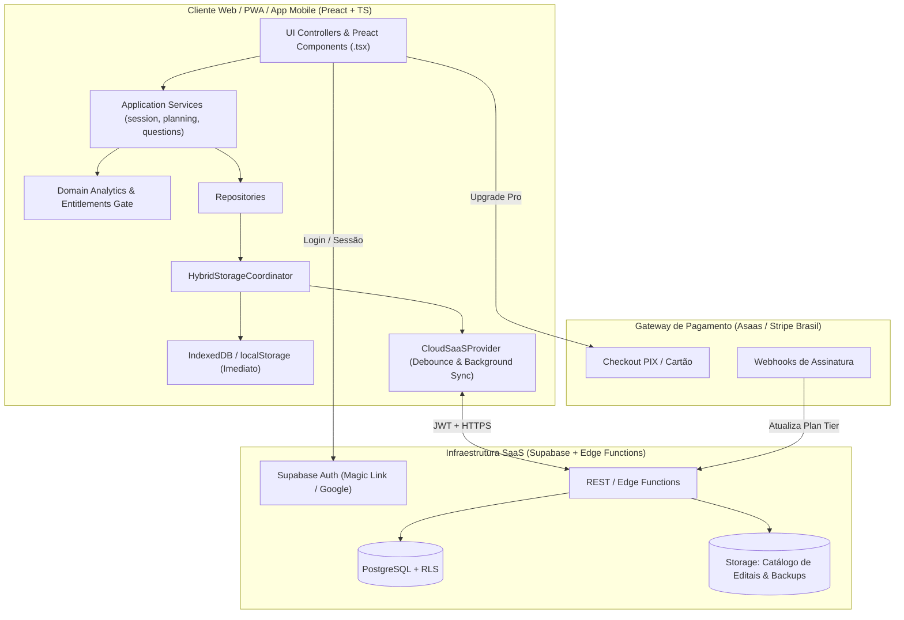

# Plano Detalhado de Transformação em SaaS — StudyTrack

Este documento estabelece o roteiro técnico, arquitetural e de negócios para transformar o **StudyTrack** de uma aplicação local-only em um **SaaS (Software as a Service) Local-First** altamente escalável, preservando seus diferenciais de velocidade, funcionamento offline e zero dependências pesadas no cliente.

---

## 1. Arquitetura Alvo: "Local-First SaaS"

Diferente de um SaaS tradicional (onde toda interação depende de round-trips HTTP e processamento em servidor), o StudyTrack adotará o padrão **Local-First SaaS**:

1. **Processamento 100% no Cliente (Custo Marginal R$ 0 de CPU):**
   - Todos os motores analíticos ([`priority-score.ts`](file:///c:/Users/vitor/Documents/Extrato/src/domain/analytics/priority-score.ts), [`readiness-score.ts`](file:///c:/Users/vitor/Documents/Extrato/src/domain/analytics/readiness-score.ts), [`cognitive-profile.ts`](file:///c:/Users/vitor/Documents/Extrato/src/domain/diagnostics/cognitive-profile.ts), [`performance-forecast.ts`](file:///c:/Users/vitor/Documents/Extrato/src/domain/forecasts/performance-forecast.ts)) continuam rodando no navegador do usuário compilados em TypeScript.
2. **Persistência Primária Instantânea (`IndexedDB`):**
   - A interface sempre lê e grava primeiro no [`indexed-db-provider.ts`](file:///c:/Users/vitor/Documents/Extrato/src/storage/indexed-db-provider.ts) e [`local-storage-provider.ts`](file:///c:/Users/vitor/Documents/Extrato/src/storage/local-storage-provider.ts). O usuário nunca vê telas de _loading_ ao registrar uma sessão ou questão.
3. **Nuvem Assíncrona para Assinantes (`CloudSaaSProvider`):**
   - O backend atua como **camada de identidade, faturamento, sincronização multi-dispositivo, backup contínuo e distribuição de catálogos de editais**.



---

## 2. Estrutura do Banco de Dados e Segurança (PostgreSQL + RLS)

Como o estado do StudyTrack já é validado e migrado por [`src/state/schema.ts`](file:///c:/Users/vitor/Documents/Extrato/src/state/schema.ts) e [`src/storage/migration-service.ts`](file:///c:/Users/vitor/Documents/Extrato/src/storage/migration-service.ts), o esquema relacional no PostgreSQL (Supabase) será enxuto e blindado com **Row Level Security (RLS)**:

### 2.1. Tabelas Principais

```sql
-- 1. Perfis e Controle de Assinatura
CREATE TABLE public.profiles (
  id UUID PRIMARY KEY REFERENCES auth.users(id) ON DELETE CASCADE,
  email TEXT NOT NULL,
  display_name TEXT,
  plan_tier TEXT NOT NULL DEFAULT 'free' CHECK (plan_tier IN ('free', 'pro', 'mentor')),
  subscription_status TEXT NOT NULL DEFAULT 'inactive' CHECK (subscription_status IN ('inactive', 'trialing', 'active', 'past_due', 'canceled')),
  subscription_period_end TIMESTAMPTZ,
  payment_customer_id TEXT,
  created_at TIMESTAMPTZ NOT NULL DEFAULT now(),
  updated_at TIMESTAMPTZ NOT NULL DEFAULT now()
);

-- 2. Estado Sincronizado do Estudante (Documento Canônico Validado)
CREATE TABLE public.user_study_states (
  user_id UUID PRIMARY KEY REFERENCES public.profiles(id) ON DELETE CASCADE,
  schema_version INTEGER NOT NULL,
  state_json JSONB NOT NULL,
  checksum_sha256 TEXT NOT NULL,
  device_id TEXT,
  client_updated_at TIMESTAMPTZ NOT NULL,
  server_updated_at TIMESTAMPTZ NOT NULL DEFAULT now()
);

-- 3. Histórico de Snapshots na Nuvem (Proteção Anti-Corrupção / Rollback)
CREATE TABLE public.user_state_snapshots (
  id UUID PRIMARY KEY DEFAULT gen_random_uuid(),
  user_id UUID NOT NULL REFERENCES public.profiles(id) ON DELETE CASCADE,
  schema_version INTEGER NOT NULL,
  state_json JSONB NOT NULL,
  checksum_sha256 TEXT NOT NULL,
  reason TEXT NOT NULL DEFAULT 'auto_weekly', -- 'auto_weekly' | 'pre_import' | 'manual'
  created_at TIMESTAMPTZ NOT NULL DEFAULT now()
);

-- 4. Catálogo Oficial de Editais Verticalizados (Atualizável sem Deploy)
CREATE TABLE public.exam_catalog_templates (
  id UUID PRIMARY KEY DEFAULT gen_random_uuid(),
  slug TEXT UNIQUE NOT NULL,
  title TEXT NOT NULL,
  organizer_banca TEXT NOT NULL,
  exam_year INTEGER NOT NULL,
  category TEXT NOT NULL, -- 'bancario' | 'fiscal' | 'tribunais' | 'policial' | 'enem'
  is_premium BOOLEAN NOT NULL DEFAULT true,
  version INTEGER NOT NULL DEFAULT 1,
  blueprint_json JSONB NOT NULL,
  published_at TIMESTAMPTZ NOT NULL DEFAULT now()
);

-- 5. Vínculo Mentor <-> Aluno (Para o Tier B2B Mentoria)
CREATE TABLE public.mentor_students (
  id UUID PRIMARY KEY DEFAULT gen_random_uuid(),
  mentor_id UUID NOT NULL REFERENCES public.profiles(id) ON DELETE CASCADE,
  student_id UUID NOT NULL REFERENCES public.profiles(id) ON DELETE CASCADE,
  status TEXT NOT NULL DEFAULT 'pending' CHECK (status IN ('pending', 'active', 'revoked')),
  created_at TIMESTAMPTZ NOT NULL DEFAULT now(),
  UNIQUE(mentor_id, student_id)
);
```

### 2.2. Políticas de Segurança (RLS)

- **`user_study_states`:** `auth.uid() = user_id` para `SELECT`, `INSERT`, `UPDATE`. (E leitura permitida ao `mentor_id` caso exista vínculo `'active'` em `mentor_students`).
- **`profiles`:** O usuário pode ler seu próprio perfil, mas **apenas a Service Role (Webhook de Pagamento)** pode alterar `plan_tier`, `subscription_status` e `subscription_period_end`.

---

## 3. Fases de Implementação Técnica no Código

A implementação é dividida em **7 Fases Incrementais**, garantindo que os testes existentes (`npm run test:fast`) continuem passando a cada etapa.

---

### Fase 1: Camada de Autenticação e Sessão (`src/auth/`)

- **Objetivo:** Permitir que o estudante use o app anonimamente (modo Free Local) ou crie/entre em uma conta para ativar recursos na nuvem, sem perder nenhum dado já registrado localmente.
- **Arquivos a Criar/Modificar:**
  1. `src/auth/auth-client.ts`:
     - Cliente leve REST/Fetch em TypeScript para autenticação (Magic Link por e-mail, Login com Google e Refresh Token JWT), sem adicionar SDKs pesados ao bundle.
  2. `src/auth/session-manager.ts`:
     - Gerencia o ciclo de vida do usuário autenticado (`user`, `accessToken`, `profile.planTier`, `subscriptionStatus`).
     - Emite eventos de login/logout para o [`create-app-context.ts`](file:///c:/Users/vitor/Documents/Extrato/src/application/create-app-context.ts).
  3. **Fusão de Conta no Primeiro Login (Onboarding Merge):**
     - Se o usuário já estudou por 10 dias no modo anônimo local e resolve criar conta:
       - Caso a nuvem esteja vazia, o estado local é enviado imediatamente (`initial upload`).
       - Caso a nuvem já tenha dados de outro aparelho, exibe modal de resolução em Preact: _"Manter dados da nuvem"_, _"Substituir pelos dados deste dispositivo"_ ou _"Baixar backup antes de sincronizar"_.

---

### Fase 2: Controle de Planos e Feature Gates (`src/domain/billing/entitlements.ts`)

- **Objetivo:** Centralizar em funções puras de domínio o que cada plano (`free`, `pro`, `mentor`) pode acessar, evitando `if (user.isPro)` espalhados pela UI.
- **Arquivos a Criar:**
  1. `src/domain/billing/entitlements.ts`:
     ```ts
     export interface UserProfile {
       planTier: 'free' | 'pro' | 'mentor';
       subscriptionStatus: 'inactive' | 'trialing' | 'active' | 'past_due' | 'canceled';
       subscriptionPeriodEnd?: string | null;
     }

     export interface FeatureEntitlements {
       tier: 'free' | 'pro' | 'mentor';
       canCloudSync: boolean;
       canImportCsvQuestions: boolean;
       canUseOfficialExamCatalog: boolean;
       canUseWhatIfSimulator: boolean;
       canUseAutoStudyCycle: boolean;
       canUseFocusEnergyAnalytics: boolean;
       maxActiveSubjects: number;
       isMentor: boolean;
     }

     export function resolveEntitlements(
       profile?: UserProfile | null,
       nowMs = Date.now()
     ): FeatureEntitlements {
       const isPaidActive =
         (profile?.planTier === 'pro' || profile?.planTier === 'mentor') &&
         (profile?.subscriptionStatus === 'active' || profile?.subscriptionStatus === 'trialing') &&
         (!profile?.subscriptionPeriodEnd || Date.parse(profile.subscriptionPeriodEnd) > nowMs);

       return Object.freeze({
         tier: isPaidActive ? profile.planTier : 'free',
         canCloudSync: isPaidActive,
         canImportCsvQuestions: isPaidActive,
         canUseOfficialExamCatalog: isPaidActive,
         canUseWhatIfSimulator: isPaidActive,
         canUseAutoStudyCycle: isPaidActive,
         canUseFocusEnergyAnalytics: isPaidActive,
         maxActiveSubjects: isPaidActive ? Infinity : 5,
         isMentor: isPaidActive && profile?.planTier === 'mentor',
       });
     }
     ```
  2. `src/ui/components/PaywallModal.tsx`:
     - Modal declarativo em Preact utilizando as primitivas de `src/ui/primitives/*.tsx` (`Dialog`, `Button`, `Card`, `Badge`), exibido quando um usuário `free` clica em um recurso `PRO`, destacando o benefício exato daquela funcionalidade e oferecendo link direto para o Checkout PIX/Cartão ou demonstração no Modo Demo.

---

### Fase 3: Sincronização Automática Local-Nuvem (`src/storage/cloud-saas-provider.ts`)

- **Objetivo:** Sincronizar o estado de forma transparente, resiliente a quedas de conexão e com controle de concorrência entre PC e celular.
- **Arquivos a Criar/Modificar:**
  1. `src/storage/cloud-saas-provider.ts`:
     - Implementa a sincronização contínua acoplada ao [`real-storage-provider.ts`](file:///c:/Users/vitor/Documents/Extrato/src/storage/real-storage-provider.ts):
       - **Gravação (Push com Debounce + Fila Offline):**
         - Ao salvar no `IndexedDB`, agenda um push de 3 segundos.
         - Se estiver offline (`!navigator.onLine`), marca `pendingCloudSync = true` no `localStorage` e dispara assim que o evento `window.addEventListener('online')` ocorrer.
       - **Leitura e Reconciliação (Pull no Boot / `visibilitychange`):**
         - Quando o estudante abre o app ou volta para a aba (`document.visibilityState === 'visible'`), consulta `server_updated_at` e `checksum_sha256`.
         - Se o servidor tiver um estado mais novo e íntegro (validado por [`migration-service.ts`](file:///c:/Users/vitor/Documents/Extrato/src/storage/migration-service.ts)), atualiza o `IndexedDB` local, guarda a versão anterior no backup rotativo ([`backup-service.ts`](file:///c:/Users/vitor/Documents/Extrato/src/storage/backup-service.ts)) e re-renderiza a UI.
       - **Opção de Criptografia Ponta a Ponta (Zero-Knowledge):**
         - Reaproveita [`src/core/crypto-utils.ts`](file:///c:/Users/vitor/Documents/Extrato/src/core/crypto-utils.ts) caso o usuário deseje criptografar o `state_json` com senha própria antes de enviar ao banco SaaS.
  2. **Indicador de Status de Sync no Header (`CloudSyncBadge.tsx`):**
     - Badge discreto no cabeçalho: `☁️ Sincronizado agora`, `🔄 Sincronizando...`, `⚡ Offline (salvo neste aparelho)`.

---

### Fase 4: Integração de Pagamentos (PIX e Cartão) e Webhooks

- **Objetivo:** Permitir assinatura autosserviço com liberação instantânea (especialmente via PIX).
- **Fluxo de Implementação:**
  1. **Edge Function `POST /api/billing/create-checkout`:**
     - Recebe o `user_id` do JWT autenticado e o plano escolhido (`pro_monthly`, `pro_annual_pix`, `mentor_monthly`).
     - Gera sessão de checkout no **Stripe** ou cobrança PIX/Assinatura no **Asaas / AbacatePay**.
  2. **Edge Function `POST /api/billing/webhook`:**
     - Valida a assinatura criptográfica do webhook (`stripe-signature` ou token Asaas).
     - Eventos tratados:
       - `checkout.session.completed` / `PAYMENT_CONFIRMED`: atualiza `profiles.plan_tier = 'pro'`, `subscription_status = 'active'` e `subscription_period_end`.
       - `invoice.payment_failed` / `PAYMENT_OVERDUE`: muda para `past_due` (mantém 3 dias de tolerância antes de bloquear o Cloud Sync).
       - `customer.subscription.deleted`: retorna para `free` (o usuário **nunca perde os dados locais**, apenas pausa a sincronização na nuvem e os recursos preditivos exclusivos).
  3. **Portal do Assinante:**
     - Botão em Configurações: _"Gerenciar Assinatura / Baixar Nota Fiscal / Alterar Cartão"_.

---

### Fase 5: Catálogo Dinâmico de Editais na Nuvem (`src/application/subjects/cloud-catalog-service.ts`)

- **Objetivo:** Transformar a dor de "cadastrar edital" no maior ímã de conversão para o plano Pro.
- **Como Implementar:**
  1. Hoje [`exam-catalog-runtime.ts`](file:///c:/Users/vitor/Documents/Extrato/src/domain/exams/exam-catalog-runtime.ts) carrega BB e Caixa de um bundle estático.
  2. Criar `src/application/subjects/cloud-catalog-service.ts` que consulta `GET /api/v1/exam-catalog`:
     - Lista todos os concursos disponíveis na nuvem com filtros por área (_Bancária, Fiscal, Tribunais, Policial, Administrativa, ENEM/Vestibulares, OAB_).
     - Cada item mostra: _Quantidade de disciplinas, Total de tópicos mapeados, Banca organizadora e Pesos calibrados_.
     - Ao selecionar um edital no plano Pro, o JSON do edital é baixado e passado diretamente para o [`exam-import-service.ts`](file:///c:/Users/vitor/Documents/Extrato/src/application/subjects/exam-import-service.ts) já existente, que faz o merge idempotente com o estado do aluno.

---

### Fase 6: Módulo B2B para Mentorias (`Painel do Mentor`)

- **Objetivo:** Criar uma segunda fonte de receita de ticket alto (R$ 149 a R$ 399/mês) vendendo para mentores e pequenos cursos preparatórios.
- **Como Implementar:**
  1. **Convite por Link:** O mentor gera um link de vínculo. O aluno aceita compartilhar a leitura do seu extrato com o mentor.
  2. **Visão Consolidada da Turma:**
     - O mentor vê uma tabela com seus alunos ordenada por **Risco de Abandono / Queda de Aderência** ([`risk-score.ts`](file:///c:/Users/vitor/Documents/Extrato/src/domain/diagnostics/risk-score.ts)):
       - `Nome do Aluno` | `Horas na Semana (Meta vs Real)` | `Índice de Prontidão` | `Principal Gargalo Atual` | `Última Sessão`.
  3. **Injeção de Metas / Edital:** O mentor pode publicar um edital verticalizado customizado da sua mentoria para todos os seus alunos com 1 clique.

---

### Fase 7: Go-To-Market, Landing Page Conversiva e Empacotamento Mobile

1. **Landing Page com "Live Demo de 1 clique":**
   - A maior arma de vendas do StudyTrack já está pronta: o [`demo-generator.ts`](file:///c:/Users/vitor/Documents/Extrato/src/demo/demo-generator.ts) que cria 130 dias de histórico realista.
   - Na página inicial de vendas, em vez de apenas prints estáticos, colocar o botão: **"Testar Plataforma Ao Vivo (Com 130 dias de dados simulados)"**. O visitante entra imediatamente no Modo Demo, interage com o Índice de Prontidão, vê a Matriz do Edital e o Simulador, e tem um CTA no topo: _"Criar minha conta e começar meu plano real"_.
2. **Publicação nas Lojas (Google Play & App Store):**
   - Empacotar o bundle gerado por [`scripts/build-app-bundle.mjs`](file:///c:/Users/vitor/Documents/Extrato/scripts/build-app-bundle.mjs) via **Capacitor** ou **Bubblewrap (TWA)** para presença nas lojas oficiais.
3. **Conformidade LGPD Nativa:**
   - Como o app já possui Exportação Completa em JSON e Limpeza Total de Dados em [`backup-service.ts`](file:///c:/Users/vitor/Documents/Extrato/src/storage/backup-service.ts), basta adicionar o endpoint `DELETE /api/v1/account` (que apaga a linha em `auth.users` com `ON DELETE CASCADE`) para cumprir 100% dos requisitos de portabilidade e direito ao esquecimento da LGPD.

---

## 4. Status de Implementação e Cronograma de Lançamento

### 4.1. Fundações Concluídas no Cliente (Fases 1 a 4 do Plano Master)

> [!NOTE]
> `entitlements.ts` e `cloud-saas-provider.ts` são módulos preparatórios, cobertos por testes unitários, mas ainda sem consumidor na interface. Nenhum recurso é bloqueado por plano hoje.

- [x] **Motor de Entitlements & Plan Tiers:** [`src/domain/billing/entitlements.ts`](file:///c:/Users/vitor/Documents/Extrato/src/domain/billing/entitlements.ts) implementa regras puras para `free`, `pro` e `mentor` com limites de matérias ativas, simulados/mês e feature gates.
- [x] **Conector de Nuvem SaaS Desacoplado:** [`src/storage/cloud-saas-provider.ts`](file:///c:/Users/vitor/Documents/Extrato/src/storage/cloud-saas-provider.ts) com contratos de push/pull com debounce, verificação de versão remota e fallback local seguro.
- [x] **Recursos de Alto Valor do Plano Pro:** Simulador "E se?", Modo Reta Final, Edital Verticalizado com parser de PDF, Ciclo de Estudos flexível, Análise de Fadiga/Energia e Caderno de Erros com Repetição Espaçada.

### 4.2. Cronograma Executivo de Lançamento na Nuvem (Infraestrutura)

|    Etapa    | Entrega Principal                                   | Critério de Pronto (DoD)                                                                           |
| :---------: | --------------------------------------------------- | -------------------------------------------------------------------------------------------------- |
| **Etapa 1** | **Setup Supabase + Auth (Magic Link & Google)**     | Projeto Supabase provisionado, RLS configurado e fusão segura do estado anônimo local com a conta. |
| **Etapa 2** | **Deploy das Edge Functions de Sync**               | Endpoints de push e pull sincronizando o estado validado entre múltiplos navegadores e celulares.  |
| **Etapa 3** | **Checkout PIX/Cartão + Webhooks (Asaas / Stripe)** | Fluxo de assinatura ativando o plano `pro` em menos de 5 segundos após confirmação do PIX.         |
| **Etapa 4** | **Catálogo de 15 Editais na Nuvem**                 | Catálogo dinâmico com download e merge automático de concursos via `exam-import-service.ts`.       |
| **Etapa 5** | **Landing Page + Modo Demo de 130 Dias**            | Página de conversão com botão para experimentar o StudyTrack ao vivo com dados simulados.          |
| **Etapa 6** | **Empacotamento Mobile (Capacitor)**                | Build Android/iOS publicado nas lojas oficiais com shell nativo.                                   |

---

## 5. Unit Economics Estimado (Viabilidade Financeira)

Graças à arquitetura **Local-First**:

- **Custo fixo inicial de infraestrutura:** ~R$ 0 a R$ 150/mês (Cloudflare Pages Grátis + Supabase Free/Pro).
- **Tamanho médio do estado de 1 ano de estudos por aluno:** ~150 KB a 400 KB em JSON comprimido (1 GB de banco armazena mais de **2.500 assinantes ativos**).
- **Margem Bruta estimada:** **> 90%** (descontadas apenas as taxas do gateway de pagamento de ~1% no PIX a ~3,9% no cartão).
