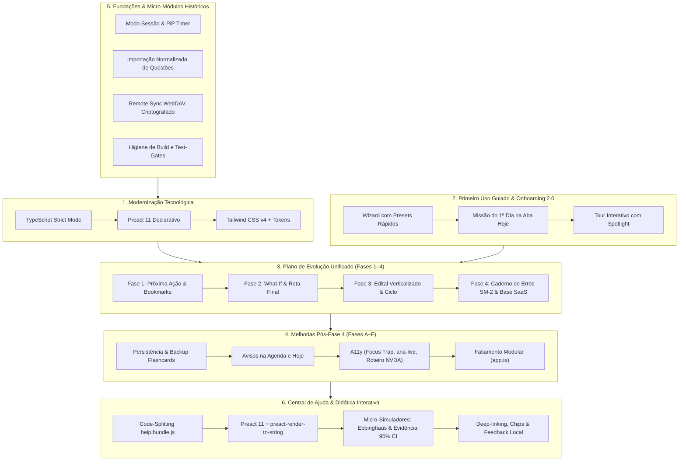

# Histórico de Planos Concluídos — StudyTrack

Este documento consolida, unifica e preserva o histórico técnico e arquitetural de **todos os planos de desenvolvimento já implementados, testados e integrados** no StudyTrack.

> [!NOTE]
> Para o planejamento ativo e os horizontes futuros do projeto, consulte:
> - **Plano Ativo (Próximas Evoluções em Inteligência, UX e Engenharia):** [docs/PLANO-PROXIMAS-EVOLUCOES.md](file:///c:/Users/vitor/Documents/Extrato/docs/PLANO-PROXIMAS-EVOLUCOES.md)
> - **Plano Futuro de Infraestrutura e SaaS:** [docs/PLANO-TRANSFORMACAO-SAAS.md](file:///c:/Users/vitor/Documents/Extrato/docs/PLANO-TRANSFORMACAO-SAAS.md)
> - **Painel Geral de Pendências e Status:** [docs/O-QUE-FALTA-IMPLEMENTAR.md](file:///c:/Users/vitor/Documents/Extrato/docs/O-QUE-FALTA-IMPLEMENTAR.md)

---

## Sumário Executivo dos Planos Concluídos

| Plano | Foco Principal | Status | Entregáveis Centrais |
|---|---|:---:|---|
| **1. Modernização Tecnológica** | TypeScript, Preact 11 e Tailwind CSS v4 | ✅ 100% Concluído | `strict: true` (0 erros), 100% de bundles reproduzíveis, UI Kit declarativo (`src/ui/primitives/`) e `tokens.css`. |
| **2. Primeiro Uso Guiado** | Onboarding 2.0, ativação rápida e tour | ✅ 100% Concluído | Wizard em 4 etapas com presets, cálculo pedagógico de viabilidade, disparo em 1 clique da 1ª atividade e tour interativo. |
| **3. Evolução Unificada (Fases 1 a 4)** | Decisão rápida, inteligência preditiva, hub de estudos e caderno de erros | ✅ 100% Concluído | Card Próxima Ação (6 perguntas), bookmarks de parada, simulador *What-If*, modo reta final, edital verticalizado, ciclo rotativo, foco/energia e motor SM-2. |
| **4. Melhorias Pós-Fase 4 (Fases A a F)** | Integridade, usabilidade do caderno e acessibilidade | ✅ 100% Concluído | Schema e persistência de flashcards, avisos na agenda e hoje, exportação JSON/CSV, focus traps, `aria-live`, roteiro NVDA e controller isolado. |
| **5. Micro-Módulos Fundacionais** | Sessões, importações e sincronização segura | ✅ 100% Concluído | Timer em Document Picture-in-Picture, normalizador de questões (Tec/QC), WebDAV com PBKDF2/AES-GCM-256 e runners de gates. |

---

## 1. Plano de Modernização Tecnológica (TypeScript, Preact e Tailwind CSS)

### 1.1. Contexto e Objetivos
Modernização estrutural da base legada em JavaScript e CSS customizado para uma arquitetura moderna, fortemente tipada, componentizada e declarativa, sem runtime pesado e com garantia estrita de compatibilidade offline e local-first.

### 1.2. Fases Executadas
1. **Fase 0 — Formatação e Higiene:**
   - Padronização total via Prettier (`npm run check:format`, `npm run format`).
   - Normalização de quebras de linha e regras de linting em toda a base.
2. **Fase 1 — Infraestrutura TypeScript:**
   - Configuração do `tsconfig.json` e `tsconfig.tests.json` com `strict: true`.
   - Setup do hook nativo de resolução de módulos TypeScript no Node (`scripts/ts-resolve-hook.mjs`).
   - Integração do verificador estático aos gates: `npm run check:types` e `npm run check:types:tests`.
3. **Fase 2 — Contratos Centrais, Core, State e Storage:**
   - Tipagem completa de contratos de dados em [`src/core/types.ts`](file:///c:/Users/vitor/Documents/Extrato/src/core/types.ts).
   - Isolamento e imutabilidade em `src/state/` (`state-boundaries.ts`, `app-state-store.ts`).
   - Blindagem da camada de persistência em `src/storage/` e validação profunda de backup em `backup-validator.ts`.
4. **Fase 3 — Camada de Domínio Puro (`src/domain/`):**
   - 100% dos algoritmos de cálculo, projeção, prontidão e diagnóstico convertidos em funções puras sem efeitos colaterais.
5. **Fase 4 — Camada de Aplicação (`src/application/`):**
   - Casos de uso orquestrados em módulos dedicados (planejamento, metas, recovery, relatórios, recomendações).
6. **Fase 5 — Fatiamento de Controladores e UI:**
   - Criação de stores e despachante de eventos (`DelegatedActions`, `TabRouter`, `SearchController`, `AchievementsController`).
7. **Fase 6 — Setup Preact 11 + Tailwind CSS v4 Conectado a Tokens:**
   - Integração do Preact 11 (`preact/compat` e JSX) empacotado via esbuild (`scripts/build.mjs`).
   - Tailwind CSS v4 integrado diretamente a [`styles/tokens.css`](file:///c:/Users/vitor/Documents/Extrato/styles/tokens.css) e compilado para [`styles/tailwind.css`](file:///c:/Users/vitor/Documents/Extrato/styles/tailwind.css).
8. **Fase 7 — Primitivas Declarativas (`src/ui/primitives/`):**
   - Criação do design system compartilhado: [`Card.tsx`](file:///c:/Users/vitor/Documents/Extrato/src/ui/primitives/Card.tsx), [`Button.tsx`](file:///c:/Users/vitor/Documents/Extrato/src/ui/primitives/Button.tsx), [`Badge.tsx`](file:///c:/Users/vitor/Documents/Extrato/src/ui/primitives/Badge.tsx), [`dialog.tsx`](file:///c:/Users/vitor/Documents/Extrato/src/ui/primitives/dialog.tsx), [`a11y.ts`](file:///c:/Users/vitor/Documents/Extrato/src/ui/primitives/a11y.ts).
9. **Fase 8 — Migração das Superfícies:**
   - Componentização declarativa em Preact de abas críticas (Hoje, Metas, Desempenho, Disciplinas, Caderno de Erros).

### 1.3. Resultados e Métricas Alcançadas
- `npm run check:types`: **0 erros**.
- `npm run check:bundle`: **100% dos artefatos reproduzíveis**.
- Diretriz inegociável de engenharia incorporada em [AGENTS.md](file:///c:/Users/vitor/Documents/Extrato/AGENTS.md): proibição de novas funções no `app.ts` e proibição de `innerHTML` em novas interfaces.

---

## 2. Plano de Primeiro Uso Guiado (Onboarding 2.0 & Ativação)

### 2.1. Contexto e Objetivos
Garantir que um concurseiro novo configure sua preparação completa em menos de 60 segundos e experimente o valor central da aplicação (saber exatamente o que estudar hoje) já no primeiro contato, sem atritos ou telas vazias desorientadoras.

### 2.2. Arquitetura em 3 Camadas Implementada
1. **Camada 1: Wizard Inicial de Alta Eficiência (`src/ui/onboarding/GuidedFirstRunModal.tsx`)**
   - **Etapa Prova (`goal`):** Atalhos rápidos de data estimada (3, 6 e 12 meses) com realce ativo (`aria-pressed="true"` e classes `.is-active`).
   - **Etapa Rotina (`availability`):** Presets de disponibilidade semanal em 1 clique (Leve: 2h/dia; Padrão: 4h/dia; Foco em Fim de Semana).
   - **Etapa Edital (`content`):** Nivelamento rápido em lote por disciplina (`guided-bulk-levels`) evitando configuração tópico a tópico.
   - **Etapa Planejamento (`plan`):** Diagnóstico pedagógico em tempo real via [`calculatePlanFeasibility`](file:///c:/Users/vitor/Documents/Extrato/src/domain/planning/guided-plan-feasibility.ts), informando status claro (`comfortable`, `balanced`, `tight`, `deficit`).
2. **Camada 2: Ativação Fluida na Aba Hoje (`FirstStepsMission.tsx`)**
   - Widget reativo com checklist da primeira semana.
   - Botão de ação direta `[▶ Iniciar 1ª atividade]` conectando diretamente ao cronômetro via `startPlannedActivity`.
   - Atalho de foco direto para a aba de resolução de questões.
3. **Camada 3: Tour Guiado Interativo (`src/ui/components/GuidedTourPopover.tsx`)**
   - Spotlight com seletores semânticos precisos (`.plano-hoje-card`, `#performancePage, #panel-desempenho`, `#subjectsPage`).
   - Isolamento seguro do Modo Demo, permitindo explorar dados de exemplo sem sobrescrever o plano real do usuário.
   - Navegação por teclado acessível com retenção de foco e Escape.

### 2.3. Validação
- 6 testes unitários dedicados em `tests/unit/guided-first-run.test.js`.
- 19 testes E2E no Playwright em `tests/e2e/onboarding.spec.js`.

---

## 3. Plano Unificado de Implementação e Evolução (Fases 1 a 4)

### 3.1. Fase 1: Decisão Rápida, UX do Painel & Primeiro Uso
- **Card de Próxima Ação (Contrato das 6 Perguntas):**
  - Implementado em Preact no dashboard inicial respondendo contratualmente: *O que estudar?*, *Por que estudar?*, *Quanto tempo reservar?*, *Qual a importância para a prova?*, *Qual evidência sustenta a escolha?* e *Qual a próxima ação recomendada?* ([`DECISION-EXPERIENCE-CONTRACT.md`](file:///c:/Users/vitor/Documents/Extrato/docs/DECISION-EXPERIENCE-CONTRACT.md)).
- **Bookmarks de Ponto de Parada:**
  - Registros de retomada de leitura em PDF (página atual/total), videoaulas (minutagem) e lei seca integrados ao domínio puro [`src/domain/topic-bookmark.ts`](file:///c:/Users/vitor/Documents/Extrato/src/domain/topic-bookmark.ts), ao encerramento da sessão e renderizados no [`BookmarkBadge.tsx`](file:///c:/Users/vitor/Documents/Extrato/src/ui/components/BookmarkBadge.tsx).
- **Critérios de aceite:** Resposta em < 3 segundos na tela inicial, persistência de ponto de parada validada e testes rápidos passando.

### 3.2. Fase 2: Inteligência Preditiva & Modo Reta Final
- **Simulador "E se?" (`what-if-simulator.ts`):**
  - Motor de simulação hipotética rodando puramente em memória via `structuredClone(appState)`.
  - Simula acréscimo de minutos diários e realocação de carga em matérias de maior peso, recalculando a prontidão sem persistir dados e sem poluir o histórico do estudante.
  - Interface no modal Preact [`WhatIfSimulatorModal.tsx`](file:///c:/Users/vitor/Documents/Extrato/src/ui/forecasts/WhatIfSimulatorModal.tsx).
- **Modo Reta Final (`final-stretch-policy.ts`):**
  - Política de reta final ativada a < 15 dias da prova (ou limiar configurado).
  - Inversão automática das proporções (85%+ da capacidade em questões e simulados), congelamento de novos tópicos teóricos densos e boost de prioridade para lacunas com acerto < 70%.
- **Detecção de "Falsa Consolidação" (`volatile-mastery.ts`):**
  - Identificação de tópicos com acerto aparente alto (> 90%) seguido de colapso de retenção em revisões espaçadas (> 14 dias), alertando no diagnóstico como *Domínio Volátil*.

### 3.3. Fase 3: Hub Completo de Estudos & Flexibilidade
- **Edital Verticalizado Interativo & Parser:**
  - Parser de edital em texto bruto [`raw-syllabus-parser.ts`](file:///c:/Users/vitor/Documents/Extrato/src/application/subjects/raw-syllabus-parser.ts) capaz de processar editais de PDF estruturados.
  - Visão declarativa [`VerticalizedSyllabusView.tsx`](file:///c:/Users/vitor/Documents/Extrato/src/ui/views/VerticalizedSyllabusView.tsx) com checklist em 4 etapas (Teoria, Resumo, Lei Seca, Questões).
- **Ciclo de Estudos Flexível (`study-cycle-engine.ts`):**
  - Modo alternador entre Agenda por Dia da Semana e Ciclo Rotativo contínuo, pausando a fila em imprevistos sem gerar acúmulo artificial de atrasos.
- **Análise Cronobiológica de Energia e Fadiga (`focus-energy-analytics.ts`):**
  - Registro de Foco e Energia no encerramento da sessão e correlação de precisão em questões por turno do dia (manhã, tarde, noite) com alertas de fadiga mental.

### 3.4. Fase 4: Caderno de Erros Ativo, Acessibilidade & Base SaaS
- **Caderno de Erros Ativo com Algoritmo SM-2:**
  - Motor de repetição espaçada adaptada [`src/domain/notebook/error-notebook-engine.ts`](file:///c:/Users/vitor/Documents/Extrato/src/domain/notebook/error-notebook-engine.ts) aplicando cálculo SM-2 (fator de facilidade, intervalo de dias e agendamento de repetição).
  - Interface declarativa [`ErrorNotebookView.tsx`](file:///c:/Users/vitor/Documents/Extrato/src/ui/views/ErrorNotebookView.tsx).
- **Acessibilidade por Teclado e Focus Traps:**
  - Garantia de fechamento por `Escape`, foco cíclico em modais e navegação livre de armadilhas.
- **Isolamento de Contratos SaaS:**
  - Módulos preparatórios isolados para nuvem [`src/storage/cloud-saas-provider.ts`](file:///c:/Users/vitor/Documents/Extrato/src/storage/cloud-saas-provider.ts) e controle de planos [`src/domain/billing/entitlements.ts`](file:///c:/Users/vitor/Documents/Extrato/src/domain/billing/entitlements.ts).

---

## 4. Plano de Melhorias Pós-Fase 4 (Fases A a F)

Implementado para eliminar qualquer divergência entre a documentação e o código entregue, fortalecendo a persistência e a acessibilidade.

### 4.1. Detalhamento das Fases
- **Fase A — Sincronização de Documentação:**
  - Alinhamento rigoroso entre documentação e código real; classificação transparente de módulos preparatórios SaaS como sem consumidor na UI.
- **Fase B — Persistência e Integridade de `errorFlashcards`:**
  - Registro de `errorFlashcards` nas fronteiras do estado (`state-boundaries.ts`).
  - Validação profunda no [`backup-validator.ts`](file:///c:/Users/vitor/Documents/Extrato/src/storage/backup-validator.ts) com tolerância a dados legados e descarte seguro com aviso.
  - 16 testes unitários em `tests/unit/error-flashcards-persistence.test.js` em fuso duplo (UTC e São Paulo).
- **Fase C — Caderno de Erros Integrado ao Fluxo Diário:**
  - Funções puras `findQuestionsAwaitingFlashcard` e criação idempotente `addErrorFlashcard`.
  - Componente de aviso de flashcards vencidos [`ErrorNotebookDueNotice.tsx`](file:///c:/Users/vitor/Documents/Extrato/src/ui/components/ErrorNotebookDueNotice.tsx) na Agenda de Revisões e na aba Hoje.
  - Exportação completa do caderno em formatos JSON e CSV para impressão/revisão off-screen.
  - Extração arquitetural do [`error-notebook-controller.ts`](file:///c:/Users/vitor/Documents/Extrato/src/ui/controllers/error-notebook-controller.ts).
- **Fase D — Acessibilidade Verificável:**
  - Focus traps em `dialog.tsx` e `GuidedTourPopover.tsx`.
  - Anúncios `aria-live` em `a11y.ts` para atualizações de estado do cronômetro (`#timerAriaLive`) e ratings do caderno.
  - Elaboração do roteiro de teste assistivo manual em [`docs/ROTEIRO-AUDITORIA-NVDA.md`](file:///c:/Users/vitor/Documents/Extrato/docs/ROTEIRO-AUDITORIA-NVDA.md).
- **Fase E — Primeiro Uso e Backlog Analítico:**
  - Banner interativo da Reta Final [`FinalStretchBanner.tsx`](file:///c:/Users/vitor/Documents/Extrato/src/ui/forecasts/FinalStretchBanner.tsx) integrado com disparo direto do simulador *What-If*.
  - Histórico explicável de recomendações e feedback de aceitação (`recommendation-history.ts`).
- **Fase F — Arquitetura e Contratos de Governança:**
  - Formalização do contrato SM-2 em [`docs/CADERNO-ERROS-SM2-CONTRATO.md`](file:///c:/Users/vitor/Documents/Extrato/docs/CADERNO-ERROS-SM2-CONTRATO.md).
  - Homologação do gate fast com 957 testes verdes em ~31s.

---

## 5. Micro-Módulos e Tarefas Fundacionais Históricas

Consolidação dos planos de tarefas fundacionais que estabeleceram os alicerces do projeto:

1. **Modo Sessão e Cronômetro em Janela Flutuante (`plan-modo-sessao`):**
   - Integração com a API `documentPictureInPicture` permitindo cronometrar estudos fora da aba do navegador.
   - Resiliência contra abas esquecidas e restauração de cronômetro após reload ou fechamento acidental.
   - Check-out de sessão integrado com registro de progresso e bookmarking.
2. **Importação Normalizada de Questões (`plan-question-import`):**
   - Normalizador puro de dados importados de plataformas externas (Tec Concursos e QConcursos).
   - Suporte a múltiplos formatos de CSV e detecção automática de banca, ano, disciplina e taxa de acerto.
   - Prevenção de duplicações via hash determinístico da questão.
3. **Sincronização Remota Segura WebDAV (`plan-remote-sync`):**
   - Sincronização em nuvem pessoal do usuário via protocolo WebDAV.
   - Criptografia simétrica client-side de ponta a ponta com **AES-GCM-256** e derivação de chave **PBKDF2** com salt criptográfico, garantindo privacidade absoluta dos registros.
   - Resolução de conflitos baseada em carimbo de tempo (*last-write-wins* com confirmação explícita de sobrescrita).
4. **Higiene de Build e Test-Gates (`plan.md`):**
   - Configuração do pipeline de automação de testes com tiers proporcionais:
     - `FAST_GATE` (< 120s): sintaxe, types, inventário, unitários UTC e SP, browser smoke.
     - `REGRESSION` (< 420s): regressão completa de persistência e fluxos.
     - `FULL`: auditoria global e matriz visual.
   - Inventário estrito e auditado de 267 arquivos de teste.
5. **Limpeza da Base Pós-Migração (`plan-base-cleanup`):**
   - Eliminação gradual de arquivos de legado sem quebrar contratos de persistência.
   - Remoção de dependências mortas e migração de seletores para o padrão do design system.

---

## 6. Modernização e Didática Interativa da Central de Ajuda (Instruções 2.0)

A reformulação integral da aba de **Instruções** transformou a documentação estática em uma **Central de Ajuda Reativa, PWA-ready e Pedagogicamente Interativa**, executada em duas frentes complementares (Fases 1–4 e Sprints A & B):

### 6.1. Engenharia, Performance & Code-Splitting
- **Code-Splitting Assíncrono sob Demanda:**
  - Extração do catálogo e runtime de ajuda para um bundle independente ([`src/help.bundle.js`](file:///c:/Users/vitor/Documents/Extrato/src/help.bundle.js) ~80 KB), carregado via `loadHelpBundle()` exclusivamente quando o usuário acessa a aba de Instruções.
  - Alívio expressivo do bundle principal (`app.bundle.js`), preservando o carregamento inicial instantâneo da aplicação.
  - Inclusão no manifesto do Service Worker (`APP_SHELL`) para garantir funcionamento offline total no PWA.
- **Renderização Unificada em Preact 11 Declarativo:**
  - Criação da árvore de componentes reativos em [`src/ui/help/`](file:///c:/Users/vitor/Documents/Extrato/src/ui/help/): `HelpTab.tsx`, `HelpHero.tsx`, `HelpSearchHero.tsx`, `HelpCategoryNav.tsx`, `HelpTopicCard.tsx`, `HelpVisualRenderer.tsx` e `HelpReferenceSection.tsx`.
  - Unificação do [`help-renderer.ts`](file:///c:/Users/vitor/Documents/Extrato/src/ui/help/help-renderer.ts) utilizando `preact-render-to-string`, eliminando completamente mais de 100 linhas de templates de strings HTML manuais duplicados.
- **Conectividade, Roteamento Direto e Busca:**
  - Suporte a deep-linking e hash routing: URLs diretas no formato `#instrucoes?topic=<id>` ou `#instrucoes/<id>` abrem imediatamente a categoria e realizam rolagem com foco acessível no tópico correspondente.
  - Botão discreto `🔗 Copiar link` no [`HelpTopicCard.tsx`](file:///c:/Users/vitor/Documents/Extrato/src/ui/help/HelpTopicCard.tsx) com cópia imediata da URL para a área de transferência e feedback visual temporário (`✓ Copiado`).
  - Chips de atalho rápido interativos (`#revisão`, `#prontidão`, `#planejamento`, etc.) no cabeçalho de busca que preenchem e filtram os tópicos automaticamente com 1 clique.

### 6.2. Didática Interativa e Micro-Simuladores
- **Simulador da Curva de Ebbinghaus e Repetição Espaçada:**
  - Motor puro de cálculo exponencial em [`retention-simulator.ts`](file:///c:/Users/vitor/Documents/Extrato/src/domain/help/retention-simulator.ts) modelando o decaimento mnemônico ao longo de 30 dias.
  - Componente interativo [`EbbinghausSimulator.tsx`](file:///c:/Users/vitor/Documents/Extrato/src/ui/help/EbbinghausSimulator.tsx) permitindo comparar visualmente a retenção com e sem revisões programadas (D+1, D+7, D+21) com barra de progresso dinâmica e estágios de consolidação.
- **Simulador de Confiabilidade da Evidência e Amostragem (Lei dos Grandes Números):**
  - Motor estatístico em [`evidence-simulator.ts`](file:///c:/Users/vitor/Documents/Extrato/src/domain/help/evidence-simulator.ts) calculando erro-padrão e intervalos de confiança de 95% para amostras de questões de 1 a 250.
  - Componente [`EvidenceConfidenceSimulator.tsx`](file:///c:/Users/vitor/Documents/Extrato/src/ui/help/EvidenceConfidenceSimulator.tsx) conectado ao tópico `evidence-guide` com controles dinâmicos de amostra e precisão, barra de incerteza estatística e justificativa pedagógica do algoritmo do StudyTrack (<10 questões volátil, 10–29 em observação, 30–79 sólido, 80+ robusto).
- **Widget de Avaliação Local de Utilidade:**
  - Componente [`HelpFeedbackWidget.tsx`](file:///c:/Users/vitor/Documents/Extrato/src/ui/help/HelpFeedbackWidget.tsx) e motor [`help-feedback.ts`](file:///c:/Users/vitor/Documents/Extrato/src/domain/help/help-feedback.ts) gravando avaliações binárias ("Esta explicação ajudou? 👍 / 👎") no `localStorage` sob a chave `studytrack_help_feedback`.

### 6.3. Enriquecimento de Conteúdo e Metadados
- **3 Novos Guias Abrangentes:**
  - `pip-timer-guide`: Operação do Cronômetro Flutuante em Picture-in-Picture.
  - `error-notebook-guide`: Metodologia de classificação de erros, repetição espaçada e Active Recall em flashcards.
  - `what-if-simulator-guide`: Simulação de cenários de capacidade na reta final sem poluir o planejamento real.
- **Metadados Didáticos Dinâmicos:**
  - Módulo [`topic-metadata.ts`](file:///c:/Users/vitor/Documents/Extrato/src/domain/help/topic-metadata.ts) calculando tempo estimado de leitura (`⏱ X min`) com base na densidade de palavras e nível pedagógico (`Iniciante`, `Estratégico`, `Avançado`).
- **Acessibilidade e Contraste WCAG AA:**
  - Estilização com tokens nativos do design system (`status-badge status-badge--success / warning / info / danger` e `text-text` sobre `bg-surface-muted`), assegurando contraste estrito > 4.5:1 tanto no tema claro quanto no escuro (`[data-theme="dark"]`).

---

## 7. Auditoria Completa e Refinamento de UX, UI & Acessibilidade (Fases 1, 2 e 3)

Com base na auditoria visual e de experiência executada com Playwright em múltiplas resoluções (1440px a 320px) e nos temas Claro e Escuro, foram implementados os refinamentos essenciais de ergonomia, legibilidade, acessibilidade e densidade:

### 7.1. Contraste de Controles e Formulários (WCAG 2.1 AA 1.4.11)
- **Token de Borda de Controle Dedicado:**
  - Criação do token `--border-control` (`#857F6F` no tema Claro / `#738198` no tema Escuro) com contraste superior a 3:1 em relação aos fundos de página (`--paper`) e cartões (`--surface-card`).
  - Aplicação universal a `input`, `select`, `textarea`, caixas de busca de disciplinas (`.subject-search input`) e formulários de cenários modais, eliminando o antigo `--paper-line` (~1.3:1) que causava falha nos critérios de acessibilidade de componentes interativos.
  - Alvos de toque com `min-height: var(--touch-target)` (44px) no mobile e anel de foco `outline: 2px solid var(--border-emphasis)` com offset acessível.

### 7.2. Normalização de Bordas e Identidade Sharp-Radius
- **Unificação para `var(--radius)` (2px):**
  - Remoção de valores arredondados soltos (`4px`, `8px`, `20px`) em badges de prioridade (`.priority-badge`), chips de tópicos (`.tag-chip`), pílulas de progresso (`.subject-progress-pill`), seletores de status (`select.status-select`), carimbos (`.stamp`), caixas de toast (`.toast`) e formulários de replanejamento.
  - A interface consolida a estética intencional de extrato bancário/ledger com cantos levemente facetados (2px) e linhas limpas.

### 7.3. Formatação Tipográfica Unificada de Deltas
- **Módulo Pura `formatDelta`:**
  - Implementação da função utilitária pura [`formatDelta(value, digits)`](file:///c:/Users/vitor/Documents/Extrato/src/core/format-number.ts) utilizando estritamente o sinal de menos tipográfico `−` (U+2212) e positivo explícito `+` (ex.: `+2.4 p.p.`, `−1.8%`).
  - Substituição de hifens ASCII soltos em cards de trajetória, prontidão e fechamento semanal, acompanhada de suíte dedicada de testes unitários em [`tests/unit/format-number.test.js`](file:///c:/Users/vitor/Documents/Extrato/tests/unit/format-number.test.js).

### 7.4. Ergonomia da Pilha Sticky e Eliminação de Vazamento de Conteúdo
- **Alinhamento Contínuo da Barra Fixa:**
  - A casca de navegação fixa (`.sticky-shell`) foi ajustada para aderir perfeitamente a `top: var(--demo-banner-height, 0px)` em todas as resoluções.
  - Eliminação do gap residual de 12px/8px e remoção do `margin-bottom: 14px` do banner de demonstração.
  - O conteúdo escrolado não mais "vaza" por debaixo do cabeçalho, e o espaço fixo ocupado no desktop caiu pela metade (de ~214px para ~85px), devolvendo a área vertical útil para a leitura de tabelas e gráficos.

### 7.5. Densidade Mobile e Performance na Aba Disciplinas
- **Colapso Seletivo de Disciplinas Secundárias:**
  - Ajuste em [`src/demo/demo-builders/subjects.ts`](file:///c:/Users/vitor/Documents/Extrato/src/demo/demo-builders/subjects.ts) para que disciplinas da demonstração iniciem com tópicos colapsados a partir da segunda (`collapsed: subjectIndex > 0`), mantendo a primeira aberta para exploração imediata.
  - Redução da altura renderizada inicial no mobile de ~65.600px para ~4.500px, e dos controles interativos simultâneos de 1.185 para ~150, eliminando travamentos de rolagem em aparelhos móveis sem perda funcional (o usuário expande qualquer disciplina com 1 toque).

### 7.6. Deduplicação Visual de Conquistas
- **Otimização do Renderizador de Badges:**
  - Em [`src/ui/renderers/achievement-renderer.ts`](file:///c:/Users/vitor/Documents/Extrato/src/ui/renderers/achievement-renderer.ts), suprimida a etiqueta textual redundante "Desbloqueada" dentro dos cards pertencentes à seção de já conquistadas.
  - O estado visual é transmitido pelo enquadramento e borda dourada, enquanto a acessibilidade para leitores de tela é preservada pelo atributo `aria-label="${name}: desbloqueada"`.

### 7.7. Desacoplamento do Gerenciamento de Dados e Backup
- **Modal Próprio Flutuante (`#dataManagementOverlay`):**
  - O bloco extenso de backup e zona de perigo foi removido do encerramento das abas normais de trabalho e encapsulado em um modal overlay dedicado.
  - Acionamento via botão discreto `[⚙ Gerenciar dados e backups]` no rodapé permanente (`footer`).
  - O botão `[▶ Explorar demonstração]` permanece imediatamente visível no rodapé e no CTA de primeiro uso, garantindo onboarding direto.
  - Isolamento estrutural fora da tag `<main>`, eliminando bloqueios de foco e `inert` acidentais observados em diálogos aninhados.
  - Suítes de backup (`backup-schema24-cycle.spec.js`), relatórios e sincronização WebDAV ajustadas e validadas com sucesso.

### 7.8. Biblioteca de Primitivas de Ícones SVG Nativos
- **Componente Declarativo e Tipado:**
  - Implementação de [`src/ui/primitives/icon.tsx`](file:///c:/Users/vitor/Documents/Extrato/src/ui/primitives/icon.tsx) contendo 20 ícones SVG leves de traço fino (stroke 2px, `currentColor`, acessibilidade integrada com `aria-hidden` automático ou `aria-label`).
  - Suíte de testes unitários dedicada em [`tests/unit/ui-primitives.test.js`](file:///c:/Users/vitor/Documents/Extrato/tests/unit/ui-primitives.test.js) cobrindo renderização, atributos SVG e acessibilidade.

### 7.9. Escala Tipográfica Estrita e Piso de 12px de Legibilidade
- **Tokens Semânticos de Tipografia:**
  - Adição dos tokens `--text-page-title: 1.5rem` (24px Fraunces), `--text-card-title: 1.25rem` (20px Fraunces) e `--text-label: 0.75rem` (12px Mono).
  - Elevação do token `--text-micro` para `.75rem` (12px), estabelecendo um piso universal de legibilidade e prevenindo que qualquer rótulo ou detalhe caia abaixo de 12px em resoluções pequenas.

### 7.10. Hierarquia Visual no Banner de Demonstração
- **Rebaixamento de Botão Secundário:**
  - O botão "Sair da demonstração" no banner superior foi rebaixado para a variante `btn ghost small`, evitando que dispute atenção visual com as ações primárias de estudo da aplicação.

---

## 8. Plano Diretor de Modularização do `app.ts` (Fases 1 a 5 Concluídas)

Em atendimento estrito à política inegociável de governança de `AGENTS.md` (*Modularização Obrigatória: Zero Novas Funções no `app.ts`*), foi executado e concluído o [Plano Diretor de Modularização](PLANO-MODULARIZACAO-APP.md), reduzindo o monolito de **10.921 linhas** para **9.254 linhas** (-1.667 linhas líquidas / -15.3%):

### 8.1. Fase 1: Extração do Domínio Puro
- Isolamento de motores determinísticos sob `src/domain/`, sem dependências de DOM, Preact ou storage:
  - [`src/domain/analytics/approval-metrics.ts`](file:///c:/Users/vitor/Documents/Extrato/src/domain/analytics/approval-metrics.ts) (11 testes).
  - [`src/domain/analytics/study-streak.ts`](file:///c:/Users/vitor/Documents/Extrato/src/domain/analytics/study-streak.ts) (3 testes).
  - [`src/domain/planning/rhythm-estimator.ts`](file:///c:/Users/vitor/Documents/Extrato/src/domain/planning/rhythm-estimator.ts) (6 testes).
  - [`src/domain/analytics/subject-error-metrics.ts`](file:///c:/Users/vitor/Documents/Extrato/src/domain/analytics/subject-error-metrics.ts) (3 testes).

### 8.2. Fase 2: Extração de Eventos Globais, Atalhos e Diálogos
- Unificação de feedback e controle de teclado em `src/ui/`:
  - [`src/ui/primitives/modal-dialogs.ts`](file:///c:/Users/vitor/Documents/Extrato/src/ui/primitives/modal-dialogs.ts) (`showToast`, `flashSaved`, `showConfirm`, `showPrompt` - 3 testes).
  - [`src/ui/events/keyboard-shortcuts.ts`](file:///c:/Users/vitor/Documents/Extrato/src/ui/events/keyboard-shortcuts.ts) (atalhos globais, trap de Escape - 3 testes).
  - [`src/ui/events/delegated-actions.ts`](file:///c:/Users/vitor/Documents/Extrato/src/ui/events/delegated-actions.ts) (`composeDelegatedActionHandlers` - 3 testes).

### 8.3. Fase 3: Desacoplamento do Cronômetro de Estudos (Timer)
- Isolamento completo do subsistema do timer em aplicação e interface:
  - [`src/application/sessions/timer-coordinator.ts`](file:///c:/Users/vitor/Documents/Extrato/src/application/sessions/timer-coordinator.ts) (orquestração do timer, bookmarks e sessões - 6 testes).
  - [`src/core/format-duration.ts`](file:///c:/Users/vitor/Documents/Extrato/src/core/format-duration.ts) (`formatDuration`, `formatPlanMinutes` - 2 testes).
  - [`src/ui/controllers/session-modal-controller.ts`](file:///c:/Users/vitor/Documents/Extrato/src/ui/controllers/session-modal-controller.ts) (4 testes).
  - [`src/ui/controllers/study-timer-view-controller.ts`](file:///c:/Users/vitor/Documents/Extrato/src/ui/controllers/study-timer-view-controller.ts) (3 testes).

### 8.4. Fase 4: Telas Pesadas, Matrizes e Editores de UI
- Desacoplamento procedural para controladores dedicados sob `src/ui/tabs/`:
  - [`src/ui/tabs/approval/approval-tab-controller.ts`](file:///c:/Users/vitor/Documents/Extrato/src/ui/tabs/approval/approval-tab-controller.ts) (1 teste).
  - [`src/domain/analytics/topic-performance.ts`](file:///c:/Users/vitor/Documents/Extrato/src/domain/analytics/topic-performance.ts) & [`src/ui/tabs/questions/question-analytics-controller.ts`](file:///c:/Users/vitor/Documents/Extrato/src/ui/tabs/questions/question-analytics-controller.ts) (8 + 1 testes).
  - [`src/ui/tabs/diagnostics/diagnostics-tab-controller.ts`](file:///c:/Users/vitor/Documents/Extrato/src/ui/tabs/diagnostics/diagnostics-tab-controller.ts) (1 teste).
  - [`src/ui/tabs/goals/goals-tab-controller.ts`](file:///c:/Users/vitor/Documents/Extrato/src/ui/tabs/goals/goals-tab-controller.ts) (5 testes).
  - [`src/ui/tabs/subjects/topic-analytics-view.ts`](file:///c:/Users/vitor/Documents/Extrato/src/ui/tabs/subjects/topic-analytics-view.ts) (1 teste).
  - [`src/ui/tabs/goals/exam-matrix-controller.ts`](file:///c:/Users/vitor/Documents/Extrato/src/ui/tabs/goals/exam-matrix-controller.ts) (Matriz Histórica, Matriz de Domínio, Inteligência, Blueprint Config e Revisão de Classificação - 4 testes).
  - [`src/ui/tabs/goals/subject-target-editor-controller.ts`](file:///c:/Users/vitor/Documents/Extrato/src/ui/tabs/goals/subject-target-editor-controller.ts) (Editor de Metas de Acerto por Disciplina - 4 testes).
  - [`src/ui/tabs/subjects/topic-strategy-editor-view.ts`](file:///c:/Users/vitor/Documents/Extrato/src/ui/tabs/subjects/topic-strategy-editor-view.ts) (1 teste).

### 8.5. Fase 5: Refatoração do Bootstrap e Master Renderer
- Composição e ciclo de renderização desacoplados do ponto de entrada:
  - [`src/bootstrap/wire-dependencies.ts`](file:///c:/Users/vitor/Documents/Extrato/src/bootstrap/wire-dependencies.ts) (instanciação unificada de providers, repositórios e serviços de aplicação - 4 testes).
  - [`src/bootstrap/master-renderer.ts`](file:///c:/Users/vitor/Documents/Extrato/src/bootstrap/master-renderer.ts) (loop de renderização, profundidade aninhada, cache de candidatos e captura de erros - 6 testes).

### 8.6. Fase 6: Gestão de Conteúdo (Disciplinas, Editais, Questões e Simulados)
- Modularização completa das operações de conteúdo sob `src/ui/tabs/` e `src/features/`:
  - [`src/ui/tabs/subjects/subjects-tab-controller.ts`](file:///c:/Users/vitor/Documents/Extrato/src/ui/tabs/subjects/subjects-tab-controller.ts) (CRUD de disciplinas, edital verticalizado, notas, limites, ordenação, duplicação, exclusão segura e ciclo de vida de tópicos - 4 testes).
  - [`src/features/exam-import/exam-import-modal-controller.ts`](file:///c:/Users/vitor/Documents/Extrato/src/features/exam-import/exam-import-modal-controller.ts) (modal de importação de editais com catalog, preview, blueprints e sincronização - 2 testes).
  - [`src/ui/tabs/questions/questions-tab-controller.ts`](file:///c:/Users/vitor/Documents/Extrato/src/ui/tabs/questions/questions-tab-controller.ts) (CRUD de questões, categorização de erros e travas de excesso - 3 testes).
  - [`src/ui/tabs/questions/simulations-tab-controller.ts`](file:///c:/Users/vitor/Documents/Extrato/src/ui/tabs/questions/simulations-tab-controller.ts) (CRUD de simulados, breakdowns por disciplina e cálculo de notas - 3 testes).
- Conclusão homologada com **1103 testes unitários verdes em 33.38s** no Fast Gate.

### 8.7. Fase 7: Desacoplamento do Fluxo Temporal (Calendário, Agenda de Revisões e Foco do Cronômetro)
- Modularização completa das operações temporais sob `src/ui/tabs/` e `src/ui/controllers/`:
  - [`src/ui/tabs/calendar/calendar-tab-controller.ts`](file:///c:/Users/vitor/Documents/Extrato/src/ui/tabs/calendar/calendar-tab-controller.ts) (grade mensal, unificação de eventos com revisões, indicadores de prazo, atrasadas agrupadas, renderização, paginação e CRUD de eventos de calendário - 3 testes).
  - [`src/ui/tabs/reviews/reviews-tab-controller.ts`](file:///c:/Users/vitor/Documents/Extrato/src/ui/tabs/reviews/reviews-tab-controller.ts) (agenda de revisões, notas adaptativas SM-2, agendamento manual, unificação de pendências e geração automática - 3 testes).
  - [`src/ui/controllers/timer-ui-controller.ts`](file:///c:/Users/vitor/Documents/Extrato/src/ui/controllers/timer-ui-controller.ts) (modo foco do cronômetro com restauração da aba de origem, atalhos de teclado Esc e sincronização do ponto de parada/bookmarks - 2 testes).
- `src/app.ts` reduzido de 8.651 para **8.079 linhas** (-572 linhas líquidas eliminadas; -2.842 linhas acumuladas).
- Conclusão homologada com **1111 testes unitários verdes em 50.1s** no Fast Gate (dual timezone UTC e America/Sao_Paulo).

### 8.8. Fase 8: Desacoplamento do Hub de Execução Diária & Onboarding
- Modularização completa do hub da Aba Hoje, Histórico de Sessões, Recomendações/Replanejamento e Onboarding 2.0 sob `src/ui/tabs/today/` e `src/features/onboarding/`:
  - [`src/ui/tabs/today/session-history-controller.ts`](file:///c:/Users/vitor/Documents/Extrato/src/ui/tabs/today/session-history-controller.ts) (histórico de sessões, filtros por período/tipo/disciplina, agrupamento diário, paginação, edição segura e exclusão com diálogo - 3 testes em `tests/unit/session-history-controller.test.js`).
  - [`src/features/onboarding/onboarding-modal-controller.ts`](file:///c:/Users/vitor/Documents/Extrato/src/features/onboarding/onboarding-modal-controller.ts) (wizard em 4 etapas, atalhos de data, presets de rotina semanal, nivelamento em lote por disciplina e geração de plano inicial - 3 testes em `tests/unit/onboarding-modal-controller.test.js`).
  - [`src/ui/tabs/today/study-recommendation-controller.ts`](file:///c:/Users/vitor/Documents/Extrato/src/ui/tabs/today/study-recommendation-controller.ts) (cards de recomendação, replanejamento adaptativo, baseline de estudo semanal, aceitação/descarte e confirmação de prévias - 3 testes em `tests/unit/study-recommendation-controller.test.js`).
  - [`src/ui/tabs/today/today-tab-controller.ts`](file:///c:/Users/vitor/Documents/Extrato/src/ui/tabs/today/today-tab-controller.ts) (materialização de plano de hoje, cards de execução, resumo diário, metas de hoje e checklist da primeira semana - 4 testes em `tests/unit/today-tab-controller.test.js`).
- `src/app.ts` reduzido de 8.079 para **6.736 linhas** (-1.343 linhas líquidas na fase; **-4.185 linhas acumuladas** desde o início do plano).
- Conclusão homologada com **1124 testes unitários verdes em 35.14s** no Fast Gate (dual timezone UTC e America/Sao_Paulo, Playwright smoke passing e bundles reproduzíveis).

### 8.9. Fase 9: Desacoplamento Analítico, Planejamento & Fechamento Semanal
- Modularização e isolamento completo sob `src/ui/tabs/` e `src/features/`:
  - [`src/ui/tabs/dashboard/dashboard-tab-controller.ts`](file:///c:/Users/vitor/Documents/Extrato/src/ui/tabs/dashboard/dashboard-tab-controller.ts) (indicadores KPIs, contagem regressiva, progresso do edital, heatmap de horas e consistência, filtros e navegação acessível - 7 testes em `tests/unit/dashboard-components.test.js`).
  - [`src/ui/tabs/goals/study-plan-builder-controller.ts`](file:///c:/Users/vitor/Documents/Extrato/src/ui/tabs/goals/study-plan-builder-controller.ts) (construtor de planos de estudo semanais e diários de 7 dias, conselhos adaptativos e estratégias de fases de prova - 3 testes em `tests/unit/study-plan-builder-controller.test.js`).
  - [`src/features/weekly-close/weekly-close-modal-controller.ts`](file:///c:/Users/vitor/Documents/Extrato/src/features/weekly-close/weekly-close-modal-controller.ts) (fechamento semanal, ciclo de decisão do StudyTrack 32, propostas e confirmação de prioridades, sustentabilidade e snapshots imutáveis - 3 testes em `tests/unit/weekly-close-modal-controller.test.js`).
  - [`src/ui/tabs/performance/performance-tab-controller.ts`](file:///c:/Users/vitor/Documents/Extrato/src/ui/tabs/performance/performance-tab-controller.ts) (evolução de progresso histórico de 180 dias, radar de disciplinas, página completa de desempenho e registro de eventos - 3 testes em `tests/unit/performance-tab-controller.test.js`).
- `src/app.ts` reduzido de 6.736 para **5.966 linhas** (-770 linhas líquidas na fase; **-4.955 linhas acumuladas** desde o início do plano).
- Conclusão homologada com **1136 testes unitários verdes em 36.78s** no Fast Gate (dual timezone UTC e America/Sao_Paulo, Playwright smoke passing e bundles 100% reproduzíveis).

---

## 9. Rastreabilidade de Arquitetura e Governança

Todas as decisões e entregas registradas neste histórico respeitam os contratos vigentes:
- **Diretrizes de Governança:** [AGENTS.md](file:///c:/Users/vitor/Documents/Extrato/AGENTS.md)
- **Plano Diretor de Modularização:** [docs/PLANO-MODULARIZACAO-APP.md](file:///c:/Users/vitor/Documents/Extrato/docs/PLANO-MODULARIZACAO-APP.md)
- **Visão Arquitetural Atual:** [ARCHITECTURE.md](file:///c:/Users/vitor/Documents/Extrato/ARCHITECTURE.md)
- **Design System e Tokens:** [DESIGN-SYSTEM.md](file:///c:/Users/vitor/Documents/Extrato/DESIGN-SYSTEM.md)
- **Estratégia de Testes:** [docs/TEST-STRATEGY.md](file:///c:/Users/vitor/Documents/Extrato/docs/TEST-STRATEGY.md)
- **Inventário de Testes:** [docs/TEST-SUITE-INVENTORY.md](file:///c:/Users/vitor/Documents/Extrato/docs/TEST-SUITE-INVENTORY.md) (312 arquivos auditados, 1136 testes unitários verdes em ~36s)
- **Contrato SM-2:** [docs/CADERNO-ERROS-SM2-CONTRATO.md](file:///c:/Users/vitor/Documents/Extrato/docs/CADERNO-ERROS-SM2-CONTRATO.md)
- **Roteiro de Auditoria NVDA:** [docs/ROTEIRO-AUDITORIA-NVDA.md](file:///c:/Users/vitor/Documents/Extrato/docs/ROTEIRO-AUDITORIA-NVDA.md)
- **Contrato de Decisão e Experiência:** [docs/DECISION-EXPERIENCE-CONTRACT.md](file:///c:/Users/vitor/Documents/Extrato/docs/DECISION-EXPERIENCE-CONTRACT.md)
