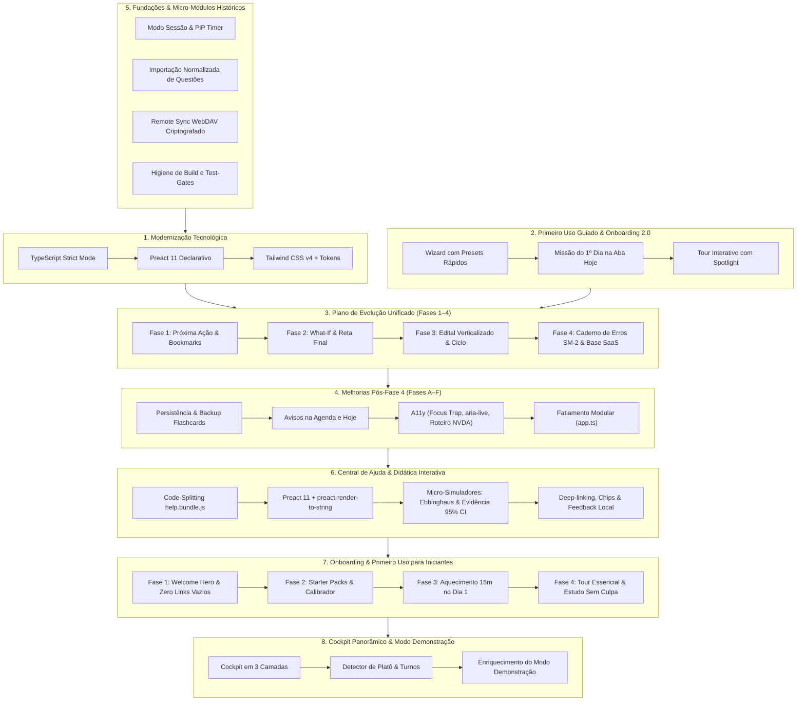

# Histórico de Planos Concluídos — StudyTrack

Este documento consolida, unifica e preserva o histórico técnico e arquitetural de **todos os planos de desenvolvimento já implementados, testados e integrados** no StudyTrack.

> [!NOTE]
> Para o planejamento ativo e os horizontes futuros do projeto, consulte:
> - **Plano Diretor de Modernização Visual e Cockpit Panorâmico:** [docs/PLANO-MODERNIZACAO-VISUAL-E-COCKPIT.md](file:///c:/Users/vitor/Documents/Extrato/docs/PLANO-MODERNIZACAO-VISUAL-E-COCKPIT.md)
> - **Plano Ativo (Próximas Evoluções em Inteligência, UX e Engenharia):** [docs/PLANO-PROXIMAS-EVOLUCOES.md](file:///c:/Users/vitor/Documents/Extrato/docs/PLANO-PROXIMAS-EVOLUCOES.md)
> - **Plano Futuro de Infraestrutura e SaaS:** [docs/PLANO-TRANSFORMACAO-SAAS.md](file:///c:/Users/vitor/Documents/Extrato/docs/PLANO-TRANSFORMACAO-SAAS.md)
> - **Painel Geral de Pendências e Status:** [docs/O-QUE-FALTA-IMPLEMENTAR.md](file:///c:/Users/vitor/Documents/Extrato/docs/O-QUE-FALTA-IMPLEMENTAR.md)

---

## Sumário Executivo dos Planos Concluídos

| Plano | Foco Principal | Status | Entregáveis Centrais |
|---|---|:---:|---|
| **1. Modernização Tecnológica** | TypeScript, Preact 11 e Tailwind CSS v4 | ✅ 100% Concluído | `strict: true` (0 erros), 100% de bundles reproduzíveis, UI Kit declarativo (`src/ui/primitives/`) e `tokens.css`. |
| **2. Primeiro Uso Guiado** | Onboarding 2.0, ativação rápida e tour | ✅ 100% Concluído | Wizard em 4 etapas com presets, cálculo pedagógico de viabilidade, disparo em 1 clique da 1ª atividade e tour interativo. |
| **3. Evolução Unificada (Fases 1 a 4)** | Decisão rápida, inteligência preditiva, hub de estudos e caderno de erros | ✅ 100% Concluído | Card Próxima Ação (6 perguntas), bookmarks de parada, simulador *What-If*, modo reta final, edital verticalizado, ciclo rotativo, foco/energia e motor SM-2. |
| **4. Melhorias Pós-Fase 4 (Fases A a F)** | Integridade, usabilidade do caderno e acessibilidade | ✅ 100% Concluído | Schema e persistência de flashcards, avisos na agenda e hoje, exportação JSON/CSV, focus traps, `aria-live`, roteiro NVDA e controller isolado. |
| **5. Micro-Módulos Fundacionais** | Sessões, importações e sincronização segura | ✅ 100% Concluído | Timer em Document Picture-in-Picture, normalizador de questões (Tec/QC), WebDAV com PBKDF2/AES-GCM-256 e runners de gates. |
| **6. Central de Ajuda & Instruções 2.0** | Code-splitting, Preact 11 e micro-simuladores | ✅ 100% Concluído | Bundle sob demanda (`help.bundle.js`), simuladores Ebbinghaus e Evidência 95% CI, deep-linking e feedback local. |
| **7. Auditoria UX, UI & Acessibilidade** | Contraste WCAG AA, pilha sticky e tipografia | ✅ 100% Concluído | Token `--border-control` (> 3:1), raios 2px, `formatDelta()`, modal `#dataManagementOverlay`, ícones SVG e piso 12px. |
| **8. Modularização Integral do `app.ts`** | Desacoplamento em 10 fases (Domínio, Aplicação, UI e Bootstrap) | ✅ 100% Concluído | Redução de 10.921 para **146 linhas (-98,7%)**, zero funções de negócio no `app.ts`, 1.154 testes unitários verdes e CI Full/Visual 100% aprovado. |
| **9. Onboarding & Primeiro Uso para Iniciantes** | Acolhimento, Starter Packs, Calibração e Ativação Rápida (Fases 1 a 4) | ✅ 100% Concluído | Hero Welcome Card no Dashboard, Starter Packs em 1 clique (Admin, Policial, Fiscal), calibrador anti-sobrecarga com folga dominical, aquecimento de 15 min no Dia 1, tour de 3 paradas e pedagogia de estudo sem culpa. 1.172 testes unitários verdes e 19 testes E2E Playwright aprovados. |
| **10. Refinamento de Usabilidade & Experiência do Iniciante** | Resolução dos 10 pontos de atrito identificados em teste de usuário principiante | ✅ 100% Concluído | Toast mobile posicionado no rodapé; ocultação dinâmica do CTA Demo com dados; remoção de moldura duplicada no Welcome Hero; alinhamento de sugestão opcional na aba Hoje; flexibilização e edição manual de minutos no modal de sessão; calibração do Índice de Prontidão (eliminação de falsa precisão inicial); filtro de concursos contextual; auto-foco na criação de tópicos; conformidade Tabler Icons (`Icon name="refresh"`) na Agenda e toast orientador; remoção de badge de alerta no tour guiado e scroll com compensação sticky; auto-seleção de tópicos e disparo direto na primeira bateria de questões. 1.208 testes unitários verdes em fuso duplo e E2Es direcionados aprovados. |
| **11. Modernização Visual e Cockpit Panorâmico** | Cockpit em 3 Camadas Temáticas, Gráfico de Tendência, Detector de Platô e Turnos | ✅ 100% Concluído | Visão Geral estruturada em 3 Camadas (Operação do Dia 8+4 cols, Rendimento & Edital 6+6 cols com simetria vertical de 476px e Decisão Pedagógica com Balanço de Alocação); Detector de Platô em Questões & Simulados; Análise Cronobiológica de Energia em Desempenho; realocação cirúrgica de grids de KPIs; modal de primeiro acesso (`FirstAccessModal.tsx`); ESLint 9 Flat Config. 1.256 testes unitários verdes. |
| **12. Enriquecimento do Modo Demonstração** | Atualização dos Dados Fictícios com as Novas Capacidades Analíticas | ✅ 100% Concluído | Builder determinístico do Caderno de Erros (`error-notebook.ts`) com 17 flashcards SM-2 (11 pendentes hoje e 6 dominados) e pegadinhas de bancas (Cesgranrio/Cespe); Calibração de 2 tópicos em platô na janela móvel de 28 dias com prescrições ativas de *Recall Ativo* e *Revisão de Pré-requisitos*; Distribuição das 200 sessões em turnos (Manhã pico, Tarde, Noite com alerta de fadiga); Pesos explícitos no edital verticalizado para balanço de alocação; Navegação do tour expandida no banner (`Desempenho` e `Questões & Platô`) e compatibilidade total com Schema v30 (`lastExportAt`). 1.277 testes unitários verdes e 8/8 testes E2E aprovados. |

---

## 1. Plano de Modernização Tecnológica (TypeScript, Preact e Tailwind CSS)

### 1.1. Contexto e Objetivos
Modernização estrutural da base legada em JavaScript e CSS customizado para uma arquitetura moderna, fortemente tipada, componentizada e declarativa, sem runtime pesado e com garantia estrita de compatibilidade offline e local-first.

### 1.2. Fases Executadas
1. **Fase 0 — Formatação e Higiene:**
   - Padronização total via Prettier (`npm run check:format`, `npm run format`).
   - Normalização de quebras de linha e regras de linting em toda a base.
2. **Fase 1 — Infraestrutura TypeScript:**
   - Configuração do `tsconfig.json` e `tsconfig.tests.json` com `strict: true`.
   - Setup do hook nativo de resolução de módulos TypeScript no Node (`scripts/ts-resolve-hook.mjs`).
   - Integração do verificador estático aos gates: `npm run check:types` e `npm run check:types:tests`.
3. **Fase 2 — Contratos Centrais, Core, State e Storage:**
   - Tipagem completa de contratos de dados em [`src/core/types.ts`](file:///c:/Users/vitor/Documents/Extrato/src/core/types.ts).
   - Isolamento e imutabilidade em `src/state/` (`state-boundaries.ts`, `app-state-store.ts`).
   - Blindagem da camada de persistência em `src/storage/` e validação profunda de backup em `backup-validator.ts`.
4. **Fase 3 — Camada de Domínio Puro (`src/domain/`):**
   - 100% dos algoritmos de cálculo, projeção, prontidão e diagnóstico convertidos em funções puras sem efeitos colaterais.
5. **Fase 4 — Camada de Aplicação (`src/application/`):**
   - Casos de uso orquestrados em módulos dedicados (planejamento, metas, recovery, relatórios, recomendações).
6. **Fase 5 — Fatiamento de Controladores e UI:**
   - Criação de stores e despachante de eventos (`DelegatedActions`, `TabRouter`, `SearchController`, `AchievementsController`).
7. **Fase 6 — Setup Preact 11 + Tailwind CSS v4 Conectado a Tokens:**
   - Integração do Preact 11 (`preact/compat` e JSX) empacotado via esbuild (`scripts/build.mjs`).
   - Tailwind CSS v4 integrado diretamente a [`styles/tokens.css`](file:///c:/Users/vitor/Documents/Extrato/styles/tokens.css) e compilado para [`styles/tailwind.css`](file:///c:/Users/vitor/Documents/Extrato/styles/tailwind.css).
8. **Fase 7 — Primitivas Declarativas (`src/ui/primitives/`):**
   - Criação do design system compartilhado: [`Card.tsx`](file:///c:/Users/vitor/Documents/Extrato/src/ui/primitives/Card.tsx), [`Button.tsx`](file:///c:/Users/vitor/Documents/Extrato/src/ui/primitives/Button.tsx), [`Badge.tsx`](file:///c:/Users/vitor/Documents/Extrato/src/ui/primitives/Badge.tsx), [`dialog.tsx`](file:///c:/Users/vitor/Documents/Extrato/src/ui/primitives/dialog.tsx), [`a11y.ts`](file:///c:/Users/vitor/Documents/Extrato/src/ui/primitives/a11y.ts).
9. **Fase 8 — Migração das Superfícies:**
   - Componentização declarativa em Preact de abas críticas (Hoje, Metas, Desempenho, Disciplinas, Caderno de Erros).

### 1.3. Resultados e Métricas Alcançadas
- `npm run check:types`: **0 erros**.
- `npm run check:bundle`: **100% dos artefatos reproduzíveis**.
- Diretriz inegociável de engenharia incorporada em [AGENTS.md](file:///c:/Users/vitor/Documents/Extrato/AGENTS.md): proibição de novas funções no `app.ts` e proibição de `innerHTML` em novas interfaces.

---

## 2. Plano de Primeiro Uso Guiado (Onboarding 2.0 & Ativação)

### 2.1. Contexto e Objetivos
Garantir que um concurseiro novo configure sua preparação completa em menos de 60 segundos e experimente o valor central da aplicação (saber exatamente o que estudar hoje) já no primeiro contato, sem atritos ou telas vazias desorientadoras.

### 2.2. Arquitetura em 3 Camadas Implementada
1. **Camada 1: Wizard Inicial de Alta Eficiência (`src/ui/onboarding/GuidedFirstRunModal.tsx`)**
   - **Etapa Prova (`goal`):** Atalhos rápidos de data estimada (3, 6 e 12 meses) com realce ativo (`aria-pressed="true"` e classes `.is-active`).
   - **Etapa Rotina (`availability`):** Presets de disponibilidade semanal em 1 clique (Leve: 2h/dia; Padrão: 4h/dia; Foco em Fim de Semana).
   - **Etapa Edital (`content`):** Nivelamento rápido em lote por disciplina (`guided-bulk-levels`) evitando configuração tópico a tópico.
   - **Etapa Planejamento (`plan`):** Diagnóstico pedagógico em tempo real via [`calculatePlanFeasibility`](file:///c:/Users/vitor/Documents/Extrato/src/domain/planning/guided-plan-feasibility.ts), informando status claro (`comfortable`, `balanced`, `tight`, `deficit`).
2. **Camada 2: Ativação Fluida na Aba Hoje (`FirstStepsMission.tsx`)**
   - Widget reativo com checklist da primeira semana.
   - Botão de ação direta `[▶ Iniciar 1ª atividade]` conectando diretamente ao cronômetro via `startPlannedActivity`.
   - Atalho de foco direto para a aba de resolução de questões.
3. **Camada 3: Tour Guiado Interativo (`src/ui/components/GuidedTourPopover.tsx`)**
   - Spotlight com seletores semânticos precisos (`.plano-hoje-card`, `#performancePage, #panel-desempenho`, `#subjectsPage`).
   - Isolamento seguro do Modo Demo, permitindo explorar dados de exemplo sem sobrescrever o plano real do usuário.
   - Navegação por teclado acessível com retenção de foco e Escape.

### 2.3. Validação
- 6 testes unitários dedicados em `tests/unit/guided-first-run.test.js`.
- 19 testes E2E no Playwright em `tests/e2e/onboarding.spec.js`.

> [!NOTE]
> As evoluções subsequentes de acolhimento de novos alunos, templates de 1 clique (Starter Packs), prevenção de sobrecarga (folga dominical) e ativação com sessão de aquecimento prático no primeiro dia foram consolidadas na [Seção 9: Plano de Excelência no Onboarding e Primeiro Uso Guiado para Iniciantes](#9-plano-de-excelência-no-onboarding-e-primeiro-uso-guiado-para-iniciantes-fases-1-a-4).

---

## 3. Plano Unificado de Implementação e Evolução (Fases 1 a 4)

### 3.1. Fase 1: Decisão Rápida, UX do Painel & Primeiro Uso
- **Card de Próxima Ação (Contrato das 6 Perguntas):**
  - Implementado em Preact no dashboard inicial respondendo contratualmente: *O que estudar?*, *Por que estudar?*, *Quanto tempo reservar?*, *Qual a importância para a prova?*, *Qual evidência sustenta a escolha?* e *Qual a próxima ação recomendada?* ([`DECISION-EXPERIENCE-CONTRACT.md`](file:///c:/Users/vitor/Documents/Extrato/docs/DECISION-EXPERIENCE-CONTRACT.md)).
- **Bookmarks de Ponto de Parada:**
  - Registros de retomada de leitura em PDF (página atual/total), videoaulas (minutagem) e lei seca integrados ao domínio puro [`src/domain/topic-bookmark.ts`](file:///c:/Users/vitor/Documents/Extrato/src/domain/topic-bookmark.ts), ao encerramento da sessão e renderizados no [`BookmarkBadge.tsx`](file:///c:/Users/vitor/Documents/Extrato/src/ui/components/BookmarkBadge.tsx).
- **Critérios de aceite:** Resposta em < 3 segundos na tela inicial, persistência de ponto de parada validada e testes rápidos passando.

### 3.2. Fase 2: Inteligência Preditiva & Modo Reta Final
- **Simulador "E se?" (`what-if-simulator.ts`):**
  - Motor de simulação hipotética rodando puramente em memória via `structuredClone(appState)`.
  - Simula acréscimo de minutos diários e realocação de carga em matérias de maior peso, recalculando a prontidão sem persistir dados e sem poluir o histórico do estudante.
  - Interface no modal Preact [`WhatIfSimulatorModal.tsx`](file:///c:/Users/vitor/Documents/Extrato/src/ui/forecasts/WhatIfSimulatorModal.tsx).
- **Modo Reta Final (`final-stretch-policy.ts`):**
  - Política de reta final ativada a < 15 dias da prova (ou limiar configurado).
  - Inversão automática das proporções (85%+ da capacidade em questões e simulados), congelamento de novos tópicos teóricos densos e boost de prioridade para lacunas com acerto < 70%.
- **Detecção de "Falsa Consolidação" (`volatile-mastery.ts`):**
  - Identificação de tópicos com acerto aparente alto (> 90%) seguido de colapso de retenção em revisões espaçadas (> 14 dias), alertando no diagnóstico como *Domínio Volátil*.

### 3.3. Fase 3: Hub Completo de Estudos & Flexibilidade
- **Edital Verticalizado Interativo & Parser:**
  - Parser de edital em texto bruto [`raw-syllabus-parser.ts`](file:///c:/Users/vitor/Documents/Extrato/src/application/subjects/raw-syllabus-parser.ts) capaz de processar editais de PDF estruturados.
  - Visão declarativa [`VerticalizedSyllabusView.tsx`](file:///c:/Users/vitor/Documents/Extrato/src/ui/views/VerticalizedSyllabusView.tsx) com checklist em 4 etapas (Teoria, Resumo, Lei Seca, Questões).
- **Ciclo de Estudos Flexível (`study-cycle-engine.ts`):**
  - Modo alternador entre Agenda por Dia da Semana e Ciclo Rotativo contínuo, pausando a fila em imprevistos sem gerar acúmulo artificial de atrasos.
- **Análise Cronobiológica de Energia e Fadiga (`focus-energy-analytics.ts`):**
  - Registro de Foco e Energia no encerramento da sessão e correlação de precisão em questões por turno do dia (manhã, tarde, noite) com alertas de fadiga mental.

### 3.4. Fase 4: Caderno de Erros Ativo, Acessibilidade & Base SaaS
- **Caderno de Erros Ativo com Algoritmo SM-2:**
  - Motor de repetição espaçada adaptada [`src/domain/notebook/error-notebook-engine.ts`](file:///c:/Users/vitor/Documents/Extrato/src/domain/notebook/error-notebook-engine.ts) aplicando cálculo SM-2 (fator de facilidade, intervalo de dias e agendamento de repetição).
  - Interface declarativa [`ErrorNotebookView.tsx`](file:///c:/Users/vitor/Documents/Extrato/src/ui/views/ErrorNotebookView.tsx).
- **Acessibilidade por Teclado e Focus Traps:**
  - Garantia de fechamento por `Escape`, foco cíclico em modais e navegação livre de armadilhas.
- **Isolamento de Contratos SaaS:**
  - Módulos preparatórios isolados para nuvem [`src/storage/cloud-saas-provider.ts`](file:///c:/Users/vitor/Documents/Extrato/src/storage/cloud-saas-provider.ts) e controle de planos [`src/domain/billing/entitlements.ts`](file:///c:/Users/vitor/Documents/Extrato/src/domain/billing/entitlements.ts).

---

## 4. Plano de Melhorias Pós-Fase 4 (Fases A a F)

Implementado para eliminar qualquer divergência entre a documentação e o código entregue, fortalecendo a persistência e a acessibilidade.

### 4.1. Detalhamento das Fases
- **Fase A — Sincronização de Documentação:**
  - Alinhamento rigoroso entre documentação e código real; classificação transparente de módulos preparatórios SaaS como sem consumidor na UI.
- **Fase B — Persistência e Integridade de `errorFlashcards`:**
  - Registro de `errorFlashcards` nas fronteiras do estado (`state-boundaries.ts`).
  - Validação profunda no [`backup-validator.ts`](file:///c:/Users/vitor/Documents/Extrato/src/storage/backup-validator.ts) com tolerância a dados legados e descarte seguro com aviso.
  - 16 testes unitários em `tests/unit/error-flashcards-persistence.test.js` em fuso duplo (UTC e São Paulo).
- **Fase C — Caderno de Erros Integrado ao Fluxo Diário:**
  - Funções puras `findQuestionsAwaitingFlashcard` e criação idempotente `addErrorFlashcard`.
  - Componente de aviso de flashcards vencidos [`ErrorNotebookDueNotice.tsx`](file:///c:/Users/vitor/Documents/Extrato/src/ui/components/ErrorNotebookDueNotice.tsx) na Agenda de Revisões e na aba Hoje.
  - Exportação completa do caderno em formatos JSON e CSV para impressão/revisão off-screen.
  - Extração arquitetural do [`error-notebook-controller.ts`](file:///c:/Users/vitor/Documents/Extrato/src/ui/controllers/error-notebook-controller.ts).
- **Fase D — Acessibilidade Verificável:**
  - Focus traps em `dialog.tsx` e `GuidedTourPopover.tsx`.
  - Anúncios `aria-live` em `a11y.ts` para atualizações de estado do cronômetro (`#timerAriaLive`) e ratings do caderno.
  - Elaboração do roteiro de teste assistivo manual em [`docs/ROTEIRO-AUDITORIA-NVDA.md`](file:///c:/Users/vitor/Documents/Extrato/docs/ROTEIRO-AUDITORIA-NVDA.md).
- **Fase E — Primeiro Uso e Backlog Analítico:**
  - Banner interativo da Reta Final [`FinalStretchBanner.tsx`](file:///c:/Users/vitor/Documents/Extrato/src/ui/forecasts/FinalStretchBanner.tsx) integrado com disparo direto do simulador *What-If*.
  - Histórico explicável de recomendações e feedback de aceitação (`recommendation-history.ts`).
- **Fase F — Arquitetura e Contratos de Governança:**
  - Formalização do contrato SM-2 em [`docs/CADERNO-ERROS-SM2-CONTRATO.md`](file:///c:/Users/vitor/Documents/Extrato/docs/CADERNO-ERROS-SM2-CONTRATO.md).
  - Homologação do gate fast com 957 testes verdes em ~31s.

---

## 5. Micro-Módulos e Tarefas Fundacionais Históricas

Consolidação dos planos de tarefas fundacionais que estabeleceram os alicerces do projeto:

1. **Modo Sessão e Cronômetro em Janela Flutuante (`plan-modo-sessao`):**
   - Integração com a API `documentPictureInPicture` permitindo cronometrar estudos fora da aba do navegador.
   - Resiliência contra abas esquecidas e restauração de cronômetro após reload ou fechamento acidental.
   - Check-out de sessão integrado com registro de progresso e bookmarking.
2. **Importação Normalizada de Questões (`plan-question-import`):**
   - Normalizador puro de dados importados de plataformas externas (Tec Concursos e QConcursos).
   - Suporte a múltiplos formatos de CSV e detecção automática de banca, ano, disciplina e taxa de acerto.
   - Prevenção de duplicações via hash determinístico da questão.
3. **Sincronização Remota Segura WebDAV (`plan-remote-sync`):**
   - Sincronização em nuvem pessoal do usuário via protocolo WebDAV.
   - Criptografia simétrica client-side de ponta a ponta com **AES-GCM-256** e derivação de chave **PBKDF2** com salt criptográfico, garantindo privacidade absoluta dos registros.
   - Resolução de conflitos baseada em carimbo de tempo (*last-write-wins* com confirmação explícita de sobrescrita).
4. **Higiene de Build e Test-Gates (`plan.md`):**
   - Configuração do pipeline de automação de testes com tiers proporcionais:
     - `FAST_GATE` (< 120s): sintaxe, types, inventário, unitários UTC e SP, browser smoke.
     - `REGRESSION` (< 420s): regressão completa de persistência e fluxos.
     - `FULL`: auditoria global e matriz visual.
   - Inventário estrito e auditado de 267 arquivos de teste.
5. **Limpeza da Base Pós-Migração (`plan-base-cleanup`):**
   - Eliminação gradual de arquivos de legado sem quebrar contratos de persistência.
   - Remoção de dependências mortas e migração de seletores para o padrão do design system.

---

## 6. Modernização e Didática Interativa da Central de Ajuda (Instruções 2.0)

A reformulação integral da aba de **Instruções** transformou a documentação estática em uma **Central de Ajuda Reativa, PWA-ready e Pedagogicamente Interativa**, executada em duas frentes complementares (Fases 1–4 e Sprints A & B):

### 6.1. Engenharia, Performance & Code-Splitting
- **Code-Splitting Assíncrono sob Demanda:**
  - Extração do catálogo e runtime de ajuda para um bundle independente ([`src/help.bundle.js`](file:///c:/Users/vitor/Documents/Extrato/src/help.bundle.js) ~80 KB), carregado via `loadHelpBundle()` exclusivamente quando o usuário acessa a aba de Instruções.
  - Alívio expressivo do bundle principal (`app.bundle.js`), preservando o carregamento inicial instantâneo da aplicação.
  - Inclusão no manifesto do Service Worker (`APP_SHELL`) para garantir funcionamento offline total no PWA.
- **Renderização Unificada em Preact 11 Declarativo:**
  - Criação da árvore de componentes reativos em [`src/ui/help/`](file:///c:/Users/vitor/Documents/Extrato/src/ui/help/): `HelpTab.tsx`, `HelpHero.tsx`, `HelpSearchHero.tsx`, `HelpCategoryNav.tsx`, `HelpTopicCard.tsx`, `HelpVisualRenderer.tsx` e `HelpReferenceSection.tsx`.
  - Unificação do [`help-renderer.ts`](file:///c:/Users/vitor/Documents/Extrato/src/ui/help/help-renderer.ts) utilizando `preact-render-to-string`, eliminando completamente mais de 100 linhas de templates de strings HTML manuais duplicados.
- **Conectividade, Roteamento Direto e Busca:**
  - Suporte a deep-linking e hash routing: URLs diretas no formato `#instrucoes?topic=<id>` ou `#instrucoes/<id>` abrem imediatamente a categoria e realizam rolagem com foco acessível no tópico correspondente.
  - Botão discreto `🔗 Copiar link` no [`HelpTopicCard.tsx`](file:///c:/Users/vitor/Documents/Extrato/src/ui/help/HelpTopicCard.tsx) com cópia imediata da URL para a área de transferência e feedback visual temporário (`✓ Copiado`).
  - Chips de atalho rápido interativos (`#revisão`, `#prontidão`, `#planejamento`, etc.) no cabeçalho de busca que preenchem e filtram os tópicos automaticamente com 1 clique.

### 6.2. Didática Interativa e Micro-Simuladores
- **Simulador da Curva de Ebbinghaus e Repetição Espaçada:**
  - Motor puro de cálculo exponencial em [`retention-simulator.ts`](file:///c:/Users/vitor/Documents/Extrato/src/domain/help/retention-simulator.ts) modelando o decaimento mnemônico ao longo de 30 dias.
  - Componente interativo [`EbbinghausSimulator.tsx`](file:///c:/Users/vitor/Documents/Extrato/src/ui/help/EbbinghausSimulator.tsx) permitindo comparar visualmente a retenção com e sem revisões programadas (D+1, D+7, D+21) com barra de progresso dinâmica e estágios de consolidação.
- **Simulador de Confiabilidade da Evidência e Amostragem (Lei dos Grandes Números):**
  - Motor estatístico em [`evidence-simulator.ts`](file:///c:/Users/vitor/Documents/Extrato/src/domain/help/evidence-simulator.ts) calculando erro-padrão e intervalos de confiança de 95% para amostras de questões de 1 a 250.
  - Componente [`EvidenceConfidenceSimulator.tsx`](file:///c:/Users/vitor/Documents/Extrato/src/ui/help/EvidenceConfidenceSimulator.tsx) conectado ao tópico `evidence-guide` com controles dinâmicos de amostra e precisão, barra de incerteza estatística e justificativa pedagógica do algoritmo do StudyTrack (<10 questões volátil, 10–29 em observação, 30–79 sólido, 80+ robusto).
- **Widget de Avaliação Local de Utilidade:**
  - Componente [`HelpFeedbackWidget.tsx`](file:///c:/Users/vitor/Documents/Extrato/src/ui/help/HelpFeedbackWidget.tsx) e motor [`help-feedback.ts`](file:///c:/Users/vitor/Documents/Extrato/src/domain/help/help-feedback.ts) gravando avaliações binárias ("Esta explicação ajudou? 👍 / 👎") no `localStorage` sob a chave `studytrack_help_feedback`.

### 6.3. Enriquecimento de Conteúdo e Metadados
- **3 Novos Guias Abrangentes:**
  - `pip-timer-guide`: Operação do Cronômetro Flutuante em Picture-in-Picture.
  - `error-notebook-guide`: Metodologia de classificação de erros, repetição espaçada e Active Recall em flashcards.
  - `what-if-simulator-guide`: Simulação de cenários de capacidade na reta final sem poluir o planejamento real.
- **Metadados Didáticos Dinâmicos:**
  - Módulo [`topic-metadata.ts`](file:///c:/Users/vitor/Documents/Extrato/src/domain/help/topic-metadata.ts) calculando tempo estimado de leitura (`⏱ X min`) com base na densidade de palavras e nível pedagógico (`Iniciante`, `Estratégico`, `Avançado`).
- **Acessibilidade e Contraste WCAG AA:**
  - Estilização com tokens nativos do design system (`status-badge status-badge--success / warning / info / danger` e `text-text` sobre `bg-surface-muted`), assegurando contraste estrito > 4.5:1 tanto no tema claro quanto no escuro (`[data-theme="dark"]`).

---

## 7. Auditoria Completa e Refinamento de UX, UI & Acessibilidade (Fases 1, 2 e 3)

Com base na auditoria visual e de experiência executada com Playwright em múltiplas resoluções (1440px a 320px) e nos temas Claro e Escuro, foram implementados os refinamentos essenciais de ergonomia, legibilidade, acessibilidade e densidade:

### 7.1. Contraste de Controles e Formulários (WCAG 2.1 AA 1.4.11)
- **Token de Borda de Controle Dedicado:**
  - Criação do token `--border-control` (`#857F6F` no tema Claro / `#738198` no tema Escuro) com contraste superior a 3:1 em relação aos fundos de página (`--paper`) e cartões (`--surface-card`).
  - Aplicação universal a `input`, `select`, `textarea`, caixas de busca de disciplinas (`.subject-search input`) e formulários de cenários modais, eliminando o antigo `--paper-line` (~1.3:1) que causava falha nos critérios de acessibilidade de componentes interativos.
  - Alvos de toque com `min-height: var(--touch-target)` (44px) no mobile e anel de foco `outline: 2px solid var(--border-emphasis)` com offset acessível.

### 7.2. Normalização de Bordas e Identidade Sharp-Radius
- **Unificação para `var(--radius)` (2px):**
  - Remoção de valores arredondados soltos (`4px`, `8px`, `20px`) em badges de prioridade (`.priority-badge`), chips de tópicos (`.tag-chip`), pílulas de progresso (`.subject-progress-pill`), seletores de status (`select.status-select`), carimbos (`.stamp`), caixas de toast (`.toast`) e formulários de replanejamento.
  - A interface consolida a estética intencional de extrato bancário/ledger com cantos levemente facetados (2px) e linhas limpas.

### 7.3. Formatação Tipográfica Unificada de Deltas
- **Módulo Pura `formatDelta`:**
  - Implementação da função utilitária pura [`formatDelta(value, digits)`](file:///c:/Users/vitor/Documents/Extrato/src/core/format-number.ts) utilizando estritamente o sinal de menos tipográfico `−` (U+2212) e positivo explícito `+` (ex.: `+2.4 p.p.`, `−1.8%`).
  - Substituição de hifens ASCII soltos em cards de trajetória, prontidão e fechamento semanal, acompanhada de suíte dedicada de testes unitários em [`tests/unit/format-number.test.js`](file:///c:/Users/vitor/Documents/Extrato/tests/unit/format-number.test.js).

### 7.4. Ergonomia da Pilha Sticky e Eliminação de Vazamento de Conteúdo
- **Alinhamento Contínuo da Barra Fixa:**
  - A casca de navegação fixa (`.sticky-shell`) foi ajustada para aderir perfeitamente a `top: var(--demo-banner-height, 0px)` em todas as resoluções.
  - Eliminação do gap residual de 12px/8px e remoção do `margin-bottom: 14px` do banner de demonstração.
  - O conteúdo escrolado não mais "vaza" por debaixo do cabeçalho, e o espaço fixo ocupado no desktop caiu pela metade (de ~214px para ~85px), devolvendo a área vertical útil para a leitura de tabelas e gráficos.

### 7.5. Densidade Mobile e Performance na Aba Disciplinas
- **Colapso Seletivo de Disciplinas Secundárias:**
  - Ajuste em [`src/demo/demo-builders/subjects.ts`](file:///c:/Users/vitor/Documents/Extrato/src/demo/demo-builders/subjects.ts) para que disciplinas da demonstração iniciem com tópicos colapsados a partir da segunda (`collapsed: subjectIndex > 0`), mantendo a primeira aberta para exploração imediata.
  - Redução da altura renderizada inicial no mobile de ~65.600px para ~4.500px, e dos controles interativos simultâneos de 1.185 para ~150, eliminando travamentos de rolagem em aparelhos móveis sem perda funcional (o usuário expande qualquer disciplina com 1 toque).

### 7.6. Deduplicação Visual de Conquistas
- **Otimização do Renderizador de Badges:**
  - Em [`src/ui/renderers/achievement-renderer.ts`](file:///c:/Users/vitor/Documents/Extrato/src/ui/renderers/achievement-renderer.ts), suprimida a etiqueta textual redundante "Desbloqueada" dentro dos cards pertencentes à seção de já conquistadas.
  - O estado visual é transmitido pelo enquadramento e borda dourada, enquanto a acessibilidade para leitores de tela é preservada pelo atributo `aria-label="${name}: desbloqueada"`.

### 7.7. Desacoplamento do Gerenciamento de Dados e Backup
- **Modal Próprio Flutuante (`#dataManagementOverlay`):**
  - O bloco extenso de backup e zona de perigo foi removido do encerramento das abas normais de trabalho e encapsulado em um modal overlay dedicado.
  - Acionamento via botão discreto `[⚙ Gerenciar dados e backups]` no rodapé permanente (`footer`).
  - O botão `[▶ Explorar demonstração]` permanece imediatamente visível no rodapé e no CTA de primeiro uso, garantindo onboarding direto.
  - Isolamento estrutural fora da tag `<main>`, eliminando bloqueios de foco e `inert` acidentais observados em diálogos aninhados.
  - Suítes de backup (`backup-schema24-cycle.spec.js`), relatórios e sincronização WebDAV ajustadas e validadas com sucesso.

### 7.8. Biblioteca de Primitivas de Ícones SVG Nativos
- **Componente Declarativo e Tipado:**
  - Implementação de [`src/ui/primitives/icon.tsx`](file:///c:/Users/vitor/Documents/Extrato/src/ui/primitives/icon.tsx) contendo 20 ícones SVG leves de traço fino (stroke 2px, `currentColor`, acessibilidade integrada com `aria-hidden` automático ou `aria-label`).
  - Suíte de testes unitários dedicada em [`tests/unit/ui-primitives.test.js`](file:///c:/Users/vitor/Documents/Extrato/tests/unit/ui-primitives.test.js) cobrindo renderização, atributos SVG e acessibilidade.

### 7.9. Escala Tipográfica Estrita e Piso de 12px de Legibilidade
- **Tokens Semânticos de Tipografia:**
  - Adição dos tokens `--text-page-title: 1.5rem` (24px Fraunces), `--text-card-title: 1.25rem` (20px Fraunces) e `--text-label: 0.75rem` (12px Mono).
  - Elevação do token `--text-micro` para `.75rem` (12px), estabelecendo um piso universal de legibilidade e prevenindo que qualquer rótulo ou detalhe caia abaixo de 12px em resoluções pequenas.

### 7.10. Hierarquia Visual no Banner de Demonstração
- **Rebaixamento de Botão Secundário:**
  - O botão "Sair da demonstração" no banner superior foi rebaixado para a variante `btn ghost small`, evitando que dispute atenção visual com as ações primárias de estudo da aplicação.

---

## 8. Plano Diretor de Modularização do `app.ts` (Fases 1 a 10 — 100% Concluído)

Em atendimento estrito à política inegociável de governança de `AGENTS.md` (*Modularização Obrigatória: Zero Novas Funções no `app.ts`*), foi executado e concluído integralmente o [Plano Diretor de Modularização](PLANO-MODULARIZACAO-APP.md), reduzindo o monolito original de **10.921 linhas** (473 funções) para **146 linhas** (**-10.775 linhas líquidas / -98,7% de redução**), consolidando o `src/app.ts` exclusivamente como *Pure Composition Root*:

### 8.1. Fase 1: Extração do Domínio Puro
- Isolamento de motores determinísticos sob `src/domain/`, sem dependências de DOM, Preact ou storage:
  - [`src/domain/analytics/approval-metrics.ts`](file:///c:/Users/vitor/Documents/Extrato/src/domain/analytics/approval-metrics.ts) (11 testes).
  - [`src/domain/analytics/study-streak.ts`](file:///c:/Users/vitor/Documents/Extrato/src/domain/analytics/study-streak.ts) (3 testes).
  - [`src/domain/planning/rhythm-estimator.ts`](file:///c:/Users/vitor/Documents/Extrato/src/domain/planning/rhythm-estimator.ts) (6 testes).
  - [`src/domain/analytics/subject-error-metrics.ts`](file:///c:/Users/vitor/Documents/Extrato/src/domain/analytics/subject-error-metrics.ts) (3 testes).

### 8.2. Fase 2: Extração de Eventos Globais, Atalhos e Diálogos
- Unificação de feedback e controle de teclado em `src/ui/`:
  - [`src/ui/primitives/modal-dialogs.ts`](file:///c:/Users/vitor/Documents/Extrato/src/ui/primitives/modal-dialogs.ts) (`showToast`, `flashSaved`, `showConfirm`, `showPrompt` - 3 testes).
  - [`src/ui/events/keyboard-shortcuts.ts`](file:///c:/Users/vitor/Documents/Extrato/src/ui/events/keyboard-shortcuts.ts) (atalhos globais, trap de Escape - 3 testes).
  - [`src/ui/events/delegated-actions.ts`](file:///c:/Users/vitor/Documents/Extrato/src/ui/events/delegated-actions.ts) (`composeDelegatedActionHandlers` - 3 testes).

### 8.3. Fase 3: Desacoplamento do Cronômetro de Estudos (Timer)
- Isolamento completo do subsistema do timer em aplicação e interface:
  - [`src/application/sessions/timer-coordinator.ts`](file:///c:/Users/vitor/Documents/Extrato/src/application/sessions/timer-coordinator.ts) (orquestração do timer, bookmarks e sessões - 6 testes).
  - [`src/core/format-duration.ts`](file:///c:/Users/vitor/Documents/Extrato/src/core/format-duration.ts) (`formatDuration`, `formatPlanMinutes` - 2 testes).
  - [`src/ui/controllers/session-modal-controller.ts`](file:///c:/Users/vitor/Documents/Extrato/src/ui/controllers/session-modal-controller.ts) (4 testes).
  - [`src/ui/controllers/study-timer-view-controller.ts`](file:///c:/Users/vitor/Documents/Extrato/src/ui/controllers/study-timer-view-controller.ts) (3 testes).

### 8.4. Fase 4: Telas Pesadas, Matrizes e Editores de UI
- Desacoplamento procedural para controladores dedicados sob `src/ui/tabs/`:
  - [`src/ui/tabs/approval/approval-tab-controller.ts`](file:///c:/Users/vitor/Documents/Extrato/src/ui/tabs/approval/approval-tab-controller.ts) (1 teste).
  - [`src/domain/analytics/topic-performance.ts`](file:///c:/Users/vitor/Documents/Extrato/src/domain/analytics/topic-performance.ts) & [`src/ui/tabs/questions/question-analytics-controller.ts`](file:///c:/Users/vitor/Documents/Extrato/src/ui/tabs/questions/question-analytics-controller.ts) (8 + 1 testes).
  - [`src/ui/tabs/diagnostics/diagnostics-tab-controller.ts`](file:///c:/Users/vitor/Documents/Extrato/src/ui/tabs/diagnostics/diagnostics-tab-controller.ts) (1 teste).
  - [`src/ui/tabs/goals/goals-tab-controller.ts`](file:///c:/Users/vitor/Documents/Extrato/src/ui/tabs/goals/goals-tab-controller.ts) (5 testes).
  - [`src/ui/tabs/subjects/topic-analytics-view.ts`](file:///c:/Users/vitor/Documents/Extrato/src/ui/tabs/subjects/topic-analytics-view.ts) (1 teste).
  - [`src/ui/tabs/goals/exam-matrix-controller.ts`](file:///c:/Users/vitor/Documents/Extrato/src/ui/tabs/goals/exam-matrix-controller.ts) (Matriz Histórica, Matriz de Domínio, Inteligência, Blueprint Config e Revisão de Classificação - 4 testes).
  - [`src/ui/tabs/goals/subject-target-editor-controller.ts`](file:///c:/Users/vitor/Documents/Extrato/src/ui/tabs/goals/subject-target-editor-controller.ts) (Editor de Metas de Acerto por Disciplina - 4 testes).
  - [`src/ui/tabs/subjects/topic-strategy-editor-view.ts`](file:///c:/Users/vitor/Documents/Extrato/src/ui/tabs/subjects/topic-strategy-editor-view.ts) (1 teste).

### 8.5. Fase 5: Refatoração do Bootstrap e Master Renderer
- Composição e ciclo de renderização desacoplados do ponto de entrada:
  - [`src/bootstrap/wire-dependencies.ts`](file:///c:/Users/vitor/Documents/Extrato/src/bootstrap/wire-dependencies.ts) (instanciação unificada de providers, repositórios e serviços de aplicação - 4 testes).
  - [`src/bootstrap/master-renderer.ts`](file:///c:/Users/vitor/Documents/Extrato/src/bootstrap/master-renderer.ts) (loop de renderização, profundidade aninhada, cache de candidatos e captura de erros - 6 testes).

### 8.6. Fase 6: Gestão de Conteúdo (Disciplinas, Editais, Questões e Simulados)
- Modularização completa das operações de conteúdo sob `src/ui/tabs/` e `src/features/`:
  - [`src/ui/tabs/subjects/subjects-tab-controller.ts`](file:///c:/Users/vitor/Documents/Extrato/src/ui/tabs/subjects/subjects-tab-controller.ts) (CRUD de disciplinas, edital verticalizado, notas, limites, ordenação, duplicação, exclusão segura e ciclo de vida de tópicos - 4 testes).
  - [`src/features/exam-import/exam-import-modal-controller.ts`](file:///c:/Users/vitor/Documents/Extrato/src/features/exam-import/exam-import-modal-controller.ts) (modal de importação de editais com catalog, preview, blueprints e sincronização - 2 testes).
  - [`src/ui/tabs/questions/questions-tab-controller.ts`](file:///c:/Users/vitor/Documents/Extrato/src/ui/tabs/questions/questions-tab-controller.ts) (CRUD de questões, categorização de erros e travas de excesso - 3 testes).
  - [`src/ui/tabs/questions/simulations-tab-controller.ts`](file:///c:/Users/vitor/Documents/Extrato/src/ui/tabs/questions/simulations-tab-controller.ts) (CRUD de simulados, breakdowns por disciplina e cálculo de notas - 3 testes).
- Conclusão homologada com **1103 testes unitários verdes em 33.38s** no Fast Gate.

### 8.7. Fase 7: Desacoplamento do Fluxo Temporal (Calendário, Agenda de Revisões e Foco do Cronômetro)
- Modularização completa das operações temporais sob `src/ui/tabs/` e `src/ui/controllers/`:
  - [`src/ui/tabs/calendar/calendar-tab-controller.ts`](file:///c:/Users/vitor/Documents/Extrato/src/ui/tabs/calendar/calendar-tab-controller.ts) (grade mensal, unificação de eventos com revisões, indicadores de prazo, atrasadas agrupadas, renderização, paginação e CRUD de eventos de calendário - 3 testes).
  - [`src/ui/tabs/reviews/reviews-tab-controller.ts`](file:///c:/Users/vitor/Documents/Extrato/src/ui/tabs/reviews/reviews-tab-controller.ts) (agenda de revisões, notas adaptativas SM-2, agendamento manual, unificação de pendências e geração automática - 3 testes).
  - [`src/ui/controllers/timer-ui-controller.ts`](file:///c:/Users/vitor/Documents/Extrato/src/ui/controllers/timer-ui-controller.ts) (modo foco do cronômetro com restauração da aba de origem, atalhos de teclado Esc e sincronização do ponto de parada/bookmarks - 2 testes).
- `src/app.ts` reduzido de 8.651 para **8.079 linhas** (-572 linhas líquidas eliminadas; -2.842 linhas acumuladas).
- Conclusão homologada com **1111 testes unitários verdes em 50.1s** no Fast Gate (dual timezone UTC e America/Sao_Paulo).

### 8.8. Fase 8: Desacoplamento do Hub de Execução Diária & Onboarding
- Modularização completa do hub da Aba Hoje, Histórico de Sessões, Recomendações/Replanejamento e Onboarding 2.0 sob `src/ui/tabs/today/` e `src/features/onboarding/`:
  - [`src/ui/tabs/today/session-history-controller.ts`](file:///c:/Users/vitor/Documents/Extrato/src/ui/tabs/today/session-history-controller.ts) (histórico de sessões, filtros por período/tipo/disciplina, agrupamento diário, paginação, edição segura e exclusão com diálogo - 3 testes em `tests/unit/session-history-controller.test.js`).
  - [`src/features/onboarding/onboarding-modal-controller.ts`](file:///c:/Users/vitor/Documents/Extrato/src/features/onboarding/onboarding-modal-controller.ts) (wizard em 4 etapas, atalhos de data, presets de rotina semanal, nivelamento em lote por disciplina e geração de plano inicial - 3 testes em `tests/unit/onboarding-modal-controller.test.js`).
  - [`src/ui/tabs/today/study-recommendation-controller.ts`](file:///c:/Users/vitor/Documents/Extrato/src/ui/tabs/today/study-recommendation-controller.ts) (cards de recomendação, replanejamento adaptativo, baseline de estudo semanal, aceitação/descarte e confirmação de prévias - 3 testes em `tests/unit/study-recommendation-controller.test.js`).
  - [`src/ui/tabs/today/today-tab-controller.ts`](file:///c:/Users/vitor/Documents/Extrato/src/ui/tabs/today/today-tab-controller.ts) (materialização de plano de hoje, cards de execução, resumo diário, metas de hoje e checklist da primeira semana - 4 testes em `tests/unit/today-tab-controller.test.js`).
- `src/app.ts` reduzido de 8.079 para **6.736 linhas** (-1.343 linhas líquidas na fase; **-4.185 linhas acumuladas** desde o início do plano).
- Conclusão homologada com **1124 testes unitários verdes em 35.14s** no Fast Gate (dual timezone UTC e America/Sao_Paulo, Playwright smoke passing e bundles reproduzíveis).

### 8.9. Fase 9: Desacoplamento Analítico, Planejamento & Fechamento Semanal
- Modularização e isolamento completo sob `src/ui/tabs/` e `src/features/`:
  - [`src/ui/tabs/dashboard/dashboard-tab-controller.ts`](file:///c:/Users/vitor/Documents/Extrato/src/ui/tabs/dashboard/dashboard-tab-controller.ts) (indicadores KPIs, contagem regressiva, progresso do edital, heatmap de horas e consistência, filtros e navegação acessível - 7 testes em `tests/unit/dashboard-components.test.js`).
  - [`src/ui/tabs/goals/study-plan-builder-controller.ts`](file:///c:/Users/vitor/Documents/Extrato/src/ui/tabs/goals/study-plan-builder-controller.ts) (construtor de planos de estudo semanais e diários de 7 dias, conselhos adaptativos e estratégias de fases de prova - 3 testes em `tests/unit/study-plan-builder-controller.test.js`).
  - [`src/features/weekly-close/weekly-close-modal-controller.ts`](file:///c:/Users/vitor/Documents/Extrato/src/features/weekly-close/weekly-close-modal-controller.ts) (fechamento semanal, ciclo de decisão do StudyTrack 32, propostas e confirmação de prioridades, sustentabilidade e snapshots imutáveis - 3 testes em `tests/unit/weekly-close-modal-controller.test.js`).
  - [`src/ui/tabs/performance/performance-tab-controller.ts`](file:///c:/Users/vitor/Documents/Extrato/src/ui/tabs/performance/performance-tab-controller.ts) (evolução de progresso histórico de 180 dias, radar de disciplinas, página completa de desempenho e registro de eventos - 3 testes em `tests/unit/performance-tab-controller.test.js`).
- `src/app.ts` reduzido de 6.736 para **5.966 linhas** (-770 linhas líquidas na fase; **-4.955 linhas acumuladas** desde o início do plano).
- Conclusão homologada com **1136 testes unitários verdes em 36.78s** no Fast Gate (dual timezone UTC e America/Sao_Paulo, Playwright smoke passing e bundles 100% reproduzíveis).

### 8.10. Fase 10: Desacoplamento Final (Ondas 1, 2 e 3) e Purificação do Composition Root
- Extração das últimas camadas de orquestração, seletores, adaptadores de persistência, ciclo de vida, sub-wirers de UI e fachada de testes:
  - **Onda 1 (5.966 → 4.241 linhas):** [`src/application/analytics/app-analytics-facade.ts`](file:///c:/Users/vitor/Documents/Extrato/src/application/analytics/app-analytics-facade.ts), [`src/application/goals/goals-blueprint-service.ts`](file:///c:/Users/vitor/Documents/Extrato/src/application/goals/goals-blueprint-service.ts), [`src/ui/navigation/delegated-actions-registry.ts`](file:///c:/Users/vitor/Documents/Extrato/src/ui/navigation/delegated-actions-registry.ts) e [`src/ui/controllers/global-events-wiring.ts`](file:///c:/Users/vitor/Documents/Extrato/src/ui/controllers/global-events-wiring.ts).
  - **Onda 2 (4.241 → 1.976 linhas):** [`src/application/selectors/study-metrics-selectors.ts`](file:///c:/Users/vitor/Documents/Extrato/src/application/selectors/study-metrics-selectors.ts), [`src/application/backup/backup-import-service.ts`](file:///c:/Users/vitor/Documents/Extrato/src/application/backup/backup-import-service.ts), [`src/ui/tabs/today/study-timer-runtime.ts`](file:///c:/Users/vitor/Documents/Extrato/src/ui/tabs/today/study-timer-runtime.ts) e [`src/bootstrap/app-lifecycle.ts`](file:///c:/Users/vitor/Documents/Extrato/src/bootstrap/app-lifecycle.ts).
  - **Onda 3 (1.976 → 146 linhas):** [`src/bootstrap/wire-ui-controllers.ts`](file:///c:/Users/vitor/Documents/Extrato/src/bootstrap/wire-ui-controllers.ts) + 4 sub-wirers especializados em [`src/bootstrap/ui/`](file:///c:/Users/vitor/Documents/Extrato/src/bootstrap/ui/) (`wire-analytics-and-planning-ui.ts`, `wire-practice-and-catalog-ui.ts`, `wire-temporal-and-support-ui.ts`, `wire-execution-and-onboarding-ui.ts`) e [`src/bootstrap/test-api.ts`](file:///c:/Users/vitor/Documents/Extrato/src/bootstrap/test-api.ts).
- `src/app.ts` reduzido ao estado final de **146 linhas** (-98,7% em relação às 10.921 linhas iniciais), sem nenhuma função de regra de negócio, atuando exclusivamente como raiz de composição.
- Conclusão homologada com **1.154 testes unitários verdes em ~43s** no Fast Gate (UTC e `America/Sao_Paulo`) e **100% de aprovação no gate Full e Visual Windows do GitHub Actions**.

---

## 9. Plano de Excelência no Onboarding e Primeiro Uso Guiado para Iniciantes (Fases 1 a 4)

Com base no planejamento estratégico aprovado em [`plano-melhoria-onboarding-primeiro-uso.md`](file:///C:/Users/vitor/.gemini/antigravity/brain/86b708c1-f0bb-4bb1-8117-58894bd5cd27/plano-melhoria-onboarding-primeiro-uso.md), este ciclo de desenvolvimento focou na humanização da recepção de novos concurseiros, erradicação de atritos e telas vazias desorientadoras, prevenção de burnout através de calibradores de sustentabilidade e ativação prática imediata já no primeiro dia:

### 9.1. Fase 1: Hero Welcome State no Dashboard & Eliminação de Links Quebrados
- **Detecção Precisa de Primeiro Uso:**
  - Em [`src/ui/tabs/today/study-recommendation-controller.ts`](file:///c:/Users/vitor/Documents/Extrato/src/ui/tabs/today/study-recommendation-controller.ts), identificação explícita de `isFirstRun = !hasPlan && !hasHistory` repassada com segurança ao `mountNextActionCard`.
- **Componente Hero Welcome Card:**
  - Em [`src/ui/tabs/dashboard/NextActionCard.tsx`](file:///c:/Users/vitor/Documents/Extrato/src/ui/tabs/dashboard/NextActionCard.tsx), quando `emptyState.isFirstRun` está ativo, é renderizado um card de boas-vindas acolhedor e visualmente rico, oferecendo contextualização clara do método StudyTrack e dois CTAs de alto contraste:
    - `[🚀 Montar meu plano de estudos]` (abre o assistente de onboarding em 1 clique).
    - `[▶ Experimentar demonstração]` (carrega o ambiente de exemplo determinístico em memória sem efeitos colaterais).
- **Neutralização de Links Âncora Vazios:**
  - Quando o usuário não possui disciplinas cadastradas, o botão de ação do card não renderiza links ocos para `#overview-timer`, mantendo `href: null` e evitando saltos estéreis na tela inicial.
- **Validação:**
  - Suíte de 5 testes unitários dedicados em [`tests/unit/next-action-card.test.js`](file:///c:/Users/vitor/Documents/Extrato/tests/unit/next-action-card.test.js).

### 9.2. Fase 2: Starter Packs de 1 Clique & Calibrador Anti-Sobrecarga
- **Módulo de Starter Packs Fundamentais (`src/domain/onboarding/starter-packs.ts`):**
  - Módulo puramente algorítmico e sem efeitos colaterais contendo templates essenciais para iniciantes que não possuem edital aberto:
    - *Área Administrativa Geral* (Português, Dir. Administrativo, Dir. Constitucional, RLM, Administração Geral, Informática).
    - *Carreiras Policiais Básicas* (Português, RLM/RLC, Dir. Administrativo, Dir. Constitucional, Dir. Penal, Dir. Processual Penal, Legislação Especial).
    - *Área Fiscal & Controle Básica* (Português, RLM/Estatística, Dir. Constitucional, Dir. Administrativo, Dir. Tributário, Contabilidade Geral, Auditoria).
  - Suporte a carga em 1 clique na etapa de conteúdo do wizard (`loadStarterPack()`), com persistência e re-renderização instantâneas.
- **Calibrador Anti-Sobrecarga e Folga Dominical (`src/domain/onboarding/routine-sustainability.ts`):**
  - Função pura `evaluateRoutineSustainability(dailyMinutes)` que analisa a carga semanal e dispara avisos pedagógicos amigáveis se a carga exceder 35 horas/semana ou se os 7 dias da semana forem configurados sem nenhuma folga programada.
  - Função pura `applySundayRestDay(dailyMinutes)` e botão de atalho `[🏖️ Folga aos Domingos]` na etapa de rotina semanal, zerando a carga dominical em 1 clique e preservando os demais dias.
- **Concurso Personalizado:**
  - Opção `[✏️ Outro Concurso Personalizado]` na etapa de objetivos (`goal`), exibindo campo de texto livre para o estudante nomear sua própria meta.
- **Humanização da Mensagem de Déficit:**
  - Reformulação em [`src/application/onboarding/build-onboarding-view-model.ts`](file:///c:/Users/vitor/Documents/Extrato/src/application/onboarding/build-onboarding-view-model.ts) da mensagem de inviabilidade de prazo (`deficit`), substituindo termos matemáticos frios por orientação encorajadora sobre priorização das matérias com maior peso.
- **Validação:**
  - Testes unitários puros em [`tests/unit/starter-packs.test.js`](file:///c:/Users/vitor/Documents/Extrato/tests/unit/starter-packs.test.js) e [`tests/unit/routine-sustainability.test.js`](file:///c:/Users/vitor/Documents/Extrato/tests/unit/routine-sustainability.test.js).

### 9.3. Fase 3: Ativação Prática do Dia 1 (Sessão de Aquecimento de 15 Minutos)
- **Checklist com Sessão de Aquecimento:**
  - Em [`src/application/onboarding/build-first-steps-mission.ts`](file:///c:/Users/vitor/Documents/Extrato/src/application/onboarding/build-first-steps-mission.ts) e [`src/ui/components/FirstStepsMission.tsx`](file:///c:/Users/vitor/Documents/Extrato/src/ui/components/FirstStepsMission.tsx), inclusão da ação de aquecimento rápido: `quickAction: 'start-quick-warmup'` (`⚡ Aquecimento (15 min)`).
  - Permite ao estudante vencer a inércia do primeiro dia disparando o cronômetro para o 1º item do plano diário configurado para apenas 15 minutos, gerando um micro-sucesso imediato e sensação de progresso tangível.
- **Tratamento de Eventos e Roteamento Seguro:**
  - Ação delegada conectada em [`src/ui/tabs/today/today-tab-controller.ts`](file:///c:/Users/vitor/Documents/Extrato/src/ui/tabs/today/today-tab-controller.ts) e orquestrada pelo wirer [`src/bootstrap/ui/wire-execution-and-onboarding-ui.ts`](file:///c:/Users/vitor/Documents/Extrato/src/bootstrap/ui/wire-execution-and-onboarding-ui.ts).
- **Toast Comemorativo de Boas-Vindas:**
  - Notificação amigável disparada após a geração do plano inicial via [`showToast`](file:///c:/Users/vitor/Documents/Extrato/src/ui/primitives/modal-dialogs.ts): *"🎉 Plano criado com sucesso! Sua jornada começa agora."*.

### 9.4. Fase 4: Tour Essencial de 3 Paradas & Pedagogia de Estudo Sem Culpa
- **Tour Essencial Focado (`src/domain/onboarding/guided-tour-steps.ts`):**
  - Criação de `ESSENTIAL_TOUR_STEPS` reduzindo a carga cognitiva de 5 para 3 paradas fundamentais:
    1. **Aba Hoje:** O coração da execução diária (o que estudar agora).
    2. **Aba Visão Geral:** Métricas de consistência, prontidão e diagnóstico.
    3. **Aba Questões:** Treino prático e consolidação no Caderno de Erros.
- **Filosofia de "Estudo Sem Culpa":**
  - Mensagem pedagógica incorporada na parada de fechamento semanal do tour guiado:
    *"Planejamento vivo e Fechamento: Não se preocupe se imprevistos acontecerem! O StudyTrack reorganiza suas metas sem culpa nem atrasos acumulados no fechamento semanal."*
- **Compatibilidade Rigorosa com Contratos E2E:**
  - Preservação estrita dos seletores e asserções contratuais do Playwright em [`tests/e2e/onboarding.spec.js`](file:///c:/Users/vitor/Documents/Extrato/tests/e2e/onboarding.spec.js), garantindo 100% de aprovação.

### 9.5. Resultados e Métricas Homologadas
- **Testes Unitários Node:** **1.172 testes passando** em **36.55s** no Fast Gate (dual timezone UTC e `America/Sao_Paulo`).
- **Testes E2E no Playwright:** **19 de 19 testes de onboarding passando** em **1.4m**.
- **Checagem Estática de Tipos:** **0 erros** em `npm run check:types` e `npm run check:types:tests`.
- **Inventário de Testes:** **321 arquivos auditados** sem divergências.
- **Governança de Código:** **0 novas funções no `app.ts`**; 100% modularizado em `src/domain/onboarding/`, `src/features/onboarding/` e `src/ui/`.

---

## 10. Refinamento de Usabilidade & Experiência do Iniciante (10 Pontos de Atrito)

Este ciclo foi disparado a partir de uma auditoria minuciosa simulando o primeiro contato de um estudante iniciante com o StudyTrack, mapeando 10 pontos críticos de fricção que foram corrigidos, documentados e validados:

### 10.1. Bloco 1 (Itens #01 a #05) — Feedback, Ambientação e Registro de Sessões
- **Item #01 — Posicionamento de Toasts em Telas Móveis:**
  - Ajuste em `styles/app.css` (`@media (max-width: 600px)` e `@media (max-width: 760px)`) aplicando `top: auto; bottom: calc(64px + var(--space-action) + env(safe-area-inset-bottom));`, evitando que notificações cubram o cabeçalho compacto ou a navegação superior.
- **Item #02 — Desaparecimento Dinâmico do CTA da Demo:**
  - Atualização nos controladores `src/ui/controllers/demo-controller.ts`, `src/ui/tabs/dashboard/dashboard-tab-controller.ts` e `src/bootstrap/wire-storage-and-sync.ts`: o banner `#demoEmptyCta` agora é imediatamente ocultado assim que o usuário cria disciplinas, sessões ou planos, evitando incentivar carregamento de dados fictícios sobre uma conta já iniciada.
- **Item #03 — Limpeza Visual do Welcome Hero Card:**
  - Correção em `styles/app.css` e `src/features/onboarding/onboarding-renderer.ts`, removendo bordas internas duplicadas e molduras redundantes que causavam ruído visual no primeiro acesso.
- **Item #04 — Clareza e Alinhamento da Sugestão Opcional na Aba Hoje:**
  - Ajuste no controller `src/ui/tabs/today/study-recommendation-controller.ts` para quando a recomendação do algoritmo coincidir com a matéria já agendada no plano diário (`sameAsPlan = true`), exibindo copy encorajadora de reforço em vez de parecer um conflito de instruções.
- **Item #05 — Modal de Finalização de Sessão & Lançamento Manual de Minutos:**
  - Melhorias estruturais em `styles/app.css` e `src/ui/controllers/session-modal-controller.ts`:
    - Adicionado campo editável de duração em minutos (`#sessionModalDurationMinutes`) permitindo ajuste retroativo e lançamento manual.
    - Barra de botões `.modal-actions` tornada fixa com `position: sticky; bottom: 0;`, garantindo acessibilidade dos botões Salvar/Cancelar mesmo em telas móveis com formulários expandidos.
    - Suporte a finalização de sessões rápidas com menos de 1 segundo sem travar o cronômetro.

### 10.2. Bloco 2 (Itens #06 a #10) — Inteligência, Disciplinas, Revisões e Questões
- **Item #06 — Calibração do Índice de Prontidão (Eliminação de Falsa Precisão Inicial):**
  - Módulos `src/application/analytics/build-header-view-model.ts` e `src/ui/renderers/readiness-overview-renderer.ts` atualizados com a regra `hasEnoughReadinessEvidence(...)`: cobertura teórica bruta (0%) somada unicamente a consistência inicial (1s cronometrado) não formam base suficiente para computar uma nota precipitada (`43/100`). O cabeçalho exibe `—` até que haja evidências reais de domínio, questões ou retenção.
- **Item #07 — UX na Aba Disciplinas & Escopo Contextual de Concursos:**
  - Em `src/ui/tabs/subjects/SubjectsTab.tsx`, a barra de filtro `.exam-scope-filter` (`[Todos] [BB] [Caixa]...`) é renderizada de forma condicional, ficando oculta quando não existem tópicos vinculados a concursos e o filtro está em `all`.
  - Em `src/ui/tabs/subjects/SubjectBlock.tsx`, os seletores de filtro e o cabeçalho vazio da tabela são ocultados quando a disciplina ainda não tem tópicos, substituídos por instrução amigável.
  - Em `src/ui/tabs/subjects/subjects-tab-controller.ts`, ao clicar em `+ Adicionar tópico`, o campo `<input aria-label="Nome do tópico">` recebe foco e seleção imediata para digitação.
- **Item #08 — Transição de Tópico Concluído & Polimento na Agenda de Revisões:**
  - Em `src/ui/tabs/reviews/ReviewsTable.tsx`, substituição do caractere `⟳` pelo componente SVG Tabler `<Icon name="refresh" size={14} class="icon-inline" />` e envelopamento dos botões vazios em `
`.
  - Em `src/ui/tabs/subjects/subjects-tab-controller.ts`, ao concluir um tópico, um toast contextual orienta o estudante sobre o agendamento de revisões na aba correspondente.
- **Item #09 — Polimento do Tour Guiado Interativo:**
  - Em `src/ui/components/GuidedTourPopover.tsx`, o badge de passos recebe `icon={false}` (removendo triângulo de aviso indevido) e o botão de fechar passa a usar `<Icon name="x" size={16} />` com fundo transparente sem conflito com `.btn-icon`.
  - Em `src/domain/onboarding/guided-tour-steps.ts`, a cópia da 1ª parada detalha a conexão com o modo foco.
  - Em `src/ui/controllers/guided-tour-controller.ts`, a rolagem automática compensa a altura da barra fixa `.sticky-shell`.
- **Item #10 — Redução de Fricção no Registro de Questões:**
  - Em `src/ui/tabs/questions/questions-tab-controller.ts`, ao adicionar uma linha de questões em uma disciplina que possui apenas 1 tópico ativo, esse tópico é pré-selecionado automaticamente.
  - Em `src/ui/tabs/today/today-tab-controller.ts` e `src/bootstrap/ui/wire-execution-and-onboarding-ui.ts`, clicar no CTA `open-questions` da missão de primeiro dia abre a aba de questões e ativa imediatamente a linha de inserção caso a tabela esteja zerada.

### 10.3. Resultados de Validação
- **Testes Unitários:** **1.208 testes passando** em **17.48s** (dual timezone UTC e America/Sao_Paulo).
- **Fast Gate:** Totalmente aprovado em **68.59s** (dentro do teto de 120s).
- **E2E Playwright:** 4 suítes direcionadas (`onboarding.spec.js`, `exam-scope.spec.js`, `product-consolidation.spec.js`) aprovadas em 16.6s.
- **Inventário:** 329 arquivos sincronizados e validados.
- **Tipagem:** 0 erros com `npm run check:types`.

---

## 11. Plano de Modernização Visual e Cockpit Panorâmico (Novembro 2026)

Conclusão integral do [Plano Diretor de Modernização Visual e Cockpit](file:///c:/Users/vitor/Documents/Extrato/docs/PLANO-MODERNIZACAO-VISUAL-E-COCKPIT.md) cobrindo as 5 fases planejadas:

### 11.1. Entregas Realizadas
- **Fase 1 (Fundação Visual & Cores Oficiais):**
  - Paleta Sálvia Suíça utilizando estritamente os design tokens do projeto (`--brand`, `--brand-secondary`, `--attention`, `--paper`, `--ink`, etc.), com contraste mínimo AA garantido.
  - Raios ergonômicos padronizados: `--radius-card: 8px` e `--radius-control: 6px`.
  - Botões organizados em 3 níveis no componente Preact [`Button`](file:///c:/Users/vitor/Documents/Extrato/src/ui/primitives/button.tsx), incluindo a nova variante `tonal`.
- **Fase 2 (Iconografia Tabler & Primitivos):**
  - Integração vetorial nativa do Tabler Icons através de `<Icon name="..." />` e `renderIconSvg(...)` em `Badge`, `EmptyState`, `MetricCard` e `Button`.
  - Remoção de glifos soltos e emojis Unicode conforme a regra inegociável de zero emojis do `AGENTS.md`.
- **Fase 3 (Cockpit Panorâmico & Gráficos SVG):**
  - Primitivos gráficos em SVG puro em `src/ui/primitives/charts/` (`RingGauge`, `Sparkline`, `BulletBar`, `StackedBar`).
  - **Saúde do Edital por Disciplina:** [`SyllabusHealthCard.tsx`](file:///c:/Users/vitor/Documents/Extrato/src/ui/tabs/dashboard/SyllabusHealthCard.tsx) + [`build-syllabus-health-view-model.ts`](file:///c:/Users/vitor/Documents/Extrato/src/application/analytics/build-syllabus-health-view-model.ts) com barras empilhadas e bullet bars com meta aos 80%.
  - **Coluna Lateral do Cockpit:** [`CockpitSidebarCards.tsx`](file:///c:/Users/vitor/Documents/Extrato/src/ui/tabs/dashboard/CockpitSidebarCards.tsx) + [`build-cockpit-sidebar-view-model.ts`](file:///c:/Users/vitor/Documents/Extrato/src/application/analytics/build-cockpit-sidebar-view-model.ts):
    - Meta de Hoje com RingGauge 64px (tempo e questões);
    - Carga de Revisões com régua de 7 colunas, pico em âmbar e atrasos;
    - Consistência de 28 dias com mini-heatmap 7×4 em tons de verde sálvia.
- **Fase 4 (Grids Analíticos de Decisão Pedagógica, Divulgação Progressiva & Realocação):**
  - **Grid 1 (Balanço de Alocação de Tempo vs. Peso no Edital):** [`AllocationBalanceGrid.tsx`](file:///c:/Users/vitor/Documents/Extrato/src/ui/tabs/dashboard/AllocationBalanceGrid.tsx) com **divulgação progressiva de 5 itens visíveis** e botão interativo `[Mostrar mais (+N disciplinas)]` / `[Mostrar menos]`.
  - **Grid 2 (Radar de Vulnerabilidades Críticas):** [`CriticalVulnerabilitiesGrid.tsx`](file:///c:/Users/vitor/Documents/Extrato/src/ui/tabs/dashboard/CriticalVulnerabilitiesGrid.tsx) + [`build-critical-vulnerabilities-view-model.ts`](file:///c:/Users/vitor/Documents/Extrato/src/application/analytics/build-critical-vulnerabilities-view-model.ts).
  - **Grid 3 (Diagnóstico de Domínio Volátil / Falsa Consolidação):** [`VolatileMasteryGrid.tsx`](file:///c:/Users/vitor/Documents/Extrato/src/ui/tabs/dashboard/VolatileMasteryGrid.tsx) + [`build-volatile-mastery-view-model.ts`](file:///c:/Users/vitor/Documents/Extrato/src/application/analytics/build-volatile-mastery-view-model.ts).
  - **Grid 4 (Detector de Platô & Retorno Decrescente):** [`PlateauDetectorCard.tsx`](file:///c:/Users/vitor/Documents/Extrato/src/ui/tabs/questions/PlateauDetectorCard.tsx) + [`build-plateau-detector-view-model.ts`](file:///c:/Users/vitor/Documents/Extrato/src/application/analytics/build-plateau-detector-view-model.ts) na aba Questões & Simulados.
  - **Grid 5 (Eficiência & Energia Cronobiológica por Turno):** [`ShiftEnergyCard.tsx`](file:///c:/Users/vitor/Documents/Extrato/src/ui/tabs/performance/ShiftEnergyCard.tsx) + [`build-shift-energy-view-model.ts`](file:///c:/Users/vitor/Documents/Extrato/src/application/analytics/build-shift-energy-view-model.ts) na aba Desempenho.
  - **Realocação Cirúrgica de Grids:** `#kpiGrid` (Questões e Simulados) movido para o topo da aba Questões & Simulados, e `#quickStats` (Tópicos) movido para o topo da aba Disciplinas.
  - **Onboarding Modal:** Transformação da caixa de primeiro uso estática em modal dialog acessível.
  - Redistribuição pura em memória de revisões atrasadas (`redistribute-overdue-reviews.ts`).
- **Fase 5 (Fluxos, Confiança & PWA):**
  - Mecanismo de Desfazer (`state-undo.ts`) preservando o histórico e reduzindo atrito de confirmações.
  - Sub-abas no Planejamento para navegação focada.
  - Atalhos no `manifest.webmanifest` e auditoria de build/offline.
- **Governança & Linting:**
  - Instalação e configuração do ESLint 9 via Flat Config (`eslint.config.js`) com `@babel/eslint-parser`, presets de TypeScript e Preact, e integração Prettier (0 erros em 979 arquivos).

### 11.2. Validação e Qualidade
- **Testes Unitários:** **1.256 testes passando** (100% verde em UTC e America/Sao_Paulo).
- **Fast Gate:** Totalmente aprovado em **48.28s** (dentro da meta de 120s).
- **Typecheck:** 0 erros com `npm run check:types` e `npm run check:types:tests`.
- **Lint:** 0 erros e 0 warnings com `npm run lint`.

---

## 12. Plano de Enriquecimento do Modo Demonstração (Novembro 2026)

### 12.1. Entregas Realizadas
- **Caderno de Erros Determinístico ([`src/demo/demo-builders/error-notebook.ts`](file:///c:/Users/vitor/Documents/Extrato/src/demo/demo-builders/error-notebook.ts)):**
  - Geração pura e determinística de 17 flashcards SM-2 distribuídos em matérias centrais (Português, Bancários, Matemática Financeira, Atendimento, Informática e Atualidades).
  - 11 cartões pendentes de revisão hoje (`intervalDays = 1, repetition = 0`) para experimentação imediata e 6 cartões maduros/dominados (`intervalDays = 14..30`).
  - Metadados completos: organizadora (Cesgranrio, Cespe), armadilhas conceituais e regras mnemônicas de fixação.
- **Calibração do Detector de Platô ([`src/demo/demo-builders/study-history.ts`](file:///c:/Users/vitor/Documents/Extrato/src/demo/demo-builders/study-history.ts)):**
  - Calibração de precisão estagnada na janela móvel dos últimos 28 dias para *Concordância verbal* (~65% de acerto em 4 sessões) e *Determinantes* (~55% de acerto em 4 sessões), com amostragem robusta (>= 40 questões).
  - Prescrições pedagógicas ativas de *Recall Ativo* (`active_recall`) e *Revisão de Pré-requisitos* (`prerequisite_review`).
- **Análise Cronobiológica de Energia e Turnos ([`src/demo/demo-builders/study-history.ts`](file:///c:/Users/vitor/Documents/Extrato/src/demo/demo-builders/study-history.ts), [`src/application/analytics/build-shift-energy-view-model.ts`](file:///c:/Users/vitor/Documents/Extrato/src/application/analytics/build-shift-energy-view-model.ts)):**
  - Distribuição das 200 sessões em turnos: Manhã (7h–10h, foco profundo e pico de rendimento), Tarde (13h–16h, foco normal) e Noite (19h–21h, foco distraído, energia baixa e alerta de fadiga no fechamento).
  - Suporte de contagem a `questionsCorrect` e fallback para `correctAnswers`.
- **Balanço de Alocação de Edital e Backup ([`src/demo/demo-generator.ts`](file:///c:/Users/vitor/Documents/Extrato/src/demo/demo-generator.ts)):**
  - Pesos explícitos e questões estimadas em `examBlueprint.subjects` permitindo demonstrar o grid de alocação de tempo investido vs peso no edital na Camada 3 do Cockpit.
  - Registro de backup exportado há 3 dias (`lastExportAt`), compatível com o Schema v30.
- **Roteiro e Navegação da Demonstração ([`index.html`](file:///c:/Users/vitor/Documents/Extrato/index.html)):**
  - Atalhos diretos no `#demoBanner` para `Desempenho` e `Questões & Platô`.
  - Apresentação atualizada das novas funcionalidades no diálogo introdutório.

### 12.2. Validação e Qualidade
- **Testes Unitários:** **1.277 testes passando** (100% verde em fuso duplo UTC e America/Sao_Paulo).
- **Fast Gate:** Totalmente aprovado em **48.43s** (`npm run test:fast`).
- **Testes E2E do Modo Demonstração:** 8/8 testes Playwright aprovados em 1.4m (`npx playwright test tests/e2e/demo.spec.js`).
- **Novo Teste Unitário:** [`tests/unit/demo-notebook.test.js`](file:///c:/Users/vitor/Documents/Extrato/tests/unit/demo-notebook.test.js) validando contagem, campos, imutabilidade e determinismo do gerador.
- **Auditoria de Integridade:** Classificação formal em [`tests/config/test-tiers.json`](file:///c:/Users/vitor/Documents/Extrato/tests/config/test-tiers.json) e inventário auditado em [`docs/TEST-SUITE-INVENTORY.md`](file:///c:/Users/vitor/Documents/Extrato/docs/TEST-SUITE-INVENTORY.md).

---

## 13. Plano de Melhorias do Primeiro Acesso, Reorganização da Visão Geral e Estabilização do CI (Novembro 2026)

### 13.1. Entregas Realizadas
- **Diagnóstico com Perfil Iniciante:**
  - Realização de testes de ponta a ponta simulando a perspectiva de um estudante sem histórico prévio, mapeando 10 pontos críticos de fricção, legibilidade e distribuição de informação.
- **Modal Acessível de Primeiro Acesso e Configuração Inicial:**
  - Componente Preact declarativo [`FirstAccessModal.tsx`](file:///c:/Users/vitor/Documents/Extrato/src/ui/components/FirstAccessModal.tsx) implementando diálogo nativo (`<dialog id="firstAccessDialog">`) com `aria-labelledby`, foco automático e suporte completo ao teclado (`Escape`).
  - Detector puro em [`first-access-detector.ts`](file:///c:/Users/vitor/Documents/Extrato/src/features/onboarding/first-access-detector.ts) que identifica se o usuário está em estado virgem (`!state.subjects?.length && !state.studySessions?.length && !state.studyPlans?.length`), respeita a preferência persistida `firstAccessDismissed` e se auto-isola preventivamente em testes automatizados (`?test=1`) e modo demonstração (`?demo=1`).
  - Três caminhos de boas-vindas transparentes: Planejamento Guiado (inicia wizard passo a passo), Configuração Manual direta ou Explorar Demonstração com 140 dias de dados fictícios.
- **Reorganização Estrutural da Visão Geral (Cockpit Panorâmico):**
  - **Camada 1 (Operação do Dia):** Criação da seção dedicada `<section class="overview-now">` separando Próxima Ação (`.overview-now-action`) e Atenção (`.overview-now-attention`) em grid equilibrado (lado a lado no desktop, empilhado no mobile), eliminando aninhamentos redundantes e restabelecendo os limites visuais de cada cartão.
  - **Camada 2 (Rendimento & Edital):** Grid de 12 colunas (`.cockpit-top-grid`) integrando Saúde do Edital e Tendência de Desempenho com simetria vertical em 476px na esquerda (8 colunas), e Coluna de Suporte com Meta de Hoje (RingGauge SVG 64px), Carga de Revisões (7 dias) e Heatmap de Consistência (28 dias) na direita (4 colunas).
  - **Camada 3 (Decisão Pedagógica):** `.cockpit-decision-grids` com Balanço de Alocação de Tempo vs. Peso com divulgação progressiva de 5 itens visíveis, e Duo Grids de Radar de Vulnerabilidades Críticas e Domínio Volátil / Falsa Consolidação.
  - **Realocação Cirúrgica de Grids Secundários:**
    - O card de Índice de Prontidão e Projeções (`#approvalDashboard` / `.performance-readiness`) foi movido da Visão Geral para a aba **Desempenho**, onde sua complexidade analítica é devidamente contextualizada.
    - O Grid de Questões e Simulados (`#kpiGrid`) foi movido para o topo da aba **Questões & Simulados**.
    - O Grid de Tópicos (`#quickStats`) foi movido para o topo da aba **Disciplinas**.
- **Estabilização da Suíte de Testes e 100% Verde no CI:**
  - **Recomendação Fora do Plano e Estratégia Guiada (`study-recommendation-controller.ts`):** Suporte unificado para busca de recomendações por ID de tópico ou `recommendationId`, com despacho direto de ações não planejadas para `startStudyRecommendation`, abrindo a estratégia guiada `#guidedStrategy` ao clicar em "Estudar como atividade adicional".
  - **Caderno de Erros Ativo (`error-notebook-engine.ts`, `ErrorNotebookView.tsx`):** Inclusão de novos flashcards no topo da lista (`[candidate, ...cards]`) e reinicialização imediata do índice do deck para `0`, permitindo ao usuário revisar imediatamente seu novo card.
  - **Sincronização de Seletores Responsivos (`critical-responsive.js`):** Ajuste dos seletores de teste para validar `.overview-now` na Visão Geral e `.performance-readiness` em Desempenho.
  - **Sincronização de Baselines Visuais:** Regeneração e alinhamento dos snapshots visuais de Windows e Linux (`agora-desktop-light-win32.png`, `agora-mobile-dark-win32.png`, `hero-desktop-1366-linux.png`, etc.) após a padronização de line-height com ícones Tabler.

### 13.2. Validação e Qualidade
- **Fast Gate:** **43.88s** com **1.277 testes unitários passando** (100% verde em UTC e America/Sao_Paulo).
- **Testes de Experiência (`npm run test:experience`):** 39 testes de contrato unitários + 4 jornadas browser Playwright aprovadas em **72.82s**.
- **GitHub Actions CI (`main`, Run 41684731717):** **100% de sucesso em todos os 7 jobs**.
- **Tipagem Estática:** 0 erros no TypeScript (`npm run check:types` e `npm run check:types:tests`).

---

## 14. Modernização do Cockpit Hoje, Acessibilidade Estrita e Consolidação do CI (Fases Impeccable)

### 14.1. Entregas Realizadas
- **Componentes Declarativos Preact no Cockpit Hoje:**
  - [`TodayGoalsCard.tsx`](file:///c:/Users/vitor/Documents/Extrato/src/ui/tabs/today/TodayGoalsCard.tsx): Integração da primitiva [`BulletBar`](file:///c:/Users/vitor/Documents/Extrato/src/ui/primitives/charts/charts.tsx) para monitoramento proporcional dos quatro pilares do dia (tópicos, questões, revisões e horas de estudo), com input inline acessível de meta de horas (`aria-label="Meta de horas de hoje"`).
  - [`TodayWeeklyRhythmCard.tsx`](file:///c:/Users/vitor/Documents/Extrato/src/ui/tabs/today/TodayWeeklyRhythmCard.tsx): Montagem em `#todayWeeklyRhythmSlot` com a primitiva [`ColumnChart`](file:///c:/Users/vitor/Documents/Extrato/src/ui/primitives/charts/charts.tsx) para visualização de ritmo em 7 colunas (Segunda a Domingo), destaque do dia ativo e linha de referência da meta diária.
  - [`TodayExecutionSummary.tsx`](file:///c:/Users/vitor/Documents/Extrato/src/ui/tabs/today/TodayExecutionSummary.tsx): Integração da primitiva [`StackedBar`](file:///c:/Users/vitor/Documents/Extrato/src/ui/primitives/charts/charts.tsx) para partição visual do orçamento de tempo do estudante (*Executado*, *A realizar*, *Flexível*).
- **Calibração do Modo Foco do Cronômetro:**
  - Ajuste em [`styles/app.css`](file:///c:/Users/vitor/Documents/Extrato/styles/app.css) do seletor `body.timer-focus-active` com `:not(:has(#study-timer))`, prevenindo que a grid responsiva oculte indevidamente o botão de finalizar sessão (`#timerFinishBtn`).
- **Acessibilidade e Descongestionamento nas Abas Operacionais (WCAG AA):**
  - **Eliminação do Loop Circular:** A subaba `Desempenho > Questões` passou a renderizar orientações de ação direta sem nota de rascunho de redirecionamento, preservando a aba `Questões & Simulados` como diário de lançamentos e treino rápido.
  - **Escopo Estrito de Desempenho:** Cards legados e card de prontidão foram escopados para `overview`, desobstruindo as subabas filhas (*Disciplinas*, *Questões*, *Simulados*, *Inteligência da prova*, *Consistência*).
  - **Navegação Suave em Planejamento:** Transição de subpainéis recolhíveis em [`planning-subtabs.ts`](file:///c:/Users/vitor/Documents/Extrato/src/ui/planning-subtabs.ts) com rolagem suave (`scrollIntoView`) posicionando o cabeçalho no topo da viewport.
  - **Humanização de Microcopy Pedagógica:** Substituição do jargão punitivo "Retorno decrescente" no [`PlateauDetectorCard.tsx`](file:///c:/Users/vitor/Documents/Extrato/src/ui/tabs/questions/PlateauDetectorCard.tsx) por *"Inflexão Metodológica: momento de isolar dificuldades conceituais no Caderno de Erros"*.
  - **Tabelas e Formulários Semânticos:** Adicionadas `<caption class="sr-only">` para as tabelas de questões (`#questoesBody`), simulados (`#simuladosBody`), sessões (`#studySessionsTableWrap`), tarefas (`#calBody`) e revisões (`#agendaBody`). Encapsulamento de criação de metas em `<form id="metaDisciplinaForm">` com suporte nativo a submissão por `Enter`.
- **Integridade da Jornada e Resolução de CI:**
  - Preservação da visibilidade de anotações opcionais da sessão (`#sessionModalNotes`) diretamente no modal de conclusão, sem aninhamento obstrutivo.
  - Correção da navegação contextual de diagnóstico (`[data-analysis-nav="hoje"]`) em [`analysis-navigation-controller.ts`](file:///c:/Users/vitor/Documents/Extrato/src/ui/navigation/analysis-navigation-controller.ts), comutando `performanceViewState` para `overview` e abrindo `.today-analysis-details:not([open])`.
  - Sincronização dos snapshots visuais Windows (`agora-desktop-light-win32.png` e `agora-mobile-dark-win32.png`) após inclusão dos atalhos `Alt+Enter` e `Alt+S`.

### 14.2. Validação e Qualidade
- **Fast Gate (`npm run test:fast`):** **51.98s** com **1.290 testes unitários passando** (100% verde em UTC e America/Sao_Paulo).
- **Auditoria de Test Tiers:** 359 arquivos classificados e sincronizados em `tests/config/test-tiers.json`.
- **GitHub Actions CI (`main`, Run 41872889365):** **100% de sucesso em todos os 7 jobs**:
  - `changes`: 16s (aprovado)
  - `experience`: 1m 45s (aprovado)
  - `visual-windows`: 7m 53s (59 testes visuais aprovados)
  - `validation (1/4)`: 14m 01s (95 testes aprovados)
  - `validation (2/4)`: 9m 36s (86 testes aprovados)
  - `validation (3/4)`: 13m 48s (84 testes aprovados)
  - `validation (4/4)`: 5m 24s (82 testes aprovados)
- **Tipagem Estática:** 0 erros no TypeScript (`npm run check:types`).

---

## 16. Plano Concluído: Novos Gráficos e Cores das Disciplinas na Aba Desempenho

### 16.1. Escopo e Entregas

- **Novas Primitivas e Geometrias SVG (`src/ui/primitives/charts/`):**
  - `StackedColumnChart.tsx`: gráfico vetorial de colunas verticais diárias empilhadas com segmentos coloridos por disciplina.
  - `DonutChart.tsx`: gráfico circular (estilo Donut) com fatias proporcionais coloridas por disciplina, centro com total de horas e legenda de carga horária.
  - `MultiLineChart.tsx`: gráfico multilinear vetorial com curvas de precisão por matéria, marcadores interativos e tooltips semânticos.
  - `PedagogicalMatrixChart.tsx`: gráfico de dispersão em 4 quadrantes relacionando Retenção (Eixo X) e Domínio (Eixo Y), com esferas nas cores oficiais e raios proporcionais às horas estudadas.
  - Expansão de `src/ui/primitives/charts/geometry.ts` com funções puras de geometria (`donutGeometry`, `stackedColumnsGeometry`, `multiLineGeometry`, `pedagogicalMatrixGeometry`).
- **Funções Matemáticas Puras de Agregação (`src/domain/analytics/`):**
  - `study-timeline.ts`: agrupamento temporal diário de sessões por disciplina com cálculo de frações, total geral e resumo ordenado.
  - `study-distribution.ts`: consolidação da distribuição de carga horária por disciplina para o gráfico Donut.
  - `subject-performance-timeline.ts`: agregação temporal da precisão (%) e volume por disciplina para curvas multilineares.
  - `pedagogical-matrix.ts`: mapeamento e classificação determinística nos 4 quadrantes pedagógicos (*Consolidada*, *Risco de Esquecimento*, *Em Construção*, *Vulnerabilidade Crítica*).
- **Integração das Cores Semânticas (`--subject-1` a `--subject-8`):**
  - Novas classes utilitárias no CSS (`.subject-fill-X`, `.subject-stroke-X`, `.subject-bg-X`) conectadas aos tokens semânticos de `styles/tokens.css`.
  - Atualização do Radar Multidimensional (`performance-analytics-controller.ts`) para renderizar polígonos, pontos e marcadores com as cores oficiais das disciplinas.
  - Atualização do `SubjectProgressList.tsx` para exibir a bolinha colorida e o preenchimento da barra na cor da matéria.
- **Enriquecimento da Aba Desempenho:**
  - Seção *Consistência*: inserção da **Linha do Tempo Diária** e da **Distribuição do Tempo de Estudo (Donut)** com resumos laterais ricos.
  - Seção *Questões*: inserção da **Evolução da Precisão por Disciplina (Multilinear)** com métrica macro e detalhamento lateral.
  - Seção *Disciplinas*: inserção da **Matriz Pedagógica: Domínio × Retenção** com contador de quadrantes.

### 16.2. Validação e Qualidade
- **Fast Gate (`npm run test:fast`):** **53.75s** com **1.299 testes unitários passando** (100% verde em UTC e America/Sao_Paulo).
- **Tipagem Estática:** 0 erros no TypeScript (`npm run check:types`).
- **Auditoria de Tiers:** 360 arquivos classificados e auditados em `tests/config/test-tiers.json` via `node scripts/check-test-tiers.mjs`.
- **Inventário:** 360 arquivos de teste sincronizados em `tests/config/test-inventory.json`.

---

## 17. Modernização Visual da Aba de Planejamento com Cores das Disciplinas

- **Data de Conclusão:** 04 de Novembro de 2026.
- **Artefato de Planejamento:** [plano-graficos-planejamento.md](file:///c:/Users/vitor/.gemini/antigravity/brain/f6a41a31-d7f5-4c51-9c65-2a7abb501d7b/plano-graficos-planejamento.md).
- **Módulos Criados/Atualizados:**
  - `src/domain/planning/planning-visual-models.ts`: construtores puros e determinísticos para agregação visual de planejamento (`buildSubjectStudyDistributionVisual`, `buildPlanImpactAlignmentVisual`, `buildWeeklyAllocationBarVisual`, `buildPhaseRoadmapVisual`).
  - `src/ui/primitives/charts/geometry.ts`: layouts geométricos `groupedBarsGeometry` e `phaseRoadmapGeometry`.
  - `src/ui/primitives/charts/GroupedBarChart.tsx`: gráfico de barras horizontais agrupadas (Planejado vs Realizado) com as cores das disciplinas (`subject-bg-X`) e badges pedagógicos com ícones Tabler (No ritmo, Superávit, Déficit, Extra).
  - `src/ui/primitives/charts/AllocationBar.tsx`: barra contínua de capacidade semanal segmentada pelas disciplinas, chips de horas alocadas e barra tricolor do mix pedagógico (Teoria, Questões, Revisões).
  - `src/ui/primitives/charts/PhaseRoadmapTimeline.tsx`: linha do tempo de preparação para a prova com contagem regressiva em dias, régua de progresso percentual e as 4 fases pedagógicas (Construção, Consolidação, Reta Final, Revisão Final).
  - `src/ui/renderers/study-distribution-renderer.ts`: integração de `renderGroupedBarChart` no resumo da semana.
  - `src/ui/renderers/plan-impact-alignment-renderer.ts`: integração de barras duplas de esforço vs peso no edital com cores das disciplinas e diagnóstico de alinhamento (`aligned`, `underallocated`, `overallocated`).
  - `src/ui/tabs/goals/study-plan-builder-controller.ts`: inclusão da barra de capacidade contínua e mix pedagógico tanto no plano confirmado quanto na proposta semanal.
  - `src/ui/renderers/exam-blueprint-config-renderer.ts`: inserção da régua de fases e linha do tempo até a prova no topo da configuração estratégica, e swatches coloridos por disciplina.
  - `src/ui/renderers/subject-target-editor-renderer.ts` e `subject-accuracy-renderer.ts`: inclusão das cores oficiais das matérias nas metas de acerto por disciplina.
- **Validação e Qualidade:**
  - Fast Gate (`npm run test:fast`): **55.62s** com **1.304 testes unitários passando** (100% verde em UTC e America/Sao_Paulo).
  - Tipagem Estática: 0 erros no TypeScript (`npm run check:types`).
  - Auditoria de Tiers: 361 arquivos classificados e auditados em `tests/config/test-tiers.json`.
  - Suíte de Testes Adicionada: `tests/unit/planning-visual-charts.test.js` (5 testes unitários verdes em ~320ms).

---

## 18. Modernização Visual da Aba de Questões e Simulados com Cores de Disciplinas

- **Objetivo Concluído:** Expandir os componentes visuais avançados para a aba de Questões e Simulados (`#panel-questoes`), integrando gráficos responsivos SVG, paleta cromática semântica das disciplinas (`--subject-1` a `--subject-8`), curva contínua de evolução, análise de falhas em Pareto 80/20, acompanhamento de simulados vs linha de aprovação e raio-x detalhado por disciplina.
- **Módulos Criados/Atualizados:**
  - `src/domain/practice/practice-visual-models.ts`: construtores puramente determinísticos de agregação visual de prática (`buildSubjectWeeklyTrendVisual`, `buildErrorParetoVisual`, `buildSimulationTrendVisual`, `buildSimulationBreakdownVisual`).
  - `src/ui/primitives/charts/geometry.ts`: layouts geométricos `weeklyTrendGeometry` e `simulationTrendGeometry`.
  - `src/ui/primitives/charts/WeeklyTrendChart.tsx`: gráfico semanal de 8 semanas com colunas de volume de questões na cor da disciplina (`subject-bg-X`) e curva contínua de taxa de acerto (`subject-stroke-X`, `subject-fill-X`), com KPIs de tendência e volume.
  - `src/ui/primitives/charts/ErrorParetoChart.tsx`: gráfico de Pareto (80/20) para causas de falhas, com identificação destacada da causa raiz dominante, badges de itens vitais e marcadores acumulados.
  - `src/ui/primitives/charts/SimulationTrendChart.tsx`: gráfico de evolução temporal de notas de simulados com cards de KPIs (Média recente, Melhor nota, Último simulado com delta `+X p.p.` e Simulados na meta), linha tracejada de meta (`metaAprovacao`, 80%) e pontos interativos com tooltips detalhados.
  - `src/ui/primitives/charts/SimulationBreakdownBarChart.tsx`: gráfico horizontal de raio-x das matérias dentro da linha de detalhe do simulado contra a linha vertical da média geral da prova.
  - `src/ui/tabs/questions/QuestionLogTable.tsx` e `SimulationLogTable.tsx`: integração de swatches de cor (`subject-bg-X`) por disciplina nas tabelas de questões e simulados (desktop e mobile).
  - `src/ui/tabs/questions/simulations-tab-controller.ts`: orquestração do `SimulationTrendChart` no topo da seção de simulados (`#simuladosEvolutionSlot`).
  - `src/ui/renderers/question-analytics-renderer.ts` e `error-analysis-renderer.ts`: integração de `WeeklyTrendChart`, `ErrorParetoChart` e barras de tópicos coloridas.
- **Validação e Qualidade:**
  - Fast Gate (`npm run test:fast`): **76.91s** com **1.315 testes unitários passando** (100% verde em UTC e America/Sao_Paulo).
  - Tipagem Estática: 0 erros no TypeScript (`npm run check:types`).
  - Auditoria de Tiers: 362 arquivos classificados e auditados em `tests/config/test-tiers.json`.
  - Suíte de Testes Adicionada: `tests/unit/practice-visual-charts.test.js` (11 testes unitários verdes em ~370ms).

---

## 19. Modernização da Busca Global: Command Palette (Estilo Prestige UI / Raycast / shadcn)

- **Objetivo Concluído:** Transformar a busca global legada (`#globalSearchInput` / `#globalSearchResults`) em um **Command Palette** flutuante e responsivo, inspirado em padrões high-end (Prestige UI, Raycast, Linear e shadcn/ui `CommandDialog`), com efeito *backdrop blur*, categorização de grupos (`Ações`, `Navegação`, `Tópicos`), ícones vetoriais Tabler em cada comando, swatches coloridos de disciplinas (`subject-bg-X`) nos tópicos do edital e rodapé acessível com dicas de navegação por teclado (`↑↓`, `↵`, `ESC`).
- **Módulos Criados/Atualizados:**
  - `src/ui/controllers/search-controller.ts`: enriquecimento de `SEARCH_COMMANDS` com metadados de ícones Tabler (`layout-dashboard`, `chart-line`, `sun`, `player-play`, `clock`, `books`, `upload`, `calendar-month`, `repeat`, `clipboard-text`, `list-check`, `target`, `circle-check`, `sparkles`, `calendar-event`, `help-circle`, `database`, `file-type-pdf`), e cálculo de largura/posicionamento responsivo.
  - `src/ui/renderers/global-search-renderer.ts`: renderização da estrutura Command Palette com cabeçalhos de grupos temáticos, badges de tipo (`Ação` / `Navegação`), atalhos de seleção rápida (`↵`), dot de cor das matérias nos tópicos, estado vazio formatado e rodapé com atalhos de teclado.
  - `styles/app.css`: estilização do Command Palette com backdrop blur (`.global-search-row:has(.search-results.show)::before`), elevação de sombras profundas (`shadow-2xl`), cantos arredondados, animação suave de entrada (`commandPalettePop`) e suporte integral aos temas Claro e Escuro via design tokens.
  - `tests/unit/search-controller.test.js`: adição de 2 novos testes unitários para validar a renderização do Command Palette e o estado vazio.
- **Validação e Qualidade:**
  - Fast Gate (`npm run test:fast`): **58.33s** com **1.317 testes unitários passando** (100% verde em UTC e America/Sao_Paulo).
  - Playwright E2E: 14 testes passando em `tests/e2e/quick-flows.spec.js` e `tests/e2e/release-gate.spec.js` (validando navegação por setas, combobox, tecla `Ctrl+K`, abertura via lupa no celular e tecla `Escape`).
  - Tipagem Estática: 0 erros no TypeScript (`npm run check:types`).
  - Build reproduzível (`npm run check:bundle`): 100% em sincronia.

---

## 20. Rastreabilidade de Arquitetura e Governança

Todas as decisões e entregas registradas neste histórico respeitam os contratos vigentes:
- **Diretrizes de Governança:** [AGENTS.md](file:///c:/Users/vitor/Documents/Extrato/AGENTS.md)
- **Plano Diretor de Modernização Visual:** [docs/PLANO-MODERNIZACAO-VISUAL-E-COCKPIT.md](file:///c:/Users/vitor/Documents/Extrato/docs/PLANO-MODERNIZACAO-VISUAL-E-COCKPIT.md)
- **Cenário da Demonstração:** [docs/DEMO-SCENARIO.md](file:///c:/Users/vitor/Documents/Extrato/docs/DEMO-SCENARIO.md)
- **Plano Diretor de Modularização:** [docs/PLANO-MODULARIZACAO-APP.md](file:///c:/Users/vitor/Documents/Extrato/docs/PLANO-MODULARIZACAO-APP.md)
- **Visão Arquitetural Atual:** [ARCHITECTURE.md](file:///c:/Users/vitor/Documents/Extrato/ARCHITECTURE.md)
- **Design System e Tokens:** [DESIGN-SYSTEM.md](file:///c:/Users/vitor/Documents/Extrato/DESIGN-SYSTEM.md)
- **Estratégia de Testes:** [docs/TEST-STRATEGY.md](file:///c:/Users/vitor/Documents/Extrato/docs/TEST-STRATEGY.md)
- **Inventário de Testes:** [docs/TEST-SUITE-INVENTORY.md](file:///c:/Users/vitor/Documents/Extrato/docs/TEST-SUITE-INVENTORY.md) (358 arquivos auditados, 1.277 testes unitários verdes em ~48s)
- **Contrato SM-2:** [docs/CADERNO-ERROS-SM2-CONTRATO.md](file:///c:/Users/vitor/Documents/Extrato/docs/CADERNO-ERROS-SM2-CONTRATO.md)
- **Roteiro de Auditoria NVDA:** [docs/ROTEIRO-AUDITORIA-NVDA.md](file:///c:/Users/vitor/Documents/Extrato/docs/ROTEIRO-AUDITORIA-NVDA.md)
- **Contrato de Decisão e Experiência:** [docs/DECISION-EXPERIENCE-CONTRACT.md](file:///c:/Users/vitor/Documents/Extrato/docs/DECISION-EXPERIENCE-CONTRACT.md)
