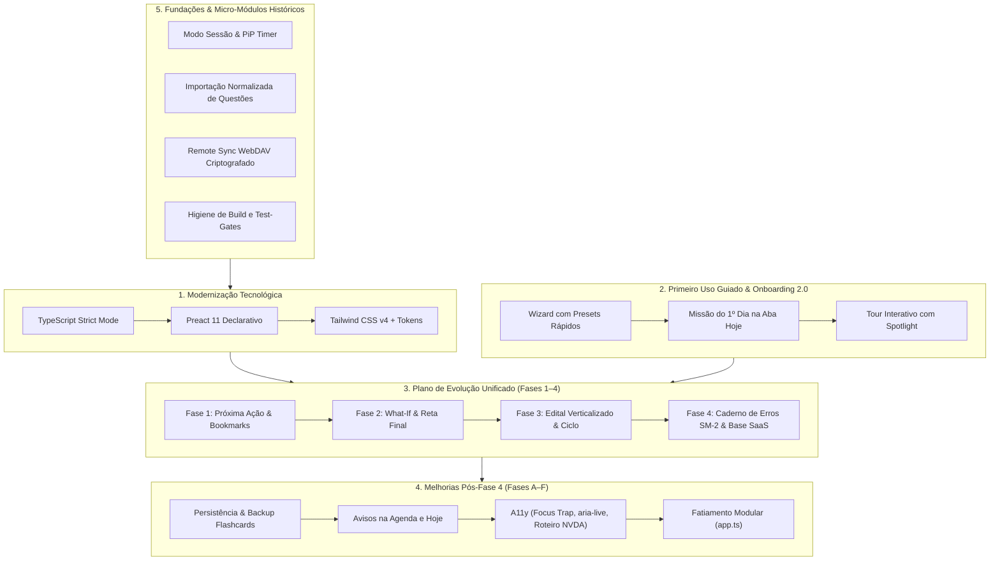

# Histórico de Planos Concluídos — StudyTrack

Este documento consolida, unifica e preserva o histórico técnico e arquitetural de **todos os planos de desenvolvimento já implementados, testados e integrados** no StudyTrack.

> [!NOTE]
> Para o planejamento ativo e os horizontes futuros do projeto, consulte:
> - **Plano Ativo (Próximas Evoluções em Inteligência, UX e Engenharia):** [docs/PLANO-PROXIMAS-EVOLUCOES.md](file:///c:/Users/vitor/Documents/Extrato/docs/PLANO-PROXIMAS-EVOLUCOES.md)
> - **Plano Futuro de Infraestrutura e SaaS:** [docs/PLANO-TRANSFORMACAO-SAAS.md](file:///c:/Users/vitor/Documents/Extrato/docs/PLANO-TRANSFORMACAO-SAAS.md)
> - **Painel Geral de Pendências e Status:** [docs/O-QUE-FALTA-IMPLEMENTAR.md](file:///c:/Users/vitor/Documents/Extrato/docs/O-QUE-FALTA-IMPLEMENTAR.md)

---

## Sumário Executivo dos Planos Concluídos

| Plano | Foco Principal | Status | Entregáveis Centrais |
|---|---|:---:|---|
| **1. Modernização Tecnológica** | TypeScript, Preact 11 e Tailwind CSS v4 | ✅ 100% Concluído | `strict: true` (0 erros), 100% de bundles reproduzíveis, UI Kit declarativo (`src/ui/primitives/`) e `tokens.css`. |
| **2. Primeiro Uso Guiado** | Onboarding 2.0, ativação rápida e tour | ✅ 100% Concluído | Wizard em 4 etapas com presets, cálculo pedagógico de viabilidade, disparo em 1 clique da 1ª atividade e tour interativo. |
| **3. Evolução Unificada (Fases 1 a 4)** | Decisão rápida, inteligência preditiva, hub de estudos e caderno de erros | ✅ 100% Concluído | Card Próxima Ação (6 perguntas), bookmarks de parada, simulador *What-If*, modo reta final, edital verticalizado, ciclo rotativo, foco/energia e motor SM-2. |
| **4. Melhorias Pós-Fase 4 (Fases A a F)** | Integridade, usabilidade do caderno e acessibilidade | ✅ 100% Concluído | Schema e persistência de flashcards, avisos na agenda e hoje, exportação JSON/CSV, focus traps, `aria-live`, roteiro NVDA e controller isolado. |
| **5. Micro-Módulos Fundacionais** | Sessões, importações e sincronização segura | ✅ 100% Concluído | Timer em Document Picture-in-Picture, normalizador de questões (Tec/QC), WebDAV com PBKDF2/AES-GCM-256 e runners de gates. |

---

## 1. Plano de Modernização Tecnológica (TypeScript, Preact e Tailwind CSS)

### 1.1. Contexto e Objetivos
Modernização estrutural da base legada em JavaScript e CSS customizado para uma arquitetura moderna, fortemente tipada, componentizada e declarativa, sem runtime pesado e com garantia estrita de compatibilidade offline e local-first.

### 1.2. Fases Executadas
1. **Fase 0 — Formatação e Higiene:**
   - Padronização total via Prettier (`npm run check:format`, `npm run format`).
   - Normalização de quebras de linha e regras de linting em toda a base.
2. **Fase 1 — Infraestrutura TypeScript:**
   - Configuração do `tsconfig.json` e `tsconfig.tests.json` com `strict: true`.
   - Setup do hook nativo de resolução de módulos TypeScript no Node (`scripts/ts-resolve-hook.mjs`).
   - Integração do verificador estático aos gates: `npm run check:types` e `npm run check:types:tests`.
3. **Fase 2 — Contratos Centrais, Core, State e Storage:**
   - Tipagem completa de contratos de dados em [`src/core/types.ts`](file:///c:/Users/vitor/Documents/Extrato/src/core/types.ts).
   - Isolamento e imutabilidade em `src/state/` (`state-boundaries.ts`, `app-state-store.ts`).
   - Blindagem da camada de persistência em `src/storage/` e validação profunda de backup em `backup-validator.ts`.
4. **Fase 3 — Camada de Domínio Puro (`src/domain/`):**
   - 100% dos algoritmos de cálculo, projeção, prontidão e diagnóstico convertidos em funções puras sem efeitos colaterais.
5. **Fase 4 — Camada de Aplicação (`src/application/`):**
   - Casos de uso orquestrados em módulos dedicados (planejamento, metas, recovery, relatórios, recomendações).
6. **Fase 5 — Fatiamento de Controladores e UI:**
   - Criação de stores e despachante de eventos (`DelegatedActions`, `TabRouter`, `SearchController`, `AchievementsController`).
7. **Fase 6 — Setup Preact 11 + Tailwind CSS v4 Conectado a Tokens:**
   - Integração do Preact 11 (`preact/compat` e JSX) empacotado via esbuild (`scripts/build.mjs`).
   - Tailwind CSS v4 integrado diretamente a [`styles/tokens.css`](file:///c:/Users/vitor/Documents/Extrato/styles/tokens.css) e compilado para [`styles/tailwind.css`](file:///c:/Users/vitor/Documents/Extrato/styles/tailwind.css).
8. **Fase 7 — Primitivas Declarativas (`src/ui/primitives/`):**
   - Criação do design system compartilhado: [`Card.tsx`](file:///c:/Users/vitor/Documents/Extrato/src/ui/primitives/Card.tsx), [`Button.tsx`](file:///c:/Users/vitor/Documents/Extrato/src/ui/primitives/Button.tsx), [`Badge.tsx`](file:///c:/Users/vitor/Documents/Extrato/src/ui/primitives/Badge.tsx), [`dialog.tsx`](file:///c:/Users/vitor/Documents/Extrato/src/ui/primitives/dialog.tsx), [`a11y.ts`](file:///c:/Users/vitor/Documents/Extrato/src/ui/primitives/a11y.ts).
9. **Fase 8 — Migração das Superfícies:**
   - Componentização declarativa em Preact de abas críticas (Hoje, Metas, Desempenho, Disciplinas, Caderno de Erros).

### 1.3. Resultados e Métricas Alcançadas
- `npm run check:types`: **0 erros**.
- `npm run check:bundle`: **100% dos artefatos reproduzíveis**.
- Diretriz inegociável de engenharia incorporada em [AGENTS.md](file:///c:/Users/vitor/Documents/Extrato/AGENTS.md): proibição de novas funções no `app.ts` e proibição de `innerHTML` em novas interfaces.

---

## 2. Plano de Primeiro Uso Guiado (Onboarding 2.0 & Ativação)

### 2.1. Contexto e Objetivos
Garantir que um concurseiro novo configure sua preparação completa em menos de 60 segundos e experimente o valor central da aplicação (saber exatamente o que estudar hoje) já no primeiro contato, sem atritos ou telas vazias desorientadoras.

### 2.2. Arquitetura em 3 Camadas Implementada
1. **Camada 1: Wizard Inicial de Alta Eficiência (`src/ui/onboarding/GuidedFirstRunModal.tsx`)**
   - **Etapa Prova (`goal`):** Atalhos rápidos de data estimada (3, 6 e 12 meses) com realce ativo (`aria-pressed="true"` e classes `.is-active`).
   - **Etapa Rotina (`availability`):** Presets de disponibilidade semanal em 1 clique (Leve: 2h/dia; Padrão: 4h/dia; Foco em Fim de Semana).
   - **Etapa Edital (`content`):** Nivelamento rápido em lote por disciplina (`guided-bulk-levels`) evitando configuração tópico a tópico.
   - **Etapa Planejamento (`plan`):** Diagnóstico pedagógico em tempo real via [`calculatePlanFeasibility`](file:///c:/Users/vitor/Documents/Extrato/src/domain/planning/guided-plan-feasibility.ts), informando status claro (`comfortable`, `balanced`, `tight`, `deficit`).
2. **Camada 2: Ativação Fluida na Aba Hoje (`FirstStepsMission.tsx`)**
   - Widget reativo com checklist da primeira semana.
   - Botão de ação direta `[▶ Iniciar 1ª atividade]` conectando diretamente ao cronômetro via `startPlannedActivity`.
   - Atalho de foco direto para a aba de resolução de questões.
3. **Camada 3: Tour Guiado Interativo (`src/ui/components/GuidedTourPopover.tsx`)**
   - Spotlight com seletores semânticos precisos (`.plano-hoje-card`, `#performancePage, #panel-desempenho`, `#subjectsPage`).
   - Isolamento seguro do Modo Demo, permitindo explorar dados de exemplo sem sobrescrever o plano real do usuário.
   - Navegação por teclado acessível com retenção de foco e Escape.

### 2.3. Validação
- 6 testes unitários dedicados em `tests/unit/guided-first-run.test.js`.
- 19 testes E2E no Playwright em `tests/e2e/onboarding.spec.js`.

---

## 3. Plano Unificado de Implementação e Evolução (Fases 1 a 4)

### 3.1. Fase 1: Decisão Rápida, UX do Painel & Primeiro Uso
- **Card de Próxima Ação (Contrato das 6 Perguntas):**
  - Implementado em Preact no dashboard inicial respondendo contratualmente: *O que estudar?*, *Por que estudar?*, *Quanto tempo reservar?*, *Qual a importância para a prova?*, *Qual evidência sustenta a escolha?* e *Qual a próxima ação recomendada?* ([`DECISION-EXPERIENCE-CONTRACT.md`](file:///c:/Users/vitor/Documents/Extrato/docs/DECISION-EXPERIENCE-CONTRACT.md)).
- **Bookmarks de Ponto de Parada:**
  - Registros de retomada de leitura em PDF (página atual/total), videoaulas (minutagem) e lei seca integrados ao domínio puro [`src/domain/topic-bookmark.ts`](file:///c:/Users/vitor/Documents/Extrato/src/domain/topic-bookmark.ts), ao encerramento da sessão e renderizados no [`BookmarkBadge.tsx`](file:///c:/Users/vitor/Documents/Extrato/src/ui/components/BookmarkBadge.tsx).
- **Critérios de aceite:** Resposta em < 3 segundos na tela inicial, persistência de ponto de parada validada e testes rápidos passando.

### 3.2. Fase 2: Inteligência Preditiva & Modo Reta Final
- **Simulador "E se?" (`what-if-simulator.ts`):**
  - Motor de simulação hipotética rodando puramente em memória via `structuredClone(appState)`.
  - Simula acréscimo de minutos diários e realocação de carga em matérias de maior peso, recalculando a prontidão sem persistir dados e sem poluir o histórico do estudante.
  - Interface no modal Preact [`WhatIfSimulatorModal.tsx`](file:///c:/Users/vitor/Documents/Extrato/src/ui/forecasts/WhatIfSimulatorModal.tsx).
- **Modo Reta Final (`final-stretch-policy.ts`):**
  - Política de reta final ativada a < 15 dias da prova (ou limiar configurado).
  - Inversão automática das proporções (85%+ da capacidade em questões e simulados), congelamento de novos tópicos teóricos densos e boost de prioridade para lacunas com acerto < 70%.
- **Detecção de "Falsa Consolidação" (`volatile-mastery.ts`):**
  - Identificação de tópicos com acerto aparente alto (> 90%) seguido de colapso de retenção em revisões espaçadas (> 14 dias), alertando no diagnóstico como *Domínio Volátil*.

### 3.3. Fase 3: Hub Completo de Estudos & Flexibilidade
- **Edital Verticalizado Interativo & Parser:**
  - Parser de edital em texto bruto [`raw-syllabus-parser.ts`](file:///c:/Users/vitor/Documents/Extrato/src/application/subjects/raw-syllabus-parser.ts) capaz de processar editais de PDF estruturados.
  - Visão declarativa [`VerticalizedSyllabusView.tsx`](file:///c:/Users/vitor/Documents/Extrato/src/ui/views/VerticalizedSyllabusView.tsx) com checklist em 4 etapas (Teoria, Resumo, Lei Seca, Questões).
- **Ciclo de Estudos Flexível (`study-cycle-engine.ts`):**
  - Modo alternador entre Agenda por Dia da Semana e Ciclo Rotativo contínuo, pausando a fila em imprevistos sem gerar acúmulo artificial de atrasos.
- **Análise Cronobiológica de Energia e Fadiga (`focus-energy-analytics.ts`):**
  - Registro de Foco e Energia no encerramento da sessão e correlação de precisão em questões por turno do dia (manhã, tarde, noite) com alertas de fadiga mental.

### 3.4. Fase 4: Caderno de Erros Ativo, Acessibilidade & Base SaaS
- **Caderno de Erros Ativo com Algoritmo SM-2:**
  - Motor de repetição espaçada adaptada [`src/domain/notebook/error-notebook-engine.ts`](file:///c:/Users/vitor/Documents/Extrato/src/domain/notebook/error-notebook-engine.ts) aplicando cálculo SM-2 (fator de facilidade, intervalo de dias e agendamento de repetição).
  - Interface declarativa [`ErrorNotebookView.tsx`](file:///c:/Users/vitor/Documents/Extrato/src/ui/views/ErrorNotebookView.tsx).
- **Acessibilidade por Teclado e Focus Traps:**
  - Garantia de fechamento por `Escape`, foco cíclico em modais e navegação livre de armadilhas.
- **Isolamento de Contratos SaaS:**
  - Módulos preparatórios isolados para nuvem [`src/storage/cloud-saas-provider.ts`](file:///c:/Users/vitor/Documents/Extrato/src/storage/cloud-saas-provider.ts) e controle de planos [`src/domain/billing/entitlements.ts`](file:///c:/Users/vitor/Documents/Extrato/src/domain/billing/entitlements.ts).

---

## 4. Plano de Melhorias Pós-Fase 4 (Fases A a F)

Implementado para eliminar qualquer divergência entre a documentação e o código entregue, fortalecendo a persistência e a acessibilidade.

### 4.1. Detalhamento das Fases
- **Fase A — Sincronização de Documentação:**
  - Alinhamento rigoroso entre documentação e código real; classificação transparente de módulos preparatórios SaaS como sem consumidor na UI.
- **Fase B — Persistência e Integridade de `errorFlashcards`:**
  - Registro de `errorFlashcards` nas fronteiras do estado (`state-boundaries.ts`).
  - Validação profunda no [`backup-validator.ts`](file:///c:/Users/vitor/Documents/Extrato/src/storage/backup-validator.ts) com tolerância a dados legados e descarte seguro com aviso.
  - 16 testes unitários em `tests/unit/error-flashcards-persistence.test.js` em fuso duplo (UTC e São Paulo).
- **Fase C — Caderno de Erros Integrado ao Fluxo Diário:**
  - Funções puras `findQuestionsAwaitingFlashcard` e criação idempotente `addErrorFlashcard`.
  - Componente de aviso de flashcards vencidos [`ErrorNotebookDueNotice.tsx`](file:///c:/Users/vitor/Documents/Extrato/src/ui/components/ErrorNotebookDueNotice.tsx) na Agenda de Revisões e na aba Hoje.
  - Exportação completa do caderno em formatos JSON e CSV para impressão/revisão off-screen.
  - Extração arquitetural do [`error-notebook-controller.ts`](file:///c:/Users/vitor/Documents/Extrato/src/ui/controllers/error-notebook-controller.ts).
- **Fase D — Acessibilidade Verificável:**
  - Focus traps em `dialog.tsx` e `GuidedTourPopover.tsx`.
  - Anúncios `aria-live` em `a11y.ts` para atualizações de estado do cronômetro (`#timerAriaLive`) e ratings do caderno.
  - Elaboração do roteiro de teste assistivo manual em [`docs/ROTEIRO-AUDITORIA-NVDA.md`](file:///c:/Users/vitor/Documents/Extrato/docs/ROTEIRO-AUDITORIA-NVDA.md).
- **Fase E — Primeiro Uso e Backlog Analítico:**
  - Banner interativo da Reta Final [`FinalStretchBanner.tsx`](file:///c:/Users/vitor/Documents/Extrato/src/ui/forecasts/FinalStretchBanner.tsx) integrado com disparo direto do simulador *What-If*.
  - Histórico explicável de recomendações e feedback de aceitação (`recommendation-history.ts`).
- **Fase F — Arquitetura e Contratos de Governança:**
  - Formalização do contrato SM-2 em [`docs/CADERNO-ERROS-SM2-CONTRATO.md`](file:///c:/Users/vitor/Documents/Extrato/docs/CADERNO-ERROS-SM2-CONTRATO.md).
  - Homologação do gate fast com 957 testes verdes em ~31s.

---

## 5. Micro-Módulos e Tarefas Fundacionais Históricas

Consolidação dos planos de tarefas fundacionais que estabeleceram os alicerces do projeto:

1. **Modo Sessão e Cronômetro em Janela Flutuante (`plan-modo-sessao`):**
   - Integração com a API `documentPictureInPicture` permitindo cronometrar estudos fora da aba do navegador.
   - Resiliência contra abas esquecidas e restauração de cronômetro após reload ou fechamento acidental.
   - Check-out de sessão integrado com registro de progresso e bookmarking.
2. **Importação Normalizada de Questões (`plan-question-import`):**
   - Normalizador puro de dados importados de plataformas externas (Tec Concursos e QConcursos).
   - Suporte a múltiplos formatos de CSV e detecção automática de banca, ano, disciplina e taxa de acerto.
   - Prevenção de duplicações via hash determinístico da questão.
3. **Sincronização Remota Segura WebDAV (`plan-remote-sync`):**
   - Sincronização em nuvem pessoal do usuário via protocolo WebDAV.
   - Criptografia simétrica client-side de ponta a ponta com **AES-GCM-256** e derivação de chave **PBKDF2** com salt criptográfico, garantindo privacidade absoluta dos registros.
   - Resolução de conflitos baseada em carimbo de tempo (*last-write-wins* com confirmação explícita de sobrescrita).
4. **Higiene de Build e Test-Gates (`plan.md`):**
   - Configuração do pipeline de automação de testes com tiers proporcionais:
     - `FAST_GATE` (< 120s): sintaxe, types, inventário, unitários UTC e SP, browser smoke.
     - `REGRESSION` (< 420s): regressão completa de persistência e fluxos.
     - `FULL`: auditoria global e matriz visual.
   - Inventário estrito e auditado de 267 arquivos de teste.
5. **Limpeza da Base Pós-Migração (`plan-base-cleanup`):**
   - Eliminação gradual de arquivos de legado sem quebrar contratos de persistência.
   - Remoção de dependências mortas e migração de seletores para o padrão do design system.

---

## 6. Rastreabilidade de Arquitetura e Governança

Todas as decisões e entregas registradas neste histórico respeitam os contratos vigentes:
- **Diretrizes de Governança:** [AGENTS.md](file:///c:/Users/vitor/Documents/Extrato/AGENTS.md)
- **Visão Arquitetural Atual:** [ARCHITECTURE.md](file:///c:/Users/vitor/Documents/Extrato/ARCHITECTURE.md)
- **Estratégia de Testes:** [docs/TEST-STRATEGY.md](file:///c:/Users/vitor/Documents/Extrato/docs/TEST-STRATEGY.md)
- **Contrato SM-2:** [docs/CADERNO-ERROS-SM2-CONTRATO.md](file:///c:/Users/vitor/Documents/Extrato/docs/CADERNO-ERROS-SM2-CONTRATO.md)
- **Roteiro de Auditoria NVDA:** [docs/ROTEIRO-AUDITORIA-NVDA.md](file:///c:/Users/vitor/Documents/Extrato/docs/ROTEIRO-AUDITORIA-NVDA.md)
- **Contrato de Decisão e Experiência:** [docs/DECISION-EXPERIENCE-CONTRACT.md](file:///c:/Users/vitor/Documents/Extrato/docs/DECISION-EXPERIENCE-CONTRACT.md)
